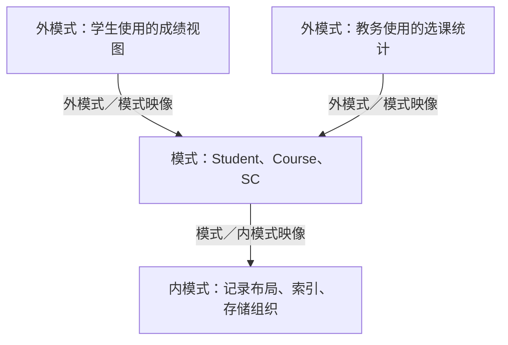

# 0.0 数据库基础知识

**主线**：数据库先解决“数据怎样长期、共享地保存”，再用关系模型规定“数据是什么、怎样操作才合法”，最后用 SQL 把查询与更新要求交给 DBMS 执行。后续章节分别补上安全、完整性、设计、编程、优化、恢复和并发控制。

来源：王珊、萨师煊《数据库系统概论》第 5 版配套课件，第 1—11 章。前三章详细整理，后续章节保留复习框架。标为“说明例”“补充理解”的内容用于解释；第 2 章关系演算课件主要给出分类，本文补充了完成 [1 基础知识复习题](%E5%A4%8D%E4%B9%A0%E9%A2%98/1%20%E5%9F%BA%E7%A1%80%E7%9F%A5%E8%AF%86%E5%A4%8D%E4%B9%A0%E9%A2%98.md) 所需的基本记法。更详细的已有课程笔记见 [1 绪论](1%20%E7%BB%AA%E8%AE%BA.md)、[2 数据模型](2%20%E6%95%B0%E6%8D%AE%E6%A8%A1%E5%9E%8B.md)；本篇章号按本次教材编排。

## 1 绪论

### 1.1 数据、数据库、DBMS 与数据库系统

**数据（data）是描述事物的符号记录。** 数字、文字、图像、声音都可以是数据。数据必须结合语义理解：`93` 可以表示成绩，也可以表示人数。

**数据库（database，DB）是长期存储在计算机内、有组织、可共享的大量数据的集合。** “有组织”意味着数据按一定模型表示，数据之间的联系也被描述；“可共享”意味着同一批数据可以服务多个用户和应用。

**数据库管理系统（DBMS）是负责数据库定义、组织、存储、查询、更新和运行控制的软件。** 它位于用户或应用与底层操作系统之间，是管理数据的核心软件。

**数据库系统（DBS）是围绕数据库建立、使用和维护形成的整体。** 教材把数据库、DBMS 及其开发工具、应用程序和数据库管理员列为基本组成，完整运行环境还涉及硬件、操作系统和各类用户。

| 对象 | 它是什么 | 学生选课中的说明例 |
| --- | --- | --- |
| DB | 有组织的数据集合 | 学生、课程、选课和成绩记录 |
| DBMS | 管理数据库的软件 | 执行查询、检查约束、处理故障的软件 |
| DBS | 数据、软件、人员等组成的系统 | 选课应用、数据库及其维护和使用环境 |

DBMS 的主要功能可以沿一次操作理解：

1. **数据定义**：通过 DDL 定义表、属性、约束等对象。
2. **数据组织、存储与管理**：安排记录、文件、索引和存取方法。
3. **数据操纵**：通过 DML 查询、插入、修改和删除数据。
4. **事务与运行管理**：统一处理安全、完整性、并发和恢复。
5. **建立与维护**：装载数据、转储备份、监控性能和调整组织。

### 1.2 为什么从文件管理走向数据库管理

**说明例**：教务处和学院各维护一个学生文件。学生转系后，只更新了教务处的文件，就会出现两套不一致的系别。若程序还直接依赖文件中的字节位置，增加一列也可能要求修改程序。

| 阶段 | 数据面向谁 | 主要特点与局限 |
| --- | --- | --- |
| 人工管理 | 某个程序 | 程序员负责管理，程序与数据紧密依赖 |
| 文件系统 | 某个应用 | 数据可长期保存，但共享困难、冗余较大、整体联系主要靠应用维护 |
| 数据库系统 | 整个组织及多个应用 | 统一描述结构和联系，由 DBMS 管理共享、约束与运行 |

数据库系统的主要特点是：

- **整体结构化**：既描述一条记录内部的结构，也描述记录、实体和联系之间的结构。
- **共享程度高、冗余度低、易扩充**：减少各应用独立维护同一事实的情况。低冗余不等于绝对没有冗余。
- **数据独立性高**：尽量让数据组织的变化不传到应用程序。
- **统一管理与控制**：共同执行安全性、完整性、并发控制和故障恢复规则。

这四类控制解决不同问题：安全性限制不合法访问，完整性限制不合法数据，并发控制协调同时发生的操作，恢复处理失败后的数据状态。

### 1.3 数据模型：从现实对象到数据库结构

#### 1.3.1 概念模型、逻辑模型与物理模型

**数据模型是对现实世界数据特征的抽象。** 它需要能够表达现实含义，也要便于理解和实现。

| 层次 | 要回答的问题 | 说明例 |
| --- | --- | --- |
| 概念模型 | 业务中有哪些对象和联系？ | 学生选修课程，选课有成绩 |
| 逻辑模型 | 用 DBMS 支持的结构怎样表示？ | 用 `Student`、`Course`、`SC` 三个关系表示 |
| 物理模型 | 怎样在内部存储和访问？ | 记录布局、数据页、索引、存取路径 |

基本过程是：**现实世界 → 概念模型 → 逻辑模型 → 物理实现**。概念模型中的“学生”是业务对象，逻辑模型中的 `Student` 是关系，二者不是同一抽象层次。

#### 1.3.2 概念模型的基本对象

- **实体**：客观存在且可以相互区别的事物，例如一名学生或一门课程。
- **属性**：实体具有的某种特性，例如学号、姓名。
- **码**：能够唯一标识实体的属性集。
- **实体型**：用名称和属性集合描述的一类实体，例如“学生（学号，姓名，系别）”。
- **实体集**：同一类型实体在某一时刻的集合，例如全校在读学生。
- **联系**：实体之间的关联，例如学生“选修”课程。

联系可以是一对一、一对多、多对多。判断依据是**两端一个实体分别最多可以对应多少个另一端实体**，而不是当前样本恰好有几条记录。

**说明例**：一名学生可选多门课，一门课可被多名学生选择，所以学生与课程是多对多联系。“成绩”属于这一次选课，不能只挂在学生或课程上。

E-R 方法用实体、属性和联系描述概念模型，便于设计人员与用户讨论业务语义。将其转换为关系模式，是后续数据库设计的任务。

#### 1.3.3 数据模型的三个组成要素

| 要素 | 定义 | 说明例 |
| --- | --- | --- |
| 数据结构 | 描述组成对象及对象之间的联系，是静态特征 | 学生、课程、选课关系及其属性 |
| 数据操作 | 对数据实例允许执行的操作及规则，是动态特征 | 查询选课、插入记录、修改成绩 |
| 完整性约束 | 限制合法数据库状态及状态变化的规则 | 学号唯一、选课必须引用已有课程 |

只有“长什么样”不足以定义数据模型，还要规定“允许怎样操作”和“什么状态才合法”。

#### 1.3.4 层次、网状与关系模型

| 模型 | 基本结构 | 联系的表示与代价 |
| --- | --- | --- |
| 层次模型 | 树；只有一个根，其余结点各有一个双亲 | 直接表达一对多，多对多不自然，操作依赖层次路径 |
| 网状模型 | 允许多个无双亲结点，也允许一个结点有多个双亲 | 用多组一对多联系表达更复杂结构，路径和操纵方式较复杂 |
| 关系模型 | 关系，在用户层面呈现为二维表 | 实体与联系统一用关系表示，用户描述结果，DBMS 决定存取路径 |

关系模型的优势来自统一的数学结构和较高的数据独立性，代价之一是 DBMS 需要负责查询优化。课件关于模型效率的比较带有历史实现背景，不能推出某种模型在所有数据、查询和实现下都更快。

### 1.4 模式、实例与三级模式

#### 1.4.1 模式描述结构，实例描述当前内容

**模式（schema）是数据库结构、联系和约束的描述；实例（instance）是该模式在某一时刻的具体数据状态。**

**说明例**：`Student(Sno, Sname, Sdept)` 描述学生关系的结构。今天表里有 100 人，明天新增一人，实例发生变化，模式可以不变。增加“电话”属性，则属于模式变化。

#### 1.4.2 三级模式

| 层次 | 定义 | 说明例 |
| --- | --- | --- |
| 外模式 | 某类用户或应用使用的局部逻辑结构与特征 | 学生看到自己的课程和成绩 |
| 模式，也称逻辑模式 | 数据库全体数据的全局逻辑结构与特征 | 全校学生、课程、选课结构及约束 |
| 内模式，也称存储模式 | 数据物理结构与存储方式的描述 | 记录如何组织、索引怎样建立 |

按教材的三级模式体系，一个数据库有一个全局模式、一个内模式，可以有多个外模式。这里的外模式是数据描述层次，不只是一个界面，也不等于给每个用户复制一份数据。



#### 1.4.3 二级映像与两类数据独立性

**映像是相邻层次数据表示之间的对应规则。** 下层发生变化时，修改相应映像，有机会维持上层表示与程序不变。

| 数据独立性 | 哪一层改变 | 调整什么 | 直接保护什么 |
| --- | --- | --- | --- |
| 逻辑独立性 | 全局模式 | 外模式／模式映像 | 外模式及依赖它的应用 |
| 物理独立性 | 内模式 | 模式／内模式映像 | 全局模式，进而保护应用 |

**说明例**：把一个学生表拆成基本信息表与联系方式表，若仍能组合出应用原来需要的数据，可借外部表示保持接口稳定，这是逻辑独立性。新增索引或调整记录的存放方式，而学生表结构与查询含义不变，这是物理独立性。

边界是：新的底层表示必须仍能提供原有信息和语义。直接删除应用需要的数据，不能指望只修改映像就解决。独立性也不意味着性能完全不变。

### 1.5 数据库系统中的人员

**DBA（数据库管理员）**负责信息内容与结构、存储和存取策略、权限与约束、备份恢复、运行监控以及改进重组。系统分析员分析需求，数据库设计人员设计各级模式，应用程序员实现应用，最终用户通过接口使用数据。

本章需要能解释：DB、DBMS、DBS 的区别；为什么需要统一管理；数据模型的三要素；三级模式与两类独立性的对应关系。

## 2 关系数据库

### 2.1 从域和笛卡尔积定义关系

#### 2.1.1 域、元组、度与基数

**域（domain）是一组具有相同数据类型的值的集合。** 例如整数域、学号字符串域、合法成绩的取值集合。

给定 $n$ 个域 $D_1,\ldots,D_n$，它们的笛卡尔积包含所有可能的组合：

$$
D_1\times\cdots\times D_n
=\{(d_1,\ldots,d_n)\mid d_i\in D_i,\ i=1,\ldots,n\}.
$$

其中一个组合称为 **$n$ 元组**，每一个 $d_i$ 称为分量。若各域为有限集，笛卡尔积的基数为 $\prod_{i=1}^{n}|D_i|$。

**关系是这些域的笛卡尔积的一个子集**：

$$
R\subseteq D_1\times\cdots\times D_n.
$$

它挑出需要记录的实际组合。关系的**度**是属性个数，**基数**是元组个数。二元关系表示“两列”，与“两行”无关。

**说明例**：学号域是 $\{s_1,s_2\}$，课程号域是 $\{c_1,c_2\}$，笛卡尔积有 4 对；实际选课关系可以只有 $\{(s_1,c_1),(s_1,c_2),(s_2,c_1)\}$，其度为 2、基数为 3。

#### 2.1.2 关系与一般表格的区别

在本章的经典关系模型中：

- 一列的值来自同一个域；不同列可以来自同一个域，但需要不同属性名区分。
- 元组不能重复，行的排列顺序不影响关系。
- 以属性名识别列时，列的展示顺序不影响含义；使用 `t[1]` 等位置记法时，必须先固定属性顺序。
- 每个分量取原子值，不能在单元格里嵌入另一张表。原子性的判断与当前数据模型及应用粒度有关。

**关系代数采用集合语义。SQL 查询通常保留重复行，必须按需求使用 `DISTINCT`。** 不能把 SQL 的默认重复行为带入本章的投影运算。

基本表保存实际数据，查询表表示查询结果，普通视图是由基表或其他视图定义出的虚表。关系的逻辑形式是表，并不要求物理上“一张表恰好对应一个文件”。

### 2.2 关系模式与码

#### 2.2.1 关系模式的表示

关系模式可写成：

$$
R(U,D,\mathrm{DOM},F),
$$

其中 $R$ 是关系名，$U$ 是属性名集合，$D$ 是相关域，$\mathrm{DOM}$ 指定属性对应哪个域，$F$ 是属性间的数据依赖。常简记为 $R(A_1,\ldots,A_n)$。

模式描述结构，关系是该模式在某时刻的值。多个相关关系及其约束共同构成关系数据库。

#### 2.2.2 超码、候选码、主码与主属性

**补充理解**：为避免课件简写造成混淆，把“唯一”和“最小”分开。

- **超码**：能唯一标识元组的属性集。
- **候选码**：具有最小性的超码，删除其中任何一个属性就不能继续保证唯一。
- **主码**：从候选码中选定的一个，也称主键。
- **主属性**：属于任意一个候选码的属性；不属于任何候选码的属性是非主属性。
- **全码**：全部属性一起构成候选码，即不能再删掉任何属性。

码由业务语义和约束决定，不能仅凭当前几行没有重名就断言姓名是候选码。

**说明例**：若每个学生对每门课程只有一条选课记录，则 `SC(Sno,Cno,Grade)` 的候选码是 `(Sno,Cno)`。`Sno` 单独不能区分同一学生的多门课，`Cno` 单独不能区分同一课程的多个学生。`(Sno,Cno,Grade)` 是超码，但不是候选码。

若学生的学号与身份证号都分别唯一，则二者都是候选码，即使只选学号作主码，身份证号仍是主属性。**主属性不等于只出现在主码中的属性。**

### 2.3 三类完整性约束

#### 2.3.1 实体完整性

实体完整性要求主码能够标识元组，**主码的每一个分量都不能为 NULL**，主码值也必须唯一。联合主码不能只要求“不是全部为空”。

课件在这部分把“主属性”与“主码中的属性”混用。复习时应保留上一节的严格术语区分；SQL 中由 `PRIMARY KEY` 直接保证主键唯一且非空，其他候选码需用相应约束表达。

#### 2.3.2 参照完整性与外码

**外码（外键）是本关系中用于引用另一关系或本关系中被参照码的属性组。** 教材主要以引用主码说明；SQL 还可在相应约束条件下引用被保证唯一的键。

例如 `SC.Sno` 引用 `Student.Sno`，`SC.Cno` 引用 `Course.Cno`。外码与被参照列不必同名，但属性组必须能够对应、类型相容。

按本课件的参照完整性表述，外码要么为空，要么等于被参照关系中某个主码值；课件对复合外码的空值情况采用“各分量均为空”的表述。实际 SQL 还需结合 `NOT NULL` 和复合外键的匹配规则判断，不能把空值规则无条件套到所有 DBMS。

**外码可以同时属于主码，也可以本身就是码。** 课件“外码不是本关系的码”的简写不应作为一般限制。选课表的 `Sno`、`Cno` 分别是外码，又共同组成主码，因此不能为空。自引用也合法，例如 `Course.Cpno` 引用 `Course.Cno`。

#### 2.3.3 用户定义的完整性

这是具体应用的语义约束，例如成绩在 0—100 之间、课程名不得为空、学分只能来自指定集合。DBMS 应提供统一的定义与检查机制，SQL 中常通过 `NOT NULL`、`UNIQUE`、`CHECK` 等表达。

### 2.4 关系代数的基本操作

**关系代数用对关系的运算来表达查询，输入和输出都是关系。** 因而一个运算的结果可以继续交给下一个运算。

下面用 $t[A]$ 表示元组 $t$ 在属性或属性组 $A$ 上的值。

#### 2.4.1 并、交、差：先检查相容性

$R\cup S$、$R\cap S$、$R-S$ 要求两个关系的度相同，对应属性的域相容，并且已建立明确的属性对应关系；必要时先重命名。

$$
\begin{aligned}
R\cup S &= \{t\mid t\in R\lor t\in S\},\\
R\cap S &= \{t\mid t\in R\land t\in S\},\\
R-S &= \{t\mid t\in R\land t\notin S\}.
\end{aligned}
$$

差集具有方向性，通常 $R-S\ne S-R$。交可由差表达：$R\cap S=R-(R-S)$。

#### 2.4.2 笛卡尔积：枚举全部配对

若 $R$ 有 $n$ 列、$r$ 行，$S$ 有 $m$ 列、$s$ 行，则 $R\times S$ 有 $n+m$ 列、$rs$ 行。结果的每行把一个 $R$ 元组和一个 $S$ 元组拼接起来。

同名属性需要用 `R.A`、`S.A` 或重命名区分。笛卡尔积只做所有配对，不会自动依据相同学号筛选。

#### 2.4.3 选择：保留满足条件的行

$$
\sigma_F(R)=\{t\mid t\in R\land F(t)\}.
$$

$F$ 是选择条件。选择不改变列结构，只筛选元组。例如计算机系学生：

$$
\sigma_{Sdept='CS'}(Student).
$$

#### 2.4.4 投影：保留指定列，并去重

$$
\pi_A(R)=\{t[A]\mid t\in R\}.
$$

例如查询选课表里出现过的学号：$\pi_{Sno}(SC)$。同一个学生选三门课，也只出现一次。

选择与投影常组合使用。查询选修 1 号课程的学号：

$$
\pi_{Sno}\bigl(\sigma_{Cno='1'}(SC)\bigr).
$$

必须先用到 `Cno` 再把它投影掉；先删掉它，后续选择条件就失去了依据。

### 2.5 连接：按条件组合事实

#### 2.5.1 θ 连接与等值连接

连接可以定义为对笛卡尔积的选择：

$$
R\bowtie_F S=\sigma_F(R\times S).
$$

若 $F$ 是两表属性的相等条件，就是等值连接；也可以用大于、小于等条件构成其他 θ 连接。

**说明例**：把学生与选课记录连接：

$$
Student\bowtie_{Student.Sno=SC.Sno}SC.
$$

结果保留匹配的学生信息和选课信息。一般等值连接仍保留两边的连接列。

#### 2.5.2 自然连接

自然连接 $R\bowtie S$ 要求**全部同名属性分别相等**，并在输出中只保留一份同名属性。

假设 $R(A,B,C)$、$S(B,C,D)$，自然连接条件是：

$$
R.B=S.B\ \land\ R.C=S.C.
$$

不能只连 `B` 而忽略 `C`。结果模式为 $(A,B,C,D)$。如果没有同名属性，自然连接退化为笛卡尔积。

自然连接依据属性名推导条件，所以只有同名列确实具有相应业务含义时，结果才符合需求。

#### 2.5.3 外连接与悬浮元组

内连接会舍弃找不到匹配的元组，课件称其为**悬浮元组**。外连接保留指定一侧或两侧的未匹配元组，另一侧缺少的列用 NULL 补齐。

- 左外连接：保留左关系的全部元组。
- 右外连接：保留右关系的全部元组。
- 全外连接：保留两侧的未匹配元组。

**说明例**：查询所有学生及其选课情况，必须考虑尚未选课的学生。以 `Student` 为左表做左外连接，才能保留他们。

### 2.6 除法：表达“满足全部要求”

#### 2.6.1 象集与全称条件

给定 $R(X,Y)$，固定一个 $X$ 值 $x$，它的 **$Y$ 象集**为：

$$
Y_x=\{t[Y]\mid t\in R,\ t[X]=x\}.
$$

象集回答“这个 $x$ 对应了哪些 $Y$ 值”。对选课关系而言，固定一个学号，它的课程号象集就是已选课程集合。

**本套课件采用 $R(X,Y)\div S(Y,Z)$ 的定义**：先把 $S$ 投影到共同参与除法的属性组 $Y$，再寻找覆盖这些值的 $x$：

$$
R\div S
=\{x\in\pi_X(R)\mid \pi_Y(S)\subseteq Y_x\}.
$$

$X$ 是结果属性，$Y$ 是要求全部匹配的属性，$Z$ 是除数的其他属性。本定义等价于对 $S_Y=\pi_Y(S)$ 做常见的 $R(X,Y)\div S_Y(Y)$；**不能仅因 $S$ 还有 $Z$ 列，就把本课程的表达式判为非法。**

#### 2.6.2 手算说明例

令选课关系 $P(Sno,Cno)$ 为：

| Sno | Cno |
| --- | --- |
| s1 | c1 |
| s1 | c2 |
| s1 | c3 |
| s2 | c1 |
| s2 | c3 |

要求课程集合 $K(Cno)=\{c1,c2\}$。`s1` 的象集为 $\{c1,c2,c3\}$，包含 $K$；`s2` 的象集为 $\{c1,c3\}$，缺少 `c2`。因此：

$$
P\div K=\{s1\}.
$$

除法表示“至少覆盖所有要求”，不是“恰好只包含这些要求”。

#### 2.6.3 用基本运算表达除法

令 $S_Y=\pi_Y(S)$，则：

$$
R\div S
=\pi_X(R)-\pi_X\bigl((\pi_X(R)\times S_Y)-R\bigr).
$$

这里先列出每个候选 $x$ 应有的全部配对，再减去实际已有配对，得到“缺失的配对”；投影出不合格的 $x$，最后从候选中删除。

若 $S_Y$ 为空，全称条件对候选 $x$ 自动成立，结果是 $\pi_X(R)$。候选范围依然来自 $R$；它不自动包含一个外部学生表中从未在 $R$ 出现的学生。

### 2.7 关系演算与代数转换（复习题补充）

#### 2.7.1 元组关系演算

元组关系演算用谓词描述结果必须满足的条件：

$$
\{t\mid P(t)\}.
$$

变量代表整个元组；$R(u)$ 表示 $u\in R$；$u[i]$ 表示按已给模式顺序排列的第 $i$ 个分量。$\exists u$ 表示至少存在一个 $u$，$\forall u$ 表示所有 $u$；$\land$、$\lor$、$\neg$ 分别表示且、或、非。

**说明例**：对 $SC(Sno,Cno,Grade)$，查询选修 `c1` 的学号：

$$
\{t\mid \exists u\,(SC(u)\land u[2]='c1'\land t[1]=u[1])\}.
$$

这里 $t$ 是一元输出元组，$u$ 是三元源元组。

#### 2.7.2 域关系演算

域关系演算的变量代表单个属性值。相同查询可写为：

$$
\{s\mid \exists c\,\exists g\,(SC(s,c,g)\land c='c1')\}.
$$

阅读 $R(w,q,x)$ 时，应先按 $R$ 的属性顺序标出每个变量的含义。不同关系重复使用同一个变量，就要求相应位置的值相等，通常对应连接条件。

#### 2.7.3 转换的固定步骤

1. 找出每个变量来自哪个关系，先确定可用的元组或域值。
2. 只涉及一个关系的条件转为选择。
3. 涉及不同关系的比较转为连接条件；同一个关系使用多次时先重命名。
4. 由输出变量或 `t[i]` 的赋值确定投影列与顺序。
5. 存在量词表示找到匹配即可；输出按集合语义去重。

“对所有要求都成立”可以改写成“不存在一个不满足的要求”，对应除法或 SQL 的双重 `NOT EXISTS`。

**安全性边界**：演算表达式应把输出限制在有限且可由数据库确定的取值范围内。孤立的 $\{t\mid\neg R(t)\}$ 没有限定候选范围，可能产生依赖外部无限域的结果，不能直接当作普通有限查询。

### 2.8 代数优化的基本直觉（连接第 9 章）

**补充说明例**：

$$
\pi_{Sname}\bigl(\sigma_{Sdept='CS'\land Grade\ge90}
(Student\bowtie SC)\bigr)
$$

可以先分别筛出计算机系学生和高分选课，再连接：

$$
\pi_{Sname}\left(
\pi_{Sno,Sname}(\sigma_{Sdept='CS'}Student)
\bowtie
\pi_{Sno}(\sigma_{Grade\ge90}SC)
\right).
$$

两侧仍保留 `Sno`，所以连接条件没有丢失。优化的目标是在**结果等价**的前提下，尽早减少中间结果的行数与列数。

这里讨论经典集合关系代数和内连接。含外连接、NULL、聚集或 SQL 重复计数的查询，不能无条件照搬这些变换。

## 3 关系数据库标准语言 SQL

### 3.1 SQL 的位置与基本对象

#### 3.1.1 SQL 解决什么问题

SQL（Structured Query Language，结构化查询语言）是关系数据库的标准语言。它用同一套语言处理数据库从建立到使用的大部分任务：定义表和约束、查询数据、插入修改删除数据，以及授权、完整性和事务等控制。通常把前几类操作分别称为数据定义语言（DDL）、数据操纵语言（DML）和数据控制语言（DCL）。本章重点是 DDL 与 DML；权限和事务的细节留待后续内容。

SQL 的关键特点是**非过程化**：用户说明希望得到什么结果和结果应满足什么条件，而不指定“先读哪个文件、沿哪条索引找”的存取路径。优化器再选择具体执行计划。它也以**集合**为操作对象：一条 `SELECT` 可以返回许多行，一条 `UPDATE` 或 `DELETE` 也可以同时作用于满足条件的许多行。实际 SQL 默认常保留重复行，这一点会在 `DISTINCT` 与集合运算处特别区分。

SQL 还可交互执行，也可嵌入宿主程序。虽然 SQL 有国际标准，但不同 DBMS 支持的标准版本和扩展不同。因此学习时应先掌握共同的关系语义；某个产品才有的语法不能直接当作所有数据库都支持的 SQL。

#### 3.1.2 基本表、视图与三级模式

一个关系在 SQL 中通常对应一个**基本表**（base table）。基本表是独立定义、实际保存数据的逻辑表；其数据在底层存储文件中，索引可为表提供附加的访问结构。用户写查询时看到的是表名和列名，不必知道文件怎样排列，这正是模式与内模式分离的含义。

**视图**（view）是由一个或多个基本表或其他视图导出的虚表。数据库保存的是它的查询定义，通常不保存视图自身的数据；查询视图时，系统再依据定义到基本表取数。于是基本表属于模式层，视图常给不同用户提供不同的外模式，而存储文件和索引属于更靠内的实现层。

### 3.2 贯穿示例：学生—课程数据库

后文统一使用三个关系。`Student(Sno, Sname, Ssex, Sage, Sdept)` 保存学生的学号、姓名、性别、年龄和院系；`Course(Cno, Cname, Cpno, Ccredit)` 保存课程号、课程名、先修课程号和学分；`SC(Sno, Cno, Grade)` 表示选课事实及成绩。`Student.Sno` 与 `Course.Cno` 分别唯一标识学生和课程，`SC` 的 `(Sno, Cno)` 联合起来唯一标识“一名学生选一门课”。`SC.Sno` 应引用 `Student.Sno`，`SC.Cno` 应引用 `Course.Cno`；`Course.Cpno` 可以为空，非空时引用另一门课程的 `Course.Cno`。

这个例子也说明关系的含义：`Student` 的一行描述一个学生，`Course` 的一行描述一门课，`SC` 的一行把二者联系起来。不能把学生姓名重复写进每条选课记录，否则改名时容易产生不一致；连接查询正是按共同的 `Sno` 把这些事实重新组合。

### 3.3 数据定义：把模式、表和索引写入数据库

#### 3.3.1 模式与基本表

这里的 schema 是 SQL 中用于组织表、视图等对象的**命名空间**，例如可写作 `school.Student`，由 `CREATE SCHEMA` 建立、由 `DROP SCHEMA` 删除。它不同于三级模式结构中抽象意义的全局“模式”：后者描述整个数据库的逻辑结构；前者是 SQL 对象的名称归属。删除时 `RESTRICT` 表示仍有依赖对象就拒绝，`CASCADE` 表示连同依赖对象处理。具体产品对默认模式、授权者和级联规则会有差异，应先检查所用 DBMS 的文档。

`CREATE TABLE` 定义表的列、数据类型和完整性约束。下面是一个**说明例**，类型名仅表示常见 SQL 概念，长度和精确类型应按实际系统调整：

```sql
CREATE TABLE Student (
  Sno   CHAR(9) PRIMARY KEY,
  Sname VARCHAR(40) NOT NULL,
  Ssex  CHAR(1),
  Sage  SMALLINT CHECK (Sage >= 0),
  Sdept VARCHAR(30)
);

CREATE TABLE Course (
  Cno     CHAR(4) PRIMARY KEY,
  Cname   VARCHAR(60) NOT NULL,
  Cpno    CHAR(4),
  Ccredit SMALLINT CHECK (Ccredit > 0),
  FOREIGN KEY (Cpno) REFERENCES Course(Cno)
);

CREATE TABLE SC (
  Sno   CHAR(9) NOT NULL,
  Cno   CHAR(4) NOT NULL,
  Grade SMALLINT,
  PRIMARY KEY (Sno, Cno),
  FOREIGN KEY (Sno) REFERENCES Student(Sno),
  FOREIGN KEY (Cno) REFERENCES Course(Cno),
  CHECK (Grade BETWEEN 0 AND 100)
);
```

列级或表级约束都在声明“哪些状态是合法的”。`PRIMARY KEY` 要求唯一且非空；`FOREIGN KEY` 在值非空时要求能在被引用表中找到，若要强制每行都引用一个对象，还需另加 `NOT NULL`；`UNIQUE` 禁止重复的非空值，但多个 `NULL` 是否允许由标准与产品的细节共同决定；`CHECK` 限制取值范围；`DEFAULT` 则在插入时未给列赋值时提供默认值。`CHECK (Grade BETWEEN 0 AND 100)` 对 `Grade=NULL` 的结果为 `UNKNOWN`，而 `CHECK` 通常只拒绝 `FALSE`，所以它本身不能保证成绩必填；业务要求必填时应写成 `Grade SMALLINT NOT NULL CHECK (Grade BETWEEN 0 AND 100)`。约束不是注释：插入和更新时，DBMS 应检查它们。

`ALTER TABLE` 用于演化已有表，例如添加列、添加或删除约束、修改列定义；`DROP TABLE` 删除表定义及其数据。这里要先辨清 `DELETE FROM SC` 与 `DROP TABLE SC`：前者只删行，表仍存在；后者撤销整个表对象。涉及被引用表、视图或其他依赖对象时，`CASCADE`/`RESTRICT` 的实际行为必须按产品核对，不能把某一产品的策略泛化为标准结论。

#### 3.3.2 索引与数据字典

索引是依附于表的访问结构，目的是让某些检索、连接或排序少扫描数据，但也会增加写入和维护成本。概念上的写法是：

```sql
CREATE INDEX idx_sc_cno ON SC(Cno);
DROP INDEX idx_sc_cno;
```

主键通常已经由系统建立或使用相应的唯一访问结构，因此不必再为 `Student.Sno` 或 `(Sno, Cno)` 机械重复建索引。唯一索引用于业务上确实要求某些非键值组合不重复的情形，不能把“姓名加院系”误当作天然唯一。索引名、`UNIQUE` 的支持较普遍；课件中出现的 `CLUSTER`、以及某些 `ALTER INDEX` 形式属于旧标准或特定 DBMS 的扩展，是否可用不能假定。索引应根据真实查询模式建立，例如频繁按 `SC.Cno` 找选课记录才考虑第一条索引，而不是为每列机械建索引。

数据字典保存模式、表、列、约束、索引和授权等元数据。它使 DBMS 能检查对象是否存在、查询是否合法、对象之间有什么依赖；不同系统暴露数据字典的系统表或 `INFORMATION_SCHEMA` 视图名称不完全相同。

### 3.4 数据查询：从行筛选到关系组合

#### 3.4.1 单表查询与结果重复

基本形式是：

```sql
SELECT [ALL | DISTINCT] select_list
FROM table_or_view
WHERE row_condition
GROUP BY grouping_columns
HAVING group_condition
ORDER BY sort_columns;
```

逻辑上可先理解为：`FROM` 选定数据来源，`WHERE` 保留条件为真的行，`GROUP BY` 把剩余行分组，`HAVING` 保留满足条件的组，`SELECT` 形成输出列；`ORDER BY` 只排列最终显示次序。优化器可以改变物理执行顺序，但不能改变这个结果语义。

```sql
-- 说明例：列投影、表达式与行筛选
SELECT Sno, Sname, Sage + 1 AS AgeNextYear
FROM Student
WHERE Sdept = 'CS' AND Sage >= 18;
```

`WHERE` 可使用比较运算、`AND`/`OR`/`NOT`、`BETWEEN ... AND ...`、`IN (...)`、`LIKE`、`IS NULL` 等条件。`LIKE '张%'` 匹配以“张”开头的字符串；通配符通常是 `%`（任意长度）和 `_`（一个字符），但转义规则要留意具体 DBMS。

`ORDER BY` 是展示结果的排序要求，而不是表中数据的物理顺序。可按一列或多列升序、降序排列；若同一排序键相等而没有给出后续键，它们之间的先后次序不应被假定。查询只取部分列并不改变原表，称为投影；`WHERE` 保留部分行则是选择。把“筛行”和“选列”分清，读复杂查询时就能先判断每一个子句在缩小哪一种对象。

SQL 查询默认是 `ALL`，即**保留重复行**。例如一个学生选了三门课，`SELECT Sno FROM SC` 可以出现该学号三次；`SELECT DISTINCT Sno FROM SC` 才在投影后去重。关系代数的传统集合语义默认没有重复元组，而多数 SQL 实现采用多重集（bag）语义以避免无谓去重成本。需要“有哪些不同学生”时写 `DISTINCT`，需要“共有多少条选课记录”时则不能随意去重。

#### 3.4.2 聚集、分组与 HAVING

聚集函数把一组行归约为值：`COUNT(*)` 数行数，`COUNT(column)` 只数该列非 `NULL` 的行；`SUM`、`AVG`、`MAX`、`MIN` 通常忽略输入中的 `NULL`。空输入的 `COUNT` 为 0，而 `SUM` 与 `AVG`（以及通常的 `MAX`、`MIN`）为 `NULL`，不能把它们默认当成 0。`DISTINCT` 可放在许多聚集函数参数前，表示先对该输入值去重，例如 `COUNT(DISTINCT Sno)` 是至少选过课的不同学生数。

```sql
-- 每门课的已登记成绩人数和平均成绩
SELECT Cno, COUNT(Grade) AS GradedCount, AVG(Grade) AS AvgGrade
FROM SC
GROUP BY Cno
HAVING COUNT(Grade) >= 5;
```

`WHERE` 过滤的是**分组前的单行**，不能用它筛选 `AVG(Grade)`；`HAVING` 过滤的是**分组后的组**，因此可引用聚集结果。通常，目标列中每个非聚集列都应写入 `GROUP BY`，这样其值能从每组唯一确定；标准 SQL 在能由分组列函数依赖识别该列时允许更窄的例外，但不同 DBMS 的实现与检查并不一致。没有 `GROUP BY` 时，整个输入通常视为一组。

#### 3.4.3 连接、自连接和外连接

连接把来自多个表、但本来分开的事实放到同一行中。最常见的是等值连接：

```sql
-- 说明例：查询学生姓名、课程名与成绩
SELECT s.Sname, c.Cname, sc.Grade
FROM Student AS s
JOIN SC AS sc ON s.Sno = sc.Sno
JOIN Course AS c ON sc.Cno = c.Cno;
```

别名 `s`、`sc`、`c` 既缩短书写，也明确同名列来自哪里。旧式逗号连接配合 `WHERE s.Sno = sc.Sno` 可以表达内连接，但若漏掉连接条件就会产生笛卡尔积，行数可能暴涨；教学和实际代码中优先使用显式 `JOIN ... ON ...`。

**自连接**是同一表以两个别名参加查询。`Course.Cpno` 指向先修课时，可用如下查询找课程及其先修课名称：

```sql
SELECT c.Cname AS CourseName, p.Cname AS PrerequisiteName
FROM Course AS c
JOIN Course AS p ON c.Cpno = p.Cno;
```

它并非特殊表，只是同一关系在“当前课程”和“先修课程”两个角色中各出现一次。

内连接只留下能配对的行。左外连接则以左表为主体：左表无法匹配的行仍输出，右表相应列填 `NULL`；右外连接相反。例如：

```sql
SELECT s.Sno, s.Sname, sc.Cno, sc.Grade
FROM Student AS s
LEFT OUTER JOIN SC AS sc ON s.Sno = sc.Sno;
```

结果包含尚未选课的学生。外连接后若在 `WHERE sc.Grade >= 60` 再筛右表列，补出的 `NULL` 行会被排除，结果往往退化为内连接。若目标是保留**所有学生**，同时只显示他们及格的选课记录，及格条件必须写在 `ON`：

```sql
SELECT s.Sno, s.Sname, sc.Cno, sc.Grade
FROM Student AS s
LEFT OUTER JOIN SC AS sc
  ON s.Sno = sc.Sno AND sc.Grade >= 60;
```

不要把 `WHERE sc.Grade >= 60 OR sc.Grade IS NULL` 当成等价替代：一名学生若有选课记录但全部不及格，连接已成功却没有空补行，仍会被遗漏。

#### 3.4.4 嵌套查询：成员、比较与存在性

子查询是嵌在另一查询块中的 `SELECT`。它可先独立计算，也可引用外层当前行成为相关子查询。`IN` 检验某值是否属于子查询结果：

```sql
SELECT Sname
FROM Student
WHERE Sno IN (
  SELECT Sno FROM SC WHERE Cno = 'C01'
);
```

标量子查询必须产生至多一个值，因而可与 `=`, `>`, `<` 等比较：零行的标量子查询结果为 `NULL`，多行则是错误。若子查询可能返回多值，可用 `ANY`（或 `SOME`）与 `ALL`：`x > ANY (Q)` 意味着 x 大于 Q 中至少一个值，`x > ALL (Q)` 意味着 x 大于 Q 的每个值。`= ANY (Q)` 与 `IN (Q)` 在 `NULL` 下也有相同的三值逻辑语义；对空集，`ANY` 为 `FALSE`，`ALL` 为 `TRUE`。因此不能无条件把 `x > ALL (Q)` 改写为 `x > MAX(Q)`：空集时前者为真而后者与 `NULL` 比较为未知，Q 含 `NULL` 时也须逐项分析。

`EXISTS (Q)` 不关心 Q 返回哪些列，只问 Q 是否至少有一行，因此目标列常写 `SELECT *`。相关子查询把外层行带入内层条件：

```sql
-- 说明例：找至少选过一门课的学生
SELECT s.Sno, s.Sname
FROM Student AS s
WHERE EXISTS (
  SELECT * FROM SC AS sc WHERE sc.Sno = s.Sno
);
```

双重 `NOT EXISTS` 可表达全称量词。要找“选修了全部课程”的学生，可理解为：不存在一门课程，使得不存在该学生对它的选课记录。

```sql
SELECT s.Sno, s.Sname
FROM Student AS s
WHERE NOT EXISTS (
  SELECT * FROM Course AS c
  WHERE NOT EXISTS (
    SELECT * FROM SC AS sc
    WHERE sc.Sno = s.Sno AND sc.Cno = c.Cno
  )
);
```

内层否定找“该学生漏掉的课程”，外层否定要求这种漏课不存在。这个结构表达的是逻辑上的“对 `Course` 中每门课都选过”，不应把两个 `NOT EXISTS` 当作神秘固定模板。若 `Course` 为空，该全称条件对每个 `Student` 都成立；若题意是“在已选过课的学生中，选完全部课程”，需额外加 `EXISTS (SELECT * FROM SC WHERE SC.Sno=s.Sno)`。关系除法中候选学生的范围也常从 `SC` 的投影取出，而不是无条件从整个 `Student` 取出，取决于题目是否要排除从未选课者。

这几种谓词有相近之处，却各自对应不同的问题：`IN` 是成员资格，标量比较问一个值和唯一结果的大小关系，`ANY` 问是否存在一个满足比较的结果，`ALL` 问所有结果是否都满足，`EXISTS` 只问结果集是否非空。写子查询前先用自然语言补出量词“某一个”还是“每一个”，可避免把“成绩高于某个 CS 学生”误写成“高于所有 CS 学生”。相关子查询在概念上像逐行检查，但 DBMS 可能将它改写为连接或其他计划；语义正确性不能依赖某一种实现路径。

#### 3.4.5 集合查询与派生表

`UNION`、`INTERSECT`、`EXCEPT`（有的产品用不同名称或限制支持）分别表达并、交、差。参与运算的两个查询必须列数相同，且对应列类型可兼容。`UNION` 按集合语义消除重复；`UNION ALL` 保留重复。例如可用 `UNION` 合并两个院系的学号，若只求“不同学生”正合适；若要保留来源查询各自产生的重复记录，则用 `UNION ALL`。

派生表是 `FROM` 中的子查询，先给它命名再像普通表一样查询：

```sql
SELECT x.Sno, x.Gavg
FROM (
  SELECT Sno, AVG(Grade) AS Gavg
  FROM SC
  GROUP BY Sno
) AS x
WHERE x.Gavg >= 90;
```

这里聚集先在内层完成，外层才能把 `Gavg` 当作普通列筛选。这也解释了为什么不能把 `AVG(Grade) >= 90` 直接写在同一查询块的 `WHERE` 中。

### 3.5 数据更新：插入、修改与删除

#### 3.5.1 INSERT

`INSERT INTO` 可插入一行常量，也可插入一个查询结果。明确写列名能避免表列顺序变化带来的误写，并表明未给出的列如何取默认值或 `NULL`：

```sql
INSERT INTO Student (Sno, Sname, Ssex, Sage, Sdept)
VALUES ('202600001', '陈冬', '男', 18, 'IS');

INSERT INTO SC (Sno, Cno)
VALUES ('202600001', 'C01');
```

第二条中 `Grade` 若允许为空且无默认值，会成为 `NULL`，表示尚无成绩，绝不等于 0 分。插入查询结果时，查询的列数、顺序和类型必须与目标列匹配。无论常量还是查询插入，主码、外码、非空和 `CHECK` 等约束都要被检查。

例如，若希望把每个院系的平均年龄保存到一个汇总表，先定义 `DeptAge(Sdept, AvgAge)`，再使用 `INSERT INTO DeptAge (Sdept, AvgAge) SELECT Sdept, AVG(Sage) FROM Student GROUP BY Sdept`。这不是把查询结果临时显示出来，而是把结果行真正写入目标表；以后源表变动时，汇总表不会自动随之重算，除非再次执行更新或采用专门的物化视图机制。

#### 3.5.2 UPDATE 与 DELETE

`UPDATE` 以 `SET` 给满足 `WHERE` 的每一行计算新值；省略 `WHERE` 会修改全表：

```sql
UPDATE Student
SET Sage = Sage + 1
WHERE Sdept = 'CS';

UPDATE SC
SET Grade = 0
WHERE Sno IN (SELECT Sno FROM Student WHERE Sdept = 'CS');
```

第二条说明更新条件也能由子查询给出。更新主键、外键或受约束列时，DBMS 仍需验证完整性；实际工作先用同样的 `WHERE` 写一条 `SELECT` 核对目标行，是避免误更新的基本习惯。

`DELETE FROM table WHERE condition` 删除满足条件的行；省略 `WHERE` 删除表中所有行，但表定义仍保留。删除被其他表外键引用的行是否允许，以及如何级联或置空，取决于外键声明的参照动作。它与 `DROP TABLE` 的区别再次在于：`DELETE` 处理数据行，`DROP` 处理模式对象。

### 3.6 NULL 与三值逻辑

`NULL` 表示值未知、不适用或暂未填写，不是空字符串、0，也不是一个可与其他值相等的普通值。它可由未提供的可空列、显式赋值，或外连接中无匹配的一侧产生。主键和 `NOT NULL` 列不能取 `NULL`；课件还将 `UNIQUE` 视为不能取空值，但这一点在现代各 DBMS 的唯一约束实现中并不完全一致，使用时须查产品规则。

空值并不意味着可以放弃数据建模。若“尚未考试”和“免修、不应有成绩”对业务有不同含义，仅用同一个 `Grade=NULL` 无法区分它们；需要用状态列、单独关系或明确业务规则保存差别。反过来，也不要用一个魔法数字如 `-1` 冒充未知成绩，因为它会参与比较和聚集，破坏本章介绍的语义。

判断空值必须写 `IS NULL` 或 `IS NOT NULL`，不能写 `Grade = NULL`。因为 `NULL` 与任何值（包括另一个 `NULL`）的普通比较结果是 `UNKNOWN`。因此 SQL 条件有 `TRUE`、`FALSE`、`UNKNOWN` 三个值：`TRUE AND UNKNOWN` 为 `UNKNOWN`，`FALSE AND UNKNOWN` 为 `FALSE`；`TRUE OR UNKNOWN` 为 `TRUE`，`FALSE OR UNKNOWN` 为 `UNKNOWN`；`NOT UNKNOWN` 仍为 `UNKNOWN`。`WHERE` 只保留结果为 `TRUE` 的行，`FALSE` 和 `UNKNOWN` 都不保留。

例如 `Grade < 60` 对成绩缺失者不是假，而是未知，所以不会找出缺考者。若业务定义“不及格或缺考”，需明确写出：

```sql
SELECT Sno
FROM SC
WHERE Cno = 'C01' AND (Grade < 60 OR Grade IS NULL);
```

三值逻辑要求把“数据尚无”与“业务判断失败”分开。特别是含 `NULL` 的 `NOT IN` 容易产生 `UNKNOWN`；处理可能为空的关联条件时，`NOT EXISTS` 常更容易把意图表达清楚。

### 3.7 视图：保存查询定义，而非复制数据

#### 3.7.1 定义、查询与消解

用 `CREATE VIEW view_name AS query` 建立视图；列名可在视图名后显式给出，尤其在列是表达式、聚集值或存在同名列时。`WITH CHECK OPTION` 要求经由视图插入或修改后，行仍满足该视图定义的筛选条件：

```sql
CREATE VIEW IS_Student AS
SELECT Sno, Sname, Sage, Sdept
FROM Student
WHERE Sdept = 'IS'
WITH CHECK OPTION;
```

查询 `IS_Student` 时可像查表一样写 `SELECT`。系统通常先做有效性检查，再把视图定义和用户条件合成为对基本表的等价查询，这个过程称为视图消解。例如查询该视图中小于 20 岁的人，本质上会同时满足 `Sdept='IS'` 与 `Sage < 20`。分组视图或复杂嵌套下，直接把外层条件塞进内层 `WHERE` 可能改变语义；应保留正确的 `HAVING`，或用派生表表达分层计算。

`DROP VIEW` 删除视图定义而非基本表数据。若其他视图依赖它，是否需要 `CASCADE` 以及依赖如何处理，仍是需要核对具体 DBMS 的地方。

#### 3.7.2 可更新边界与作用

行列子集视图，即从单个基本表选取一部分行和列、并保留识别行所需键的视图，通常最容易更新。对上面的 `IS_Student` 改姓名，可以明确翻译为带 `Sdept='IS'` 限制的 `Student` 更新；`WITH CHECK OPTION` 则防止经此视图把学生改到别的院系。

但不是所有视图都可更新。含连接的视图无法总是唯一判断应修改哪张基表；含 `GROUP BY`、聚集函数、`DISTINCT`、集合操作、表达式列或复杂嵌套的视图，通常也不能把一条视图更新唯一且有意义地反映到基表。不同产品会在这些边界上给出不同规则，课件中列举的 DB2 限制只能作为该产品示例，不能当作通用标准。比如：

```sql
CREATE VIEW StudentAvg AS
SELECT Sno, AVG(Grade) AS Gavg
FROM SC
GROUP BY Sno;
```

对 `StudentAvg.Gavg` 设成 90 并没有唯一答案：一名学生的多门原始成绩应怎样改才能使平均分为 90？因此它是典型的不可更新视图。

视图的价值在于把重复的连接、过滤、聚集封装成可复用接口；让不同用户从各自角度看同一组基本表；在一定程度上隔离表结构重构；也可只暴露允许查看的列和行以辅助安全控制。它提供的是逻辑抽象，不替代授权和完整性机制，更不能保证所有经由视图的更新在表结构变化后都不必调整。

### 3.8 本章复习

| 对象 | 关键机制 | 最易混淆的边界 | 自测 |
| --- | --- | --- | --- |
| 基本表与视图 | 基本表存数据；视图保存查询定义 | 视图不是独立数据副本 | 基表改动后，普通视图查询为何会变化？ |
| `DISTINCT` | 对投影结果去重 | SQL 默认 `ALL`，常保留重复 | `COUNT(*)` 与 `COUNT(DISTINCT Sno)` 各在数什么？ |
| `WHERE` / `HAVING` | 前者筛行，后者筛组 | 聚集条件不能放进同一层 `WHERE` | 怎样找平均分至少 90 的学生？ |
| 连接 | 用共同属性组合事实 | 内连接丢失无匹配行，外连接补 `NULL` | 怎样保留未选课的学生？ |
| 子查询 | `IN`、比较、`ANY/ALL`、`EXISTS` 表达集合条件 | 全称条件要识别“是否存在反例” | 双重 `NOT EXISTS` 在排除什么？ |
| NULL | 未知/不适用引入 `UNKNOWN` | `= NULL` 不会判断空值 | 为什么 `Grade < 60` 不含缺考者？ |
| 视图更新 | 更新须能唯一映射回基表 | 聚集、分组、连接等常不可更新 | 平均成绩视图为何不能直接改平均值？ |

本章的主线是：先用 DDL 把关系、约束和辅助访问结构定义清楚；再用 `SELECT` 在集合层面筛选、连接、分组和组合数据；最后用 DML 改变数据，并在 `NULL` 与视图的边界处保留正确语义。写 SQL 时，先说明每一行代表什么、条件是筛行还是筛组、重复与未知值怎样处理，通常比先记住某个语法片段更重要。

## 4 数据库安全性

### 4.1 安全性控制主线

数据库安全性要防止未授权存取、敏感数据泄露以及通过多次合法查询推知秘密。控制通常按“身份鉴别—存取控制—视图—审计—加密”展开：先确认用户是谁，再判断其能对什么对象做什么操作。

### 4.2 授权、角色与视图

**自主存取控制（DAC）**由对象属主或管理员用 `GRANT` 授权、用 `REVOKE` 回收。权限由数据对象和操作类型共同确定，例如可授予用户对 `Student` 的 `SELECT`，也可只授予某一列的 `UPDATE`；`WITH GRANT OPTION` 允许受权者继续转授。**角色**是权限的集合，把角色授给用户可以减少逐个授权的管理成本。**强制存取控制（MAC）**则给用户配置许可证级别、给对象配置密级，访问由系统按级别规则决定，用户不能任意转授。

**视图**是由查询定义的虚拟关系。把 `Student` 中某系学生定义成视图，再只授予用户该视图的权限，可以隐藏无权查看的行或列，实现最小必要访问。

### 4.3 审计与加密

**审计**把用户操作、语句、服务器事件或特定模式对象上的访问记入专用审计日志，用于追踪“谁在何时对什么数据做了什么”。审计日志本身应限制新增、修改和删除权限，并在转储后再清理；审计会消耗时间和空间，需要按安全需求启用。

**加密**把明文变成密文，主要保护存储和传输。透明存储加密在写盘时加密、授权读取时解密，应用基本无须改动；传输可做链路加密或端到端加密。加密解决的是数据被直接窃取后的可读性，不能代替身份鉴别与授权。

## 5 数据库完整性

### 5.1 实体完整性与参照完整性

**实体完整性**要求基本表的主码唯一且非空；单属性码可在列级或表级定义，组合码在表级定义。例如 `SC(Sno,Cno,Grade)` 的 `(Sno,Cno)` 是主码。

**参照完整性**要求外码值必须与被参照表的主码值相匹配，或在允许空值时取空。定义外码用 `FOREIGN KEY ... REFERENCES`。插入或修改参照表外码、删除或修改被参照表主码时都要检查。违约可以拒绝操作，也可按语义选择 `CASCADE`，或将参照列设为 `NULL`。

### 5.2 用户约束与断言

用户定义完整性是具体应用的语义要求。列级约束包括 `NOT NULL`、`UNIQUE` 和列上的 `CHECK`；元组级 `CHECK` 可以表达多个属性之间的关系，例如“工资加补贴不低于某值”。约束可用 `CONSTRAINT` 命名，并通过 `ALTER TABLE` 删除或增加。

**断言（ASSERTION）**是更一般的声明式约束，可涉及多个表或聚集查询；任何使断言变假的更新都应被拒绝。它是标准中的概念，具体数据库产品未必完整支持该语句。

### 5.3 触发器

**触发器**是由事件自动启动的过程，典型事件是对某表的 `INSERT`、`UPDATE` 或 `DELETE`，并可限定 `BEFORE`/`AFTER` 以及行级或语句级。它适合记录审计信息、维护派生数据和实现复杂业务规则。例如插入订单后自动写入操作日志。触发器执行可能再次引发其他触发器，因此要注意递归、循环和更新代价；能用声明式约束表达的规则应优先使用约束。触发器的具体语法和支持范围依产品而异。

## 6 关系数据理论

### 6.1 函数依赖与码

函数依赖 `X→Y` 的含义是：任意满足语义的关系中，若两个元组在 `X` 上相同，则在 `Y` 上也相同。它是模式的语义约束，不能只由某一个样本表碰巧推出。若 `Y⊆X`，依赖是平凡的；若 `X` 的任何真子集都不能决定 `Y`，则是完全函数依赖，否则是部分函数依赖。严格地说，若 `X→Y`、`Y⊈X`、`Y↛X`，且 `Y→Z`、`Z⊈Y`，则称 `Z` 传递函数依赖于 `X`。

**超码**是能函数决定全部属性的属性集；**候选码**是最小超码，所以候选码本身以及它的真超集都是超码。选定的候选码称主码，出现在任一候选码中的属性称主属性。设计问题来自不合适的依赖：把学生、系主任和选课成绩塞进一张表，会重复存储系主任，并产生更新、插入和删除异常。

### 6.2 1NF、2NF与3NF

**1NF**要求每个属性分量都是不可再分的单值。**2NF**要求模式属于1NF，且每个非主属性都完全函数依赖于每个候选码；因此组合码下只依赖码的一部分会违反2NF。将 `S-L-C(Sno,Sdept,Sloc,Cno,Grade)`（`Sno`为学号，`Sdept`为所在系，`Sloc`为住处，`Cno`为课程号，`Grade`为成绩）分解成 `SC(Sno,Cno,Grade)` 与 `S-L(Sno,Sdept,Sloc)`，就是把部分依赖分离出去。

**3NF**在1NF基础上要求：对每个非平凡函数依赖 `X→A`，`X` 是超码，或 `A` 是主属性。在 `Sno` 为候选码、`Sdept` 不是超码且 `Mname`（系主任姓名）为非主属性时，传递依赖 `Sno→Sdept→Mname` 违反3NF，应拆为学生—系和系—主任关系。与2NF相比，3NF还处理非主属性之间的传递依赖；3NF允许某些决定因素不是超码，只要右部是主属性。

### 6.3 BCNF与多值依赖

**BCNF**要求每个非平凡函数依赖 `X→Y` 的决定因素 `X` 都是超码。因而BCNF比3NF严格：3NF中“右部为主属性”的例外在BCNF中不再允许。分解时要同时检查无损连接和依赖保持。

**多值依赖** `X↠Y` 表示在给定 `X` 后，`Y` 的取值集合与其余属性的取值集合可以独立组合。若一门课有多名教师和多本彼此独立的参考书，把三者放在一表会产生组合冗余。**4NF**要求模式属于1NF，且每个非平凡多值依赖的决定因素都是超码；通常需拆成“课程—教师”和“课程—参考书”。

### 6.4 分解的判断

求候选码时可先算属性闭包：若 `X+` 在给定函数依赖下能推出全部属性，则 `X` 是超码，再检查其真子集以判断是否为候选码。规范化不是盲目拆表，而是用依赖降低冗余，同时保留原语义。无损连接要求把原关系投影到各子模式后再自然连接，恰好恢复原关系，不产生伪元组，依赖保持要求原依赖可在子关系上分别检查；二者不是同一个条件。经典3NF综合分解可以同时保证无损连接和依赖保持，而分解到BCNF通常能保证无损连接，却未必保持全部依赖。规范化层次越高，依赖造成的异常通常越少，但查询可能需要更多连接。

## 7 数据库设计

### 7.1 设计阶段

数据库设计把现实需求逐步落实为可运行的数据库，基本阶段是：需求分析、概念结构设计、逻辑结构设计、物理结构设计、数据库实施、运行和维护。设计同时考虑数据结构与处理行为，不能只画表而忽略查询、更新、安全和性能需求。

### 7.2 从需求到E-R模型

**需求分析**要收集数据、处理和约束，形成数据字典；数据字典描述数据项、数据结构、数据流、数据存储和处理过程。**概念结构设计**独立于具体DBMS，通常用E-R模型表达实体、属性、联系及联系的基数。比如“学生选修课程”是学生与课程之间的多对多联系，成绩可作为联系属性。

### 7.3 逻辑、物理与维护

逻辑结构设计把E-R图转换为DBMS支持的数据模型，关系模型中实体通常变成表，实体标识成为主码，联系按基数转换为外码或联系表，再按规范化检查。物理结构设计选择存储组织、索引、分区和存取路径。实施阶段建立数据库、装载数据、编写应用并测试；运行维护阶段持续监测性能、备份恢复、调整模式和处理需求变化。

## 8 数据库编程

### 8.1 嵌入式SQL、游标与动态SQL

SQL面向集合，宿主高级语言负责过程控制。嵌入式SQL经预编译器转换为宿主语言调用，通常以 `EXEC SQL` 标识。SQLCA向程序返回执行状态，主变量在程序与SQL之间传递参数；单行查询可用 `INTO` 直接接收结果。多行查询或按当前行更新、删除时使用游标，步骤是声明、打开、逐行提取、关闭。

静态SQL在编译时已确定；若语句或条件要到运行时才知道，则使用动态SQL。SQL语句主变量可配合 `EXECUTE IMMEDIATE`，带 `?` 的动态参数则先 `PREPARE`，再 `EXECUTE` 绑定值。

### 8.2 过程化SQL与存储模块

过程化SQL以块为基本单位，包含声明、执行和异常处理，可使用变量、常量、条件分支和循环。存储过程是编译优化后保存在服务器中的命名过程，可降低通信量并集中实施业务规则；函数与过程类似，但必须声明返回类型并返回值。过程、函数及其调用语法依赖具体产品，课件中的形式不能视为所有DBMS都完全通用。

### 8.3 ODBC

ODBC以统一API隔离应用和具体DBMS，使同一应用可经不同驱动访问多个数据源。基本结构是应用程序、驱动管理器、数据库驱动和数据源。典型流程为配置数据源、初始化环境、建立连接、分配语句句柄、执行SQL、处理结果集、释放资源并断开连接。

## 9 关系查询处理和查询优化

### 9.1 查询处理

查询处理通常经历查询分析、查询检查、查询优化和查询执行。系统先检查语法、语义、表列和权限，再把SQL转换为关系代数或查询树，优化器选择执行计划，最后调用具体算法完成选择、投影、连接等操作。

### 9.2 代数优化：尽早缩小中间结果

等价关系代数表达式在结果相同的前提下可以改变操作次序。最重要的启发式规则是尽早下推选择，把过滤条件推到相关基本表附近；投影也可下推以减少列数，但必须保留后续选择和连接所需的属性，尤其不能删掉连接列。例如查询选修2号课的学生，应先选择 `SC.Cno='2'`，再按 `Sno` 与 `Student` 连接，最后投影 `Sname`。把选择放在笛卡尔积或连接之前，能显著减少中间元组。

### 9.3 物理优化

代数优化决定操作组合，物理优化还要选择全表扫描、索引扫描、连接算法等存取路径。优化器依据统计信息估算I/O、CPU、内存以及分布式场景下的通信代价，选择代价较小的计划。小关系常适合顺序扫描；大关系且选择结果很少时索引可能更好，不能脱离数据规模和选择率机械套用规则。

## 10 数据库恢复技术

### 10.1 事务与ACID

事务是用户定义的不可分割操作序列，`COMMIT` 提交，`ROLLBACK` 撤销。ACID分别是：原子性（全做或全不做）、一致性（从一个一致状态到另一个一致状态）、隔离性（并发事务互不干扰）、持续性（提交结果永久保存）。事务既是恢复单位，也是并发控制单位。

### 10.2 故障、备份与日志

事务故障只影响未正常结束的事务；系统故障使内存缓冲丢失但通常不破坏外存；介质故障会破坏磁盘数据。恢复依靠冗余数据：**数据转储**形成后备副本，**日志**按事务记录更新前值和更新后值。登记日志必须遵守先写日志、后写数据库的原则，这样即使两次写入之间发生故障，也能按日志恢复。

### 10.3 UNDO、REDO与检查点

事务故障对该事务做 `UNDO`，反向扫描日志，用旧值撤销更新。系统故障时，未提交事务要 `UNDO`，已提交事务可能尚未写盘，要 `REDO`。介质故障通常先装入最近后备副本，再利用日志重做已提交事务。课件中的检查点会把日志缓冲和数据缓冲刷入磁盘，并记录活动事务及日志位置，因此可缩短恢复扫描；但不能简单理解为完全不读检查点以前的日志，检查点时仍活跃的事务做 `UNDO` 时可能需要那些旧日志。恢复时从检查点建立 `UNDO`、`REDO` 队列；数据库镜像可在介质故障时提供副本，但持续复制会产生运行开销。

## 11 并发控制

### 11.1 并发异常与封锁

并发交错若破坏隔离性，会出现三类典型异常：**丢失修改**是一个事务的写结果被另一个事务覆盖；**不可重复读**是同一事务两次读取同一数据得到不同值；**读脏数据**是读到了随后被回滚的未提交修改。课件把新增或消失的记录也归入不可重复读的幻读情形。封锁要求事务在访问数据对象前申请锁。共享锁S允许并发读但不允许写，排它锁X禁止其他事务再加任何锁。

三级封锁协议逐步提高保证：一级协议只要求写前加X锁并持有到事务结束，可防丢失修改；二级再要求读前加S锁、读完释放，可防脏读但不能保证可重复读；三级把读锁也持有到事务结束，可防已读数据被修改，但仅锁住已有行时仍不能阻止其他事务插入满足条件的新行。要保护查询结果范围，还需要范围锁、谓词锁等机制。

### 11.2 死锁与可串行化

活锁是事务长期得不到锁而不断被后来请求插队，可用先来先服务缓解。死锁是循环等待，例如T1持有R1等待R2、T2持有R2等待R1。可用超时或等待图检测回路，再撤销代价较小的事务释放锁；一次封锁法和顺序封锁法能预防死锁，但会降低并发度或增加维护困难。

调度正确的标准是**可串行化**：并发结果等价于某个串行次序。冲突可串行化只交换不冲突操作，使调度变成串行调度；它是可串行化的充分条件而非必要条件。判断时要保持不同事务对同一数据的读写、写写冲突次序，不能把冲突操作任意交换。

### 11.3 两段锁与锁粒度

两段锁协议（2PL）分扩展阶段和收缩阶段：扩展阶段只能申请锁、不能释放；一旦释放进入收缩阶段，就不能再申请新锁。所有事务遵守2PL时，调度一定冲突可串行化，但2PL本身不保证没有死锁，因为事务仍可能先各持有一把锁再互相等待。

锁粒度是锁所覆盖对象的大小。粒度大则管理开销小、并发度低；粒度小则并发度高、加锁开销大。多粒度树可同时锁数据库、关系、元组等层次。意向锁记录下层将加锁的意图：IS表示下层准备加S锁，IX表示下层准备加X锁，SIX表示本层加S锁且下层有加X锁意图。申请锁通常自上而下、释放自下而上，意向锁能避免逐个搜索子对象并提高多粒度封锁效率。
