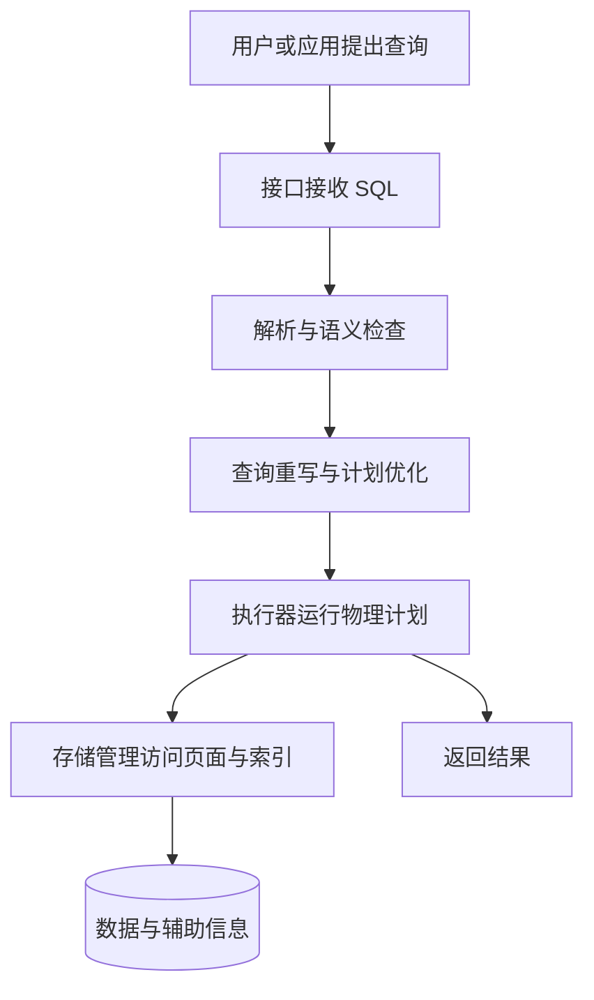
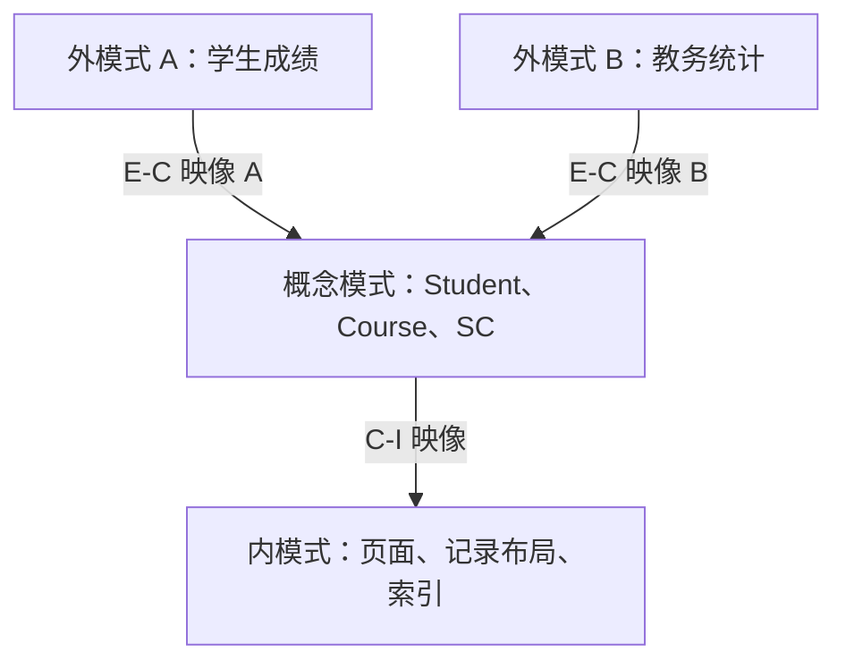

# 1 绪论

**本章主线**：学校需要长期保存学生、课程和成绩，让不同的人查询、更新，并在多人同时操作或机器故障时仍能正确工作。数据库技术由这些要求逐步展开：先组织数据，再统一管理操作，再把用户需求与存储细节分开，最后根据规模和工作负载选择系统架构。

读这一章时始终带着两个问题：**一次“查成绩”的请求怎样变成结果？底层改变后，为什么应用可以继续使用原来的数据接口？**

来源：《第1章 绪论》课件。标为“说明例”或“补充理解”的内容用于解释概念；历史分期和技术趋势按课程材料理解。

## 1.1 数据库基本概念

### 1.1.1 从“保存成绩”理解数据

考虑一句话：“赵宇的数据库课程成绩是 87 分。”计算机不能只保存孤立的 `87`，还必须能知道它属于哪个学生、哪门课，以及这个数表示什么。

**数据（data）是描述事物的符号记录**。它既包括 `87` 这样的数字，也包括姓名文本、日期、图片、音频和向量。在计算机中，这些内容都要编码成能够被存储和处理的形式。

理解数据，需要把**值**与**含义**联系起来。同一个 `87` 可以是成绩、年龄，也可以是编号。字段名称、类型以及所在的记录，为这个值提供了语境。

**数据类型**规定一个值属于什么类别、允许哪些取值与操作。例如，成绩可以用数值类型表示，姓名可以用字符串表示。把学号写成字符串并不妨碍识别学生，因为通常不需要对学号做加减运算。

按数据的组织方式，可以区分：

| 类型 | 定义与识别方法 | 说明例 |
| --- | --- | --- |
| 结构化数据 | 数据遵循明确的结构，能够按预先定义的字段解释 | 每条学生记录都有学号、姓名、系别 |
| 半结构化数据 | 数据带有标签、键或嵌套层次等结构信息，但不同记录未必遵循完全相同的字段布局 | 一份 JSON 有姓名和电话，另一份还包含多个地址 |
| 非结构化数据 | 主要内容不能直接按固定的业务字段解释 | 一段课堂录音、一篇自由文本 |

课件把 Key-Value、XML、JSON、图和向量列在半结构化数据中。这里要保留一个边界：**结构化程度取决于具体表示，不能仅凭数据名称判断。** 固定维度向量有明确结构，电子邮件则既有结构化的头部，也有自由文本正文。

### 1.1.2 为什么需要专门的数据管理系统

**说明例**：最初可以把成绩写进一个文件，每行记录“学号、课程号、成绩”。一个程序读取文件，就能查询成绩。困难来自后续要求：

1. 教务系统和学生系统都要访问它。如果各自维护一份文件，修改成绩后可能只有一份被更新。
2. 两位老师同时修改数据。如果都先读取旧文件，再把自己的版本写回，后写入的人可能覆盖前一个人的修改。
3. 保存到一半突然断电。系统需要知道哪些修改已经完成，哪些需要撤销或恢复。
4. 学生只能看自己的成绩，老师只能改自己所授课程的成绩。规则需要统一执行。
5. 数据变多后，每次从头扫描整个文件可能太慢。还需要更好的查找方法。

文件系统解决了文件命名、保存和读写等基础问题，但应用仍需额外实现这些数据管理规则。若每个应用各自实现，规则容易重复、冲突，也难以维护。

**数据库管理系统的动机，是把这些共同职责交给一套专门的软件统一处理。** 数据仍然可能落在文件中，变化在于应用通过更高层的数据接口提出需求，由管理系统决定如何可靠地完成它。

### 1.1.3 数据库、DBMS 与数据库系统

**数据库（database，DB）是长期存储在计算机中，按一定数据模型组织、可管理和共享的相关数据集合。**

其中，**数据模型**是一套描述数据结构、允许的操作和必须满足的约束的规则。比如关系模型用关系表示数据，以表格形式呈现，再规定如何查询和约束这些数据。模型的完整定义会在 [2 数据模型](2%20%E6%95%B0%E6%8D%AE%E6%A8%A1%E5%9E%8B.md) 中展开。

**数据库管理系统（database management system，DBMS）是定义、组织、存储和操作数据库，并控制访问、并发与恢复的基础软件。** 它连接应用需求与底层计算、存储资源。

**数据库系统（database system，DBS）是围绕数据库的建立、使用和维护形成的整体**。本课程采用的组成包括数据库、DBMS、开发工具与应用系统，以及数据库管理员和终端用户。数据库管理员通常简称 **DBA**，负责配置、权限、备份和运行维护等工作。

| 概念 | 它是什么对象 | 在选课业务中的对应物 |
| --- | --- | --- |
| DB | 有组织的数据集合 | 学生、课程、选课与成绩数据 |
| DBMS | 管理数据的软件 | 接收查询、执行更新、检查约束和处理故障的程序 |
| DBS | 数据、软件、工具和人员共同组成的系统 | 上述内容加上选课应用、开发运维工具、老师与学生 |

课件列出数据库的增删改查、并发处理、通用性和复制性等特征。具体操作与控制机制由 DBMS 提供；“数据库里有哪些数据”和“管理软件具有什么能力”是两个不同的问题。

### 1.1.4 用三张表表示学生、课程和选课

先明确要保存的事实：一个学生有自己的信息，一门课程有自己的信息，而“某学生选了某课程并取得某成绩”又是一类事实。

在**关系模型**中，数据用关系表示。初步可以把关系看成有明确列含义的二维表：一列称为**属性**，一行称为**元组**。元组是按这些属性组织的一组值；它可以记录一个对象，也可以记录对象之间的联系。

课件的三张表分别是：

| 表 | 属性及含义 | 一行记录的事实 |
| --- | --- | --- |
| `Student` | `Sno` 学号、`Sname` 姓名、`Sgender` 性别、`Sage` 年龄、`Sdept` 系别 | 一名学生的信息 |
| `Course` | `Cno` 课程号、`Cname` 课程名、`Cpno` 先修课程号、`Ccredit` 学分 | 一门课程的信息 |
| `SC` | `Sno` 学号、`Cno` 课程号、`Grade` 成绩 | 一名学生对一门课程的选课与成绩 |

为什么把它们分开？假设赵宇选了五门课，把姓名和系别写进每条成绩记录，就要保存五遍。修改系别时若漏改一条，同一个学生就会出现两个系别。分开之后，学生信息保存在 `Student`，选课记录通过学号引用它。

这里先建立**按事实组织数据、通过标识关联事实**的直觉。怎样判断拆分是否合理、是否丢失信息，还需要后续的数据依赖与数据库设计理论。

课件中与本次查询有关的记录可以缩成：

| `Student.Sno` | `Sname` |
| --- | --- |
| 2021310722 | 赵宇 |

| `Course.Cno` | `Cname` |
| --- | --- |
| 1 | 数据库 |

| `SC.Sno` | `SC.Cno` | `Grade` |
| --- | --- | --- |
| 2021310722 | 1 | 87 |

因此，“查赵宇的数据库成绩”可以分成三步：

1. 用姓名找到学号 `2021310722`。
2. 用课程名找到课程号 `1`。
3. 找到两个编号都匹配的选课记录，读取成绩 **87**。

第三步不能只匹配学号，因为一个学生可以选多门课；也不能只匹配课程号，因为一门课可以有很多学生。**查询要保留的是学生与课程这一对对象的对应关系。** 这里课件数据中的姓名足以定位该学生；实际系统遇到重名时，需要进一步用学号明确对象。

### 1.1.5 数据定义与数据操纵

系统既要知道“允许记录什么”，也要处理“已经记录了什么”。这对应两类操作。

**数据定义语言（data definition language，DDL）用于定义或改变数据库对象及其结构。** 例如创建一张表、为表增加一个字段、创建索引或视图。

**数据操纵语言（data manipulation language，DML）用于查询、插入、修改和删除具体数据。** 本课程把查询也纳入 DML。

**说明例**：

| 操作 | 改变或访问的对象 | 类别 |
| --- | --- | --- |
| 规定成绩表包含学号、课程号和成绩 | 表结构 | DDL |
| 记录赵宇的成绩为 87 | 一条具体记录 | DML |
| 将该成绩更正为 89 | 一条记录的值 | DML |
| 查询赵宇的所有成绩 | 符合条件的数据 | DML |
| 删除一条成绩记录 | 表中的一行，表仍存在 | DML |
| 删除整张成绩表 | 表这一数据库对象 | DDL |

**SQL** 是关系数据库中常用的语言，包含数据定义与数据操纵等功能。以下查询沿用课件表中的字段名，表示前面“查成绩”的需求：

```sql
SELECT s.Sname, c.Cname, sc.Grade
FROM Student AS s
JOIN SC AS sc ON s.Sno = sc.Sno
JOIN Course AS c ON sc.Cno = c.Cno
WHERE s.Sname = '赵宇'
  AND c.Cname = '数据库';
```

这里 `AS s` 给表起一个短名称；`JOIN ... ON ...` 按指定条件匹配记录；`WHERE` 限定目标学生和课程；`SELECT` 指定要返回哪些列。现在只需读懂它表达了什么，SQL 的完整规则在后续章节学习。

### 1.1.6 从 SQL 到结果：DBMS 的处理过程

SQL 没有要求“先读磁盘第几页，再执行第几个循环”，因为应用要描述的是结果条件。DBMS 必须把这一需求转成可执行的步骤。



**第一步：接收请求。** 应用通过接口把 SQL 交给 DBMS，并接收结果。JDBC 是 Java 数据库连接接口，ODBC 是开放数据库连接接口。它们约定应用如何连接、提交操作、获取结果；嵌入式 SQL 则把 SQL 写在宿主语言程序中，由相应工具进行处理。

**第二步：解析和检查。** 解析器识别语句结构，再检查表、字段和操作是否有意义。例如 `Grade` 是否存在、引用的表是否明确。系统还要执行适用的访问权限检查。

**第三步：选择执行计划。** **执行计划**是一组具体的数据处理步骤及其依赖关系。对于同一个查询，可能存在不同计划：先找赵宇再匹配选课，或者先找数据库课程的全部选课再匹配学生。

**说明例**：假设学校有 1 万名学生、100 万条选课记录，而赵宇只选了 5 门课。若有合适的查找手段，先定位赵宇的 5 条选课，再检查课程，可能比让大量无关记录进入后续处理更省工作。是否真的更快，还取决于索引、数据分布和具体算法。

优化器需要区分两个层次：

- **逻辑优化**改变查询的等价表达，例如把能够提前进行的筛选向前移动。前提是保持查询结果语义。
- **物理优化**选择具体实现，例如用全表扫描还是索引查找、采用哪种连接算法。

**基数**是某个关系或中间结果的元组数量。**基数估计**预测某步会产生多少行；**代价估计**进一步预测方案所需的计算、存储访问等开销。**统计信息**是系统维护的行数、取值分布等摘要，用于辅助这些估计。估计可能有误，所以优化器选择的是所依据模型下的合适方案，并非无条件保证全局最快。

**第四步：执行计划。** **算子**是计划中的一个处理单元，例如读取记录的扫描、按条件保留记录的筛选、匹配两个输入的连接。执行器组织算子，使一处产生的数据成为下一处的输入。

课件列出的执行方式，可以先用以下含义理解：

| 执行方式 | 基本组织方法 |
| --- | --- |
| 火山模型 | 算子通常通过迭代接口向子算子逐条索取记录 |
| 物化模型 | 一个阶段先生成并保存中间结果，再供后续阶段使用 |
| 向量化执行 | 一次处理一批值或记录，减少逐条调用的开销 |
| 编译执行 | 将查询中的操作编译成适合该查询的可执行代码 |
| 并行执行 | 让多个工作单元协作处理不同数据或不同任务 |

这些是执行的不同组织维度，可以组合使用。本章只建立它们在系统中的位置。

**第五步：读取底层数据。** 需要的记录可能已在内存中，也可能要从持久化存储读取。存储管理层负责记录组织、数据定位和数据搬运，再把需要的内容交给执行器。

数据库语言把复杂需求表达出来，关系运算把需求分解，执行计划把运算落实成程序。[2 数据模型](2%20%E6%95%B0%E6%8D%AE%E6%A8%A1%E5%9E%8B.md) 中的关系代数正是理解这一过程的基础。

### 1.1.7 存储、事务与安全各自解决什么问题

先补齐存储层的基本对象：

| 对象 | 定义 | 为什么需要它 |
| --- | --- | --- |
| 页面（page） | DBMS 组织和传输存储数据时使用的块状单位 | 不必每次只为一个字段单独访问存储设备 |
| 缓冲区（buffer pool） | DBMS 在内存中维护的数据页缓存区域 | 重复访问数据时，尽量避免反复读取持久化存储 |
| 索引（index） | 按查找字段组织的辅助数据结构，帮助定位记录 | 根据学号查学生时，减少无关数据的检查 |
| 元数据（metadata） | 描述数据对象的结构、约束等信息的数据 | 系统需要知道表有什么列、列是什么类型 |
| 数据字典 | 集中保存和管理这些元数据的目录 | 为解析、检查和管理提供结构信息 |
| 日志（log） | 按恢复机制记录更新或相关事件的信息 | 故障后有依据判断和重建应保留的状态 |

**说明例**：查询某学生时，系统先通过索引确定数据位置，再检查相应页面是否在缓冲区中；若不在，则读取该页。索引解决“去哪里找”，缓冲区解决“是否必须再读一次存储设备”，两者作用不同。

接下来考虑一次修改。**事务（transaction）是被数据库作为一个逻辑工作单元管理的一组操作。**

**说明例**：学生成功选课，需要“增加一条选课记录”和“扣减一个剩余名额”同时成立。只增加记录而不扣名额，会使剩余名额失真，后续可能超额选课；只扣名额而不增加记录，会无故占用名额。将它们放进一个事务，就是要求系统按相应事务规则处理整体成功或失败。

- **并发控制**协调重叠执行的事务，避免多个操作相互干扰而破坏规定的正确性。比如只剩一个名额时，两名学生不能都基于同一个旧状态成功占用它。
- **故障恢复**在执行中断、系统崩溃等情况下，利用日志等信息恢复数据库应有的状态。
- **备份与恢复**通过保留可恢复的数据副本，应对数据损坏、误操作或更大范围故障。备份与日志的具体配合由恢复方案决定。

安全又是另一组要求：**身份认证**确定访问者是谁，**权限控制**确定其允许执行哪些操作，**审计**记录访问与操作以便追查，**数据防护**保护存储与传输中的数据。课件还列出入侵检测和第三方安全测试等措施。

这些机制贯穿系统，不能理解成查询结束后再统一加上的一个步骤。后续课程会进一步定义事务保证、并发规则和恢复协议。

### 1.1.8 数据库内核之外的工具与生态

**数据库内核**是直接负责查询、事务和数据管理的核心软件部分。要把它用于长期运行的业务，还需要接入、迁移和运维工具。

| 配套部分 | 做什么 | 选课系统中的用途〔说明例〕 |
| --- | --- | --- |
| 访问中间件、开发建模工具 | 连接应用，设计结构和数据访问代码 | 让选课应用提交查询，帮助设计表 |
| 导入导出、同步、集成工具 | 搬运数据或将变更传播到其他系统 | 导入新生名单，将数据送入分析系统 |
| 监控与运维工具 | 观察负载、配置、故障与告警 | 发现选课高峰中的慢查询 |
| 备份与恢复工具 | 保存和验证可恢复的数据 | 误删数据后按恢复方案处理 |
| 操作系统与硬件平台 | 提供计算、内存、网络和存储资源 | 承载 DBMS 的运行 |

课件把应用接入、数据流动、运维和基础平台分别称为北向、西向、东向和南向配套。这些方向是组织工具类别的方式。

进一步看产品生态：**内核生态**涉及语法、类型、驱动等兼容性；**技术生态**涉及与操作系统和其他工具的适配；**用户生态**涉及社区、培训和使用经验；**商业生态**涉及行业应用、服务商和合作伙伴。因此，采用一种数据库还要考虑迁移成本、工具与维护能力。

## 1.2 数据库系统结构抽象

### 1.2.1 同一份数据为什么需要不同的描述

仍然考虑成绩系统：

- 学生关心自己选了哪些课、得了多少分。
- 教务部门关心全校学生、课程和选课之间的关系。
- 存储管理程序关心记录在哪些页面、怎样定位和读取。

这三个角色使用同一批事实，但所需的描述不同。若让学生应用直接依赖页面位置，存储调整就会迫使应用修改；若让每个应用都接触全局细节，开发和维护也会变得困难。

因此，数据库用不同抽象层次描述数据，并通过层间对应关系连接起来。这里的**抽象**是保留当前任务需要的性质，将不必由这一层处理的细节交给下一层。

### 1.2.2 模式与实例：规则和当前内容

**模式（schema）是对数据库数据结构的描述，包括数据对象、属性及其类型、对象之间的联系和有关约束。**

**数据库实例或状态（instance/state）是某一时刻按该模式保存的具体数据。** 模式给出规则，实例是当时满足规则的一组内容。

**说明例**：

```text
结构规则：Student(学号：字符串，姓名：字符串，系别：字符串)
约束：每名学生使用唯一学号

当前数据：
(2021310722, 赵宇, CS)
(2021310723, 张敏, CS)
```

在这个例子中：

- 增加一个新生，只改变实例。
- 更正某学生的姓名，只改变实例。
- 增加“电子邮箱”属性，改变模式，并需要相应处理原有数据。

“实例”在这里指数据状态；部署数据库时说的“一个数据库实例”有时指一套运行中的服务进程和资源，阅读时要依据上下文区分。

课件还用 **view** 表示某一抽象层次呈现的数据。SQL 中的**视图对象**通常用一个命名查询定义其呈现的数据。它可以帮助实现外部表示，但三级模式中的“视图”含义更宽，不能全部等同于某个 `CREATE VIEW` 对象。

### 1.2.3 三级模式：分别描述什么

**外模式（external schema）是某类用户或应用所需的局部数据结构及有关约束的描述。** 它规定这一使用者通过什么表示访问数据。

**概念模式（conceptual schema），也称逻辑模式，是整个数据库的全局逻辑结构与约束的描述。** 它描述有哪些事实以及事实之间的联系，暂不关心具体物理位置。

**内模式（internal schema）是数据的物理存储组织与存取方式的描述。** 它关注记录如何存放、页面和索引如何组织等实现细节。

| 模式 | 成绩系统中的说明例 | 这一层不必知道什么 |
| --- | --- | --- |
| 外模式 | 向学生呈现“课程名、成绩”，并限定为本人数据 | 全校所有数据和存储布局 |
| 概念模式 | `Student`、`Course`、`SC` 的结构与关联约束 | 某行实际位于哪一个磁盘块 |
| 内模式 | 记录布局、数据页组织、学号索引与存取路径 | 用户界面如何展示成绩 |

按这套标准结构，一个数据库可以有多个外模式，由统一的概念模式描述全局逻辑，由统一的内模式描述内部组织。外模式提供局部表示，通常不意味着为每位用户复制整份数据库；实际访问限制还需要权限等机制落实。

### 1.2.4 两层映像：表示之间怎样对应

**映像（mapping）是相邻两层数据描述之间的对应规则**。它说明上一层的数据如何由下一层的数据表示与操作实现，并不要求简单的一一对应。



**外模式—概念模式映像（E-C mapping）**规定局部表示与全局逻辑结构的对应关系。例如，学生界面的“课程名、成绩”可以由 `SC` 与 `Course` 按课程号匹配后得到，并按当前学生的学号限制范围。

**概念模式—内模式映像（C-I mapping）**规定逻辑数据与物理存储之间的对应关系。例如，逻辑上的“按学号查找 `Student` 记录”，如何对应到存储记录布局与索引所指向的位置。

应用依赖上一层的表示，系统借助映像找到下一层的实现。这样，下一层调整时，有机会只修改映像，继续向上层提供相同的语义。

### 1.2.5 逻辑数据独立性：全局结构变了，应用如何不变

**逻辑数据独立性是概念模式发生变化时，通过调整 E-C 映像，使外模式及其应用程序可以保持不变的能力。**

**说明例**：原来的全局结构是一张表：

```text
Student(学号, 姓名, 系别, 电话)
```

后来为了单独管理联系方式，将其改为：

```text
StudentBasic(学号, 姓名, 系别)
StudentContact(学号, 电话)
```

假设在这次拆分中，每名学生在两张表中各有一条对应记录，学号唯一，所有原信息都保留。那么可以按学号把两部分重新匹配，继续提供原来的“学号、姓名、系别、电话”表示：

1. 概念模式从一张表变成两张表。
2. E-C 映像改为从两张表组合出原来的外部表示。
3. 应用仍访问原来的字段与含义，因此可以保持不变。

成立的关键是**新结构仍能重建应用所需的原信息与语义**。若电话被直接删除，或拆分后一个学生有多个电话而旧应用只接受一个，映像就需要额外规则，不能自动保证独立性。

### 1.2.6 物理数据独立性：存储变了，逻辑结构如何不变

**物理数据独立性是内模式发生变化时，通过调整 C-I 映像，使概念模式可以保持不变，并进而保护外模式及应用的能力。**

**说明例**：开始时查询学生需要扫描数据页，后来建立学号索引，并调整记录存放位置。此时：

1. 内部的存储组织和访问路径改变。
2. 系统依据新的内部组织完成逻辑数据访问。
3. `Student` 仍具有原来的属性和含义，应用仍然提交同样的学号查询。

系统返回的逻辑数据可以相同，但响应速度、存储空间和维护成本可能变化。**数据独立性保护的是上层接口与语义，不表示性能或全部外部行为毫无变化。**

| 要判断的问题 | 逻辑数据独立性 | 物理数据独立性 |
| --- | --- | --- |
| 哪一层发生改变？ | 概念模式 | 内模式 |
| 哪个映像吸收改变？ | E-C | C-I |
| 直接保护哪一层？ | 外模式 | 概念模式 |
| 说明例 | 拆分全局表后仍提供原外部表示 | 调整记录布局后仍提供原逻辑表 |

### 1.2.7 三级模式与 DBMS 模块分层的区别

前一节讲的解析器、优化器、执行器和存储管理，是**软件功能怎样分工**。这一节讲的外模式、概念模式和内模式，是**同一批数据怎样被不同层次描述**。

它们回答不同问题，不能把“查询处理层”直接等同于“外模式”，也不能把一个模式看成一个后台进程。解释查询运行过程时使用模块分工；解释数据表示和变化隔离时使用三级模式。

## 1.3 数据库历史回顾

### 1.3.1 数据管理方式怎样演进

前面从成绩文件遇到的困难，可以反过来理解数据库的发展。

| 阶段 | 课件采用的时间范围 | 管理方式与变化 |
| --- | --- | --- |
| 人工管理 | 20 世纪 50 年代中期以前 | 主要面向科学计算，程序与数据紧密绑定，依赖卡片、磁带等介质，管理和共享困难 |
| 文件系统管理 | 50 年代中期至 60 年代中期 | 借助文件系统与可直接存取的设备长期保存文件，但文件格式、访问逻辑仍经常由各应用分别约定 |
| 数据库管理 | 60 年代末以来 | 通过数据模型和 DBMS 统一描述、操作与控制数据，提高共享和独立性，并处理并发等问题 |

这条演进线的核心是**数据管理职责逐渐从单个应用中分离出来**。应用可以关注“查谁的成绩”，把文件布局、数据定位和协调更新交给专门的系统。

这里的“数据库阶段”并不意味着文件系统消失。DBMS 仍可能利用文件系统完成底层读写，同时提供其上的数据管理能力。

### 1.3.2 技术发展围绕哪些新问题展开

课程按四个阶段概括数据库技术史：

1. **探索阶段（1959–1967）**：格式文件系统与数据库概念的探索。
2. **确立阶段（1968–1975）**：层次、网状和关系模型发展，商用系统出现，关系理论奠基。
3. **成熟阶段（1976–20 世纪 80 年代前期）**：标准体系结构、SQL、System R、Ingres，以及关系理论与应用的发展。
4. **深化发展阶段（1985 年以来）**：新模型、专用系统与其他计算机技术不断结合。

比单独记年代更有用的是看新增的需求：

| 新增需求 | 主要发展方向 |
| --- | --- |
| 用统一的逻辑方式组织和查询数据 | 关系模型与 SQL |
| 正确处理大量同时发生的业务操作 | 事务处理、并发控制、OLTP |
| 从大量历史记录中计算统计结果 | 分析处理、OLAP、分析型数据库 |
| 保存不同形态的数据，承受更大的访问规模 | NoSQL、专用模型、分布式处理 |
| 在扩展容量的同时保留关系与事务能力 | NewSQL、分布式 SQL |
| 按变化的需求分配计算与存储资源 | 云数据库、弹性伸缩、存算分离 |
| 在较新的业务数据上分析，支持更多数据形态 | HTAP、多模处理、数据库与 AI 的结合 |

**NoSQL**是对一批不以传统关系表为唯一组织中心的数据库路线的统称，常见模型包括键值、文档、宽列和图。课件历史图把它概括为“通常不支持事务及 SQL”，应作为特定历史设计取向理解，不能据此断言所有 NoSQL 系统都没有事务或查询语言。

**NewSQL**在课程图中的重点，是兼顾关系／SQL、事务能力与较高可扩展性。这些类别长期并存，新的方向通常解决新的约束，不意味着原有系统全部失效。

### 1.3.3 代表人物与技术主线

| 人物 | 图灵奖年份 | 课件强调的贡献方向 |
| --- | --- | --- |
| Charles W. Bachman | 1973 | 网状数据库管理系统 |
| Edgar F. Codd | 1981 | 关系数据库理论与实现 |
| Jim Gray（James Gray） | 1998 | 事务处理与分布式数据库 |
| Michael Stonebraker | 2014 | 数据库系统原型与商业化 |

可将这些贡献分别放回数据组织、关系理论、事务处理和系统实现的主线中理解。

## 1.4 数据库系统架构与分类

### 1.4.1 分类首先要说明在比较什么

**工作负载（workload）是系统需要处理的一组操作及其运行特征**，包括读写比例、数据访问范围、并发程度和时延要求等。登记一次选课，与统计十年的选课趋势，访问同类数据，却形成不同负载。

数据库的其他分类也各有维度：

| 分类维度 | 回答的问题 | 常见类别 |
| --- | --- | --- |
| 数据模型 | 数据怎样表示和关联？ | 关系、键值、文档、图、列簇；时序、空间等专用类型 |
| 负载模型 | 主要执行什么工作？ | OLTP、OLAP、HTAP |
| 系统架构 | 数据和计算怎样在节点间组织？ | 集中式、集群、分布式；主备、读写分工等 |
| 部署与服务方式 | 部署在哪里，由谁提供资源与运维？ | 本地部署、云服务、托管服务、Serverless |

**说明例**：“云上的分布式关系型 OLTP 数据库”可以同时成立，因为每个词描述不同维度。云原生进一步描述系统是否围绕云环境的能力进行架构设计。

业务场景会决定这些维度如何组合。课件列举订单、物流、游戏、数据分析、反欺诈等场景，意在说明选择系统前要先理解访问需求。

### 1.4.2 OLTP、OLAP 与 HTAP

**在线事务处理（online transaction processing，OLTP）面向持续发生的业务事务。** 一次事务通常访问相对有限的数据，系统需要处理大量并发请求，并满足相应的正确性和响应时间要求。

**在线分析处理（online analytical processing，OLAP）面向对大量数据进行查询、连接、统计和汇总的分析负载。** 它通常要从积累的数据中形成对业务的整体认识。

**混合事务分析处理（hybrid transactional/analytical processing，HTAP）是同时支持事务负载与分析负载、并强调较新业务数据可用于分析的技术路线。**


用同一个选课系统理解三者〔说明例〕：

| 需求 | 对应负载 | 为什么系统关注点不同 |
| --- | --- | --- |
| 赵宇选一门课并扣减名额 | OLTP | 需要及时、正确地完成一次业务操作 |
| 统计五年来各学院课程的平均成绩 | OLAP | 需要读取和汇总大量历史记录 |
| 选课仍在进行，同时查看最新课程拥挤程度 | HTAP | 既要维持选课响应，又要让分析及时看到更新 |

传统方案可以将事务数据周期性搬到分析系统。**ETL** 指提取（extract）、转换（transform）、加载（load）：从源系统获取数据，整理成目标格式，再放入分析系统。

```text
业务操作 → OLTP 数据库 → ETL → OLAP 分析系统
```

若每晚执行一次 ETL，白天分析就可能看不到当天的新选课。HTAP 希望缩短这种数据新鲜度差距，但必须协调资源：一条扫描大量数据的分析查询，可能与大量短事务争用 CPU、内存和 I/O。

### 1.4.3 集中式、集群与分布式

**节点**是参与系统运行的一台机器或一个独立服务单元。**集中式数据库**将主要数据管理集中在一个中心服务体系中；它仍可以有远程客户端或备用节点。**集群**是多个协作节点组成的运行形态，本身不能说明数据是否分片。

**分布式数据库**把数据或其副本组织在多个相互通信的节点上，并通过协同机制提供数据库服务。具体如何划分数据、处理事务和暴露接口，需要看其架构。


分析多节点系统，先区分两件事：

- **分片（sharding）**：把数据划为不同子集，让不同节点负责不同部分。
- **复制（replication）**：为同一份数据维护多个副本。

**说明例**：按学号范围把学生数据分到两个节点，是分片；为其中一个节点保存一份备用副本，是复制。系统可以同时采用两者。

分片有助于分担容量和处理负载；复制提供冗余，可用于故障接替，也可能分担读请求。增加节点同时带来网络通信、更新协调和故障判断等问题，因此高性能、高可用和可扩展性都是需要机制实现的目标。

课件进一步列出：

| 形态 | 基本含义 |
| --- | --- |
| 一主多备 | 一个主节点接受主要更新，备用节点维护副本以支持接替 |
| 一写多读 | 将写入集中处理，让其他节点承担部分读取 |
| 多写多读 | 多个节点可以处理写入与读取，需要协调数据和并发操作 |
| 原生分布式 | 系统自身包含分布式数据管理能力 |
| 中间件分布式 | 由中间层路由和协调多个底层数据库 |

课程分类图把无分片的单机／集群与有分片的分布式形态区分展示，这是图中采用的分类口径。“多台机器”“多个副本”“多个分片”不能相互替代。

### 1.4.4 云数据库、托管服务与 Serverless

**云数据库**是在云环境中部署并通过网络提供数据库能力的系统或服务。它可以结合按需使用资源、弹性扩展、备份容灾等服务能力。

**云托管数据库**是由服务商承担数据库部署和约定范围内的运维工作、向用户提供数据库使用能力的服务，常称为 **DBaaS（database as a service）**。用户仍需负责自身业务的数据设计、访问授权和使用方式等事项，具体责任以服务边界为准。

**Serverless 数据库服务**进一步减少用户直接管理服务器和容量的工作，由平台按服务机制分配或调整资源。这里的 Serverless 说明资源管理接口，不意味着没有服务器，也不保证任意请求都能无上限扩展。

课件以多个计算—存储一体的实例及实例间复制，说明一种云托管实现，指出其可能存在副本冗余、复制滞后、恢复时间和网络瓶颈。其中 **RTO（recovery time objective）**是故障后恢复服务所允许的最大中断时间目标；RTO 较高表示允许的恢复窗口较长。目标与实际恢复耗时需要区分，不能只凭“云托管”标签推断实际恢复速度。

**托管描述由谁负责服务，底层架构描述资源怎样组织。** 因此，课件示例中的 Shared Everything 等架构标签、兼容性优势和高 RTO 等局限，不能推广为所有托管数据库的共同定义。

### 1.4.5 云原生与存算分离

**云原生数据库**是围绕云环境的弹性、分布式和自动化能力设计的数据库。课件重点介绍其中的存算分离路线。

先定义资源：**计算层**执行查询和事务中的计算；**持久化存储层**负责让数据在进程结束或重启后仍可保留。内存缓存可以加快访问，但不能因此被等同于持久化数据。

**存算一体**将计算资源与其管理的持久化存储较紧密地绑定在节点上。**存算分离**将两者解耦，让计算节点通过网络等方式访问独立的存储服务。

**说明例**：学校已有足够空间保存学生数据，但选课第一天的查询量突然增加十倍。若计算与存储必须作为整套节点扩展，增加计算可能连带购买很多暂时不需要的存储；存算分离希望让计算和存储各自按需求扩展。

```text
多个计算节点：解析与执行查询、处理事务
              ↓
独立的持久化存储服务：保存数据与日志
```

独立伸缩减少了某些资源绑定，也增加了网络访问和分布式协调的要求。最终收益仍取决于数据访问模式、缓存与网络等因素。

课件称计算节点“无状态”，应理解为持久化数据不必绑定在某个计算节点上。**计算节点仍可能持有连接、缓存、会话和正在执行的事务状态**，关闭或切换节点时仍要妥善处理。

云托管和云原生可以同时成立：前者描述服务管理方式，后者描述架构设计。存算分离是这里讨论的关键方案，但不能把所有云原生设计缩成一个完全相同的架构。

### 1.4.6 为什么进一步拆出共享缓存

存算分离后，多个计算节点仍可能各自缓存同一批热门数据。新增计算节点也可能需要重新把数据读入自己的缓存。

**计算—缓存—存储三层池化**将这三类资源分别组织成可管理的资源池，并通过访问机制协同工作。**资源池**是把一类资源统一管理，再按需求分配给多个使用者的组织方式。

```text
计算池：处理查询和事务
   ↓
共享缓存池：提供可复用、可调度的内存缓存
   ↓
存储池：持久化数据与日志
```

其动机是让缓存容量也能独立调节，并减少多个节点从存储层反复读取相同数据的工作。这里的“共享”需要具体访问和协调机制支持，并非天然等同于同一进程里的普通内存读取。

课件指出，事务、数据副本、异步更新和故障恢复仍是关键技术。它用“OLTP 更重视事务与日志、OLAP 更重视分片与分析”突出不同负载的设计重点，不代表其中一种完全不需要另一类机制。

## 1.5 数据库发展趋势

### 1.5.1 用需求与代价理解技术演进

一种新技术出现时，可以先问：什么条件变了，原方案哪一步变贵了，新方案又增加了什么代价？

| 改变的条件 | 课程涉及的方向 | 需要重新考虑的问题 |
| --- | --- | --- |
| 数据形态 | 关系、JSON、图、向量 | 如何表示数据、定义匹配与查询 |
| 硬件 | 多核、NUMA、NVM、RDMA、GPU、FPGA | 计算、内存、存储与网络的开销怎样变化 |
| 运行环境 | 本地、云、Serverless、端边云 | 资源如何分配，数据与计算放在哪里 |
| 系统规模 | 主备、多主、集群、分布式 | 节点怎样分工，如何协调和恢复 |
| 应用需求 | 事务、分析、时序、流、AI、安全隐私 | 哪种操作最频繁，要求多快、何种保证 |
| 可用软件方法 | 编译技术、分布式协议、机器学习 | 哪些已有机制可以用来改进实现 |

评价系统时也要明确指标：**吞吐量**是单位时间内完成的工作量，例如每秒完成多少个事务；**时延**是一次请求从开始到完成所需时间，**可用性**关注能否持续提供符合约定的服务，**容错**关注出现故障后维持或恢复正确服务的能力，**弹性**关注能否随需求调整资源。

课件还列出一致性、安全、隐私和鲁棒性等目标。它们不能由一个“更快”概括。比如增加副本提供冗余，却需要额外传播更新；讨论优势时必须同时说明负载与保证。

### 1.5.2 多模处理与跨领域融合

**多模数据库处理**是在一个系统或统一框架中支持多种数据模型及其操作的能力。动机是同一应用可能同时需要不同表示。

**说明例**：学校用关系表管理选课，用文档保存课程介绍，用图表示先修依赖，用向量表示课程文本的数值特征以支持相似性查找。这些任务不必都强行改写成同一种访问方式。


模型与操作必须一起看：**键值模型**按 key 定位 value；**文档模型**组织带字段与嵌套层次的文档；**图模型**把对象和联系表示为节点与边；**向量表示**用数值序列记录特征，并依据选定的距离或相似度比较对象。

课程也提到数据仓库、数据湖和湖仓融合：**数据仓库**面向分析组织和整合数据；**数据湖**侧重集中保存多种形态的数据，供后续处理；湖仓融合尝试结合两者的数据管理与分析能力。这里先认识需求，不能把这些名词都等同于一种数据模型。

数据库与其他基础课程的联系则来自具体工作：

- 解析 SQL、重写表达式和生成机器代码，会用到编译原理与编程语言技术。
- 分配缓存、调度任务和管理文件，会用到操作系统知识。
- 在多核和异构设备上执行计算，会用到计算机体系结构知识。
- 协调不同节点的更新与故障，会用到网络和分布式系统知识。

这解释了数据库为什么同时包含形式化模型和复杂的系统实现。

### 1.5.3 新硬件与内存数据库

| 技术 | 最少必要定义 | 对数据库的影响方向 |
| --- | --- | --- |
| SMP | 多个处理器较对称地共享主要内存资源的组织方式 | 如何并行执行并协调共享访问 |
| NUMA | 内存访问代价随处理器与内存所在位置变化的组织方式 | 数据与任务放在哪里会影响访问成本 |
| GPU、FPGA | 图形处理器，以及可配置逻辑电路的硬件 | 为适合的计算提供并行或专用加速 |
| NVM | 断电后仍可保存内容的非易失性内存类介质 | 重新考虑数据组织与持久化路径 |
| RDMA | 通过相应网络能力直接访问远端内存的机制 | 改变某些远程数据访问和分布式缓存的实现成本 |

**内存数据库**以主内存作为主要数据访问与处理介质来设计运行机制。其出发点是：当主要数据驻留内存，原来为减少磁盘 I/O 而做的设计，未必继续是最佳选择。

课件列出从页面组织到记录组织、从磁盘索引到内存索引、从部分悲观控制到乐观控制、从解释执行到编译执行等方向。

其中，**悲观并发控制**倾向于在可能冲突前协调或限制操作；**乐观并发控制**允许先执行，再验证是否发生冲突，并按规则处理失败。它们是不同设计取向，不是“内存数据库必须使用乐观控制”的定义。

**补充理解**：内存访问更快并不消除并发、持久化与恢复问题。断电后如何保留已经确认的数据，仍需要日志、持久化介质、副本或其组合机制支持。

### 1.5.4 AI4DB：用 AI 改进数据库

**AI4DB**是将机器学习等 AI 方法用于数据库内部优化、配置和运行维护的方向。被改进的对象是 DBMS 自身。

它的动机很具体：查询与数据分布变化多，配置空间大，海量实例的人工运维成本高，传统估计方法可能难以准确预测所有负载。

| 位置 | 课件中的任务 | 希望改进什么 |
| --- | --- | --- |
| 优化器 | 查询重写、执行代价估计、物理计划选择 | 选择更合适的查询方案 |
| 执行器 | 并行性能预测 | 判断资源与并行安排的效果 |
| 存储引擎 | 学习型索引 | 利用数据分布辅助定位 |
| 物理设计 | 索引推荐、视图推荐、数据划分 | 调整数据组织以适应负载 |
| 运行维护 | 自治数据库 | 辅助配置、诊断和管理 |

**说明例**：模型观察历史查询的输入规模与运行时间，再预测新查询的不同计划可能耗时多少。优化器用这个预测辅助选计划。

这里要区分**性能判断**和**结果正确性**。预测错误可能选出较慢的计划；查询语义、权限和事务正确性仍需相应机制保证，不能由模型“通常预测得准”推出。

### 1.5.5 DB4AI：用数据库支持 AI

**DB4AI**是用数据库的数据管理与计算能力支持 AI 的数据准备、训练、分析或推理流程的方向。被支持的对象是 AI 应用。

**说明例**：模型需要学生历次课程记录作为输入。数据库可以统一管理这些记录，完成过滤和特征准备，并让推理在靠近数据的位置执行，减少把大量数据反复导出到另一系统的步骤。

课程强调统一数据与统一查询，并用三组变化说明目标：

- `T+1 → T+0`：减少离线处理等待，使推理或分析更及时。
- `ETL → In-DB`：更多操作在数据库内部或其集成环境中完成，减少数据流转。
- 多份冗余数据 → 尽量复用同一份数据：提高资源利用率。

这些表达描述改进方向，并非零延迟、绝对安全或永远只存一个副本的保证。库内计算仍需要权限控制、资源隔离和正确的数据管理。

| 方向 | 谁服务于谁 | 一个判断例子 |
| --- | --- | --- |
| AI4DB | AI 服务于数据库 | 模型辅助预测查询代价 |
| DB4AI | 数据库服务于 AI | 数据库管理模型输入并支持特征处理 |

### 1.5.6 数据库与安全、隐私

安全问题需要按保护对象区分。**补充理解**：

| 方向 | 要解决的核心问题 |
| --- | --- |
| 全密态数据库 | 怎样在保护数据机密性的同时支持必要计算，具体保证取决于方案及威胁模型 |
| 防篡改数据库 | 怎样防止或检测未授权修改，并使结果可验证 |
| 智能访问控制 | 怎样辅助决定谁可以在什么条件下进行哪些操作 |
| 隐私保护 | 数据、查询、结果或交互过程会泄露哪些信息，如何限制这种泄露 |
| 联邦数据查询 | 怎样对分布在多个来源的数据组织统一查询，并遵守各来源的访问规则 |

**联邦查询**保留多个数据来源，通过协调查询来使用它们。它与联邦学习不是同一个概念，也不会因为数据留在原处就自动保护所有隐私。

加密、权限控制和篡改检测提供的保证不同，需要说明攻击者能接触什么、信任哪些组件，以及具体保护哪类信息。

### 1.5.7 数据库研究的入口

课件列出数据库领域的 VLDB、SIGMOD／PODS、ICDE，也列出 EDBT、DASFAA、KDD 等相关方向会议，以及国内的 NDBC（中国数据库学术年会）。这里可先把它们作为后续检索的入口。

读一项数据库研究时，可以沿本章的结构定位：它改变的是数据模型、查询处理、执行、存储、事务、架构，还是某种工作负载下的组合？这比只记一个新系统的名称更有帮助。

## 1.6 复习与课程任务

### 1.6.1 本章的推理链

从“长期保存并使用成绩”开始，可以逐步重建本章：

1. 为了让值有明确含义，需要属性、类型和数据结构。
2. 为了统一管理共享数据，需要 DBMS，而不是让各应用重复承担全部职责。
3. 为了表达需求并自动执行，需要数据库语言、查询计划、算子与存储管理。
4. 为了支持并发、故障和不同权限，需要事务、恢复与安全机制。
5. 为了让应用不被每次结构和存储调整牵动，需要三级模式、两层映像和数据独立性。
6. 当负载、规模和运行环境变化时，系统在模型、架构与实现上产生不同路线。

### 1.6.2 本章复习总表

| 自测问题 | 应能给出的具体解释 |
| --- | --- |
| 为什么只有一个 `87` 还不足以记录成绩？ | 还要明确学生、课程、字段含义及其关联 |
| DB、DBMS、DBS 分别是什么对象？ | 数据集合、管理软件、围绕数据使用和维护的整体系统 |
| `SC` 为什么要同时保存学号与课程号？ | 一条成绩属于学生与课程的配对，仅一个编号不足以确定这条事实 |
| 创建成绩表与删除一条成绩分别属于什么操作？ | 定义结构的 DDL，与操作数据的 DML |
| 查询计划为什么不直接由 SQL 唯一确定？ | 同一结果条件可能由不同算子安排和访问方法实现 |
| 索引和缓冲区解决的是同一个问题吗？ | 前者帮助定位，后者减少重复读取持久化存储 |
| 增加一名学生与增加邮箱字段有何区别？ | 前者改变实例，后者改变模式 |
| 将学生表拆成两张，应用仍用原接口，依靠什么？ | 保留原语义并调整 E-C 映像，实现逻辑数据独立性 |
| 改变记录位置或索引，表的逻辑结构不变，体现什么？ | 物理数据独立性，依靠概念层与内部存储的对应关系 |
| 为何不能把外模式直接等同于查询处理模块？ | 一个描述数据，一个划分软件功能 |
| 登记选课与统计五年成绩有什么不同？ | 前者主要是事务负载，后者主要是分析负载 |
| 分片和复制分别改变什么？ | 数据如何分工，以及同一数据保留几份副本 |
| 数据量没变而查询量上升，存算分离有何动机？ | 单独增加计算资源，减少与持久化存储的绑定 |
| 托管与云原生为什么可以同时成立？ | 它们分别描述服务管理方式和架构设计 |
| AI 预测查询代价与数据库准备训练数据如何区分？ | 前者是 AI4DB，后者是 DB4AI |

### 1.6.3 课件中的复习与作业要求

课程给出三种复习途径：结合《数据库系统概论》第 5 版阅读与练习、构建课程知识图谱，以及使用课程 AI 助教。

其中，知识图谱作业的要求是：

1. **先人工梳理**章节，每章列出至少 5 个核心知识点，并区分概念、方法、对比、计算等类型。
2. **再用 AI 辅助抽取与关联**，记录模型名称与版本、提示词和输出；人工查重、纠错，并补充 3–5 个 AI 未识别的重要知识点。
3. **构建图谱**，覆盖课程 14 章，节点不少于 80 个、关系不少于 120 条。节点包含名称、定义、章节、类型；关系包含先修、包含、对比、应用等。
4. **可视化与交付**，支持按章节和关系类型筛选，提供全图及至少 2 个局部图，并提交数据文件、提示词与修正记录、可视化材料，以及有用到的代码。知识点先修查询和学习路径查询属于加分内容。

这些是课件中的课程任务。理解本章时，可以先用“数据模型 → 关系运算 → SQL → 查询优化”练习辨认先修关系；知识图谱作业本身需要另行完成。
