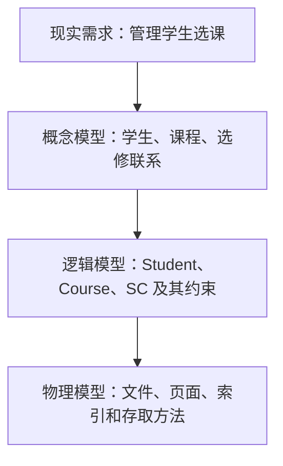
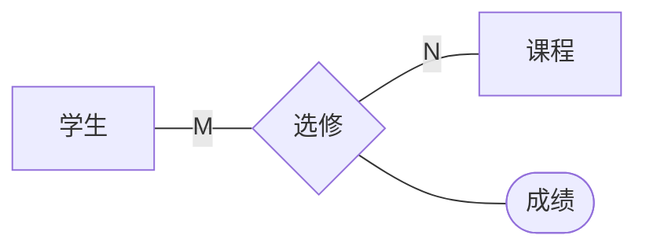
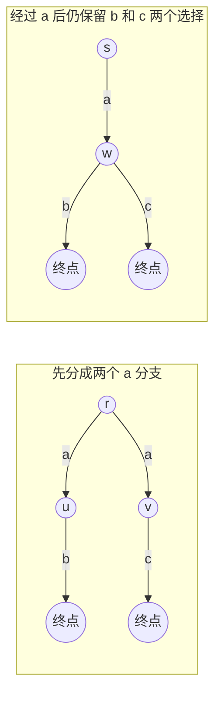

# 2 数据模型

上一章 [1 绪论](1%20%E7%BB%AA%E8%AE%BA.md) 解释了为什么需要 DBMS。这一章继续追问：**现实中的学生、课程和选课行为，怎样变成机器可以保存、查询并检查的数据？**

这件事至少包含三个问题：用什么结构表达事实，怎样从事实中得到答案，以及怎样排除不合法的数据。它们分别对应数据模型的**结构、操作、约束**。后面的表、键、关系代数和 E-R 图，都是在解决这三个问题。

本篇结合《第2章 数据模型1》《第2章 数据模型2(1)》与《第2章 数据模型3》：2.1、2.2 介绍概述与经典模型，2.3 讨论时态与多维分析，2.4 介绍半结构化数据与 OEM，2.5 连接图结构、模拟与双模拟、图查询、属性图和 RDF，2.6 介绍本体语义模型及查询、推理、验证的分工。空间、概率、模糊等扩展仍只作方向性介绍。

## 2.1 概述：怎样把现实问题变成数据问题

### 2.1.1 从选课系统出发理解模型与抽象

考虑一个具体需求：查询“选修数据库课程的学生姓名和成绩”。为了回答它，至少需要知道学生是谁、课程是什么、谁选了什么课，以及这次选课的成绩。

现实中的学生还有身高、衣着和当天心情，但这些信息不一定影响这次查询。**抽象**就是从具体对象中提取与当前问题有关的共同特征，暂时忽略其他细节。**模型**则是用选定的对象、属性、联系和规则，对现实事物或系统作出的抽象描述。

**说明例**：把学生表示为“学号、姓名、年龄、所在系”，就是一种模型。它能支持选课管理，却不能直接支持服装尺码推荐，因为后一个任务需要的属性没有被保留。

因此，模型不是现实的完整副本。判断模型是否合适，要先问：**它保留的信息是否足以回答业务问题，保留的规则是否足以排除错误状态？**

### 2.1.2 数据模型的三个组成部分

**数据模型**是描述数据对象、对象之间的联系、允许的操作及合法性条件的一组概念和规则。通常由以下三部分组成：

| 组成部分 | 准确定义 | 选课系统中的对应内容 |
| --- | --- | --- |
| 数据结构 | 规定数据库中有哪些对象，以及对象由什么组成、怎样关联 | 学生、课程、选课记录及其属性 |
| 数据操作 | 规定可以对这些对象的实例执行哪些操作，以及操作的含义和规则 | 查询选课、插入选课记录、修改成绩、删除记录 |
| 完整性约束 | 限定数据库合法状态及合法状态变化的条件 | 学号唯一，选课引用的课程存在，成绩在规定范围内 |

结构描述静态组成，操作描述状态怎样被查询和改变，约束决定某个状态或变化是否允许。

例如，仅有一张包含 `Sno` 和 `Cno` 的表，还不能保证记录可信：它可能重复保存同一条选课事实，也可能引用不存在的课程。**能写成表，不代表符合业务含义。** 因此，完整性约束是模型的一部分。

操作也不能只列出名称。“选择”究竟筛行还是筛列，结果是否去重，两个操作按什么规则组合，都属于数据操作的定义。

### 2.1.3 概念、逻辑与物理模型：每次只解决一层问题

如果一开始就同时考虑“学生是什么”和“磁盘上放在哪一页”，问题会混在一起。数据抽象通过分层，把需求逐步变成可实现的数据库。



| 模型层次 | 描述对象与边界 | 选课系统说明例 |
| --- | --- | --- |
| 概念模型／信息模型 | 按业务观点描述实体、属性、联系和规则，暂不依赖某种 DBMS 的存储方式 | 学生可以选多门课，课程可以被多人选，选修联系有成绩 |
| 逻辑模型 | 用选定 DBMS 所支持的数据组织形式表达上述需求 | 采用关系模型，设计三张关系表及主键、外键 |
| 物理模型／存储模型 | 描述数据在系统内部怎样表示、存放和访问 | 记录组织、索引结构、磁盘页面和访问路径 |

E-R 模型主要服务于概念设计；关系、层次、网状等模型可以服务于逻辑设计；物理设计再决定底层实现。

**边界**：这里的三层是建模时的抽象层次。上一章的“外模式—概念模式—内模式”是数据库系统的模式结构，两者不能机械地逐项对应。尤其 E-R 概念模型不等于三级模式中的概念模式。

### 2.1.4 合法性不等于访问权限

完整性问的是：“这条数据和已有数据放在一起，是否满足规定？”安全性问的是：“这个用户是否有权做这次操作？”

**说明例**：教师有权修改成绩，但把百分制成绩改成 130，仍应被完整性约束拒绝。反过来，改成 90 虽然数值合法，没有权限的人也不能操作。

结构、操作、约束需要共同工作：更新首先得是允许的操作，其产生的新状态还必须满足约束。

### 2.1.5 数据模型的分类与演化

数据模型可以按表达方式分为面向语法与面向语义、基于逻辑与基于图；按应用范围分为通用模型与领域模型。这些分类轴讨论的是不同性质，不是互相排斥的一套名单。

从发展脉络看，课件依次介绍层次与网状、关系，以及面向对象、对象关系、半结构化、图、语义／本体等模型，并延伸到多模型与向量数据。


理解这条演化线，关键是识别新增的数据组织需求：严格树形从属之外还有多对多联系，统一表结构之外还有嵌套和不规则数据，按字段精确匹配之外还有连接结构和向量相似性。

**边界**：模型不直接决定某个产品的全部能力。不能仅凭“关系型”推断一定难扩展，也不能仅凭“NoSQL”推断一定不支持事务；产品架构与具体实现还会影响这些性质。

## 2.2 经典数据模型回顾

### 2.2.1 层次模型与网状模型：先规定记录怎样相连

**层次模型**用有根树组织记录类型及其联系：有一个根节点，除根以外，每个节点有且只有一个父节点。它适合表达逐级从属关系，典型系统是 IBM IMS。

**说明例**：“学院—系—教研室”可以自然地画成树。但选课系统中，一名学生选多门课程，一门课程又有多名学生。若把课程只挂在一个学生下面，就无法直接表达其他学生也选了它；若重复挂多份，又会产生多份课程信息的维护问题。

**网状模型**用图结构组织记录及联系，允许一个节点有多个父节点，也允许多个节点没有父节点，因而放宽了树形结构的限制。课件以 IDS 和 DBTG 体系为代表。

| 比较对象 | 层次模型 | 网状模型 |
| --- | --- | --- |
| 基本组织 | 有根树 | 网状图 |
| 父节点限制 | 非根节点恰有一个父节点 | 可以有多个父节点 |
| 直接表达的长处 | 清楚的逐级从属 | 更复杂的关联结构 |
| 理解时的边界 | 复杂联系可能需要额外处理 | 早期记录与访问路径机制不等于今天所有图数据库的机制 |

关系模型换了一个出发点：把事实写成具有明确属性的元组，通过属性值表达关联，再用统一运算查询这些事实。

### 2.2.2 关系：为什么一张表可以看成数学对象

#### 2.2.2.1 先固定本章的三个关系

课件使用学生、课程和选课三个关系。以下数据是后续运算的共同输入。

`Student`：

| Sno | Sname | Sgender | Sage | Sdept |
| --- | --- | --- | --- | --- |
| 2021310721 | 李博 | 男 | 17 | CS |
| 2021310722 | 赵宇 | 男 | 19 | CS |
| 2021310723 | 张敏 | 女 | 18 | CS |
| 2021310724 | 王勇 | 男 | 18 | MA |
| 2021310725 | 刘佳 | 女 | 17 | MA |

`Course`：

| Cno | Cname | Cpno | Ccredit |
| --- | --- | --- | --- |
| 1 | 数据库 | 2 | 4 |
| 2 | 数据结构与算法 | 6 | 4 |
| 3 | 操作系统 | 2 | 3 |
| 4 | 高等数学 | — | 4 |
| 5 | 软件工程 | 6 | 2 |
| 6 | 程序设计 | — | 3 |
| 7 | 数值分析 | 4 | 2 |

`Cpno` 是先修课程号；“—”表示课件该单元格为空，不是一个课程编号。

`SC`：

| Sno | Cno | Grade |
| --- | --- | --- |
| 2021310721 | 5 | 98 |
| 2021310722 | 1 | 87 |
| 2021310723 | 1 | 92 |
| 2021310723 | 5 | 76 |
| 2021310724 | 7 | 84 |
| 2021310725 | 4 | 95 |

`SC` 的一行表达一个事实：“某名学生选了某门课程，并获得这个成绩。”张敏选了两门课，所以有两条选课事实；这不会使她在 `Student` 中变成两名学生。

#### 2.2.2.2 域、属性与元组

**域（domain）** 是某个属性允许使用的值的集合。它不仅可以限定数据类型，还可以限定范围。例如年龄可使用满足业务范围的整数，课程号来自规定的课程编号集合。

**属性（attribute）** 是关系中有名字的数据项，每个属性关联一个域。例如 `Sage` 是属性名，`18` 是这个属性的一个值。课件中“年龄至少为 17”只是示例业务规定，不是所有学生数据库都必须满足的规则。

**元组（tuple）** 是按关系的属性结构组成的一组值，每个分量必须对应到相应属性。对学生赵宇，元组可写为：

$$
t=(2021310722,\text{赵宇},\text{男},19,\text{CS})
$$

这里的五个位置依次对应 `Sno、Sname、Sgender、Sage、Sdept`。**分量**就是某个元组在某个属性上的值，写作 $t[Sage]=19$。同样的数字放在不同属性下，含义可能不同。

#### 2.2.2.3 从笛卡尔积到关系

**笛卡尔积**是从若干集合中各选一个元素，再把所选元素按对应位置组成元组，得到的全部可能组合。

**说明例**：暂时只考虑两个学号和两个课程号：

$$
D_{Sno}=\{s_1,s_2\},\qquad D_{Cno}=\{1,5\}
$$

则它们的笛卡尔积为：

$$
D_{Sno}\times D_{Cno}
=\{(s_1,1),(s_1,5),(s_2,1),(s_2,5)\}
$$

这四个组合表示所有可能的学生—课程配对，却不表示四次选课都真的发生。如果实际只发生了 $(s_1,5)$ 和 $(s_2,1)$，选课关系就只包含这两个元组。

因此，给定属性对应的域 $D_1,\ldots,D_n$，一个 **$n$ 元关系**是这些域的笛卡尔积的一个子集：

$$
R\subseteq D_1\times D_2\times\cdots\times D_n
$$

其中 $n$ 是属性个数；$R$ 中的元素是符合该属性结构的元组。数据库中的关系实例通常是有限集合。**笛卡尔积给出可能的组合，关系选出其中被记录的组合，完整性约束再限定哪些关系实例是合法的。**

二维表只是这一结构的直观展示：列对应属性，行对应元组。关系有多少属性叫**度／元数**；当前有多少元组叫**基数**，记作 $|R|$。

`Student` 的度为 5，当前基数也为 5。新增一名学生使基数变为 6，度仍然为 5。

#### 2.2.2.4 关系模式与关系实例

**关系模式**是对一类关系的结构及约束的描述，包括关系名、属性、相应的域和约束。课堂常用简写只列出名称与属性：

```text
Student(Sno, Sname, Sgender, Sage, Sdept)
Course(Cno, Cname, Cpno, Ccredit)
SC(Sno, Cno, Grade)
```

**关系实例**是在某一时刻，满足该模式要求的具体元组集合。模式回答“可以记录什么样的数据”，实例回答“现在记录了哪些数据”。

把模式类比为程序中的类型、实例类比为该结构的当前取值，有助于理解：新增学生一般改变实例，新增 `Email` 属性则涉及模式变化。一个关系数据库由多个这样的关系及其相互约束组成。

#### 2.2.2.5 集合语义与 SQL 的重复行

经典关系是**元组的集合**，所以没有重复元组，也没有内在的行顺序。集合中的元素要么存在，要么不存在，“同一个元素出现三遍”不是额外信息。

SQL 查询结果通常允许重复行，可以用**多重集（bag／multiset）** 理解：除了行的值，还保留该行出现了几次。

**本篇约定：基本关系代数使用集合语义；涉及 SQL、单独去重和聚合时，明确说明是否保留重复。** 课件把关系称为多重集，同时又规定投影去重，这两种口径需要分开使用。

例如 `Student` 的系别为 `CS、CS、CS、MA、MA`：

| 表达 | 结果 | 原因 |
| --- | --- | --- |
| 集合关系代数 $\pi_{Sdept}(Student)$ | CS、MA | 投影结果仍是集合 |
| `SELECT Sdept FROM Student` | 5 行 | SQL 默认保留重复行 |
| `SELECT DISTINCT Sdept FROM Student` | 2 行 | 明确要求消除重复 |

MySQL 的 `SELECT` 默认采用 `ALL` 语义，`DISTINCT` 才消除重复结果。[MySQL SELECT 文档](https://dev.mysql.com/doc/refman/8.4/en/select.html)

SQL 中的 `NULL` 还需要单独理解：它是缺失或未知信息的标记，不是数值 0，也不是普通空字符串。后面的外连接和约束会显式说明它的作用，不能把 SQL 的空值比较直接套进经典二值逻辑。

### 2.2.3 键：怎样稳定地指认一条事实

#### 2.2.3.1 为什么需要键

“修改赵宇的年龄”依赖姓名识别学生，但学校可能出现两个赵宇。数据库需要一组由业务保证唯一的属性，使操作能明确指向一个对象。

设 $K$ 是关系模式的一组属性。若对任意合法实例中的两个元组 $t_1,t_2$，都有：

$$
t_1[K]=t_2[K]\ \Longrightarrow\ t_1=t_2
$$

则 $K$ 是**超键（superkey）**。这里 $t[K]$ 表示取出元组 $t$ 在属性组 $K$ 上的值；公式说的是：两个元组如果在这组属性上相同，就不能再是两条不同记录。

“任意合法实例”很关键。当前样本中没有同名学生，只能说明现在没重复，不能证明姓名以后也不会重复。

#### 2.2.3.2 候选键的最小性

**候选键（candidate key）** 是不含多余属性的超键：它能唯一标识元组，但去掉其中任何一个属性后就失去这种保证。

在学号唯一的业务规则下：

- `{Sno}` 是超键，也是候选键。
- `{Sno,Sname}` 是超键，因为学号已经足够；它不是候选键，因为姓名是多余的。

这里的“最小”是**按集合包含关系不能再删属性**，不要求它的列数少于所有其他候选键。一个关系可以同时具有不同列数的候选键。

**主键（primary key）** 是从候选键中选定、用作主要标识的那个键。一张表至多声明一个主键约束，但这个主键可以包含多列。

**主属性**是属于至少一个候选键的属性；**非主属性**是不属于任何候选键的属性。因此，“主属性”不等于“选中的主键里的属性”。若业务另行保证 `Sname` 也构成候选键，那么即使选择 `Sno` 作主键，`Sname` 仍是主属性。

#### 2.2.3.3 复合键来自事实本身的粒度

**复合键**是由两个或更多属性共同组成的键。

在 `SC(Sno,Cno,Grade)` 中，假设一名学生的一门课程最多对应一条成绩记录：

1. 同一学生可以选多门课程，`Sno` 单独不能区分记录。
2. 同一课程可以有多名学生，`Cno` 单独也不能区分记录。
3. 指定“哪名学生”和“哪门课程”之后，才能确定这一条选课事实。

因此 `(Sno,Cno)` 是复合候选键，可以被选作主键。两列各自可以重复，但组合不能重复。

**说明例**：若系统允许跨学期重修，`(Sno,Cno)` 就不再足够，可能还要加入学期或开课班标识。键的设计依赖“一行究竟表示什么事实”，不能只看表面列名。

#### 2.2.3.4 外键表示引用，不负责唯一标识本表

**外键（foreign key）** 是一个关系中用于引用另一关系或本关系的键的一组属性；其非空取值必须对应被引用关系中已存在的键值。课件主要讨论参照主键的情况。

例如：

```text
SC.Sno → Student.Sno
SC.Cno → Course.Cno
Course.Cpno → Course.Cno
```

前两条说明一条选课记录属于哪名学生、哪门课程；第三条是自引用，说明一门课程的先修课是哪门课程。

**键与外键解决的问题不同**：`SC` 的主键 `(Sno,Cno)` 区分本表中的选课记录；`SC.Sno` 外键检查这次引用的学生是否存在。同一个 `Sno` 可以在多条选课记录中出现，它作为外键不要求本列唯一。

外键关系也不是由“列名相同”自动产生的，必须在模型和数据库约束中明确指定；复合外键则要按整个属性组合进行参照。

### 2.2.4 完整性约束：哪些表格状态不能接受

#### 2.2.4.1 实体完整性

**实体完整性**要求主键的值唯一，并且主键的每个组成属性都不能为 `NULL`。唯一性让不同记录可区分；非空性保证标识能够确定。

对 `SC` 的复合主键 `(Sno,Cno)`，合法性检查是：

1. 学号和课程号都已给出。
2. `(Sno,Cno)` 这一对没有与已有记录重复。

它不要求两列分别唯一。否则，一名学生只能选一门课，或一门课只能被一人选，这会改变业务含义。

**辨析**：课件把主键说成“只能作用于一个属性”不准确。限制的是一个主键约束，不是只准有一个主键列。[MySQL CREATE TABLE 文档](https://dev.mysql.com/doc/refman/8.4/en/create-table.html)

#### 2.2.4.2 参照完整性

**参照完整性**是引用双方之间的约束：引用值必须指向存在的被引用对象，或者按约束允许的方式表示没有引用。

**说明例**：若要插入 `(2021310999,1,90)`，但 `Student` 中没有这个学号，DBMS 应拒绝这条选课记录，因为它在讲述一个无法对应到学生的选课事实。

更新也要保持这个条件：

- 插入选课记录时，先有被引用的学生与课程。
- 删除学生时，必须处理还指向他的选课记录。
- 修改被引用的学号时，必须避免选课记录仍指向旧值。

如何处理删除和修改，取决于声明的参照动作：可以拒绝操作（`RESTRICT`），可以连同引用记录处理（`CASCADE`），也可以在列允许为空时把引用设为空（`SET NULL`）。外键不意味着必须自动级联删除。[MySQL 外键文档](https://dev.mysql.com/doc/refman/8.4/en/create-table-foreign-keys.html)

例如，先修课号可以按业务设计允许为空；但 `SC.Sno` 和 `SC.Cno` 同时属于主键，不能通过设为空来保留这条选课记录。复合外键的空值处理还需按具体约束和系统规则判断。

#### 2.2.4.3 用户定义完整性

**用户定义完整性**是具体应用另行规定的数据合法性条件，例如姓名必填、百分制成绩在 0–100 之间、年龄符合招生要求。

它与前两类约束的区别在于：这些条件来自具体业务，不是所有关系数据库都要采用的统一规则。

| SQL 机制 | 定义与作用 | 需要分清的边界 |
| --- | --- | --- |
| `NOT NULL` | 禁止指定列出现空值标记 | 不自动禁止空字符串或没有业务意义的值 |
| `UNIQUE` | 限制指定列或列组合的唯一性 | 一张表可以有多个唯一约束 |
| `CHECK` | 要求给定检查条件不被违反 | 条件中的空值行为需要单独理解 |
| `DEFAULT` | 插入时未提供该列值，按规则补入默认值 | 不要求所有显式输入都等于默认值 |
| `AUTO_INCREMENT` | 按系统机制自动产生递增标识值 | 不代替“主键是什么”的定义 |

以下 SQL 约束细节按 MySQL 8.4 说明。MySQL 允许可空的 `UNIQUE` 索引包含多个 `NULL`，所以唯一约束不等于主键约束。[MySQL CREATE TABLE 文档](https://dev.mysql.com/doc/refman/8.4/en/create-table.html)

对于启用执行的 `CHECK`（`ENFORCED`，也是默认设置），条件为 `TRUE` 或 `UNKNOWN` 时通过，为 `FALSE` 时失败。因此，`CHECK (Grade BETWEEN 0 AND 100)` 可以排除 130，却不自动排除 `NULL`。若成绩必须填写，还需 `NOT NULL`。[MySQL CHECK 文档](https://dev.mysql.com/doc/refman/8.4/en/create-table-check-constraints.html)

约束本身也可能设计错。例如给 `Sdept` 加 `UNIQUE`，确实能够限制系别重复，但会变成“每个系至多一名学生”，通常不符合学生管理业务。

### 2.2.5 基本关系代数：把查询拆成可组合的步骤

#### 2.2.5.1 运算为什么可以组合

**关系代数**是一组以关系为输入、以关系为输出的形式化运算，以及由这些运算构成的表达式。结果仍然是关系，所以一次运算的输出可以成为下一次运算的输入，这叫对关系的封闭性。

例如，“计算机系学生的姓名”可以分成两步：先从学生中筛出计算机系学生，再从筛选结果中取姓名。六种基本运算是选择、投影、并、差、笛卡尔积、重命名；其中选择、投影和重命名是一元运算，其余是二元运算。

这里的代数表达式描述逻辑上的查询组成，还没有决定使用哪个索引、哪种连接算法或怎样读取磁盘。

#### 2.2.5.2 选择：根据条件保留元组

**选择**从一个关系中保留满足谓词的元组，属性结构不变。谓词是一个对给定元组能够判断真假的条件。

$$
\sigma_p(R)=\{t\mid t\in R\land p(t)=\mathrm{True}\}
$$

$R$ 是输入关系，$t$ 是其中一个待检查元组，$p$ 是条件，$\sigma$ 表示选择。$\land$ 表示“并且”。读法是：收集所有属于 $R$ 且满足 $p$ 的 $t$。

课件例 2.1：

$$
\sigma_{Sdept='CS'}(Student)
$$

逐行检查系别，李博、赵宇、张敏满足条件；输出保留他们全部五个属性。

条件可由比较式以及 $\land$（与）、$\lor$（或）、$\neg$（非）组合。课件例 2.2 写成：

$$
\sigma_{(Sdept='CS'\land Sage\geq18)\lor Sdept='MA'}(Student)
$$

输出赵宇、张敏、王勇、刘佳。刘佳虽为 17 岁，仍满足第二个分支“数学系”；年龄要求只限制第一个分支，括号明确了条件范围。

#### 2.2.5.3 投影：从每个元组中取出指定属性

**投影**把关系中的每个元组限制到指定属性上，再把所得元组组成新关系。

$$
\pi_{A_1,\ldots,A_k}(R)
=\{t[A_1,\ldots,A_k]\mid t\in R\}
$$

$A_1,\ldots,A_k$ 是需要保留的属性；$t[A_1,\ldots,A_k]$ 是从原元组取出的对应分量。由于结果是集合，完全相同的投影结果只保留一次。

课件例 2.3：

$$
\pi_{Sno,Sname}\bigl(\sigma_{Sdept='CS'}(Student)\bigr)
$$

从内向外计算：先得到三名 CS 学生的完整元组，再取学号和姓名。投影到 `Sno,Sname` 时结果有三行；若只投影到 `Sdept`，三行会合成一个 `CS`。

**选择筛行，投影取列。** SQL 的 `WHERE` 对应前者，`SELECT` 后的列清单更接近后者；但 SQL 是否去重还取决于有没有 `DISTINCT`。

#### 2.2.5.4 并与差：相同结构的事实怎样合并或排除

若一个关系记录“17 岁学生”，另一个记录“18 岁学生”，它们的每行都是同一类学生记录，因此可以合并。学生记录和课程记录的属性含义不同，不能直接拼成同一种关系。

这要求两个关系**并相容**：属性个数相同，对应属性具有相同的域和相应含义；使用属性名表示时，还要通过重命名等方式对齐属性结构。

**并**保留属于任一输入关系的元组：

$$
R\cup S=\{t\mid t\in R\lor t\in S\}
$$

课件例 2.4：

$$
\sigma_{Sage=17}(Student)\cup\sigma_{Sage=18}(Student)
$$

得到李博、张敏、王勇、刘佳。若一个元组同时属于两边，集合并仍只保留一次。SQL 的 `UNION` 去重，`UNION ALL` 则保留重复。

**差**保留左侧存在而右侧不存在的元组：

$$
R-S=\{t\mid t\in R\land t\notin S\}
$$

课件例 2.5：

$$
\sigma_{Sdept='CS'}(Student)-\sigma_{Sage\geq18}(Student)
$$

先取 CS 学生，再删除其中属于成年学生集合的元组，剩下李博。右侧可以包含王勇等不在左侧的人，他们不会影响结果；差运算只从左侧删除。交换左右通常会改变答案。

#### 2.2.5.5 关系的笛卡尔积：先枚举全部配对

前面从域构造元组；现在把两个关系的元组作为元素，构造更长的元组。

$$
R\times S=\{t\mathbin{\|}u\mid t\in R\land u\in S\}
$$

这里 $t\mathbin{\|}u$ 表示把两个元组的分量拼接起来。每个 $R$ 元组都与每个 $S$ 元组配一次。若 $R,S$ 分别有 $m,n$ 个元组和 $p,q$ 个属性，积就有 $mn$ 个元组、$p+q$ 个属性。

本章数据中：

$$
|Student\times SC|=5\times6=30
$$

李博会先与六条选课记录全部配对，包括属于赵宇的记录。这一步没有声称这些配对都具有业务意义；之后再筛选“两边学号相等”，才能得到真正属于这个学生的选课记录。

同名属性要明确身份，例如 `Student.Sno` 与 `SC.Sno`，以免不知道条件指的是哪一边。

#### 2.2.5.6 重命名：同一份数据可以扮演不同角色

**重命名**改变关系名或属性名，不改变元组的实际值。

$$
\rho_{S(B_1,\ldots,B_n)}(R)
$$

表示把 $R$ 命名为 $S$，并按原属性的对应次序使用新属性名 $B_1,\ldots,B_n$。只改关系名时也可简写为 $\rho_S(R)$。

**说明例**：查询“比另一名学生年长的学生配对”，需要让同一个 `Student` 同时扮演两个角色：

$$
A=\rho_A(Student),\qquad B=\rho_B(Student)
$$

$$
\sigma_{A.Sage>B.Sage}(A\times B)
$$

此时 `A.Sage` 是配对中第一位学生的年龄，`B.Sage` 是第二位的年龄。重命名解决的是身份与属性名歧义，不要求复制出两张永久数据库表。

### 2.2.6 交与连接：从基本运算得到更直接的表达

#### 2.2.6.1 交：同时属于两个关系

**交**保留同时属于两个并相容关系的元组：

$$
R\cap S=\{t\mid t\in R\land t\in S\}=R-(R-S)
$$

第二种写法为什么成立？$R-S$ 是只在 $R$ 中、不在 $S$ 中的部分；再从 $R$ 中删除这一部分，就剩下两边共有的部分。

课件例 2.8：

$$
\sigma_{Sdept='CS'}(Student)\cap\sigma_{Sage\geq18}(Student)
$$

结果为赵宇、张敏，与一次选择“CS 且至少 18 岁”相同。

#### 2.2.6.2 条件连接与等值连接

**条件连接**将两个关系中的元组配对，保留满足给定连接条件的配对。它可以定义为先做笛卡尔积，再做选择：

$$
R\bowtie_p S=\sigma_p(R\times S)
$$

其中 $p$ 是比较两边属性的条件。条件由相等比较构成时，称为**等值连接**。

课件例 2.9：

$$
Student\bowtie_{Student.Sno=SC.Sno}SC
$$

从 30 个可能配对中，筛出学号相同的配对，得到 6 行。张敏连接到她的两条选课记录，所以结果中出现两次张敏，但这两行的课程号和成绩不同，并不是重复元组。

这个定义说明连接的逻辑含义，不表示 DBMS 必须真的生成完整笛卡尔积后才过滤。

#### 2.2.6.3 自然连接

**自然连接**对两边所有同名属性施加相等条件，并在输出中把对应的同名列合并为一列：

$$
Student\bowtie SC
$$

这里两边只有 `Sno` 同名，因此按学号相等连接。显式等值连接保留两份学号，结果有 $5+3=8$ 列；自然连接合并学号列，结果有 7 列。

**边界**：自然连接使用所有同名属性。如果以后两张表又增加一个同名列，连接条件会一起变化。它的简洁依赖命名与业务语义一致；实际查询需要明确条件时，可显式写 `ON`。

#### 2.2.6.4 外连接：匹配失败也可能有信息价值

内连接只返回成功匹配的配对。若要查询“所有学生及其选课，包括没有选课的人”，只返回成功匹配的结果就会遗漏学生。

**外连接**在内连接结果之外，还保留指定一侧没有匹配的元组，并在缺少的另一侧属性上填入 `NULL`。

| 运算 | 在匹配结果之外还保留什么 |
| --- | --- |
| 左外连接 $R\;⟕\;S$ | R 中没有匹配的元组 |
| 右外连接 $R\;⟖\;S$ | S 中没有匹配的元组 |
| 全外连接 $R\;⟗\;S$ | 两边各自没有匹配的元组 |

课件例 2.11 使用：

```text
R(A,B) = {(a,1), (b,1), (b,3)}
S(B,C) = {(2,i), (1,j), (4,k)}
```

按同名属性 `B` 连接，匹配到 `B=1` 的两对；`B=3` 只在左边，`B=2,4` 只在右边。全外连接结果为：

| A | B | C | 保留理由 |
| --- | --- | --- | --- |
| a | 1 | j | 两边匹配 |
| b | 1 | j | 两边匹配 |
| b | 3 | NULL | 左侧未匹配 |
| NULL | 2 | i | 右侧未匹配 |
| NULL | 4 | k | 右侧未匹配 |

左外连接取其中两条匹配行与左侧未匹配行，共 3 行；右外连接共 4 行；全外连接共 5 行。

**勘误与边界**：课件全外连接图重复列出了两条匹配行。同一个匹配对不会因为同时出现在左右外连接结果中，再额外输出一份。SQL 多重集语义下，也不能不加处理就对左右外连接使用 `UNION ALL`。

交、内连接、后面的除法都可以由基本集合关系代数导出。外连接还引入了空值补齐，不能与纯集合关系代数中的这些派生运算混为一谈。

### 2.2.7 除法：怎样表达“每一门都选了”

#### 2.2.7.1 “存在一个”与“对每一个”的区别

查询“选过 1 号课的学生”，筛选 `Cno=1` 就能完成。查询“1 号和 5 号课都选过的学生”，则要比较**同一学生的多条记录是否覆盖了完整要求**。单独检查某一行无法判断是否选齐。

**除法**正是为这种“满足全部指定要求”的查询提供的运算。

设关系 $R(X,Y)$ 的属性分为不重叠的两组 $X,Y$，关系 $S(Y)$ 只含要求覆盖的那组属性。则：

$$
R\div S
=\{x\in\pi_X(R)\mid\forall y\in S,\ (x,y)\in R\}
$$

$X,Y$ 可以各含多个属性；$x,y$ 是对应属性组上的值组合；$\forall$ 表示“对每一个”。结果只输出 $X$：某个 $x$ 只有能与 $S$ 中每个 $y$ 配对，才会被保留。

#### 2.2.7.2 在选课数据上手算除法〔说明例〕

令 $R=\pi_{Sno,Cno}(SC)$，去掉成绩，因为这里只检查“是否选了”，不比较分数。令指定课程集合 $S=\{1,5\}$。

| 学生 | 实际选课 | 对照要求 1、5 后缺少什么 | 是否保留 |
| --- | --- | --- | --- |
| 李博 | 5 | 1 | 否 |
| 赵宇 | 1 | 5 | 否 |
| 张敏 | 1、5 | 无 | 是 |
| 王勇 | 7 | 1、5 | 否 |
| 刘佳 | 4 | 1、5 | 否 |

结果只包含张敏的学号。学生即使还选了别的课，也不会因此失败；除法要求覆盖指定集合，不要求实际集合与指定集合完全相同。

课件例 2.13 的抽象版本为：

$$
R(A,B)=\{(a,1),(a,2),(a,3),(b,1),(b,2)\},\quad
S(B)=\{1,2,3\}
$$

`a` 覆盖了 1、2、3，`b` 缺少 3，所以 $R\div S=\{a\}$。

#### 2.2.7.3 为什么可以用“删掉不合格者”实现

直接检查“全部满足”不容易，但只要找到一个缺失配对，就能证明某个候选不合格。因此可以从反面构造：

$$
R\div S
=\pi_X(R)-\pi_X\bigl((\pi_X(R)\times S)-R\bigr)
$$

不要先背整条公式，按候选—要求—缺失—排除来读：

1. $C=\pi_X(R)$：列出可能合格的候选。
2. $E=C\times S$：生成每位候选应该拥有的全部配对。
3. $M=E-R$：从应有配对中减去已有事实，得到缺失配对。
4. $B=\pi_X(M)$：只要缺少一个配对，就把这个候选列入不合格集合。
5. $C-B$：从全部候选中删去不合格者。

在上面的选课说明例中，5 名候选各需两门课，$E$ 有 10 对；与 1、5 号课有关的实际记录有 4 对，缺失 6 对；缺失者覆盖 4 名学生，最后留下张敏。

这里两次做差的关系都有相同的属性结构：第一次都是 $(X,Y)$，第二次都是 $X$，因此满足并相容要求。

#### 2.2.7.4 属性对齐与空除数的边界

查询“选齐课程表中全部课程的学号”，应写为：

$$
\pi_{Sno,Cno}(SC)\div\pi_{Cno}(Course)
$$

不能直接写完整的 `SC ÷ Course`：`Course` 还含 `Cname、Cpno、Ccredit`，并非 `SC` 的属性子集。也要去掉 `Grade`，否则留下的候选可能变成“学号与成绩的组合”，偏离问题。

课件共有 7 门课，没有人选齐，因此结果为空。

若 $S=\varnothing$，就没有任何要求可被违反。按上述定义，所有候选 $\pi_X(R)$ 都留下；这叫全称条件的空真。**候选范围仍来自 $R$**，不会自动包含 `Student` 中所有从未选课的学生。若业务把候选定义为全部学生，表达式也要显式从 `Student` 构造候选集合。

### 2.2.8 扩展关系代数：计数、计算与显示顺序

#### 2.2.8.1 去重

**去重运算** $\delta(R)$ 把多重集中重复的元组合并为一份。在经典集合关系上，它不会改变结果；在 SQL 风格的多重集上，它可能减少行数。

例如先以保留重复的方式取出 `Sdept`，会有五行；再去重，得到 `CS、MA` 两行。不能同时默认投影已经去重，又把去重后行数的变化算一遍。

#### 2.2.8.2 广义投影

**广义投影**允许输出列使用由输入属性、常量、运算符和函数组成的表达式，而不只限于原有属性：

$$
\pi_{F_1,\ldots,F_k}(R)
$$

$F_i$ 是第 $i$ 个输出表达式。例如：

$$
\pi_{Sno,Sname,\,2024-Sage}(Student)
$$

按给定年龄计算，结果应为李博 2007、赵宇 2005、张敏 2006、王勇 2006、刘佳 2007。

#### 2.2.8.3 聚合：把一组值变成一个统计值

**聚合函数**接受一组记录或属性值，输出一个汇总值，例如计数 `count`、求和 `sum`、平均数 `avg`、最小值 `min`、最大值 `max`。

课件用 $\mathcal G$ 表示聚合。查询学生人数和平均年龄：

$$
\mathcal G_{\operatorname{count}(Sno),\operatorname{avg}(Sage)}(Student)
$$

下标给出要计算的汇总项。这里所有学生一起构成一个输入组：

$$
\operatorname{count}=5,\qquad
\operatorname{avg}(Sage)=\frac{17+19+18+18+17}{5}=17.8
$$

聚合前必须说清“统计什么对象”。`SC` 有 6 条选课记录，但只有 5 名学生，因为张敏贡献了两条记录：

```sql
SELECT COUNT(*) AS selection_count,
       COUNT(DISTINCT Sno) AS student_count
FROM SC;
```

两个结果分别为 6 和 5。`COUNT(*)` 数行，`COUNT(DISTINCT Sno)` 数不同的非空学号；本例学号属于主键，不允许为空。

#### 2.2.8.4 分组：先决定哪些记录应该一起统计

**分组聚合**先按分组属性的取值，把输入元组划分为若干组，再对每组分别聚合。两个元组只有在所有分组属性上都取相同的值，才属于同一组。

例如查询每名学生的平均成绩：

$$
{}_{Sno}\mathcal G_{\operatorname{avg}(Grade)}(SC)
$$

左下标 `Sno` 是分组依据，右下标是组内计算。张敏的两条记录在学号上相同，先组成一组，再求 $(92+76)/2=84$：

| Sno | avg(Grade) |
| --- | --- |
| 2021310721 | 98 |
| 2021310722 | 87 |
| 2021310723 | 84 |
| 2021310724 | 84 |
| 2021310725 | 95 |

课件例 2.20 按 `(Sdept,Sgender)` 分组：

| Sdept | Sgender | count(Sno) |
| --- | --- | --- |
| CS | 男 | 2 |
| CS | 女 | 1 |
| MA | 男 | 1 |
| MA | 女 | 1 |

如果只按系别分组，会得到 CS 3 人、MA 2 人；加入性别后，统计对象变成“某系的某性别学生”。分组属性改变，问题本身也就改变。

#### 2.2.8.5 排序

**排序**按照指定属性及其优先级，为结果指定一个输出次序。课件写作：

$$
\tau_{Sage,Sno}(Student)
$$

表示先按年龄升序，同龄者再按学号升序，结果顺序为李博、刘佳、张敏、王勇、赵宇。

经典关系本身没有行顺序，所以排序产生的是有序展示结果，超出了纯粹“无序元组集合”的结构。SQL 要求输出顺序时应明确写 `ORDER BY`；表当前看起来的顺序不构成保证。

### 2.2.9 完整查询与等价重写

#### 2.2.9.1 从结果需要什么倒推输入

课件例 2.22 要“选修 1 号课程的学生学号和成绩”。所需信息全在 `SC`，因此：

$$
\pi_{Sno,Grade}\bigl(\sigma_{Cno=1}(SC)\bigr)
$$

先选择课程号为 1 的两条记录，再投影学号和成绩，结果为 `(2021310722,87)` 和 `(2021310723,92)`。

如果还要姓名，`SC` 没有 `Sname`，才需要连接 `Student`：

$$
\pi_{Sno,Sname,Grade}\bigl(\sigma_{Cno=1}(Student\bowtie SC)\bigr)
$$

关系代数表达式应按括号和嵌套结构阅读，不能把所有运算一概理解成从左到右计算。

#### 2.2.9.2 为什么选择可以下推

前式先连接全部选课，再筛课程号；也可以先筛课程号，再取对应学生信息：

$$
\pi_{Sno,Sname,Grade}\bigl(Student\bowtie\sigma_{Cno=1}(SC)\bigr)
$$

为什么结果相同？`Cno=1` 只使用 `SC` 的属性。对于不满足条件的选课记录，无论后来连接到哪名学生，都不可能使课程号变成 1，因此可以提前排除。

| 执行思路 | 当前数据的中间结果 | 最终输出 |
| --- | --- | --- |
| 先连接，再选择 | 先连接出 6 行，再保留 2 行 | 赵宇 87、张敏 92 |
| 先选择，再连接 | 先把 SC 缩成 2 行，再连接 | 赵宇 87、张敏 92 |

这就是**选择下推**：在保持语义等价的前提下，把筛选放到更接近输入的位置，以减少后续运算的数据量。

投影也可以下推，但必须留下后续连接、过滤和最终输出需要的属性。例如若提前丢掉 `Sno`，就无法再正确关联学生姓名。

**边界**：这里使用内连接。外连接还要保留未匹配行，条件位置不能随意移动。更小的中间结果通常有利，但实际速度仍受索引、算法和数据分布影响。

#### 2.2.9.3 赋值只给中间结果起名字

课件总览还列出赋值。为便于阅读，可写：

$$
T\leftarrow\sigma_{Cno=1}(SC),\qquad
Q\leftarrow\pi_{Sno,Sname,Grade}(Student\bowtie T)
$$

$T,Q$ 分别是中间结果和最终结果的名字。赋值让分步推导更清楚，不意味着一定要在数据库中永久创建两张表。

### 2.2.10 关系演算：直接描述答案应满足的条件

#### 2.2.10.1 从操作序列转向逻辑条件

关系代数描述“用哪些运算组成答案”；**关系演算**用逻辑公式刻画“哪些值应该属于答案”。它属于非过程化查询表达：给出结果应满足的性质，由系统决定怎样求得。

使用逻辑公式前，只需要掌握四个基本记号：

| 记号 | 读法 | 本章中的含义 |
| --- | --- | --- |
| $\land,\lor,\neg$ | 与、或、非 | 组合条件 |
| $\exists s$ | 存在某个 s | 找到至少一个满足条件的对象即可 |
| $\forall s$ | 对每一个 s | 指定范围中所有对象都要满足条件 |
| $\{t\mid P(t)\}$ | 所有使 P 成立的 t 构成的集合 | 竖线左边是输出，右边是判断条件 |

关系代数与演算都处于逻辑查询层，并不直接规定磁盘读取方式。

#### 2.2.10.2 元组关系演算

**元组关系演算**使用代表整个元组的变量，并以关于元组所属关系、属性值比较和逻辑组合的公式描述查询结果。基本形式是：

$$
\{t\mid P(t)\}
$$

$t$ 是待输出元组，$P(t)$ 是它必须满足的条件；输出元组的属性结构需要明确。

课件例 2.28 查询至少 18 岁学生的完整记录：

$$
\{t\mid t\in Student\land t[Sage]\geq18\}
$$

读法是：“所有属于 `Student` 且年龄至少为 18 的元组。”逐一检查后留下赵宇、张敏、王勇的完整记录。这与 $\sigma_{Sage\geq18}(Student)$ 表达同一个结果。

#### 2.2.10.3 只输出学号，为什么还需要另一个变量

若只输出学号，输出元组就只有 `Sno`，里面没有 `Sage` 可供检查。但年龄条件仍然必须用完整学生记录验证，于是区分输出变量 $t$ 和证据变量 $s$：

$$
\{t\mid\exists s\in Student\,
(s[Sage]\geq18\land t[Sno]=s[Sno])\}
$$

这里约定 $t$ 只含 `Sno` 属性，$s$ 包含 `Student` 的完整属性。逐步读为：

1. 拿到一个候选输出学号 $t[Sno]$。
2. 检查 `Student` 中是否存在学生记录 $s$，其学号就是这个值。
3. 再检查该学生的年龄是否至少为 18。
4. 有这样一个 $s$，就输出这一列学号。

结果仍是 `2021310722、2021310723、2021310724`，但不包含其他学生属性。

**补充理解：自由变量与约束变量。** $s$ 出现在存在量词 $\exists s$ 的作用范围内，是被量词约束的变量；公式只是用它来证明“有对应学生”。$t$ 没有被量词绑定，是自由变量，其取值决定查询输出。存在量词不是把 $s$ 也输出，而是判断某种证据是否存在。

量词作用范围同样重要：$\exists s\,(A(s)\land B(s))$ 要求**同一个** $s$ 同时满足两个条件，不能分别从两条记录各取一个条件拼起来。

#### 2.2.10.4 域关系演算

**域关系演算**使用代表单个属性值的域变量，由这些值组成输出元组，并用逻辑条件限定它们。形式为：

$$
\{\langle x_1,\ldots,x_k\rangle\mid P(x_1,\ldots,x_k)\}
$$

$x_i$ 表示某个域中的一个值。条件可以是某组值属于关系、两个值之间的比较、值与常量的比较，再由逻辑运算和量词组合。

分别用 `no、name、gen、age、dept` 表示学号、姓名、性别、年龄和系别。课件例 2.34 查询成年学生的完整记录：

$$
\{\langle no,name,gen,age,dept\rangle\mid
\langle no,name,gen,age,dept\rangle\in Student\land age\geq18\}
$$

只输出学号时，其他四个值仍参与验证，但通过存在量词放入条件内部：

$$
\{\langle no\rangle\mid
\exists name,gen,age,dept\,
(\langle no,name,gen,age,dept\rangle\in Student\land age\geq18)\}
$$

这里自由变量是 `no`；其余四个变量由量词约束。元组演算用一个 $s$ 代表完整学生记录，域演算用五个变量分别代表记录中的五个分量，这是两者最直接的区别。

#### 2.2.10.5 查询为什么需要限定取值范围

**补充边界：安全性。** 数据库是有限的，但逻辑变量的潜在取值域可能无限。若只写“所有不在学生表中的元组”，就可能要求枚举无限多个从未出现过的值，无法作为通常的有限查询结果。

安全的查询表达要使结果受数据库中实际出现的值和查询常量等有限范围约束，避免依赖任意扩大的外部取值域。前面的例子用 $t\in Student$，或者用输出学号等于某个已有学生的学号来限制输出。

这说明“能写成逻辑公式”还不够，必须关心变量从哪里取值。本课件给出基础例子，没有展开安全性判定理论；这里补充的是理解边界，不把它当成已完成的形式化证明。

### 2.2.11 关系数据库理论：从能存储到合理设计

#### 2.2.11.1 为什么还需要研究依赖和分解

有了表和键，并不等于表设计已经合理。**说明例**：如果每条选课记录都重复保存学生姓名，学生选十门课，姓名就重复十次；改名时漏改一行，会出现相互矛盾的信息。

关系设计理论研究属性之间的语义依赖，以及怎样拆分表来减少这类冗余和更新问题。以函数依赖为例，$Sno\to Sname$ 表示在合法数据中，同一学号应确定同一姓名；它不是说姓名能够反过来确定学号。

课件列出下列后续理论路线，尚未展开完整定义、算法与证明：

| 主题 | 要解决的问题与后续术语 |
| --- | --- |
| 数据依赖 | 属性之间有哪些必须保持的关联；函数依赖 FD、多值依赖 MVD、连接依赖 JD |
| 依赖推理 | 已知约束还隐含哪些约束；逻辑蕴含、逻辑导出、Armstrong 公理、依赖集与属性集闭包 |
| 依赖集合整理 | 不同约束集合是否表达相同要求；等价覆盖、最小 FD 集合 |
| 关系模式分解 | 拆开后能否无损地连接回来，是否保留原有函数依赖，以及怎样判别 |
| 规范化 | 1NF、2NF、3NF、BCNF、4NF、5NF 的条件，以及分解法、合成法 |

“无损”关注拆分再连接有没有改变原信息；“保持依赖”关注拆分后能否方便地检查原约束。两者是不同要求，不能只凭“拆成更多表”判断设计更好。

#### 2.2.11.2 逻辑关联与物理地址分离

关系模型让用户通过关系、属性和键值表达数据及关联，由 DBMS 负责映射到底层存储。

例如，`SC.Sno=Student.Sno` 通过学号值找到对应学生，而不是要求应用记住学生记录位于哪个磁盘地址。记录位置改变后，只要逻辑模式及其语义保持，查询仍可以按原有属性表达。

这种分离使数据冗余、一致性和依赖可以在逻辑层上明确讨论。它也不意味着“一个现实类别永远只对应一张表”：选课联系可以独立成表，一类业务数据还可能因规范化而分解成多张表。

### 2.2.12 MySQL：把模型落实到一个 DBMS

#### 2.2.12.1 定位与基本命令

MySQL 是采用关系模型的 DBMS，使用 SQL 定义结构、查询和更新数据，并提供存储引擎、事务及备份恢复等机制。课件列出 Web、企业管理、游戏后端和数据分析等场景；是否适用仍取决于工作负载与部署设计，不能仅凭“高性能、易用”作判断。

课件版本历史存在错误。MySQL 5.0 在 **2005 年 10 月 19 日**随 5.0.15 达到 GA，并非课件写的 2000 年。[MySQL 官方历史说明](https://docs.oracle.com/cd/E19078-01/mysql/mysql-refman-5.0/faqs.html)

| 操作对象 | SQL 命令 | 作用 |
| --- | --- | --- |
| 数据库 | `CREATE DATABASE db_name` | 创建数据库 |
| 数据库 | `SHOW DATABASES` | 查看数据库 |
| 当前会话 | `USE db_name` | 选择后续语句使用的默认数据库 |
| 数据库 | `DROP DATABASE db_name` | 删除数据库 |
| 表结构 | `CREATE TABLE`、`ALTER TABLE`、`DROP TABLE` | 创建、修改、删除表 |
| 表中记录 | `INSERT INTO`、`SELECT`、`UPDATE`、`DELETE FROM` | 插入、查询、修改、删除记录 |

切换数据库写作 `USE 数据库名;`，不写成课件中的 `USE DATABASE`。[MySQL USE 文档](https://dev.mysql.com/doc/refman/8.4/en/use.html)

#### 2.2.12.2 把键和约束放进建表语句〔说明例〕

假设 `Student(Sno)` 与 `Course(Cno)` 已存在，其主键数据类型与以下定义兼容，并采用支持相应约束的配置，则选课表可以写为：

```sql
CREATE TABLE SC (
    Sno BIGINT NOT NULL,
    Cno INT NOT NULL,
    Grade DECIMAL(5, 2),
    PRIMARY KEY (Sno, Cno),
    FOREIGN KEY (Sno) REFERENCES Student(Sno),
    FOREIGN KEY (Cno) REFERENCES Course(Cno),
    CHECK (Grade BETWEEN 0 AND 100)
);
```

这段定义把四个业务判断交给数据库检查：

1. 每条选课记录必须明确属于哪名学生、哪门课程。
2. 同一学生的同一课程只能有一条记录。
3. 学生和课程都必须真实存在于被引用表中。
4. 已填写的成绩应在 0–100 之间；`Grade` 允许为空，可以表示尚未评分。

若要求每条记录都已经评分，要再为 `Grade` 添加 `NOT NULL`。如果允许重修，则需要先调整一条记录的粒度与主键，而不只是修改 SQL 写法。

#### 2.2.12.3 高级特性各自管理什么

| 特性 | 定义与用途 | 边界 |
| --- | --- | --- |
| 存储过程 | 封装在服务器端、可调用的一组 SQL 与控制逻辑 | 可减少反复交互，不自动保证更快 |
| 存储函数 | 接收参数、执行计算并返回一个值的数据库程序 | 适用位置和行为受 DBMS 规则限制 |
| 触发器 | 与表的插入、更新、删除事件关联并自动执行的程序 | 由数据事件触发，需考虑隐含操作和维护成本 |
| 事件调度 | 按时间或间隔执行 SQL 任务的机制 | 按时运行，与表发生更新是两种触发条件 |
| 视图 | 由查询定义、提供关系式访问接口的虚拟表 | 改变逻辑观察方式，可简化查询和控制访问 |
| 分区表 | 按规则把同一逻辑表的行分配到多个分区的组织方式 | 不等于把业务模式拆成多张不同的表 |
| 备份与恢复 | 保存可恢复的数据副本，并在需要时重建数据状态 | 恢复能力取决于备份内容与恢复方案 |

视图主要回答“用户看到哪些数据”；分区主要回答“同一张逻辑表的数据怎样分布和管理”。查询条件能够排除无关分区时，分区裁剪可能减少读取，但不是所有查询都更快。[MySQL 分区说明](https://dev.mysql.com/doc/refman/8.4/en/partitioning-overview.html)

### 2.2.13 E-R 模型：在建表前表达业务含义

#### 2.2.13.1 为什么还要一张概念图

前面直接使用 `Student、Course、SC` 三张表，但在设计新系统时，首先要和使用者确认：什么是独立对象、哪些信息属于对象、对象之间是什么联系。此时不宜让存储细节掩盖业务规则。

**实体—联系模型（entity–relationship model，E-R 模型）**以实体、属性和联系为基本构件，并用标识、联系基数和参与等约束描述业务，主要用于概念设计。它不依赖某一个 DBMS 的具体实现。

#### 2.2.13.2 实体、实体型、实体集与属性

**实体**是可相互区别的具体或抽象对象，例如学号为 `2021310722` 的学生。**实体型**描述一类实体共同具有的属性结构；**实体集**是属于这类结构的一组实体；其中一个具体对象也称实体实例。

例如“学生”是实体型，当前五名学生构成一个实体集，赵宇是其中一个实例。两种表示方式分别强调集合成员与结构：

$$
E=\{e_1,\ldots,e_n\},\qquad E(A_1,\ldots,A_k)
$$

左边列举实体，右边列举共同属性；$n$ 是实体数，$k$ 是属性数。

**属性**是实体或联系在某一方面的特征；**值集／域**规定该属性可取的值。属性分类取决于模型如何处理这些值，下表例子为说明例：

| 分类 | 定义 | 说明例 |
| --- | --- | --- |
| 简单／复合 | 当前模型中不再拆分／由若干子属性组成 | 学号／由省、市、街道组成的地址 |
| 单值／多值 | 每个实体在该属性上至多有一个值／可以有多个值 | 出生日期／多个联系电话 |
| 标识性／描述性 | 用于区分实体／用于描述其他特征 | 学号／姓名与系别 |
| 固有／导出 | 作为基础信息记录／由其他信息按规则得到 | 出生日期／按某个日期计算的年龄 |

这些分类可以交叉。例如一个属性是否复合，与它是否多值是两个不同问题。

**补充解释课件的映射记号**：简单属性可写为 $A:E\to\mathcal P(V)$，其中 $E$ 是实体集，$V$ 是值域，$\mathcal P(V)$ 是 $V$ 的所有子集构成的集合。它表示给每个实体分配一组属性值；单值时这组值至多一个，多值时可以多个。若属性有多个组成部分，可以分别使用相应值域来描述，不能仅凭“简单属性”推断它一定单值。

E-R 模型中的**码／键**是能够唯一标识实体实例的属性或属性集，随后可以落实为关系模式中的键。

#### 2.2.13.3 联系为什么可以有自己的属性

**联系（relationship）** 是实体之间具有特定业务含义的对应。例如“张敏选修数据库”是一条联系实例；“选修”描述这一类联系的结构；实际发生的所有选修实例构成联系集。

成绩属于谁？只给定张敏，无法知道问的是哪门课的成绩；只给定数据库课程，也无法知道是哪名学生的成绩。必须同时确定学生与课程，成绩才有明确对象。

因此，成绩是**选修联系的属性**。这也是为什么 `SC` 需要同时保存 `Sno、Cno、Grade`。

这里的“联系”描述现实对象之间的业务语义；关系模型中的“关系”是元组集合。两个词有关联，但不是同一个定义。

#### 2.2.13.4 联系基数与参与约束

**联系基数**规定一侧的一个实体，最多能与另一侧多少实体发生该联系。

| 联系类型 | 最大对应数量 | 说明例与业务前提 |
| --- | --- | --- |
| 1:1 | 两侧每个实体至多对应另一侧一个实体 | 每个部门至多一名负责人，每人至多负责一个部门 |
| 1:N | 一侧一个可以对应另一侧多个，反向至多一个 | 一个系有多名学生，每名学生只属于一个系 |
| M:N | 两侧都可以对应多个 | 学生可选多门课程，课程可被多名学生选 |

“最多一个”不自动等于“必须有一个”。**参与约束**进一步说明是否允许一个实体完全不参加该联系；完全参与表示每个实体都必须参加。

例如允许新生暂未选课，则学生对选修联系可以是部分参与；即使是 M:N 联系，也不要求当前每名学生都真的选了多门课。基数来自业务规则，不能根据当前样本刚好一对一就认定为 1:1。

#### 2.2.13.5 E-R 图的符号与扩展对象

| 图形或标记 | 表示什么 |
| --- | --- |
| 矩形 | 实体类型／实体集 |
| 菱形 | 联系类型／联系集 |
| 椭圆 | 属性 |
| 属性名下划线 | 键属性 |
| 双椭圆 | 多值属性 |
| 虚线椭圆 | 导出属性 |
| 连线上的 1、N、M 或箭头 | 联系的基数限制，需统一记号约定 |
| 双线参与 | 完全参与 |
| `l..h` | 每个实体参与数量的下界与上界 |
| 角色名 | 同一实体类型在联系中的不同角色 |
| 双矩形 | 弱实体集 |
| 双菱形 | 弱实体的标识联系 |
| 属性名虚线下划线 | 弱实体的部分键 |
| ISA 三角形 | 特化／泛化关系 |

后几类符号在课件中只作展示，理解到它们描述什么约束即可：

- **弱实体**不能仅靠自己的属性完整标识，需要结合其所依赖实体的键。部分键只能在同一个所属实体范围内区分它。**说明例**：若房间号只在一栋楼内唯一，识别房间需用“楼号＋房间号”。
- **角色**说明实体参与联系时的身份。**说明例**：课程与课程之间的先修联系，两端分别扮演“当前课程”和“先修课程”，不是两个不同实体类型。
- **特化／泛化（ISA）**表达子类型与父类型之间“是一种”的关系。完全泛化要求父类型的每个实体至少属于一个列出的子类型；互斥泛化要求不同子类型不重叠。这两个限制彼此独立。

不同教材的箭头与数字约定可能不同，不能混用后再凭图形猜方向。

#### 2.2.13.6 从 E-R 语义回到三张表〔说明例〕



这是省略其他属性后的概念结构。把它变成关系模式，需要依次处理：

1. 学生是独立对象，以学号标识，形成 `Student`。
2. 课程是独立对象，以课程号标识，形成 `Course`。
3. 选修是多对多联系，单在学生表中放一个课程号无法记录多门课，因此用 `SC` 保存每个学生—课程配对。
4. 成绩随这次配对而变，放入 `SC`。
5. 在每名学生每门课程只对应一条记录的前提下，选择 `(Sno,Cno)` 为主键，并分别引用学生与课程。

这样，概念层面的对象、联系、标识和规则，就逐步落成逻辑层面的表、属性、主键、外键和其他约束。

### 2.2.14 复习：从一个问题走完全部概念

若题目是“查询选修 1 号课程的学生姓名与成绩”，应能独立说明：

1. 姓名在 `Student`，课程号与成绩在 `SC`，所以需要两个关系。
2. 用 `Cno=1` 选择所需选课记录。
3. 按学号连接，利用相同键值找到对应学生。
4. 投影姓名与成绩，明确是否需要保留同值重复行。
5. 外键保证选课记录引用的学生存在；主键保证同一学生的同一课程不会有相互冲突的两条记录。

| 自测问题 | 必须讲清的依据 |
| --- | --- |
| 为什么关系是笛卡尔积的子集？ | 所有可能组合中，只有一部分是被记录的事实 |
| 增加一名学生改变模式还是实例？ | 元组集合改变，属性结构通常不变 |
| 姓名当前不重复，能证明它是候选键吗？ | 不能，键需要对所有合法状态保证唯一 |
| 候选键最小，是指列数最少吗？ | 是不可再删属性，不是与其他候选键比列数 |
| 主键和外键分别回答什么？ | 如何区分本表记录，以及引用是否合法 |
| SC 两个主键列能否分别重复？ | 可以，限制的是组合唯一及各列非空 |
| 为什么只投影系别得到两行？ | 集合语义下重复投影元组合并；SQL 需区分 DISTINCT |
| 连接结果中张敏出现两次是否违反集合语义？ | 两条记录的课程号、成绩不同，并非相同元组 |
| 自然连接和显式等值连接的区别是什么？ | 全部同名属性自动匹配，并合并同名列 |
| 除法为什么先构造“应有配对”？ | 只有与实际比较，才能找到缺失要求并排除候选 |
| 除数为空时，为什么不一定返回全部学生？ | 全称条件不失败，但候选范围默认来自被除关系 |
| 选课记录数与选课人数为何不同？ | 一名学生可以贡献多条记录，人数要按学号去重 |
| 自由变量与约束变量分别做什么？ | 自由变量确定输出，量词约束变量用于验证条件 |
| 只写“不在 Student 中”有什么问题？ | 未限定变量取值范围，可能产生无限结果 |
| 为什么成绩属于选修联系？ | 必须同时知道学生和课程才能确定这项事实 |
| 1:N 是否要求 N 侧每个对象必须参加联系？ | 不要求，最大基数与最小参与条件不同 |

本章的理解路径是：**现实需求 → 抽象对象与业务规则 → 关系及其键 → 保持完整性 → 用代数或演算表达查询 → 由 DBMS 选择物理实现。**

### 2.2.15 容易混淆的表述

| 容易记错的地方 | 本篇采用的口径 |
| --- | --- |
| 把关系同时当作集合和多重集 | 基本关系代数按集合解释，SQL 重复行另行说明 |
| 把主属性等同于主键属性 | 属于任一候选键的属性都是主属性 |
| 主键只允许一列 | 一张表一个主键约束，可以包含多列 |
| 直接计算完整 `SC ÷ Course` | 先把属性对齐为 `(Sno,Cno)` 和 `Cno` |
| 全外连接直接拼接左右外连接 | 保留匹配结果与两边未匹配行，不额外重复同一匹配对 |
| 把 `2024-Sage` 当成精确出生日期 | 先正确计算算术结果，再说明年龄时点的限制 |
| 表达式一概从左到右 | 按括号、嵌套与表达式结构理解 |
| `CHECK` 成绩范围就能禁止空值 | 需要时另加 `NOT NULL` |
| 删除父记录一定自动删子记录 | 参照动作必须由约束明确指定 |
| 一种现实对象永远对应一张表 | 概念到逻辑的映射还涉及联系表与模式分解 |
| 看到扩展关系代数，就认为完成扩展关系模型 | 两者属于不同层次；扩展关系模型见后面的 2.3 节 |

## 2.3 扩展关系模型

### 2.3.1 关系模型需要增加哪些表达能力

前面的关系模型已经能够表示学生、课程和选课事实。但若继续追问“某学生去年属于哪个系”“各地区每季度的销售趋势”“一篇论文怎样保存多个结构不同的作者信息”，就需要在基本模型上补充时间、分析层次或复杂值等语义。

课件提出的扩展方向包括：

| 扩展方向 | 要补充的能力 |
| --- | --- |
| 更丰富的抽象 | 分类、聚集、概括、联合、层次结构与继承，表达对象及其语义关系 |
| 动态与行为特征 | 将数据结构和操作、事件、活动、事务联系起来 |
| 引入其他理论 | 用逻辑、概率、模糊集等表达原模型不便处理的知识或不确定性 |

相应模型包括时态、空间、多维、概率、模糊、嵌套关系和对象关系模型。本课件详细展开的是**时态模型与多维分析**；空间、概率、模糊、非第一范式和对象关系等主要作为扩展方向出现。

**边界**：课件说经典模型缺少复杂约束、动态和语义支持，是在说明其基础抽象不够丰富，不意味着关系数据库不能通过约束、额外表或扩展机制表达这些信息。扩展关系模型也不等于前面关系代数的扩展运算。

### 2.3.2 时间的表示基础

#### 2.3.2.1 时态属性：属性取时间值，还是属性值随时间变

**时态数据模型**至少支持有效时间、事务时间中的一种时间维，用来表达事实随时间的变化。先区分下面两个问题：

| 对象 | 定义 | 例子 |
| --- | --- | --- |
| 时间属性 TA | 属性的值属于时间域 | 出生日期、列车出发时刻 |
| 时变属性 TVA | 属性的取值随时间改变 | 职务、工资、列车速度 |
| 常量属性 CA | 在当前建模范围内视为不随时间变化 | 出生日期所代表的既定事实 |

“值是不是时间”和“值会不会随时间变”是不同维度。例如生日是时间属性，但对同一个人通常又是常量属性；工资不是一个时间值，却可以是时变属性。录入纠错也不等于现实事实发生变化。

#### 2.3.2.2 连续、离散、步进与非时态模型

| 模型 | 主要约定 | 理解例子 |
| --- | --- | --- |
| 连续时间 | 将时间轴看作实数轴，两个时刻之间还有时刻 | 连续变化的运动过程 |
| 离散时间 | 按整数刻度或固定时间单位记录，相邻刻度之间不再区分其他时刻 | 每月工资总额分别为 19、18、20 万元 |
| 步进状态 | 只在状态改变时记录新值，两个变化点之间沿用前一次状态 | 晋升前为讲师，晋升后保持副教授状态 |
| 非时态模型 | 不显式保存事实的时间变化，通常只保留当前值 | 地址更新后覆盖旧地址 |

**补充区分**：连续／离散讨论时间域怎样划分；步进讨论状态怎样随时间保持或改变。这些不是完全互斥的分类，步进状态也可以记录在离散时间轴上。非时态存储也不表示现实中的对象永远不变。

#### 2.3.2.3 时刻、区间、跨度与粒度

- **时间点／时刻**：时间轴上的一个位置，如按天粒度表示的 `2025-03-01`。
- **时间区间**：有起止边界的一段时间，描述事实在哪一段时间成立。
- **时间跨度**：持续多久，如 3 天；它本身没有指定起点和终点。
- **时间粒度**：描述数据时采用的时间单位，如年、月、天、分钟、秒。

四种区间的端点含义为：

| 区间 | 对时间点 $t$ 的要求 |
| --- | --- |
| $[a,b]$ | $a\le t\le b$ |
| $[a,b)$ | $a\le t<b$ |
| $(a,b]$ | $a<t\le b$ |
| $(a,b)$ | $a<t<b$ |

**说明例**：使用半开区间 $[a,b)$ 与 $[b,c)$ 表示连续两段任职经历，边界 $b$ 只属于后一段，能避免交接时刻被重复计入。采用其他约定也可以，但必须保持一致。

> [!WARNING]
> **粒度变细不会凭空补出信息**
> 课件把 `2025-03-01` 换成秒粒度时写成 `2025-03-01 12:00:00`，但原日期没有提供“中午 12 点”这一信息。
> 若日期代表整天，应按约定映射到当天的时间范围；若系统要求选一个代表时刻，必须说明使用的是午夜、中午还是其他约定。

#### 2.3.2.4 多粒度与时间量子

单一粒度模型在所讨论的时间表示中采用同一种粒度；多粒度模型允许不同属性采用不同粒度。课件中，航班起飞时刻精确到分钟，假期起止日期精确到天。这来自业务精度要求，不必把所有时间都强行记到最细单位。

**时间量子（chronon）** 是离散时间表示中采用的最小、不可再细分的时间单位。课件把它直接解释为硬件时钟的最小间隔；更一般地，它是时间模型的基本单位，不应只由硬件频率定义。还需区分表示粒度、时钟分辨率和测量是否准确。（术语补充）[时态数据库共识术语表](https://sigmodrecord.org/?download_id=9853&smd_process_download=1)

### 2.3.3 用户自定义时间、有效时间与事务时间

#### 2.3.3.1 三种时间回答不同问题

| 时间类型 | 要回答的问题 | 典型特点 |
| --- | --- | --- |
| 用户自定义时间 | 这个普通业务字段表示哪个时间？ | 如生日、预约日期；由应用解释其含义 |
| 有效时间 Valid Time | 这个事实在现实中何时为真？ | 依赖业务语义，可描述过去、现在或未来 |
| 事务时间 Transaction Time | 数据库在何时把这个事实记录为当前有效的数据库版本？ | 表达数据库记录的历史，由系统维护 |

**事务时间不是一笔事务运行了多久，也不是业务事件实际发生的时间。** 它与有效时间相互独立：一个事实已经发生，系统可能稍后才知道；系统也可能提前记录未来将生效的安排。有效时间可以是一个时刻、一个区间，也可以是若干时刻或区间组成的有限集合，甚至覆盖整个时间域，不必只有一段连续时长。

只支持有效时间的系统通常称为历史数据库；同时支持有效时间与事务时间的模型称为**双时态模型**。时态模型至少支持其中一种，不要求每个时态系统都具备双时态。

#### 2.3.3.2 延迟录入与纠错的双时态例子〔说明例〕

某员工从 9 月 1 日起工资调整为 12,000 元，但人事在 9 月 5 日才录入；9 月 10 日发现金额应为 12,500 元，且仍追溯至 9 月 1 日生效。

| 工资 | 有效时间 | 事务时间 | 含义 |
| --- | --- | --- | --- |
| 12,000 | $[\text{9月1日},\infty)$ | $[\text{9月5日},\text{9月10日})$ | 在这一段数据库历史中，系统记录的生效工资是 12,000 |
| 12,500 | $[\text{9月1日},\infty)$ | $[\text{9月10日},\infty)$ | 系统纠正金额后，当前认可的生效工资是 12,500 |

于是两个问题可以得到不同答案：

- “**按今天掌握的信息**，9 月 3 日实际适用多少工资？”查询有效时间，答案为 12,500。
- “**回到 9 月 7 日数据库所知的状态**，系统认为 9 月 3 日适用多少工资？”同时限定事务时间，答案为 12,000。

表中 $\infty$ 表示“尚未记录结束边界”，不是声称未来永远不会变化。事务时间的起点来自实际记录操作，不能把一个尚未发生的入库操作当作历史；当前版本的结束边界则可以用无穷大或约定的特殊值表示。

#### 2.3.3.3 时间维与记录粒度

课件用“属性维＋元组维＋有效时间维＋事务时间维”解释双时态的四维结构。这是一种逻辑理解，不要求数据在物理上存成四维数组。

同一员工可以有多条历史记录。此时单独的“工号”通常不再唯一标识一条历史版本，必须结合时间与业务约束确定记录粒度，例如同一员工的有效任职区间是否允许重叠。不能直接把当前状态表的主键设计原封不动地搬到历史表。

### 2.3.4 时态事实怎样存储

#### 2.3.4.1 元组时间戳与属性时间戳

**元组时间戳**为整条事实附加时间范围。课件的职务、工资例子可以读为：

| 工号 | 姓名 | 职务 | 工资 | 有效时间（按月） |
| --- | --- | --- | --- | --- |
| 019504478 | 李小山 | 讲师 | 1000 | $[200003,200209]$ |
| 019504478 | 李小山 | 副教授 | 1700 | $[200210,Now]$ |

它保留的是两个历史事实，而不是用后一条简单覆盖前一条。

**属性时间戳**则让不同属性分别携带自己的取值历史。例如工资在 9 月改变，职务在 10 月改变，不必强制两者只有完全相同的变化区间。属性可能成为“时间区间—取值”的集合，这与嵌套或非第一范式表示有关。

两种方案主要区别在于**把一个时间标记附着到多大的事实单元上**，并非所有历史数据都必须破坏 1NF。也可以在普通关系表中用多行和时间列表达历史。

#### 2.3.4.2 课件列举的模型路线

| 模型或路线 | 课件强调的内容 |
| --- | --- |
| HRDM，历史关系数据模型 | 通过元组生命周期描述有效时段，以终止时间表达历史结束 |
| TempSQL 相关模型 | 属性值与区间结合，并讨论同一元组内属性生命周期的同时性 |
| TQuel | 区分有效时间与事务时间，并扩展时间查询操作 |
| 属性时标模型 | 对不同属性分别记录时间信息，表达更细粒度的历史 |
| 对象关系双时态模型 | 结合复杂对象类型与两种时间维 |

课件用 HRDM 说明偏重有效时间的历史模型，再以 TQuel、BCDM 等说明同时管理现实变化和数据库记录变化的双时态路线。这些例子用于比较建模方法，不把某个模型的限制推广为所有时态数据库的规则。课件还提到 BCDM、Allen 区间关系，以及 `as-of`、`overlap` 等查询构件，但没有给出完整定义和算法。

时态查询除了取出记录，还要处理“某时刻成立”“两个区间重叠”“某变化之前或之后”等条件。其关键是在同一种时间语义和端点约定下比较区间。

### 2.3.5 数据仓库与多维数据模型

#### 2.3.5.1 数据仓库服务于历史分析

**数据仓库（Data Warehouse，DW）** 是面向主题、集成、随时间积累且相对非易失的数据集合，用来支持管理决策。

| 特征 | 具体含义 |
| --- | --- |
| 面向主题 | 围绕销售、客户、库存等分析对象组织数据 |
| 集成 | 统一不同来源的编码、单位、字段含义与结构 |
| 时变 | 保留跨时间的数据，能够比较历史状态与趋势 |
| 非易失 | 以加载、保存和查询为主要使用方式，避免像日常事务表那样频繁覆盖历史 |

“非易失”不表示仓库永远不能更正数据或增量刷新。这里区分的是分析数据的管理方式与操作系统的日常事务更新。

课件的数据流可以概括为：


元数据说明数据来自哪里、字段表示什么、如何转换、有哪些层次与约束。仓库可以保留当前明细、历史明细及不同程度的汇总数据；汇总越粗，通常越难恢复明细。

#### 2.3.5.2 事实、维度、度量与粒度

**多维数据模型**以事实和维度组织数据，便于沿不同分析角度汇总业务指标。

考虑销售数据：

```text
Sales(TimeID, ProductID, RegionID, SalesAmount, Quantity)
```

- **事实**：在规定粒度上记录的一次业务事件或一组业务观测。
- **维度**：观察事实的角度，如时间、产品、地区。
- **维成员**：一个维的具体取值，如“上海”“2026 年 9 月”。
- **度量**：用于评价事实的指标，如销售金额、销售数量。
- **粒度**：一条事实记录到底代表多细的业务单元，如“一笔订单的一条商品明细”或“每天每产品每地区的汇总”。

**应先确定粒度，再决定表中保存哪些键与度量。** 两张表都叫销售表，不代表它们可以直接逐行相加或连接。

细粒度保留更多信息，能回答更多明细问题；粗粒度通常减少某类汇总查询的工作量，但不保证所有查询都更快，也不能回答已经丢失的细节。

#### 2.3.5.3 事实表、维表与三种模式

**事实表**通常保存维度的键值和度量。**维表**保存维成员的名称、分类、层次等描述信息。

| 模式 | 结构 | 说明例 |
| --- | --- | --- |
| 星型模式 | 一个中心事实表连接若干维表 | 销售事实直接连接时间、产品、地区维表 |
| 雪花模式 | 将部分维表进一步规范化，拆出层级表 | 产品维再连接类别表，日期维再连接月份表 |
| 事实星座 | 多张事实表共享一些维表 | 销售事实与库存事实共享产品、日期维 |

星型便于围绕一个事实主题查询；雪花表达较规范的维度层次，但连接链可能更长；事实星座支持多主题分析，仍需确认共享维度的编码、含义和粒度一致。

课件星型图出现时间、产品、市场和情景等维。维度可以超过三种，不能把“立方体”误解成只能有长、宽、高三个轴。

#### 2.3.5.4 立方体与维层次

课件把多维立方体写为

$$Cube(D_1,\ldots,D_n,M_1,\ldots,M_m),$$

其中 $D_i$ 是维度，$M_j$ 是度量。一个单元由一组维成员定位，例如“9 月、服装、上海”，单元中的值可以是这组条件下的销售数量总和。

一个维还可以有不同细节层次，如“日—月—季度—年”。沿层次汇总，就是把细层成员组合到较粗层成员。

**补充边界**：度量有各自的聚合规则。销量通常可以求和，平均价格不能不考虑权重就对各组均价再取平均，某日库存也不能简单沿日期相加当作某月库存。应先明确度量的含义，再选择聚合函数。

### 2.3.6 OLAP：围绕维度观察数据

#### 2.3.6.1 OLTP 与 OLAP

**联机事务处理（OLTP）** 支持日常业务操作，例如提交订单、登记选课。**联机分析处理（OLAP）** 支持交互式地从不同维度和汇总层次分析数据，例如比较各地区历年的销售变化。

| 比较方面 | OLTP 的典型工作负载 | OLAP 的典型工作负载 |
| --- | --- | --- |
| 目标 | 完成并保持业务事务正确 | 支持分析、比较与决策 |
| 数据 | 当前状态与细节记录 | 大量历史、明细及汇总数据 |
| 操作 | 大量短事务、插入与更新 | 扫描、连接、分组和统计分析 |
| 单次处理范围 | 通常涉及较少记录 | 经常涉及较多记录 |
| 使用方式 | 事务驱动 | 分析问题驱动 |

这些是典型差异，不是硬性禁令。OLAP 数据也会刷新、纠错，OLTP 系统也可能保存历史；“分析型数据绝对不能更新”并不准确。

#### 2.3.6.2 切片、切块与旋转

以“产品、地区、月份”为维，以销量为度量：

| 操作 | 做什么 | 说明例 |
| --- | --- | --- |
| 切片 Slice | 固定一个维的某个值，观察剩余维度 | 固定产品为服装，比较各地区各月销量 |
| 切块 Dice | 对一个或多个维选择值集合或范围，得到子立方体 | 只看上海、北京在 1–3 月的服装与电器销量 |
| 旋转／转轴 Pivot | 改变维度在行、列等展示位置的安排 | 将“行是地区、列是年份”改成“行是年份、列是地区” |

课件以三维图展示切片得到二维面、切块得到子块；一般定义不受二维／三维限制。旋转改变观察方式，通常不改变所描述的事实。

#### 2.3.6.3 上卷、下钻、钻过与钻透

| 操作 | 核心变化 | 说明例 |
| --- | --- | --- |
| 上卷 Roll-up | 沿维层次从细节汇总到更粗层 | 从每季度销售额汇总到全年销售额 |
| 下钻 Drill-down | 从汇总进入更细层次 | 从年度进入季度，再进入月份 |
| 钻过 Drill-across | 在相关事实主题之间分析，需对齐共享维度和粒度 | 对比同一产品、同一日期的销售与库存 |
| 钻透 Drill-through | 从分析结果进入底层明细记录 | 从地区销量汇总查看构成它的订单明细 |

课件的季度例子中，部门 1 的四个季度为 $20,20,35,15$，上卷后为 $90$；部门 2 为 $25,5,15,15$，合计 $60$。反向展示季度是下钻，但**仅凭年度合计不能反推出原季度值**，系统必须另有明细或更细汇总。

#### 2.3.6.4 交叉表与汇总层次

交叉表把一个维的成员放到行、另一个维的成员放到列，单元格中填入对应条件下的**度量聚合值**。课件的服装销售例中，所有尺码合并后得到：

| item_name | dark | pastel | white | total |
| --- | ---: | ---: | ---: | ---: |
| skirt | 8 | 35 | 10 | 53 |
| dress | 20 | 10 | 5 | 35 |
| shirt | 14 | 7 | 28 | 49 |
| pants | 20 | 2 | 5 | 27 |
| total | 62 | 54 | 48 | 164 |

例如 `skirt/dark` 的三个尺码数量为 $2,5,1$，所以格子中是 $2+5+1=8$。这里合计的是 `quantity`，不是对颜色或产品名称求和。

若进一步使用课件的类别分组，将 skirt、dress 归入 womenswear，shirt、pants 归入 menswear，则正确的类别小计为：

| 类别 | dark | pastel | white | total |
| --- | ---: | ---: | ---: | ---: |
| womenswear | 28 | 45 | 15 | 88 |
| menswear | 34 | 9 | 33 | 76 |

**计算核对**：课件后面的层次交叉表有颜色列数值和商品行对应不一致的地方；这里按前面的销售交叉表重新求和，不照抄错误单元格。

### 2.3.7 OLAP 的存储与处理架构

| 类型 | 数据组织及处理方式 | 主要考虑 |
| --- | --- | --- |
| ROLAP | 以关系表存储，分析请求主要转为 SQL，由关系数据库处理 | 利用已有关系存储与查询机制 |
| MOLAP | 把数据组织为专门的多维结构，并支持相应的预计算或索引 | 多维查询效率与加载、汇总、存储成本 |
| HOLAP | 混合两者，例如明细保留在关系库、部分汇总放入多维结构 | 同时管理明细访问与汇总访问 |

课件还提到虚拟组织方式：数据继续留在源系统，通过视图或请求时提取来形成分析结果。这与完整装载并持久化所有分析数据不同。

**存在哪里**和**在哪里处理**是两个分类维度。ROLAP／MOLAP／HOLAP 主要按数据组织方式区分；Client OLAP／Server OLAP 则强调分析工作放在客户端还是服务器端，不能把它们当作同一层的互斥选项。

### 2.3.8 SQL 中的多层聚合

#### 2.3.8.1 先统一字段名与查询环境

课件先定义了

```text
sales(item_name, color, clothes_size, quantity)
```

后面的 SQL 却混用了 `size` 和 `number`。以下统一使用 `clothes_size` 与 `quantity`，聚合写成 `SUM(quantity)`。

这些是扩展 SQL 的分组语法，需在支持相应构造的数据库中运行，不表示所有 DBMS 都接受同样的写法。下面按 PostgreSQL 官方文档所支持的 `CUBE`、`ROLLUP` 和 `GROUPING SETS` 解释。[分组集合文档](https://www.postgresql.org/docs/current/queries-table-expressions.html#QUERIES-GROUPING-SETS)

#### 2.3.8.2 CUBE：所有维度子集的分组

```sql
SELECT item_name, color, clothes_size, SUM(quantity) AS total_quantity
FROM sales
GROUP BY CUBE (item_name, color, clothes_size);
```

设三个维分别为 $I,C,S$。`CUBE(I,C,S)` 同时计算以下分组：

$$\{(I,C,S),(I,C),(I,S),(C,S),(I),(C),(S),()\}.$$

这里 `()` 表示不按任何维分组，即总计。三个独立分组项有 $2^3=8$ 种子集；$k$ 个独立项则有 $2^k$ 种。**8 种分组方式不等于只返回 8 行**：每种方式会按其实际组数返回多行。

可以把它理解为分别执行这些 `GROUP BY` 后，将各层结果放在同一个结果集中。此处是 SQL 的分组结果组合，不要把前面关系代数的集合去重规则直接套进来。

#### 2.3.8.3 ROLLUP：按给定顺序逐级汇总

```sql
SELECT item_name, color, clothes_size, SUM(quantity) AS total_quantity
FROM sales
GROUP BY ROLLUP (item_name, color, clothes_size);
```

它只生成给定列表的全部前缀：

$$\{(I,C,S),(I,C),(I),()\}.$$

从完整分组开始，每次删掉最右边一项，因此顺序重要。`ROLLUP(I,C,S)` 不包含单独按颜色 $(C)$ 的分组。

当维度有业务层次时，更容易理解这一点。假定 `itemcategory` 中每个商品只有一个类别，则：

```sql
SELECT c.category, s.item_name, SUM(s.quantity) AS total_quantity
FROM sales AS s
JOIN itemcategory AS c ON c.item_name = s.item_name
GROUP BY ROLLUP (c.category, s.item_name);
```

会给出“类别内各商品”“每个类别小计”和“全部商品总计”。商品到类别的连接若一对多，会重复匹配销售行，必须先处理这一粒度问题，不能只看聚合语法。

#### 2.3.8.4 多个分组构造的组合

课件例子

```sql
GROUP BY ROLLUP (item_name), ROLLUP (color, clothes_size)
```

第一项产生 $\{(I),()\}$，第二项产生 $\{(C,S),(C),()\}$。两组选择交叉组合，得到

$$\{(I,C,S),(I,C),(I),(C,S),(C),()\}.$$

也可以明确写出想要的分组，避免通过较复杂的组合间接表达：

```sql
GROUP BY GROUPING SETS (
    (item_name, color, clothes_size),
    (item_name, color),
    (item_name),
    (color, clothes_size),
    (color),
    ()
)
```

后一种写法是用于说明等价分组列表的补充，不是课件另一个独立例题。

#### 2.3.8.5 汇总 NULL 与真实 NULL

课件用 `all` 表示“这一维的全部成员”。实际分组结果中，未参与当前分组层次的列通常以 `NULL` 占位，而原数据本身也可能含有 `NULL`。

**补充：用 `GROUPING` 判断这行是不是省略了某个分组项。**

```sql
SELECT item_name,
       color,
       SUM(quantity) AS total_quantity,
       GROUPING(item_name) AS item_is_aggregated,
       GROUPING(color) AS color_is_aggregated
FROM sales
GROUP BY ROLLUP (item_name, color);
```

对单个参数，返回 `1` 表示该列未参与这一行所属的分组层，返回 `0` 表示参与了。即使原始分组值是 `NULL`，只要该列参与分组，标记仍为 `0`。所以不能只用 `IS NULL` 判断“小计／总计”。[GROUPING 官方说明](https://www.postgresql.org/docs/current/functions-aggregate.html#FUNCTIONS-GROUPING-OP)

### 2.3.9 本节应能区分的问题

| 问题 | 判断依据 |
| --- | --- |
| 事实何时发生，数据库何时知道？ | 有效时间与事务时间分别记录 |
| 日期转换成秒，能否自行填中午 12 点？ | 不能，表示更细不等于信息更多 |
| 每月工资和每天工资能否直接逐行对应？ | 先检查事实粒度与时间粒度 |
| 数据仓库与 OLAP 是否是同一东西？ | 前者提供分析数据基础，后者提供交互分析方式 |
| 下钻能否从一个总数恢复全部原值？ | 不能，需要细粒度数据支持 |
| CUBE 与 ROLLUP 的区别？ | 全部子集与指定顺序的前缀 |
| 多层聚合中的 NULL 是否一定表示缺失？ | 可能是汇总占位，需结合 GROUPING 判断 |

## 2.4 半结构化数据模型

### 2.4.1 结构可以内嵌在数据中

**半结构化数据**携带一定的结构信息，常通过标签、键值对和嵌套关系表达，但不同记录不一定遵守同一套预先固定的属性结构。

| 类型 | 结构怎样确定 | 例子 |
| --- | --- | --- |
| 结构化 | 先规定较统一的模式，再按模式组织记录 | 属性确定的学生关系表 |
| 半结构化 | 数据内部带结构标记，允许记录间结构有差异 | 含嵌套对象、可选字段的 XML／JSON 文档 |
| 非结构化 | 内容不直接按统一的字段模式组织 | 一篇自然语言文章、图片、音视频 |

“非结构化”不表示文件没有编码格式或任何内部规律；“半结构化”也不表示可以不受语法、类型或业务规则约束。

课件的联系人例子中，`name` 可以直接是 `"Alan"`，也可以分成 `first`、`last`；有的人有电话，有的人只有邮箱，有的人多出 `height`。结构由记录中的标签体现，这称为**自描述性**。

这种表示适合整合结构相似但不完全相同的数据源。不过标签叫 `name`，并不自动解决“姓名还是公司名”“摄氏度还是华氏度”等语义冲突。灵活存储后，查询与集成仍要处理结构和含义差异。

### 2.4.2 标签、嵌套与重复字段

以下为课件风格的半结构化表达式，**不是 JSON 语法**：

```text
{
  person: {
    name: "Alan",
    tel: 2157786,
    tel: 2498762
  },
  person: {
    name: {first: "Sara", last: "Black"},
    email: "s@abc.com"
  }
}
```

它表达了三件事：

1. 同名标签可以重复，如一个人有两个 `tel`，集合中有多个 `person`。
2. 值可以继续嵌套，如姓名由两个子字段组成。
3. 同一集合的记录可以有不同属性，也可以对同名属性采用不同结构。

若用 JSON 保存多个电话，通常应显式使用数组：

```json
{
  "name": "Alan",
  "tel": ["2157786", "2498762"]
}
```

不能把 OEM 中“允许重复标签”的约定直接套成“JSON 重复键在所有程序中都会被完整保留”。JSON 数组有顺序，下面课件所用的 OEM 出边集合则不依赖顺序；两者的语义需要明确区分。

### 2.4.3 OEM：用对象与带标签的边表示数据

#### 2.4.3.1 对象、标签与对象标识

**对象交换模型（Object Exchange Model，OEM）**用有根、带标签的有向图表示半结构化数据。课件将其放在 TSIMMIS 异构数据集成的背景下介绍。

| 构件 | 含义 |
| --- | --- |
| 对象／节点 | 一个可被识别的数据对象 |
| OID | 对象的唯一标识，如 `&4`，用于区分对象和建立引用 |
| 边标签 | 说明怎样从一个对象到达另一个对象，如 `author`、`name` |
| 原子对象 | 保存字符串、数字等基本值 |
| 复杂对象 | 通过一组带标签的边连接到其他对象 |
| 根／入口名称 | 提供访问数据图的起点，如 `Bib` 指向书目集合 |

**OID 与标签不同**：两个对象都可以通过 `author` 标签被访问，但拥有不同的 OID；同一个 OID 也可能被多条路径引用。OID 表达对象身份，不等于内容值；内容恰好相同的对象不必是同一对象。

课件先用“标签、OID、类型、值”的对象形式展示：

```text
{Staff, &4, set, {&9, &10}}
{name, &9, string, "Ann Beech"}
{salary, &10, decimal, 12000}
```

在后续图表示中，可以把 `name`、`salary` 理解为从员工对象到其属性值的边标签。OEM 有不同表示变体，应先固定当前图的标签放在哪里。

#### 2.4.3.2 嵌套只能直接表示树，共享与环需要引用

纯嵌套表达通常形成树。若同一个人被多篇论文共同引用，或者“母亲—孩子”相互引用，就需要 OID 表示共享或环，而不是不断复制整个对象。

**课件联系人例子的简化表示**：

```text
{
  person: &mary {
    name: "Mary",
    child: &john
  },
  person: &john {
    name: "John",
    mother: &mary
  }
}
```

这里 `&mary {...}` 定义 Mary 对象，`mother: &mary` 引用已经定义的同一个对象。John 与 Mary 之间形成环，不能靠无限展开嵌套文本来保存。

课件书目图也使用同一思路：`paper`、`book` 是根对象的出边，论文通过 `references` 指向其他论文或书；`author` 可以直接指向姓名字符串，也可以指向含 `firstname`、`lastname` 的复杂对象。

#### 2.4.3.3 表达式一致性

课件要求：每个 OID **至多定义一次**；凡是被使用的 OID，都必须在完整表达式中有定义。定义可以出现在引用之后，不要求必须先写出对象才允许引用。

为使引用写法也被语法覆盖，可以将课件的简化语法补全为：

```text
ssd-expr      ::= value | oid value | oid
value         ::= atomic-value | complex-value
complex-value ::= {label: ssd-expr, ..., label: ssd-expr}
atomic-value  ::= string | number
label         ::= string
```

其中 `oid value` 是定义，单独的 `oid` 是引用。**补充说明**：课件原语法遗漏了单独引用 OID 的分支，但后面的例子实际使用了它；这里补上该分支。原子类型的 `string | number` 也是教学简化，课件其他地方还列举了日期、时间、图像、声音等类型。

#### 2.4.3.4 OEM 在数据集成中的作用

课件列出数据图、查询语言、转换器和中介器：

- 数据图为不同来源的数据提供共同表示。
- OEM-QL 用路径表达所需对象与条件。
- 转换器将请求转到具体数据源，并转换返回结果。
- 中介器协调多个数据源的结果，再合并成统一结构。

统一表示并不自动消除源数据的语义冲突；例如同名字段含义不同，仍需要集成规则处理。

### 2.4.4 XML、JSON 与模型边界

| 表示 | 主要构件 | 模式及约束 |
| --- | --- | --- |
| XML | 元素、属性、文本与层次嵌套 | 可用 DTD、XSD 描述结构和约束 |
| JSON | 对象、键值成员、数组和基本值 | 可用 JSON Schema 等描述约束 |
| OEM | 对象标识、边标签、原子值与复杂对象 | 可借助模式图描述允许的结构 |

XML 的元素由起止标签界定，元素还可以带属性；“标签”和“属性”不是同一个语法对象。JSON 对象的成员名通常作为字段名，数组用来表达一串有序值。

把 XML／JSON 抽象为树或图，有助于统一理解导航路径，但不能直接丢弃原表示的顺序、重复次数、类型与文本信息。尤其不能用后面 OEM 的集合语义，直接判定两个 JSON 数组或两个 XML 文档是否相同。

半结构化数据可以存储在不同种类的 DBMS 中。**数据表示、数据模型、查询语言和数据库产品是不同层次**，因此“使用 JSON”本身并不能推出“只能使用 NoSQL”或“没有约束”。

### 2.4.5 半结构化查询：利用已知路径寻找未知结构

#### 2.4.5.1 路径表达式

关系表查询常常预先知道有哪些列；半结构化查询可能只知道某个字段存在，却不知道它位于哪一层。路径表达式描述沿哪些边标签导航到目标。

例如，课件的 OEM-QL 写法为：

```text
SELECT biblio.?.topic
FROM root
WHERE biblio.?.internal-call-no
```

其中 `?` 表示匹配一个任意标签。课件意图是：在书目对象中找到含 `internal-call-no` 的条目，返回这些条目的 `topic`。理解时，条件与输出必须对应**同一个中间条目**，不能只因某条目有编号，就把其他条目的主题一起输出。

若需搜索任意深度，就需要递归路径或相应的正则路径机制。课件还用 `*.phone` 作示意，但 `*`、`?`、递归下降等符号在不同语言中的含义不统一，不能直接当作通用可执行语法。

#### 2.4.5.2 查询语言的分工

| 语言或机制 | 课件中的定位 |
| --- | --- |
| OEM-QL、Lorel | 面向 OEM／半结构化对象的声明式查询 |
| XPath | 沿 XML 文档结构定位节点 |
| XQuery | 对 XML 数据进行更完整的查询与转换 |
| JSONPath | 对 JSON 的层次结构进行选择与导航 |
| JSONiq、SQL++ | 将查询扩展到更接近声明式数据处理的形式 |

本节理解共同机制即可：**用已知标签与路径条件约束搜索，不要求提前掌握每条记录的完整结构。** 具体语言的语法与求值规则仍需分别学习。

### 2.4.6 模式图：灵活结构仍然可以有规则

**模式图（Schema Graph）**用图来概括数据图中允许出现的节点类型、边标签和连接方式。它可以由设计给出，也可以从现有数据中提取，用于浏览、验证、查询优化和存储组织。

课件的公司—员工例子中，数据对象可能有 `company`、`person`、`works-for`、`name`、`phone` 等边。模式节点 `Employee` 可以代表多个实际员工对象，而不是为每个员工再建一个模式节点。

较严格的模式只列出一部分标签与结构；较宽松的模式可以增加可选的 `url`、`phone`、`position`，甚至用 `Any` 表示不限制内部结构的描述。**严格或宽松取决于允许哪些数据形状，不取决于图画得复杂不复杂。**

一个简单模式图常常只表达“允许某种边”。若某条边没出现，它未必要求必须补出来。必选字段、出现次数、互斥选择等更强约束，需要另外表达，不能单凭一条模式边就推断全部约束。

课件以模态模式图（Modal Schema Graphs）为例，提到进一步放宽根节点假设、增加条件约束的模式图扩展，但没有展开其形式定义。这里先研究它使用的基本判据：**数据图能否被模式图模拟**。这需要下面的图与模拟概念。

## 2.5 图数据模型：结构、查询与语义

本节先沿用半结构化数据的图基础和模拟／双模拟语义，再讨论图数据的分类、查询、属性图及 RDF。前半部分的“图相等”采用双模拟语义；后面的子图匹配与 RDF 图各有自己的判据，不应直接套用这一定义。

### 2.5.1 图的基本对象

**有向图**由节点集合 $V$ 和边集合 $E$ 组成。带标签的边可以写成

$$x\xrightarrow{a}y,$$

表示从源节点 $x$ 沿标签 $a$ 的边到达目标节点 $y$。相应地可以把边集合写成 $E\subseteq V\times\Sigma\times V$，其中 $\Sigma$ 是标签集合。

| 概念 | 定义或约定 |
| --- | --- |
| 路径 | 首尾衔接的一串有向边，长度等于边数 |
| 环 | 从某节点出发又回到它的正长度路径 |
| 无环图 | 不含有向环的图 |
| 根／指定入口 | 从它可以到达模型中所有节点的访问起点 |
| 有根树 | 从根到各节点有唯一有向路径的无环层次结构 |
| 叶节点 | 没有出边的节点 |
| 边标签／节点标签 | 分别附着在边或节点上的名称、类型等信息 |

**有根图可以含环和共享节点。** 采用指定根的语义时，不要求“根一定没有入边”，也不要求它是唯一一个能到达全图的节点。不要把树的限制套到全部 OEM 图。

图数据库用节点、边及相关属性组织数据。图的价值在于将对象间联系作为直接可查询的结构，但这并不意味着“所有重要信息都在边上”：节点值、属性与约束同样可能重要。前面的材料着重基础结构和形式语义；后面继续讨论不同图模型及其查询任务。

### 2.5.2 树的集合语义：重复结构不重复计数

课件规定 OEM 出边没有先后顺序，并采用集合式比较。树相等的核心要求是：

1. 若都是原子值，则值及其相关类型应相同。
2. 若都是复杂结构，左边每一条“标签—子树”都能在右边找到同标签、相等子树的对应，反向也如此。

**说明例**：

```text
{a: 1, a: 1, b: 2}  ≈  {b: 2, a: 1}
```

左右次序不同，左边还重复写了一个相同的 `a:1`，但在这一集合语义下相等。对应关系不需要一对一，多个相同子结构可以匹配同一个子结构。

注意必须同时比较标签与子树。`{a:1}` 与 `{b:1}` 不相等，`{a:1}` 与 `{a:2}` 也不相等。若改用列表、多重集或对象身份语义，重复次数与共享方式的意义会改变。

当图中有环时，不能靠不断展开子树做有限递归比较，需要用节点之间的关系来统一描述“能够继续匹配”。这就是模拟与双模拟的出发点。

### 2.5.3 模拟：源图每走一步，目标图都能跟上

设两个带边标签的图为 $G_1=(V_1,E_1)$、$G_2=(V_2,E_2)$。

> [!NOTE]
> **模拟关系**
> 一个关系 $R\subseteq V_1\times V_2$ 是从 $G_1$ 到 $G_2$ 的模拟（simulation），若对每个 $(x,y)\in R$，都有：
>
> $$
> x\xrightarrow{a}x'
> \quad\Longrightarrow\quad
> \exists y'\;\bigl(y\xrightarrow{a}y'\ \land\ (x',y')\in R\bigr).
> $$
>
> 即源节点的每条出边，都能在目标节点找到一条同标签出边，且到达的节点仍被 $R$ 关联。

逐项理解这个定义：

- 对源节点的边要求“每一条”，不能漏掉某个分支。
- 对匹配目标只要求“存在一个”，不要求所有目标分支都匹配。
- 标签必须相同，不能用 `author` 边匹配 `title` 边。
- 匹配不在走完这一步后结束，后继节点还要继续满足相同条件。

若存在包含两个根节点对的模拟，记作 $G_1\preceq G_2$。方向表示“$G_2$ 能匹配 $G_1$ 的行为”。这不要求反过来也成立。

**关系不必是函数**：一个源节点可以对应多个目标节点，多个源节点也可以对应同一个目标节点。课件将“要求它成为函数”写成 graph homeomorphism；这里应区分为满足边保持条件的**图同态 homomorphism**，并且若讨论整个源图的映射，还需在整个源节点集上定义。图同胚 homeomorphism 是另一个概念，不能混用。

### 2.5.4 数据图何时满足模式图

按课件的结构判据，数据图 $D$ 满足模式图 $S$，当且仅当存在从 $D$ 到 $S$ 的模拟 $R$，并且

$$(root(D),root(S))\in R.$$

这里 $R$ 可以把许多个员工实例关联到同一个模式节点 `Employee`。每个员工实际出现的 `name`、`works-for` 等边，都必须能在模式中找到相应的允许路径；如果数据多出一条模式无法容纳的标签，就不能通过这个判据。

这个方向解释了为什么模式可以“允许更多”：数据中没使用到某个可选结构，不会仅因模式有这条边就被拒绝。若需要检验必选字段，必须使用额外约束。

**原子值与类型的补充条件**：上述公式先只讨论边标签。真正检查带值数据时，还要检验节点值／类型是否兼容，例如字符串值能否匹配模式中的 `string` 节点。否则两个不同值的无出边叶子会仅凭“没有边需要检查”而被误当成完全相同。

### 2.5.5 双模拟：同一套关系支持双向匹配

> [!NOTE]
> **双模拟与图的语义相等**
> 若 $R\subseteq V_1\times V_2$ 是从 $G_1$ 到 $G_2$ 的模拟，同时逆关系
>
> $$R^{-1}=\{(y,x)\mid(x,y)\in R\}$$
>
> 也是从 $G_2$ 到 $G_1$ 的模拟，则 $R$ 是一个**双模拟（bisimulation）**。
> 若这样的关系包含两个根节点对，就称两个有根图在双模拟意义下等价，记作 $G_1\approx G_2$。

对每个相关节点对，左右两边的每一步都必须在另一边找到同标签匹配，并继续落在**同一个关系 $R$** 中。

因此双模拟不要求节点一一对应。共享同一个子节点，或复制出多个行为完全相同的子节点，可能得到双模拟等价的图。它与“图同构要求保持一一对应的结构”不同。

**说明例**：一个节点上的 `a` 自环，与两个节点通过 `a` 边互相连接的环，可以双模拟。把前者唯一节点同时关联到后者两个节点，每走一步，双方都能继续走 `a`，后继仍在该关系中。节点数不同，不妨碍这种行为等价。

### 2.5.6 路径集合相同，为什么还可能不等价

课件比较了两种分支结构。以下将图重画并命名节点，所有节点都是不带额外数据值的状态：



两边从根出发都能产生标签序列 `a`、`ab`、`ac`，但选择发生的位置不同：左边选定某条 `a` 边后，只剩 `b` 或只剩 `c`；右边走完 `a` 后，还同时有两种选择。

左图可以被右图模拟：把 $u,v$ 都关联到 $w$，每个源节点需要的那一种边，$w$ 都有。

反过来则不行：$w$ 无论关联到 $u$ 还是 $v$，都会有一条自己的出边找不到匹配。即使把 $w$ 同时关联到 $u,v$，也必须分别检查每个节点对，不能把两个不合格节点的边拼在一起当作一个合格匹配。

所以：**相同路径集合没有记录分支选择在哪个状态发生，不足以推出双模拟。** 同理，“数据中的每条路径都被模式允许”是有用直觉，但不能替代逐节点检查的模拟条件。

### 2.5.7 相互模拟为什么仍不推出双模拟

课件的另一个反例可写成：

```text
A：根 r --a--> u（无出边）
       └--a--> v --b--> w

B：根 s --a--> t --b--> z
```

这些同样是只比较出边结构的无值状态图。

1. **$A\preceq B$**：把 $u$ 与 $v$ 都关联到 $t$。$v$ 所需的 `b` 边可以匹配；$u$ 没有出边，因此正向模拟对它没有进一步要求。
2. **$B\preceq A$**：根的 `a` 边选择匹配到 $v$，再用 `b` 匹配到 $w$。
3. **$A\not\approx B$**：若双模拟关联两个根，$A$ 的短 `a` 分支也必须匹配到 $t$，于是需要关联 $(u,t)$；但 $t$ 有 `b` 出边，$u$ 无法在反方向匹配它。

关键区别是量词：相互模拟允许两边分别采用不同的匹配关系；双模拟要求**同一套节点对应同时满足两个方向的条件**。

### 2.5.8 最大模拟关系的计算

#### 2.5.8.1 从所有候选节点对开始删除

课件给出一种消除不可能对应的基本思路。对有限图，先令

$$R_0=V_1\times V_2,$$

再不断删除违反匹配条件的节点对：

```text
R ← 所有节点对
若模型含节点类型或原子值，先删去不兼容的节点对
重复：
    找一个 (x,y) ∈ R
    若 x 有某条出边，在 y 处找不到标签相同且后继仍在 R 中的边：
        删除 (x,y)
    若计算双模拟，还检查反方向；不满足时同样删除
直到没有节点对需要删除
```

然后检查两个根节点是否仍然关联。这里不是任选一个局部匹配就宣布相等，而是删除到整套关系相互支持为止。

**为什么不会删掉真正的匹配（补充推导）？** 初始候选包含所有真正模拟关系。如果某个节点对连在当前更大的候选集合中都找不到所需后继，那么在任何更小的真正关系中也找不到。因此删除安全。达到稳定状态后，剩余关系本身满足定义，并包含所有可能的模拟关系。

#### 2.5.8.2 空关系、并集与最大关系

课件强调两个性质：

- 空关系也满足模拟／双模拟的条件，因为其中没有需要检查的节点对。**但它没有关联两个根，不能证明两图等价。**
- 若 $R_1,R_2$ 都是模拟，则 $R_1\cup R_2$ 仍是模拟；双模拟也有相同性质。

并集中的每个节点对来自某个原关系，原关系中已有的后继匹配仍保留在并集中。因此可以把所有合法关系合起来，得到按集合包含意义最大的关系。

#### 2.5.8.3 复杂度与术语边界

基本删除过程在有限图上能用多项式时间完成，但它本身不自动拥有课件列出的更快复杂度。高效算法还需要专门的数据结构与分区细化等机制。

对相应的有限状态／标记图模型，令 $n$ 为状态数、$m$ 为转移数，原始研究给出了 $O(m\log n)$ 级的双模拟分区算法和在其条件下 $O(mn)$ 的模拟算法。具体界依赖问题形式、标签处理、输入表示及算法，不能用一句复杂度覆盖所有图模型。[双模拟算法研究](https://doi.org/10.1016/0167-6423(90)90071-K)，[模拟算法研究](https://research-explorer.ista.ac.at/record/4498)

> [!WARNING]
> **同态、同胚、同构不要混写**
> 课件的 `graph homeomorphism` 与“将模拟关系限制为函数”的说明不相符；后者对应的是满足相应条件的图同态映射。
> 课件末尾的 NP-complete 比较没有清楚限定判定问题，本笔记不把它记作“图同构是 NP 完全”。尤其不能从模拟算法复杂度，直接推出图同构、图同胚或任意同态问题的复杂度。

### 2.5.9 图语义复习表

| 问题 | 应抓住的条件 |
| --- | --- |
| 模拟的方向怎么看？ | 源图每一步，目标图都必须有同标签匹配 |
| 关系能否一对多？ | 可以；但每一个相关节点对都必须独立满足条件 |
| 目标图可以多出行为吗？ | 单向模拟允许；双模拟需要检查反方向 |
| 为什么相同路径集合不够？ | 路径集合丢失了分支选择所在状态的信息 |
| 相互模拟是否等于双模拟？ | 否，两个方向各存在关系，不等于同一关系双向成立 |
| 为什么空关系不证明图相等？ | 图等价还要求根节点对属于关系 |
| 叶子都没出边，是否都相等？ | 带值数据还需检查原子值、类型等兼容性 |
| 数据满足模式是否要求一一对应？ | 不要求，多个实例可对应同一模式节点 |
| OEM 集合语义能否直接用于 JSON 数组？ | 不能，数组顺序和重复次数有意义 |

### 2.5.10 图数据模型的分类：四条观察轴

课件用生物信息、化合物、社交关系、交通与电力、工作流、语义 Web 和知识图谱等例子说明：当对象之间的联系本身需要查询时，图能把这些联系直接表示出来。图模型可以从四条轴观察；同一个模型可以同时具有多种结构特征、用于特定领域，并采用某种标准。

| 分类轴 | 类别 | 定义 |
| --- | --- | --- |
| 结构复杂度 | 同质图（homogeneous graph，课件称“同构图”） | 只有一种节点类型和一种边类型；这里的“同构图”不等于 graph isomorphism（图同构），后者指两图之间保持结构的双射。 |
|  | 异质图 | 允许多种节点类型和／或多种边类型共存。 |
|  | 属性图 | 节点和边都可以带标签与键值属性。 |
|  | 向量标签图 | 将图元素的标签与属性统一表示为值向量，常作为图神经网络的输入表示。 |
| 语义表示 | 属性图 | 用带标签和属性的节点、边表示对象及其联系。 |
|  | RDF 图 | 用三元组表达事实，并赋予资源与关系统一的标识；具体构件和合法域见 2.5.17。 |
| 领域建模 | 网络图 | 节点表示站点或路口，边表示连接，可附方向、长度、限速和通行时间等。 |
|  | 时态图 | 在节点或边上表示时间信息，以查询不同时间的状态。 |
|  | 动态图 | 描述节点或边随时间增加、删除或变化；时态图与动态图可以重叠。 |
|  | 对象图 | 将对象映射为节点、对象引用映射为边、字段映射为属性。 |
| 标准化程度 | RDF、属性图及领域规范 | RDF 由 W3C 标准体系定义；GQL（ISO/IEC 39075:2024）定义属性图数据结构及数据管理语言，支持实现间的数据定义与操作可移植性。参见 [ISO 标准页](https://www.iso.org/standard/76120.html)。 |

边属性是否原生支持、查询语言偏声明式还是偏遍历式，也是课件的比较维度。它们描述的是模型或接口的特征，不是新的图结构分类。

### 2.5.11 两类图查询工作负载

课件按数据形态区分两类查询：

| 场景 | 数据形态 | 常见查询 |
| --- | --- | --- |
| 图集合查询（课件称“事务图数据库”） | $G=\{g_1,\ldots,g_n\}$，由许多较小的图组成，常见于化学和生物信息学 | 子图包含、反向包含、相似图查询 |
| 大型网络查询 | 单一大图 $G=(V,E)$，如社会关系、道路或文献网络 | 可达性、最短路径、关键词查询 |

这里的“事务图”指由多张图组成的图数据库，不是 ACID 事务。前一类在图集合中筛选图样本；后一类在一张网络中查询节点间的结构关系。

### 2.5.12 图集合查询：包含、相似与过滤验证

设图集合为 $D=\{g_1,\ldots,g_n\}$，查询图为 $q$。记 $a\sqsubseteq b$ 表示 $a$ 是 $b$ 的子图，匹配采用保持标签和方向的单射嵌入；是否额外要求诱导子图，需要另行规定。这里的结构包含不同于前面的模拟关系：模拟不要求节点一一映射。

- **子图查询**：返回 $g\in D$，使 $q\sqsubseteq g$。
- **反向包含查询**：返回 $g\in D$，使 $g\sqsubseteq q$。课件称其为“超图查询”；此处描述的是 supergraph query 的包含方向。hypergraph（超图）是边可以关联多个节点的另一种图结构，二者不是同义词。
- **相似查询**：按选定的图距离 $d$ 返回满足 $d(q,g)<\varepsilon$ 的图。课件以图编辑距离和最大公共子图说明相似性；具体距离由允许的编辑操作决定。课件另写 $d(g_1,g_2)=|g_1-MCS(g_1,g_2)|$，其中 $MCS$ 是最大公共子图；该写法只统计 $g_1$ 未被保留的部分，未说明计节点还是边，也未给出对称性。这里将它视为差异量示意，具体使用时仍需先明确距离定义。

对一般输入图，子图同构判定是 NP-complete；这个结论指一般情形的最坏复杂度，特定图类或受限查询可能不同。因此常用**过滤—验证**框架降低精确比较的数量：过滤阶段用索引生成候选，验证阶段再做子图匹配或计算距离。准确查询的过滤规则必须保留所有真匹配，候选中可以暂留假阳性。

**图特征过滤**从特征集合 $\mathcal F$ 中选取路径等小子图。若 $q\sqsubseteq g$，则 $q$ 的每个子图特征也必须出现在 $g$ 中：

$$
q\sqsubseteq g\Longrightarrow\forall f\in\mathcal F,\quad
(f\sqsubseteq q\Longrightarrow f\sqsubseteq g).
$$

因此可用逆否命题过滤：

$$
\exists f\in\mathcal F:\ f\sqsubseteq q\ \land\ f\not\sqsubseteq g
\quad\Longrightarrow\quad q\not\sqsubseteq g.
$$

例如，若查询 $q$ 含有一条标签为 `works-for` 的边，而候选图 $g$ 连这条特征边都没有，则 $g$ 不可能包含 $q$，无需进入精确验证。对反向包含查询，包含方向相应反转。

课件列出三种索引路线：

- **特征索引**：选取长度不超过 $L$ 的路径等子图特征并存入哈希表。构建快、索引小；常见特征区分度有限时，候选集会较大。
- **闭包索引**：把一组节点或边抽象为闭包，再用闭包概括多个图的结构，建立类似 R-tree 的层次索引。
- **编码索引**：把图分解成路径、环、星等基本单元，编码为字符串，再以如后缀树的字符串结构处理查询。

**课件路径索引例**：路径特征 `CA` 在 $g_1,g_2,g_3$ 中的出现次数分别为 $1,0,1$；`ABCB` 的次数为 $2,2,0$。若查询包含 `CA`，则可直接排除 $g_2$。这里比较的是带标签的路径，节点编号本身不参与标签匹配。

**闭包的层次组织**：课件先计算 $C_1=closure(G_1,G_2)$、$C_2=closure(G_3,G_4,G_5)$，再计算 $C_3=closure(C_1,C_2)$。叶子保存实际图，上层节点保存一组图的合并摘要。图中 $\{D,\varepsilon\}$ 表达该位置可能是 `D`，也可能在某个成员图中缺失；$\{C,D\}$ 表示候选标签。这样可以在摘要层判断是否值得进入一组图，再下探到具体候选。**这里的图闭包是合并摘要，不是可达性的传递闭包**；摘要混合了多图信息，因此最终仍要核验实际图。

编码示例则把分子中的链和环收束为 `Line 2`、`Cycle 6`、`Line 3` 等单元，再组织成 GString 交给字符串索引；能否由编码命中直接推出图匹配，取决于编码是否保留了查询需要的结构。

### 2.5.13 大型网络查询

#### 2.5.13.1 可达性查询

给定有向图 $G$ 和节点 $s,t$，可达性查询判断是否存在从 $s$ 到 $t$ 的有向路径。DFS 或 BFS 单次查询最坏需要 $O(|V|+|E|)$ 时间；显式存储传递闭包可能需要 $O(|V|^2)$ 空间。大型图通常通过索引在预处理和查询代价之间取舍。

**生成树区间编码**先在图 $G$ 上计算一棵向外的 DFS 生成树 $T$，DFS 首次进入与退出节点时，用同一个递增计时器记录 $tin(v)$、$tout(v)$，形成区间 $I(v)=[tin(v),tout(v)]$。允许零长度路径时，树上 $s$ 可达 $t$，当且仅当 $s$ 是 $t$ 的祖先（含自身），即 $I(t)\subseteq I(s)$。原图中的非树边也要编码，才能识别不沿生成树子孙关系的路径。课件图中，$d$ 的树区间是 $[12,15]$，$f$、$g$ 的区间分别是 $[5,6]$、$[7,8]$。增加非树边 $d\to f$、$d\to g$ 后，$d$ 额外记录区间 $[5,8]$，连同原区间表示这些可达目标；仅看原树区间会漏掉它们。一般算法还要将非树边带来的可达信息向前驱传播。课件把树区间包含方向写反了，正确条件是 $I(t)\subseteq I(s)$。

**不相交链编码**面向 DAG。把节点划分为 $k$ 条两两不相交的链，每条链内按可达顺序编号。对节点 $v$ 和第 $j$ 条链 $C_j$，定义

$$
p(v,j)=\min\{\operatorname{pos}_j(u):v\leadsto u,\ u\in C_j\},
\qquad \min\varnothing=\infty.
$$

按自反可达定义（允许 $v\leadsto v$），若目标 $t$ 位于第 $j$ 条链，则

$$
v\leadsto t\quad\Longleftrightarrow\quad p(v,j)\leq\operatorname{pos}_j(t).
$$

例如，节点 1 的链标记为 $\{(1,1),(2,2),(3,1),(4,1)\}$；节点 12 位于第 4 条链的位置 2，因此 $p(1,4)=1\leq2$，节点 1 可达节点 12。课件把此处的 $\leq$ 写成了严格小于号，会漏掉最早可达位置。一般有向图可先将强连通分量缩成 DAG，再对缩点图使用链索引。

#### 2.5.13.2 最短路径查询

给定图 $G$ 和节点 $s,t$，最短路径查询返回两点间最短距离及相应路径。课件用树分解组织索引，并自底向上合并局部路径信息。

树分解以一棵树 $T$ 组织一组袋（bag）$X_i\subseteq V$，并满足：

1. 每个原图节点至少出现在一个袋中；
2. 每条原图边的两个端点共同出现在某个袋中；
3. 对每个原图节点，包含它的所有袋在 $T$ 上连成一个子树。

树分解中的树节点代表袋，不是原图节点。查询时定位包含 $s,t$ 的相关袋及其最低公共祖先，结合这些袋中的局部最短距离，逐步拼接出全局距离和路径。

### 2.5.14 关键词查询：连接分散的关键词节点

关系数据库中的元组可作为图节点，主键／外键引用可作为边。给定多个关键词，先找到包含这些词的节点，再寻找连接它们的结果树 $T$。按课件的形式，结果树叶节点覆盖所有查询关键词；$T$ 的权值是边权之和，分数是权值的函数，系统返回 Top-$k$ 个高分结果。这类问题可看作带关键词约束的 Steiner 树搜索。

课件比较两种搜索策略：

- **反向搜索**：从匹配关键词的节点开始做单源最短路迭代，直到多个搜索汇聚到共同节点，将其作为候选树根。
- **双向搜索**：先探测可能的根节点，再让候选根和关键词节点同时做最短路迭代，以控制单纯反向扩展带来的空间开销。

### 2.5.15 属性图：对象、标签与属性

属性图把节点和边都视为可带标签、可带属性的图元素，并通过边端点函数连接节点。设对象全集 $\mathcal O$、标签集 $\mathcal L$、属性键集 $\mathcal K$、属性值集 $\mathcal V$ 两两不交。属性图为

$$
G=(V,E,\eta,\lambda,\sigma).
$$

其中 $V\subseteq\mathcal O$、$E\subseteq\mathcal O$ 均为有限集合，且 $V\cap E=\varnothing$。其中 $\mathcal P(A)$ 表示集合 $A$ 的幂集，即全部子集构成的集合。三个函数的含义如下：

| 函数 | 类型 | 含义 |
| --- | --- | --- |
| $\eta$ | $E\to V\times V$ | 将每条有向边映射到其有序端点对。 |
| $\lambda$ | $(V\cup E)\to\mathcal P(\mathcal L)$ | 为节点或边关联标签集合；一个元素可有多个标签，也可没有标签。 |
| $\sigma$ | $(V\cup E)\times\mathcal K\to\mathcal P(\mathcal V)$ | 为节点或边及属性键关联属性值集合；一个键可对应多个值，没有该属性时取空集。 |

**说明例**：学生节点 $s_1$ 选修课程节点 $c_1$，以边 $e_1$ 表示这次选课：

$$
V=\{s_1,c_1\},\quad E=\{e_1\},\quad \eta(e_1)=(s_1,c_1),
$$

$$
\lambda(s_1)=\{\text{学生}\},\quad
\lambda(c_1)=\{\text{课程}\},\quad
\lambda(e_1)=\{\text{选课}\},
$$

$$
\sigma(s_1,\text{姓名})=\{\text{李明}\},\quad
\sigma(c_1,\text{课程名})=\{\text{数据库}\},\quad
\sigma(e_1,\text{成绩})=\{92\}.
$$

若没有给 $e_1$ 记录学期，则 $\sigma(e_1,\text{学期})=\varnothing$。集合值定义也允许同一属性键对应多个值；若同一学生在不同学期重复选同一课程，可用两条不同边表示，并分别附上学期和成绩。两条边可以有相同端点，即 $e_1\ne e_2$ 但 $\eta(e_1)=\eta(e_2)$，因此模型允许平行边。

属性图中的节点与边在承载标签和属性方面相似，但节点表示对象、边表示连接，语义角色仍不同。GQL（ISO/IEC 39075:2024）标准化了属性图数据结构及相关数据管理语言；与 RDF 的具体比较见 2.5.17.6。

### 2.5.16 属性图的工程化

属性图系统需要处理四类工程问题：存储节点、边和属性并支持邻接访问；把声明式图查询转成物理执行计划；在分布式部署中权衡水平扩展与数据局部性；通过标准提升不同实现之间的互操作性。不同工作负载会影响这些设计选择。

### 2.5.17 RDF：用三元组表达事实

**资源描述框架**（Resource Description Framework，RDF）用“主语—谓词—宾语”三元组表达事实。一个三元组可以读作“某个资源通过某种属性关系连接到另一个资源或值”。例如，“John 是 Bill 的父亲”可以写成：

```text
<https://example.org/john> <https://example.org/fatherOf> <https://example.org/bill> .
```

RDF 的抽象数据模型不绑定某个业务领域或某种文件语法。领域词汇可以由使用者定义；RDF Schema（RDFS）进一步提供类、子类、属性、子属性等词汇及其语义。它更像是说明 RDF 词汇之间关系的模型，不等同于 XML Schema 对 XML 文档结构的约束。[RDF 1.1 Concepts](https://www.w3.org/TR/rdf11-concepts/)；[RDF Schema 1.1](https://www.w3.org/TR/rdf-schema/)

#### 2.5.17.1 资源、属性、字面值与三元组的合法域

RDF 三元组有三个位置：

| 位置 | 含义 | 可以放什么 |
| --- | --- | --- |
| 主语（subject） | 被描述的资源 | IRI 或空白节点 |
| 谓词（predicate） | 描述资源的属性或关系 | IRI |
| 宾语（object） | 关系指向的对象或值 | IRI、空白节点或字面值 |

课件称资源标识符为 URI；RDF 1.1 的抽象语法使用 **IRI**（国际化资源标识符）。IRI 是 URI 的推广，允许更广泛的 Unicode 字符。IRI 通过全局名称指称资源；谓词 IRI 表示属性关系，例如 `ex:fatherOf`。同一主语和谓词可以有多个宾语，RDF 基础模型不要求属性值唯一。[RDF 1.1 Concepts：IRIs 与三元组](https://www.w3.org/TR/rdf11-concepts/#section-IRIs)；[RFC 3987](https://www.rfc-editor.org/rfc/rfc3987)

URI 是资源标识符的统称；课件用 URN 强调命名、URL 强调定位。标识某个资源不等于保证该地址可以下载一个网页，资源也可以是人、课程或抽象概念。

**字面值**（literal）用于写字符串、数值、日期等值，只能出现在宾语位置。字面值具有数据类型；例如：

```turtle
@prefix ex:  <https://example.org/> .
@prefix xsd: <http://www.w3.org/2001/XMLSchema#> .

ex:john ex:name "John Smith" .
ex:john ex:age "20"^^xsd:integer .
ex:john ex:label "John Smith"@en-GB .
```

在 RDF 1.1 中，未附语言标签的字符串字面值对应 `xsd:string`；带语言标签的字符串字面值对应 `rdf:langString`，标签用于说明自然语言，如 `@en-GB`、`@zh`。`"20"^^xsd:integer` 中 `^^` 后面是数据类型 IRI。 常见类型还包括 `xsd:boolean`、`xsd:float`、`xsd:date` 和 `xsd:anyURI`；`rdf:XMLLiteral` 用来表达 XML 片段。IRI、字面值与空白节点是不同种类的 RDF 项：字面值内容即使长得像网址，也不会因此成为 IRI。[RDF 1.1 Concepts：Literals](https://www.w3.org/TR/rdf11-concepts/#section-Graph-Literal)

令 `I` 为 IRI 集合、`B` 为空白节点集合、`L` 为字面值集合，则一个合法三元组来自：

$$
(I \cup B) \times I \times (I \cup B \cup L)
$$

这与课件写的 $R \times U \times (R \cup L)$ 相同，其中课件令 $R=U\cup B$；这里只把 URI 统一改为 RDF 1.1 使用的 IRI 术语。由此可直接检查三元组：主语不能是字面值，谓词不能是字面值或空白节点，宾语可以是三者之一。[RDF 1.1 Concepts：Triples](https://www.w3.org/TR/rdf11-concepts/#section-triples)

#### 2.5.17.2 RDF 图：三元组的集合与不同序列化

**RDF 图**是三元组的集合。可以把它画成有向带标签图：主语和宾语是节点，谓词是从主语指向宾语的关系标签。图可以有多个出边、环或互不连通的部分；图中的顺序不是 RDF 图本身的性质。因为图是集合，完全相同的三元组写两遍不会表示“出现了两次”。[RDF 1.1 Concepts：RDF Graphs](https://www.w3.org/TR/rdf11-concepts/#section-rdf-graph)

同一张 RDF 图可以用不同语法序列化。**说明例**：下面的 Turtle 写法也属于 N3 的 RDF 兼容子集：

```turtle
@prefix ex:   <https://example.org/> .
@prefix foaf: <http://xmlns.com/foaf/0.1/> .

ex:ada foaf:name "Ada Lovelace"@en ;
       foaf:knows [ foaf:name "Charles Babbage" ] .
```

方括号内表示一个匿名资源，因此图中有三个事实：Ada 的名字、Ada 认识某个资源、该资源的名字。对应的 RDF/XML 可以写成：

```xml
<?xml version="1.0"?>
<rdf:RDF
    xmlns:rdf="http://www.w3.org/1999/02/22-rdf-syntax-ns#"
    xmlns:ex="https://example.org/"
    xmlns:foaf="http://xmlns.com/foaf/0.1/">
  <rdf:Description rdf:about="https://example.org/ada">
    <foaf:name xml:lang="en">Ada Lovelace</foaf:name>
    <foaf:knows>
      <rdf:Description>
        <foaf:name>Charles Babbage</foaf:name>
      </rdf:Description>
    </foaf:knows>
  </rdf:Description>
</rdf:RDF>
```

两种写法解析后表达同一张 RDF 图；匿名节点在不同序列化中的内部标签可以不同。XML 标签和缩进是序列化语法，不是 RDF 图模型本身。RDF/XML 是一种 XML 语法，Turtle 是一种紧凑文本语法。N3 示例只使用能够表示普通 RDF 图的语法部分；N3 本身还扩展了 RDF 表达力，见后面的补充说明。[RDF 1.1 Turtle](https://www.w3.org/TR/turtle/)；[RDF 1.1 XML Syntax](https://www.w3.org/TR/rdf-syntax-grammar/)；[Notation3 Team Submission](https://www.w3.org/TeamSubmission/n3/)

#### 2.5.17.3 空白节点：不需要全局名称的资源

**空白节点**（blank node，常写作 bnode）表示图中存在一个资源，但当前数据不提供它的全局 IRI。它可以连接一组描述同一资源的属性：

```turtle
@prefix ex: <https://example.org/> .

ex:john ex:hasName _:name .
_:name ex:firstName "John" ;
       ex:lastName  "Smith" .
```

这里 `_:name` 把名字的两个组成部分组织到同一个中间资源上。它不是字面值，也不是稳定的外部标识。空白节点标签（如 `_:name`）只是具体文件或存储中的局部记号，不能据此判断另一个文件中的同名标签就是同一个资源。可以把空白节点理解为“存在某个尚未命名的对象”，它适合表达复杂值、未知对象以及多条属性共享的内部节点。[RDF 1.1 Concepts：Blank Nodes](https://www.w3.org/TR/rdf11-concepts/#section-blank-nodes)

#### 2.5.17.4 `rdf:type`：表示类别成员关系

`rdf:type` 是 RDF 预定义的属性，其宾语通常是表示类别的资源。主语是该类别的一个实例：

```turtle
@prefix ex:  <https://example.org/> .
@prefix rdf: <http://www.w3.org/1999/02/22-rdf-syntax-ns#> .

ex:ada rdf:type ex:Person .
```

Turtle 和 N3 可用 `a` 作为 `rdf:type` 的简写：`ex:ada a ex:Person .`。这条三元组表达 Ada 属于 `ex:Person` 类；它本身不定义 XML 式字段结构，也不表示该类的所有实例必须有相同属性。[RDF Schema 1.1：rdf:type](https://www.w3.org/TR/rdf-schema/#ch_type)

#### 2.5.17.5 `rdf:Bag`、`rdf:Seq` 与 `rdf:Alt` 容器

RDF 容器是可以被描述、并通过成员关系属性连接到成员的资源。常见类型有：

| 容器类型 | 用途约定 | 顺序与重复值 |
| --- | --- | --- |
| `rdf:Bag` | 表示一组成员 | 通常按无序理解；可以重复成员 |
| `rdf:Seq` | 表示一串有序成员 | `rdf:_1`、`rdf:_2` 等成员属性编号表达预期顺序；可以重复成员 |
| `rdf:Alt` | 表示可选方案 | 通常从成员中选一个；`rdf:_1` 按约定是默认选项，也允许重复成员 |

**说明例**：一个无序的作者容器可以这样写：

```turtle
@prefix ex:  <https://example.org/> .
@prefix rdf: <http://www.w3.org/1999/02/22-rdf-syntax-ns#> .

ex:authors a rdf:Bag ;
    rdf:_1 ex:ada ;
    rdf:_2 ex:ada ;
    rdf:_3 ex:grace .
```

`ex:ada` 出现两次，是因为它分别由 `rdf:_1` 和 `rdf:_2` 两个不同三元组指向；图仍然是三元组集合，重复写同一个完整三元组不会增加第二份。W3C 的 RDFS 规范说明，同一资源可以在容器中出现多次；Bag、Seq、Alt 在形式上都是 `rdfs:Container` 的子类，无序、有序或“选择一个”的含义主要是对使用者的约定。容器通过若干编号成员属性陈述成员，并不自动证明成员已经穷尽。[RDF Schema 1.1：Containers](https://www.w3.org/TR/rdf-schema/#ch_containervocab)

这里的 `rdf:Bag`／`rdf:Seq`／`rdf:Alt` 是 RDF 词汇中的容器类型，不能套用上一节 OEM 的对象边集合语义，也不能仅凭名字就当成普通数组。具体要保留重复次数或顺序时，应查看表示这些成员的编号关系。

#### 2.5.17.6 与前面 OEM／属性图的关系和边界

RDF 与前面 OEM 都用图表达对象之间的联系，也都能表示共享节点和环；区别主要在基础模型怎样刻画节点、关系和关系上的附加信息：

| 方面 | RDF 基础三元组 | OEM 与属性图 |
| --- | --- | --- |
| 事实形状 | `(主语, 谓词, 宾语)`；谓词 IRI 是关系标签 | OEM 用 OID、边标签和对象值；属性图用有身份的节点、边及属性 |
| 节点标识 | 用 IRI 全局指称，或用局部空白节点表示匿名资源 | OEM 用 OID 引用对象；属性图也区分节点与边的身份 |
| 边上的附加信息 | 三元组本身没有独立的边标识及原生边属性槽 | OEM 的复杂对象以带标签的出边表达内容；属性图原生允许边属性 |
| 重复与顺序 | 图是三元组集合；没有通用的边顺序或重复计数 | 本笔记前文的 OEM 例子采用出边集合语义；顺序需看具体表示约定 |

需要描述关系的来源、时间等元信息时，RDF 可以把关系或一次关系事件表示为资源，再为该资源添加三元组；也可以采用 RDF 语句重述（reification）。**重述本身不蕴含原三元组成立**，它描述的是一条陈述的组成，若要断言原事实还需另行写出。区别在于基础数据模型是否直接提供有身份和属性的边对象，而不是能否表达关系的附加信息。[RDF 1.1 Semantics：Reification](https://www.w3.org/TR/rdf11-mt/#reification)

#### 2.5.17.7 补充说明：课件中的历史说法与 RDF 1.1

以下是对课件旧表述的校准，不应读成课件原话。此处以 W3C RDF 1.1 Recommendation 作为定义依据；不额外引入后续版本的扩展。

| 课件中的说法 | 补充说明 |
| --- | --- |
| “RDF an XML application” | RDF 是独立于具体语法的抽象数据模型；RDF/XML 只是其 XML 序列化之一，Turtle 等语法也能表示同一图。 |
| “Plain literals” 不带类型 | 这是 RDF 1.0 的术语背景。RDF 1.1 中所有字面值都有数据类型：普通字符串简写为 `xsd:string`，带语言标签的字符串使用 `rdf:langString`。 |
| “唯一预定义的数据类型是 `rdf:XMLLiteral`” | 不成立为 RDF 1.1 的一般结论。规范列出多种 RDF 兼容的 XML Schema 类型，并为 `rdf:HTML`、`rdf:XMLLiteral` 分配特殊类型 IRI；后两者的定义章节明确标为非规范性。XMLLiteral 是用于 XML 片段的类型之一，不是所有字面值唯一可用的类型。 |
| N3 只是“syntactic sugar” | 只对课件展示的 RDF 兼容简写而言，N3 可作为较易读写的语法。W3C Team Submission 把 N3 定义为 RDF 的超集，还包括公式、变量和逻辑蕴含等表达，因此不能把完整 N3 等同于 RDF/XML 的纯语法替换。 |

## 2.6 本体论数据模型

### 2.6.1 从“本体”到可共享的领域语义

哲学中的“本体论”讨论存在及其基本范畴。计算机科学借用这个词，指对某个领域的概念、关系和约束作出**明确、形式化的说明**。Gruber 的经典表述是“对概念化的明确说明”；课件将共享概念模型和机器可处理的规则也放进定义中。[Gruber, “Toward Principles for the Design of Ontologies Used for Knowledge Sharing”](https://tomgruber.org/writing/onto-design.pdf)。这里的“本体”是领域知识模型，不等于哲学本体论本身，也不意味着机器因此真正理解了现实。

本体把同一领域里“哪些东西算什么、它们怎样关联、哪些判断可以推出”写成显式约定。它可以消歧、支持不同系统对齐术语、复用领域知识，并让推理机从已声明事实和公理推出蕴含事实。语义检索和数据集成是可能的应用结果；仍需定义清楚概念、标识、映射和查询，不能只靠“有本体”自动实现。课件把搜索引擎和语音助手作为应用场景，但没有说明所有这类系统都使用本体。

**说明例（消歧与映射）**：两个系统都写“课程”，一个指抽象课程 `数据库原理`，另一个指某学期、某教师开设的教学班。若将二者都映射成同一个概念，会丢掉“课程”和“开课班次”的区别；可以分别建模为 `课程` 与 `开课班次`，再声明后者对应哪门课程。类似地，字段 `student_no` 和“学号”只有在含义、取值规则一致时才适合映射到同一属性；名称相似本身不足以证明语义相同。

### 2.6.2 核心构件：类、属性、关系、公理与实例

本体的核心是把领域词汇及其语义拆开表达：

| 构件 | 含义 | 选课系统中的说明例 |
| --- | --- | --- |
| 类（class） | 一类对象的共同概念或类型 | `学生`、`课程`、`研究生` |
| 属性（property） | 可复用地描述对象之间的联系，或对象与字面值之间的特征 | `姓名`连接学生与文字值；`选修`由关系属性表达 |
| 关系（relation） | 类或个体之间有明确含义的联系；在 RDF/OWL 中通常用属性表达 | 学生`选修`课程 |
| 公理（axiom） | 对类、属性及其成员关系作出的形式化断言，可供推理 | `研究生`是`学生`的子类 |
| 个体／实例（individual） | 某个具体对象 | 学生林某、课程`数据库原理` |

**类与实例不是同一层对象**：`学生`是描述一类对象的类，林某是该类的一个实例。若公理声明`研究生`是`学生`的子类，且林某是`研究生`的实例，就可推出林某也是`学生`的实例。属性的含义和取值范围也应在共享词汇中明确，而不只是给字段起名。

前面的属性图可以给选课边直接附上成绩；在 RDF／本体表示中，可把一次选课表示成一个`选课记录`个体，再把学生、课程、成绩和学期连到该记录。这与已有 E-R 笔记中“成绩属于学生—课程这次选修联系”的语义一致。课件所说的“数据绑定”，则是把本体概念与数据库、API 或文档中的实际字段和记录映射起来，属于接入与集成工作，不能仅凭本体词汇自动完成。

### 2.6.3 RDF、RDFS、OWL：从图数据到形式语义

前面的 RDF 解决“事实怎样表示”：用 IRI 标识资源，用三元组组成图。本体还要说明这些词汇的含义，以及哪些新事实可以由已有事实推出。RDFS 与 OWL 在 RDF 之上提供这样的语义。

RDFS 提供较基础的词汇，例如类、子类、属性、`domain` 和 `range`；OWL 在此基础上表达更丰富的类与属性公理，并为推理机提供形式语义。子类、子属性等声明可以推出新的类成员或关系事实，互斥类公理则有助于发现不一致。课件列出的`Lite`属于 OWL 1 名称；OWL 2 提供 Direct Semantics 与 RDF-Based Semantics；OWL 2 DL 对应满足结构限制的本体，另有 EL、QL、RL 三种受限 profiles，不能把这些名称混成简单的功能等级表。[RDF Schema](https://www.w3.org/TR/rdf-schema/)；[OWL 2 Primer](https://www.w3.org/TR/owl2-primer/)。

**说明例（短推理）**：设`研究生 ⊑ 学生`，并声明`选修`的 domain 为`学生`、range 为`课程`。数据中有`林某 选修 数据库原理`，且林某属于`研究生`。推理机可推出林某属于`学生`，并推出`数据库原理`属于`课程`。这里的 domain/range 是语义公理：它们使主语、宾语的类成员关系可被推导，不是数据库里检查字段类型或拒绝脏记录的规则。[OWL 2 Primer](https://www.w3.org/TR/owl2-primer/)；[RDF Schema](https://www.w3.org/TR/rdf-schema/)。

SPARQL 用图模式查询 RDF 数据，例如沿着`选修`关系查出学生及其课程；它负责查询，不等同于 OWL 推理。[SPARQL 1.1 Query Language](https://www.w3.org/TR/sparql11-query/)。SHACL 则以 shapes graph 检查 data graph 是否满足明示的数据形状约束，并产出验证结果；它与 OWL 的逻辑推理用途不同。[SHACL](https://www.w3.org/TR/shacl/)。

**OWL 与 SHACL 的边界**：OWL/RDFS 通常采用开放世界语义：没有记录某条事实，不等于断言它为假。上例中若没有林某的成绩，OWL 不会仅因缺少该三元组就判定数据不合法。若业务要求每条选课记录必须有一个成绩，可以用 SHACL 对该记录检查属性基数并报告缺失。反过来，OWL 的 domain/range 也不会像字段检查那样把类型不匹配直接报成违反约束；给一条`选修`事实反而可能推出其主体是学生、客体是课程。[OWL 2 Primer](https://www.w3.org/TR/owl2-primer/)；[SHACL](https://www.w3.org/TR/shacl/)。

### 2.6.4 分层架构：从数据源到语义应用

课件将系统分为六层；每层承担不同职责：

| 层次（自下而上） | 职责与课件示例 |
| --- | --- |
| 数据源层 | 数据库、API、XML/JSON，以及文本、图像、音频等原始数据 |
| 存储与数据层 | RDF 三元组库、图数据库、关系数据库、文件；保存实例与映射后的事实 |
| 语言与标准层 | RDF 数据模型；Turtle、RDF/XML、N-Triples、JSON-LD 等语法；RDFS、OWL、SWRL、SHACL 等表达机制 |
| 本体层 | 顶层本体描述通用范畴，领域本体描述专门知识，应用本体服务具体任务；实例数据承载具体事实 |
| 查询与推理层 | SPARQL 查询、OWL 推理、SWRL 规则处理、SHACL 验证 |
| 应用层 | 语义检索、问答、知识图谱、决策支持与数据集成 |

**边界**：本体词汇与实例事实可以分开管理；“实例本体”是课件使用的层次名称，不代表所有实现都必须单列这一类本体。字符编码与 URI/IRI 提供表示及身份基础，序列化语法、数据模型、逻辑语言、工具和应用则位于不同层面。

组件图进一步说明这些职责怎样衔接：

```text
                 HermiT／Pellet 推理机
                          ↑ 读取
Protégé 编辑 → OWL／RDFS 本体 ← SWRL 规则组件
                          ↕ 存储／查询
     RDF 三元组库（GraphDB、Stardog；另列 Jena TDB）
                          ↕ 映射
           数据源（数据库、API、文本等）
                          ↓
SPARQL 查询／SHACL 验证／推理服务 → 语义应用
```

这是一种组件分工示意，不是强制的固定部署顺序。Protégé 用于创建和维护本体；HermiT、Pellet 是课件点名的推理机，读取本体后执行推理；SWRL 在图中作为规则组件；GraphDB、Stardog 和 Jena TDB 位于 RDF 存储／查询一侧。SHACL 用于约束验证。存储产品、编辑器、推理机和标准语言解决不同问题，彼此不能互换；Apache Jena 将 TDB 定位为 RDF 存储与查询组件。[Protégé 官方说明](https://protege.stanford.edu/software/)；[Apache Jena TDB 文档](https://jena.apache.org/documentation/tdb/)。

SWRL 用规则表达额外的条件与结论，实际支持范围取决于所使用的规则处理工具。标准语言本身不是规则引擎；同样，三元组库也不因能保存 RDF 就自动具备课件列出的全部推理与验证能力。

### 2.6.5 与关系模型和 E-R 模型的关系

| 视角 | 主要表达对象 | 常见能力与用途 |
| --- | --- | --- |
| 关系模型 | 关系模式、元组、属性、键和约束 | 结构化保存事实，使用键与约束维护数据状态，通过 SQL 查询和连接 |
| E-R 模型 | 实体、属性、联系及基数、参与等业务规则 | 在逻辑建表前表达业务语义，形成概念设计；经常映射到关系表，也能映射到其他实现 |
| 本体语义模型 | 类、属性、个体、关系、公理及全局标识 | 以可共享的形式语义描述领域，跨数据源对齐词汇，并按公理推导隐含类型或关系 |

课件把差异概括成“关系和 E-R 关注存取，本体关注知识和推理”，适合作为侧重点提示，却不是严格二分。E-R 本来就是表达业务语义的概念模型；关系模式、键和完整性约束也有明确含义。E-R 常被转换为关系结构，但它不是关系模型的图形化语法，也不只服务于关系数据库。本体更突出的能力是把词汇、身份和推理语义明确地共享给不同系统，而不是替代其他模型。

课件把外键说成“物理存储层面的关系”不准确。外键是逻辑模式中的引用与完整性约束，不是磁盘地址或内存指针；查询通常通过连接等操作组合相关关系。E-R 中的“选修”也早已是有业务含义的命名联系。本体可以把关系作为可标识、可复用的属性来描述，并进一步声明类层级或推理规则；三种模型可在同一系统中衔接，而不是互斥选择。

**说明例（映射而非替换）**：原有选课 E-R 模型中的`学生`、`课程`可以映射为本体类，`选修`可以映射为属性，具体学生和课程记录映射为个体；关系数据库仍可存储实际记录，映射层将字段和主外键转换为 RDF 事实。本体在其上提供共享词汇和推理语义。若“课程”在不同系统中范围不同，先明确概念边界，再决定等价、子类或其他映射关系，不能只按字段名做字符串匹配。
