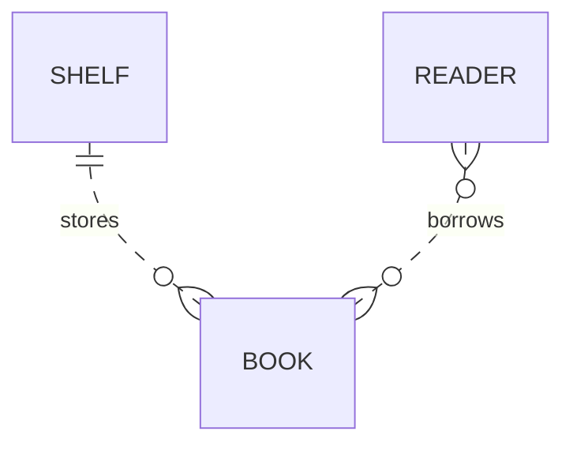
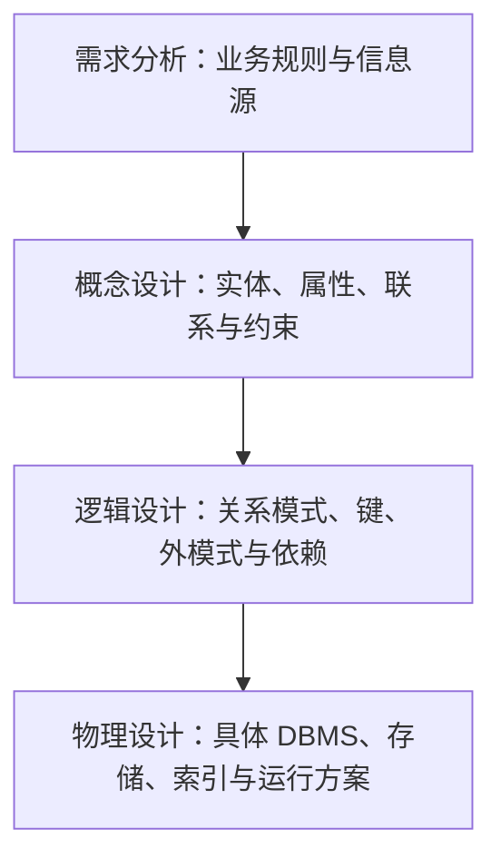

# 3 数据库建模与设计

[2 数据模型](2%20%E6%95%B0%E6%8D%AE%E6%A8%A1%E5%9E%8B.md) 介绍了用什么结构、操作和约束表示数据。本章继续追问：**给定一段业务需求，怎样设计出能准确表达业务、方便维护并能够实现的数据库？**

**本章主线**：先理解需求，区分实体、属性与联系；用 E-R 图表达业务规则；把概念模型转换成关系模式；检查键、依赖和冗余；最后结合具体 DBMS 选择存储、索引和运行方案。AI 可以辅助生成与修改模型，这条设计路径仍是判断结果是否正确的依据。

来源：《第3章 数据库建模与设计》课件。新增例子标为“说明例”，对简化表述的解释标为“补充理解”；AI 工具部分补充官方资料。关系范式在本章只作为后续理论的入口。

## 3.1 概述：从业务需求到 E-R 模型

### 3.1.1 为什么不能看到报表就直接建表

考虑课件中的折扣需求：

- 不同客户有不同折扣。
- 不同产品有不同折扣。
- 不同客户购买不同产品时，折扣还可能不同。
- 后续可能按客户类别、产品类别管理，也可能保留某个客户或产品的特殊政策。

如果折扣只由客户决定，可以先考虑把它作为客户的属性；如果折扣由“客户与产品的组合”决定，只放在客户表或产品表里，就无法表达组合之间的差异。

这里首先要确认：**一个折扣值究竟属于哪个对象或哪次联系？** 这决定了表的划分、键的选择，以及查询时应如何匹配。

单据和报表是理解业务的入口。一张销售报表可能同时展示客户姓名、产品名称、数量和金额，但它们分别来自不同对象或交易事实。若直接照着报表做一张大表，相同客户和产品的信息就会反复出现。

**数据建模**用模型表达业务中的对象、联系和规则；**数据库设计**进一步把模型落实为逻辑结构和具体实现。理解需求包括数据需求，也包括计算、修改、查询和约束等处理规则。

课件把抽象概括为四步：

1. **理解**：知道单据中的数据代表什么，怎样产生，谁使用。
2. **区分**：识别独立对象、不同属性，以及对象之间的联系。
3. **命名**：为每个对象和规则给出含义明确的名字。
4. **表达**：用统一模型把它们写成别人也能理解、检查的结构。

例如“数量”可能指采购数量、到货数量、库存量或发货数量。名字相同并不表示含义相同；命名准确的前提，是先区分业务事实。

### 3.1.2 实体、实体型与实体集

**实体（entity）**是能够相互区分的具体或抽象对象，例如借书证号为 `001` 的读者。

**实体型**描述一类实体共同具有的属性结构；**实体集**是属于该实体型的一组实体；其中一个具体对象是实体实例。

```text
实体型：读者(借书证号, 姓名, 性别, 家庭住址)
实例：  读者(001, 张三, 男, 吉林)
实例：  读者(002, 李四, 女, 黑龙江)
```

“读者”这个实体型规定可以记录哪些特征；当前登记的所有读者组成实体集。课件经常把图中的实体型或实体集简称为“实体”，阅读时需要按语境区分它与某个具体实例。

识别实体时，可以问：**这类事物是否需要独立标识、保存自己的信息，并与其他对象关联？** 例如图书馆中的读者、图书、书架，仓储系统中的供应商、零件、项目、仓库和职工。

### 3.1.3 属性：属于什么对象，取一个值还是多个值

**属性（attribute）**是实体或联系在某一方面的特征。属性名描述特征，属性值描述某个具体对象在这一特征上的取值。

| 分类维度 | 含义 | 课件例子 |
| --- | --- | --- |
| 简单／复合 | 在当前概念模型中不再拆分／由若干子属性组成 | 姓名字段；由省份、详细住址组成的家庭住址 |
| 单值／多值 | 一个实例在该属性上至多有一个值／可以有多个值 | 出生日期；多个电话号码 |
| 可空／非空 | 是否允许没有已知的属性值 | 可暂缺的联系方式；必须登记的标识 |
| 基础／导出 | 直接记录／按其他信息和规则计算得到 | 出生日期；按指定日期计算的年龄 |

这些分类可以交叉。地址是否复合，与一个人能否登记多个地址，是两个不同问题。

**说明例**：读者张三有两个电话 `138…` 和 `139…`，这是同一属性对一个实例有多个值。把它们拼成字符串 `138…,139…`，虽然只占一个文本字段，却没有直接表达“两个独立电话”的结构。

导出属性则要说明计算规则。年龄依赖出生日期和计算时点；只知道出生年份，通常不能准确得到周岁。若同时保存出生日期与年龄，还需要管理时间变化和更新一致性。

**补充理解：复合属性与 1NF。** 课件前面强调复合属性要拆分，后面的转换规则又允许把出生日期整体保存。可以统一理解为：关系中的一个属性取一个选定域中的值；日期可整体作为一个日期值，地址也可按查询需求拆成省、市、街道。是否进一步拆分取决于域的定义与业务操作。多值电话号码需要另行表达，不能把“有多个值”与“一个值有内部组成”混为一谈。

### 3.1.4 码：怎样稳定地区分实例

**码／键（key）**是能够唯一标识实体实例的属性或属性组合。例如姓名可能重复，借书证号则按业务规则唯一。

```text
读者(借书证号, 姓名, 性别, 家庭住址)
码：借书证号
```

如果书架号只在同一个房间中唯一，识别书架就需要 `(房间号, 书架号)`。这是**复合键**：两个属性共同标识实例。

逻辑设计时还要区分：能唯一标识的属性集是超键，满足最小性的超键是候选键，从候选键中选定一个作为主键。详细定义见 [2 数据模型#2.2.3 键：怎样稳定地指认一条事实](2%20%E6%95%B0%E6%8D%AE%E6%A8%A1%E5%9E%8B.md#223-%E9%94%AE%E6%80%8E%E6%A0%B7%E7%A8%B3%E5%AE%9A%E5%9C%B0%E6%8C%87%E8%AE%A4%E4%B8%80%E6%9D%A1%E4%BA%8B%E5%AE%9E)。

**键来自规则，不能只看当前样本。** 当前五个读者恰好不同名，不意味着姓名以后也不会重复。

### 3.1.5 联系及其属性

**联系（relationship）**是实体之间具有特定业务含义的对应。一条联系实例描述某些具体对象之间发生的对应；联系型描述这一类对应的结构。

```text
读者(借书证号, 姓名, ...)
图书(书号, 书名, ...)
借阅(借书证号, 书号, 借阅日期, 归还日期)
```

读者 `001` 借阅图书 `B01`，是一条借阅联系实例。借阅日期依赖“谁借了哪本书的这次借阅”，因此属于借阅联系，而不是读者或图书的一般属性。

同一对实体之间可以存在不同联系。读者“借阅”图书，与读者“拥有”图书，含义和约束都不同，因此联系需要命名。

这里的**联系**是业务语义；关系模型中的**关系**是具有固定属性结构的元组集合。联系可以转换成关系表，两个词的定义仍然不同。

### 3.1.6 联系的度与角色

**联系的度／元数**按参与联系的实体型数目区分：

| 类型 | 课件例子 | 一条事实包含什么 |
| --- | --- | --- |
| 一元／递归联系 | 零件装配；部门下设子部门 | 同一实体型的实例在不同角色之间关联 |
| 二元联系 | 读者借阅图书 | 一个读者与一本图书的对应 |
| 三元联系 | 供应商向项目供应零件 | 某供应商把某零件供应给某项目 |

**角色（role）**说明一个实体在联系中的作用。递归联系尤其需要明确角色：

```text
零件(零件号, 零件名, ...)
装配(父件号, 子件号, 数量)
```

`父件号=A，子件号=B` 表示 B 是 A 的构件。两个字段都引用零件，但含义不同；把它们都叫“零件号”，就会丢掉方向。

三元供应联系也要区分业务事实：

- `允许供应(供应商号, 零件号, 项目号)`：哪些组合允许发生。
- `已发生供应(供应商号, 零件号, 项目号, 数量, 日期)`：哪些供货事件实际发生。

许可规则和实际事件有不同的记录粒度，不能仅因涉及相同实体，就把它们视为同一个关系。

### 3.1.7 联系基数与参与约束

**联系基数（cardinality）**描述实例之间允许的对应数量。常见的 `1:1、1:N、M:N` 先说明最大数量，再用最小数量说明是否必须参与。

| 最大基数 | 业务规则 | 课件例子 |
| --- | --- | --- |
| 1:1 | 两侧每个实例至多对应另一侧一个实例 | 一个经理至多管理一个商店，一个商店至多有一个经理 |
| 1:N | 一侧一个可对应另一侧多个，反向至多一个 | 一个画家可画多幅作品，每幅作品只有一个画家 |
| M:N | 两侧都可对应多个 | 学生可选多门课，一门课可由多人选 |

**参与约束**描述是否允许某个实例完全不参加联系：

- **完全参与**：每个实例至少参加一次，最小基数至少为 1。
- **部分参与**：允许实例不参加，最小基数为 0。

使用 `(最小基数..最大基数)` 后，可以直接读出规则：

| 范围 | 含义 |
| --- | --- |
| `0..1` | 可以没有，若有则至多一个 |
| `1..1` | 必须有，而且恰好一个 |
| `0..N` | 可以没有，也可以有多个 |
| `1..N` | 至少一个，也可以有多个 |

课件中的书架—图书联系规定：

- 一个书架可以存放 `0..N` 本图书。
- 一本图书必须存放在 `1..1` 个书架上。

因此它是 1:N 联系，书架部分参与，图书完全参与。**最大基数与最小基数回答不同问题**：“最多属于一个书架”和“必须属于一个书架”需要分别表达。

**读图方向**：课件的 Chen 最小—最大标注描述贴近该实体的实例参与多少次联系；Crow’s Foot 的端点符号通常描述从另一端一个实例看，这一端可对应多少实例。先把图翻译成两个方向的业务句子，再判断约束，避免机械比较数字所在位置。

### 3.1.8 E-R 图的表达方法

#### 3.1.8.1 Chen 方法

Chen 方法把实体、属性与联系分别画成不同图形，便于展开业务语义。

| 图形／标记 | 含义 |
| --- | --- |
| 矩形 | 实体型／实体集 |
| 椭圆 | 属性 |
| 双线椭圆 | 多值属性 |
| 虚线椭圆 | 导出属性 |
| 属性名下划线 | 键属性 |
| 从复合属性引出的子椭圆 | 复合属性的组成 |
| 菱形 | 联系 |
| 联系连接的椭圆 | 联系自己的属性 |
| 连线上的角色名 | 实体在联系中的作用 |
| 双线／单线 | 完全参与／部分参与 |

基数可以写 `1、M、N`，也可以按明确约定使用箭头；课件的箭头从联系指向“一”端。还可以标最小—最大范围。**同一张图应使用一致的记号约定。**

复合键中的属性要作为一组理解。课件还用相同数字标记同一组键属性、不同数字区分不同键，不能把复合键的每个分量误认成单独的键。

Chen 图的优点是实体、属性、联系的区分直观；属性较多时，椭圆和连线会占较大空间，阅读密集模型时需要分层展示。

#### 3.1.8.2 Crow’s Foot 方法

Crow’s Foot 把实体名、键和普通属性放进同一个框，通过连线端点表达基数，通常更紧凑。

| 端点组合 | 数量范围 |
| --- | --- |
| 圆圈＋竖线 | `0..1` |
| 两条竖线 | `1..1` |
| 圆圈＋鸟爪 | `0..N` |
| 竖线＋鸟爪 | `1..N` |

圆圈表示可选，竖线表示一，鸟爪表示多。读下面的图时，从书架看图书端是 `0..N`，从图书看书架端是 `1..1`：



`SHELF`、`BOOK`、`READER` 分别表示书架、图书、读者。图省略属性；借阅的 M:N 是课件对借阅联系的抽象，具体按当前借阅还是历史借阅管理，后续仍需明确。

两种方法表达的核心都是实体、属性、联系和业务规则。IDEF1X 也是课件列举的工程化表达方法，本章主要用它说明实体级、键级和完整图的层次，未系统展开全部符号。

### 3.1.9 图书管理：模型中的一行到底表示什么

课件模型包含：

```text
图书(书号, 书名, 出版日期, 出版社)
读者(借书证号, 姓名, 年龄, 性别, 家庭住址)
书架(书架号, 房间号)
借阅：读者—图书，属性为借阅日期、归还日期
保存：书架—图书，1:N
```

设计时依次检查：每类实体有没有标识，联系有没有明确名字，日期等属性属于实体还是联系，基数与参与是否准确。

**补充理解：图书与借阅的粒度。** “书号”究竟标识一种书，还是一册可借阅的实物，决定了借阅约束。若一本书有多册，就可能需要区分书目与馆藏册；若记录历史借阅，同一读者可以多次借同一册，仅用 `(借书证号, 书号)` 就不能区分每次借阅。

这里关键的设计问题是：**表的一行记录一个对象、一个配对，还是一次事件？** 先回答这一问题，才能选择键。

### 3.1.10 折扣政策：空值的业务含义

课件的折扣表同时包含具体政策和较宽泛政策，例如：

| 折扣号 | 时间区间 | 地区 | 产品类 | 客户群 | 折扣 |
| --- | --- | --- | --- | --- | --- |
| Z01 | 2003/05–2003/07 | 黑龙江 | J1 汽车 | 经济客户 | 0.90 |
| Z02 | 2003/05–2003/07 | — | J1 汽车 | 一般客户 | 0.94 |
| Z03 | 2003/05–2003/07 | — | — | — | 0.98 |

“—”表示课件中的空白标记。要把它落实成数据库值，首先要解释业务含义：是信息未知、不适用，还是对该维度不加限制？

**补充理解**：若空白表示“不限地区／产品／客户群”，一笔交易可能同时匹配具体政策和全局政策。除了允许字段为空，还必须定义政策选择规则，例如按哪些维度判定更具体，同等条件下怎样处理冲突，以及时间区间能否重叠。课件没有给出唯一的优先级答案。

SQL 的 `NULL` 不会自动表示“匹配所有值”。查询若只使用普通等值条件，会遗漏空值对应的政策；若把所有空值都当成通配，又可能选出互相冲突的政策。

**某个实体可以不参与联系**，是实体层面的参与约束；**某条政策中的某个维度为空**，是记录层面的取值与语义问题。二者需要分别建模，不能从“部分参与”直接推出“联系表的外键都允许空”。

## 3.2 数据库设计中的抽象

### 3.2.1 三个世界与多层抽象

数据库设计从现实中的对象与活动出发，经过人的理解，再转换成计算机中的结构。

| 层次 | 关注的问题 | 产品构成例子 |
| --- | --- | --- |
| 现实世界 | 实际有什么事物、活动与规则 | 一个产品由哪些零部件构成 |
| 信息／观念世界 | 用哪些概念表达相关事实 | 零件、父件、子件、构成联系及数量 |
| 计算机世界的逻辑层 | 用选定数据模型怎样表达 | 零件表、产品结构表、键与外键 |
| 计算机世界的物理层 | 数据怎样存储和访问 | 文件组织、索引、存储空间 |

```text
零部件清单(零部件码, 零部件名称, ...)
产品结构(父件号, 子件号, 数量, ...)
```

这是从“构成关系”的概念抽象到关系模式的结果。逻辑层保留父件、子件的语义，物理层再决定如何高效保存和访问这些记录。

信息世界可以经过多层抽象。例如先识别产品和零件，再进一步归纳它们共有的物项特征。抽象层次取决于需要表达的问题。

### 3.2.2 型与值：有限描述怎样覆盖不断增加的数据

**型（type）**描述一类对象共有的结构或取值规则；**值（value）**是在这些规则下的一个具体取值。

```text
学生姓名：张三、李四、王五、……
课程名称：计算机原理、数据库系统原理、离散数学、……
```

实际姓名和课程可以不断增加，但可以用“学生姓名”“课程名称”这类有限描述组织它们。新增一个姓名值，一般不需要新增一种模型。

“型”和“值”是相对于层次而言的：

| 较高层的规则／结构 | 在该层规则下的具体对象 |
| --- | --- |
| 关系数据模型 | 某个具体关系模式，如 `读者(...)` |
| 关系模式 | 某一时刻的关系实例 |
| 实体型 | 某个实体实例 |
| 程序中的类 | 该类的对象 |

这些对子有相似的抽象关系，但各自属于不同体系，不能直接互换。例如“关系模型”与“读者关系模式”不是同一层对象。

### 3.2.3 模型与元模型

**模型**用一组对象和规则描述某个系统；**元模型（metamodel）**规定模型可以由哪些构件组成，以及这些构件如何组织。

**说明例**：

- 图书管理 E-R 图是一个具体模型：含读者、图书、书架和借阅联系。
- 用于描述 E-R 模型构件的规则，可以作为它的元模型：允许实体型、属性、联系、键和基数等构件。
- 借书证号为 `001` 的读者，是具体模型所描述的一个实例。

课件同时强调“方法论”和“应用方法论”：理解—区分—命名—表达是一套建模方法；用它分析某家企业的库存业务，是方法的一次应用。

统一模型的意义在于让不同人使用明确的概念和表达约定交流。画法一致只是其中一部分，同名对象的业务含义也要一致。

### 3.2.4 怎样判断抽象是否合适

课件用“抽象后能否具体化”检验理解：从现实提取信息，再依据模型解释回去，是否还能表达原来要处理的对象与规则？

**补充理解**：抽象会有目的地舍弃细节，检验重点是业务相关信息能否恢复，而不是复原现实中的全部细节。

**说明例**：若只保存“产品号—零件号”，可以回答某产品用了哪些零件，却不能回答每个零件用了几个。若装配业务要计算需求量，模型就必须保留装配数量。

可以用三个问题检查：

1. 需要保存的业务事实，是否都有明确位置？
2. 业务禁止的状态，是否被约束排除？
3. 需要回答的查询，能否从模型中的数据推导出来？

## 3.3 数据库设计的过程

### 3.3.1 四个阶段及其提交物



| 阶段 | 主要工作 | 提交物 |
| --- | --- | --- |
| 需求分析 | 理解业务、数据来源、处理规则与性能需求 | 需求分析报告、源清单、属性清单及定义 |
| 概念数据库设计 | 从需求中识别实体、属性、联系，统一业务语义 | 概念设计报告、E-R／IDEF1X 图及定义文档 |
| 逻辑数据库设计 | 将概念模型转换成选定数据模型的模式，检查结构与约束 | 逻辑设计报告、全局模式和用户外模式 |
| 物理数据库设计 | 结合具体 DBMS 选择实现与访问方案 | 物理设计报告、数据库定义及运行配置 |

这些阶段会相互反馈。转换时发现一个折扣值找不到确定的所属对象，应回到需求与概念设计重新确认。

**补充理解：DDL 与物理设计。** `CREATE TABLE` 可以表达字段、主键、外键等逻辑结构，也可能带有依赖具体 DBMS 的存储选项。语句本身不等于物理模型；应按它描述的是业务结构还是存储实现区分层次。

### 3.3.2 需求分析：源清单、属性清单与处理规则

需求分析要理解企业怎样工作，包括部门—岗位划分、数据处理流程以及性能需求。

**信息源**是用来发现需求的材料，包括单据、报表、原始表格，也包括查询和管理要求。只收集已有报表，可能遗漏“查询未到货订单”这类尚未体现在表单上的需求。

课件的主要文档各回答一个问题：

| 文档 | 需要说明什么 |
| --- | --- |
| 源清单 | 有哪些信息源，由哪个岗位产生或使用，承担什么用途 |
| 属性清单 | 不同信息源中出现哪些数据项，名称和含义如何统一 |
| 属性定义表 | 数据项的类型、取值范围、单位、编码、填写与计算规则 |

对每个源，进一步分析：

- **What—How**：处理什么数据，如何由基础数据形成结果。
- **Who—When—Where**：谁执行操作，在什么时间与场景执行。
- **约束与变化**：哪些值合法，哪些修改允许，未来可能有哪些扩展。

课件举“成绩只能取五个等级”“工资只能升不能降”“年龄在某个区间内”等例子，它们是特定业务规则，需要在对应系统中确认。

还要区分两类约束：成绩取值范围可以检查当前记录；“工资只能升不能降”要比较修改前后的值，属于状态变化的规则。

数据流图、功能图等可以帮助追踪数据怎样流转，概念模型则进一步说明这些数据代表什么对象与联系。

### 3.3.3 概念设计：从局部需求形成全局模型

概念设计在需求分析基础上，发现不同信息源中隐藏的共同实体和本质联系。例如客户姓名出现在多个报表中，可能都属于同一个客户实体，而不是多个独立“报表客户”。

#### 3.3.3.1 两种设计思路

| 思路 | 过程 | 需要注意什么 |
| --- | --- | --- |
| 先局部后全局 | 分别建立各部门／业务范围的局部模型，再合并 | 找出公共实体，处理冲突和冗余 |
| 先全局后局部 | 先建立统一概念模型，再为用户设计局部视图 | 全局需求是否充分，局部视图是否覆盖岗位用途 |

局部设计通常依次确定范围、定义实体、定义联系、分配属性。合并时先确认公共实体，逐个整合局部模型，检查冲突，最后优化全局模型。

这里的局部业务视图表达用户关心的对象与规则；逻辑阶段还要把用户外模式落实为适当的数据库视图或接口。

#### 3.3.3.2 三类冲突

| 冲突 | 表现 | 课件例子与处理方向 |
| --- | --- | --- |
| 属性冲突 | 类型、范围、编码或单位不同 | 学号编码不同；重量使用磅或千克，需要统一定义或转换 |
| 命名冲突 | 同名异义或异名同义 | 同名“数量”实际指不同事实；同一对象在部门间名称不同 |
| 结构冲突 | 对象、属性或联系的抽象不一致 | 职工在一处作为实体，在另一处作为属性；相同联系的基数不同 |

不能仅靠改名消除结构冲突。例如两个部门都用“客户”，一个按个人管理，另一个按公司账户管理，需要先确定是否为同一类对象，以及二者怎样关联。

全局优化包括合并实体类型、消除冗余属性和冗余联系。判断冗余要基于业务语义：能否从其他已保存信息稳定地得到它，以及删除后是否失去独立事实。

#### 3.3.3.3 不同详细程度的图与文档

课件区分：

- **实体级图**：展示实体及其联系，便于讨论范围。
- **键级图**：增加标识和引用，便于检查关联。
- **完整图**：进一步列出全部属性，便于详细评审。

还应配合实体清单、实体定义表、实体—联系矩阵、实体—属性矩阵。图展示整体结构，定义文档补充字段含义和图上容纳不下的处理规则。

### 3.3.4 仓储管理：走完一次概念建模

课件需求包括管理零件、零件来源、零件去向、多个仓库，以及管理仓库的职工。

#### 3.3.4.1 识别实体与属性

| 实体 | 关键标识 | 课件中的其他属性 |
| --- | --- | --- |
| 供应商 | 供应商号 | 姓名、地址、账号、电话号 |
| 零件 | 零件号 | 名称、规格、描述、单价 |
| 项目 | 项目号 | 项目预算、开工日期 |
| 仓库 | 仓库号 | 面积、电话号 |
| 职工 | 职工号 | 姓名、年龄、职称 |

为什么零件属性中没有直接列“供应商”和“仓库”？因为一个零件可能由多个供应商供给，也可能存放在多个仓库。这些对应需要单独表达。

#### 3.3.4.2 识别联系与联系属性

| 联系 | 参与对象 | 需要保存的事实 |
| --- | --- | --- |
| 供应 | 供应商、零件、项目 | 谁向哪个项目提供哪种零件，供应量是多少 |
| 库存 | 仓库、零件 | 哪种零件存在哪个仓库，库存量是多少 |
| 工作 | 仓库、职工 | 职工在哪个仓库工作 |
| 领导 | 职工、职工 | 哪个职工领导哪个职工，区分领导与属下角色 |

供应量属于供应组合，库存量属于仓库—零件组合。把库存量作为零件的一般属性，会丢掉“在哪个仓库”的区分。

接着确认基数。课件把库存画为 M:N，把供应画为多元联系，工作和领导画为 1:N。还需结合具体业务确认最小参与数量、是否允许跨仓库工作，以及领导关系能否形成环等约束。

**需求核对**：课件的需求写作“哪个职工管理哪个仓库”，图中联系则命名为“工作”。工作地点与管理责任可能有不同含义。若仓库负责人需要独立管理，应明确仓库—职工的管理联系，并确认每个仓库是否必须有、是否至多有一名负责人；不能仅凭工作联系就认定管理需求已覆盖。

#### 3.3.4.3 覆盖需求与规范检查

建模步骤可以复述为：

1. 找出需要独立管理的实体。
2. 为每个实体分配重要属性。
3. 标明每个实体的码。
4. 定义联系、角色、联系属性与基数。
5. 回到每条需求，检查模型能否表达，并检查画法是否一致。

例如“查询某项目的零件来自哪个供应商”，需要供应商—零件—项目的共同关联。只分别画“供应商有零件”和“项目使用零件”，未必能回答这个问题。

### 3.3.5 逻辑设计：E-R 图转换为关系模式

**关系模式**规定关系名、属性及其域和约束，常写为：

$$
R(A_1:D_1, A_2:D_2,\ldots,A_n:D_n)
$$

其中 $A_i$ 是属性，$D_i$ 是对应域。只列名称与属性时，简写为 $R(A_1,\ldots,A_n)$。转换时既要保存事实，也要保留标识、基数和参与等规则。

#### 3.3.5.1 实体、键与普通属性

每个实体型通常形成一个关系，属性形成列，标识形成候选键，再选定主键。

```text
图书(书号, 书名, 出版日期, 出版社)
读者(借书证号, 姓名, 年龄, 性别, 家庭住址)
书架(书架号, 房间号)
```

书架的键仍取决于编号规则；若只在房间内唯一，就需要复合键。建表后再加一个自动编号，也不能省略原有业务唯一性规则。

#### 3.3.5.2 复合属性与多值属性

复合属性可以按用途拆成分量，也可以在选定域中整体保存。课件给出两种出生日期表示：

```text
学生(学号, 姓名, 出生年, 出生月, 出生日)
学生(学号, 姓名, 出生日期)
```

多值属性则通常与所属实体的键组成新关系：

```text
学生(学号, 姓名)
选课(学号, 所选课程号)
```

**说明例**：多个电话号码可以表示为 `读者电话(借书证号, 电话号码)`，一行记录一个读者的一个电话。若同一读者同一电话只保存一次，可以用二者组合作为主键；借书证号同时是引用读者的外键。

若某个多值项目还有独立属性或与其他实体的联系，应进一步把它作为实体或联系来建模。例如选课若还包含课程信息和成绩，就应明确学生、课程和选修联系。

#### 3.3.5.3 一对一联系

课件给出两种常见转换：

- 双方都部分参与时，单独建立联系表。
- 一方完全参与时，把另一方的键放入完全参与一方的表中。

部门必须有一位负责人，而职工可以不负责部门，可以表示为：

```text
职工(职工号, ...)
部门(部门号, 部门名, 负责人职工号)
```

**补充理解：外键还不够。** 要表达“一人至多负责一个部门”，`负责人职工号` 还要有唯一性约束；要表达“每个部门必须有负责人”，还要有非空约束。

| 约束 | 对应规则 |
| --- | --- |
| 外键引用职工 | 负责人必须是已存在的职工 |
| `UNIQUE` | 同一职工不能同时负责两个部门 |
| `NOT NULL` | 每个部门都必须指定负责人 |

若单独建立 1:1 联系表，两端各自都应满足唯一性。仅把两端组合作为复合主键，只能禁止重复配对，仍然允许某一端与多个不同对象配对。

如果 1:1 的双方都完全参与，还需保证另一侧每个实例也被引用。单侧的非空外键加唯一性，只保证这一侧恰好对应一个对象、对方至多被引用一次，不自动保证对方全部参与。

#### 3.3.5.4 一对多联系

**把“一”端的键放到“多”端作为外键**，联系的属性也可以随之保存。

```text
教师(教工号, ...)
学生(学生号, 学生名, 班主任教工号)
```

每名学生只有一个班主任，所以一个字段足以表达；同一教师编号可以出现在多名学生记录中，表达“一位教师负责多名学生”。

“多”端是否完全参与，决定外键是否允许为空。若要求每名学生都必须有班主任，则该字段应非空。

递归 1:N 同样处理：

```text
职工(职工号, 职工名, 部门号, 领导职工号)
```

`领导职工号` 引用同一职工表，字段名保留领导角色。普通自引用外键只检查被引用职工存在，防止自己领导自己、禁止领导环等规则还需另外表达。

#### 3.3.5.5 多对多联系

M:N 联系通常形成独立关系，包含双方实体的键及联系属性。

```text
学生(学生号, ...)
课程(课程号, ...)
选修(学生号, 课程号, 成绩)
```

若每个学生—课程配对只保存一条选修记录，可以以 `(学生号, 课程号)` 为主键，二者分别引用学生和课程。

**说明例：需要保留重复事件时。** 图书历史借阅可以表示为：

```text
借阅记录(借阅号, 借书证号, 册号, 借阅日期, 归还日期)
```

这里假定 `册号` 标识可借阅实物，`借阅号` 标识一次借阅。若再次借阅同一册，应新增事件记录；新增编号解决事件标识问题，仍要单独定义当前借阅、归还状态等业务约束。

递归 M:N 则保留两端角色：

```text
零件(零件号, ...)
构成(父零件号, 子零件号, 数量)
```

#### 3.3.5.6 多元联系与记录粒度

多元联系通常形成独立关系，包含参与实体的键及联系属性。

```text
供应(项目号, 供应商号, 零件号, 数量)
```

课件对比两类标识方案：

| 方案 | 能区分的记录 | 需要确认的规则 |
| --- | --- | --- |
| 参与实体的键组成主键 | 同一项目—供应商—零件组合至多一行 | 该行是否记录组合层面的总量 |
| 新增条目号作为主键 | 同一组合可以有多个不同条目 | 条目是否代表一次供货，是否还需日期等字段 |

联系中的“一”端限制也可能使参与键的某个子集已经能够唯一标识记录。不能机械地把所有外键都认定为最小候选键。

**补充理解：多元联系拆成二元联系的条件。** 课件提到可转换为多个二元联系。若只是把三元事实投影成两两配对，可能丢掉“这三个对象在同一条事实里共同出现”的信息。

**说明例**：实际供应关系只有：

```text
(S1, P1, J2)
(S1, P2, J1)
(S2, P1, J1)
```

分别取供应商—零件、供应商—项目、零件—项目后，三张表中都存在 `(S1,P1)`、`(S1,J1)`、`(P1,J1)`。连接它们会得到原来不存在的 `(S1,P1,J1)`，产生虚假组合。

一种保留信息的转换是引入“供应记录”作为关联实体，以同一个记录标识连接供应商、零件和项目。若直接分解成配对关系，则需证明分解能够无损恢复原关系。

#### 3.3.5.7 转换后的约束检查

| 概念规则 | 常见落实方式 |
| --- | --- |
| 唯一标识一个对象／事件 | 主键或候选键约束 |
| 引用的对象必须存在 | 外键 |
| 本表记录必须引用一个对象 | 外键字段非空 |
| 一个被引用对象至多对应一条本表记录 | 外键上的唯一性约束 |
| 数值或日期关系满足业务规则 | 适当的检查约束或其他约束实现 |
| 每个父对象至少有一条子记录 | 需要进一步设计跨表约束及操作流程 |

例如在图书表上设置非空的书架外键，可以保证每本图书有书架；它不能保证每个书架至少有一本图书。**完全参与的保证要看约束落在哪一侧。**

用户外模式则按岗位需要展示全局结构的一部分。例如读者视图、馆员视图可以包含不同字段与查询结果，而不必各自保存一份重复的基础事实。

### 3.3.6 不合理设计为什么产生冗余和异常

课件把学号、姓名、班级、班主任、班主任职称放在同一张表里。一个班级有多名学生，班主任和职称就被重复保存多次。

若某班主任的职称改变，需要修改该班所有学生行；只修改其中几行，就会出现同一班主任有不同职称的矛盾。

**数据依赖**描述属性取值之间必须满足的联系。以这类业务规则为依据，可以说明冗余来自哪里。

**补充理解：函数依赖。** 在关系模式中，$X\to Y$ 表示任意合法关系实例中，两个元组只要在属性集 $X$ 上取值相同，就必须在 $Y$ 上取值相同。

若一名学生属于一个班、一个班只有一个班主任，且职工号唯一确定职称，可以写：

$$
\text{学号}\to\text{班级号},\qquad
\text{班级号}\to\text{班主任职工号},\qquad
\text{职工号}\to\text{职称}
$$

这些依赖是业务规则，不是从少量样本中观察到的偶然规律。

异常可以统一理解为：**把不同粒度的事实捆绑在一行中，导致无法独立维护。**

| 异常 | 发生什么 | 课件场景 |
| --- | --- | --- |
| 更新异常 | 同一事实有多份，修改后可能不一致 | 同一班主任职称重复在多名学生行中 |
| 插入异常 | 新事实需要依附另一类尚不存在或尚不完整的事实 | 职工—级别—工资表中，难以独立登记新级别的工资标准 |
| 删除异常 | 删除一类事实时，顺带丢失另一类事实 | 删除某系最后一名学生，也丢掉系名称和系主任 |

课件还用学生尚未确定系别的情况说明一张大表把学生事实与系事实耦合的问题。分开记录后，可以先保存学生，并按业务决定其系别引用是否允许暂空；也可以独立保存尚无学生的系。

**说明例：分开维护不同事实。**

```text
职工(职工号, 姓名, 级别)
工资标准(级别, 标准工资)
```

这里假定标准工资由级别决定。新增一个级别不需要先虚构一名职工；删除最后一名该级别职工，也不会删除工资标准。

如果保存的是个人实际工资，受到岗位、绩效或合同等因素影响，就不能直接假定 `级别→实际工资`。分解依据必须与真实业务一致。

课件称外键重复出现属于“受控冗余”。可以理解为：多个学生引用同一个班级号，是表达联系所需的标识重复；把班主任姓名、职称等事实反复复制，则额外增加一致性维护负担。两者的维护含义不同。

### 3.3.7 规范化、分解与折中

**规范化**依据数据依赖和关系范式检查、组织关系模式，减少某些冗余及由此产生的异常。它是设计者对结构的分析工作。

课件在此给出理论路线，没有展开各范式的完整定义与证明：

| 理论部分 | 本章需要建立的认识 |
| --- | --- |
| 数据依赖 | 包括函数依赖、部分／完全函数依赖、传递函数依赖、多值依赖、联结依赖 |
| 关系范式 | 包括 1NF、2NF、3NF、BCNF、4NF、5NF，规定不同层次的结构条件 |
| 模式分解 | 把一个关系模式分成若干模式，并检查信息与约束能否保留 |

**补充理解：分解的两个重要问题。**

- **无损连接**：将合法原关系投影到分解后的模式，再连接，能否准确恢复原关系，避免丢失信息或出现虚假组合？
- **保持依赖**：原来需要保证的依赖，能否仅通过检查各分解关系上的依赖来保证，而不必先把它们连接起来？

所以“拆得越多越好”不是设计原则。既要去除不必要的重复，也要保留完整业务事实和可管理的约束。

有时为了查询效率保留可计算或可连接得到的信息，称为**反规范化**。采用这类折中时，要明确重复保存哪些事实、由谁同步更新、怎样避免不一致，以及是否有实际性能需求支持。

**DBMS 可以执行已定义的键、外键等约束，但不会因为建表成功，就自动证明模式符合业务或满足规范化要求。** 合理设计与约束实现需要共同完成。

### 3.3.8 物理设计：在具体 DBMS 上实现和运行

物理设计以逻辑设计为输入，结合具体 DBMS 与工作负载决定数据怎样存储、访问和维护。

| 工作 | 要回答的问题 |
| --- | --- |
| DBMS 选型 | 哪个系统支持需要的模型、约束、规模和运行要求 |
| 存储组织 | 记录与文件怎样组织，采用什么存储结构 |
| 访问方式与索引 | 常见查询按哪些条件查找，怎样减少访问成本 |
| 容量评估 | 数据、索引及增长预计需要多少空间 |
| 约束实现 | 逻辑规则用哪些声明式约束或触发器等机制落实 |
| 视图与访问控制 | 不同用户看到哪些数据，能执行哪些操作 |
| 备份与恢复 | 怎样备份，故障后恢复到什么状态 |

课件列举堆文件、散列文件、B-Tree 文件等存储方式；具体选择依赖 DBMS 的实现与操作需求。索引可以降低某些查询的访问成本，同时占用空间并增加更新维护成本。

视图、安全与完整性规则在前面阶段就应确定含义，在此阶段选择具体实现。触发器只是可能的机制之一，能够用合适的主键、外键、唯一性或检查约束表达的规则，应先按其语义选择实现。

物理设计的结果不仅是建表语句，还包括访问、容量和运行维护方案。存储、索引、查询优化等机制会在后续 DBMS 实现内容中展开。

## 3.4 AI 辅助数据库建模与设计

### 3.4.1 AI 可以辅助哪些任务

**AI 辅助数据库建模与设计**是根据自然语言需求和已有模型上下文，辅助识别实体、推断字段、分析联系、生成约束，并输出可编辑结构与数据库定义的过程。

课件列出五类任务：

| 任务 | 输出 | 需要检查什么 |
| --- | --- | --- |
| 实体识别 | 候选实体／表 | 对象是否需要独立管理，是否遗漏业务事件 |
| 字段推断 | 属性、类型和域 | 字段含义、单位、空值和计算规则是否明确 |
| 关系识别 | 联系、角色和基数 | 最小／最大参与数量是否来自需求 |
| 约束生成 | 主键、外键等规则 | 是否保留业务唯一性和完整性 |
| DDL 输出 | SQL 建表语句 | 语法、目标 DBMS 支持及实际行为是否正确 |

它的作用是减少从业务语言到结构表达的重复工作，并辅助比较方案。判断质量仍要回到需求、记录粒度和约束。

### 3.4.2 三个辅助层次

1. **自然语言到 Schema**：根据需求生成初步表、字段、键与联系。
2. **上下文感知的设计优化**：结合已有模式、命名习惯、索引及查询，检查一致性并提出修改。
3. **智能体协作建模**：不同角色分别检查规范化、约束或性能，再比较方案中的取舍。

多个角色可以提供不同检查视角，最终仍需共享同一组明确业务规则。若“书号”含义未确定，增加评审角色也不能自动消除需求歧义。

### 3.4.3 课件中的工具路线

| 路线 | 示例 | 侧重点 |
| --- | --- | --- |
| 开发环境集成 | VS Code 的 MSSQL Schema Designer 与 GitHub Copilot | 自然语言修改、图与代码联动、差异评审 |
| 专业建模流程 | Visual Paradigm DB Modeler AI | 从业务描述逐步走到模型、SQL、规范化和测试 |
| 轻量建模方案 | [DB Designer 作者仓库](https://github.com/dddcp/db-designer) | 结合项目上下文生成、修改结构，复用设计偏好并提出索引建议 |
| 本地模型检查与转换 | MERISOR | 检查模型与规范化问题，转换逻辑模型并导出 SQL；AI 辅助可选 |

微软官方文档确认 MSSQL Schema Designer 集成 Copilot，可通过自然语言创建、修改模式，逐项接受或撤销建议，并查看待应用差异；还可生成 Prisma、Sequelize、TypeORM、Drizzle、SQLAlchemy 和 Entity Framework Core 的迁移脚本。[Microsoft Learn](https://learn.microsoft.com/en-us/sql/tools/visual-studio-code-extensions/mssql/mssql-schema-designer-copilot?view=sql-server-ver17)

Visual Paradigm 官方给出的七步流程是：

```text
业务描述 → 领域类图 → E-R 图 → 初始 SQL 模式
        → 规范化 → SQL Playground → 报告与导出
```

其产品说明将规范化过程列为 1NF 到 3NF，并提供示例数据与交互式 SQL 测试。这是工具的工作流说明；生成方案仍要通过业务样例检查。[DB Modeler AI 官方说明](https://www.visual-paradigm.com/features/dbmodeler-ai/)

**工具表述校准**：课件把 MERISOR 概括为“本地、无 AI”。可查到的同名项目在维护者发布的 `0.11.0` 版本说明中，将本地模型检查与转换作为核心流程，同时提供可选的 OpenRouter AI 助手。因此本节用它说明“规则检查与生成式辅助可分开”，不把“整个工具没有 AI”作为固定特征。[MERISOR 维护者发布说明](https://pypi.org/project/merisor/0.11.0/)

**补充理解**：生成式 AI 提出候选结构，确定性规则检查已明确的问题，二者可以配合。比如规则能检查缺失主键或命名不一致，业务人员则要确认“同一读者能否重复借同一册”这类语义。

### 3.4.4 用图书借阅需求检查 AI 输出〔说明例〕

给定明确需求：

> 管理读者、书目和馆藏册；一本书目有多册。记录每次借阅，保留历史；同一读者可以多次借同一册。每次借阅必须对应一个读者和一册图书，尚未归还时归还日期为空。

按本章知识检查生成结果：

1. **实体与粒度**：是否区分书目、馆藏册和借阅事件？
2. **键**：馆藏册与借阅事件能否各自唯一标识？重复借阅会不会发生键冲突？
3. **联系**：馆藏册是否引用所属书目，借阅是否引用读者和馆藏册？
4. **参与**：每次借阅的读者与馆藏册引用是否非空？
5. **时间规则**：归还日期是否可以为空，非空时是否不早于借阅日期？
6. **业务状态**：若要求同一册同时最多一条未归还记录，这条规则是否被实际保证？

再用具体样例尝试：新增读者但不借书；同一册归还后再借一次；引用不存在的读者；登记早于借阅日期的归还日期。

“图看起来合理”“DDL 能执行”和“业务规则被正确保证”是逐步需要检查的三个结果。

### 3.4.5 研究案例与证据范围

课件提到 AI 对概念模式的描述、精炼、解释，以及用自然语言检查组合关系的语义。

可查到的相关原始研究是 Inakura 等的 *Applying Text Generation AI to Assist Categorical Database Construction from Institutional Regulations*（2025）。其摘要介绍从机构文件中提取概念、构成功能关系，并通过自然语言检查复合态射的语义一致性，辅助构造范畴论数据库。[原始论文页面](https://iaiai.org/letters/index.php/lir/article/view/419)

**补充理解**：模型生成的解释可以帮助发现语义冲突，但“能够生成一句通顺的话”或“拒绝生成一句话”，本身不等于形式证明。仍需回到原始规则，检查关系的含义和允许的组合。

课件另称某项 2026 年用户研究使任务时间缩短 `73.1%`、错误率降低 `90%`、NASA-TLX 认知负荷评分平均下降 `43.5` 分，但未给出作者、题目、样本和出处，核验时也未定位到对应原始研究。**这些数值保留为课件待核验信息，不作为 AI 辅助建模的一般效果结论。**

## 本章复习总表

| 对象／阶段 | 核心问题 | 应能回答的自测 |
| --- | --- | --- |
| 实体与实例 | 一类对象的结构与具体对象怎样区分 | “读者”和“借书证号 001 的读者”分别是哪一层对象？ |
| 属性 | 值属于哪个对象，是否多值或导出 | 库存量为什么属于仓库—零件组合？ |
| 键 | 一行记录的事实能否唯一标识 | 历史借阅为何不能总用读者号＋书号作键？ |
| 联系与角色 | 谁与谁以什么方式关联 | 父件号与子件号都引用零件，为什么要用不同名字？ |
| 基数与参与 | 最多多少，最少多少 | 一个空书架与一本没有书架的图书，分别是否满足课件规则？ |
| 图形表达 | 记号对应哪些业务规则 | 怎样把 Crow’s Foot 两个端点读成两个方向的句子？ |
| 抽象 | 是否保留业务所需的信息与规则 | 产品结构缺少数量后，哪些查询无法回答？ |
| 需求分析 | 数据从哪里来，怎样处理 | 查询需求为什么也是信息源？ |
| 概念设计 | 多份局部需求怎样统一 | 同名异义、单位不同、实体／属性不同分别属于哪类冲突？ |
| 1:1 转换 | 引用、唯一性和非空怎样配合 | 部门有负责人外键后，为何还需要唯一性约束？ |
| 1:N／M:N 转换 | 外键放在哪，是否需要联系表 | 学生—班主任与学生—课程为何采用不同结构？ |
| 多元联系 | 是否保留共同出现的事实 | 三张两两配对表为何可能连接出虚假供应组合？ |
| 冗余与异常 | 不同粒度事实能否独立维护 | 删除最后一名职工后，工资标准为何应继续存在？ |
| 规范化与分解 | 依赖与信息能否保留 | 无损连接与保持依赖分别检查什么？ |
| 物理设计 | 如何在具体 DBMS 上实现和运行 | 逻辑表结构确定后，为什么仍要设计索引、容量和恢复方案？ |
| AI 辅助 | 生成结果如何接受检查 | 重复借阅样例能发现哪些键或粒度错误？ |

读完应能从一段需求出发，画出实体、联系、角色与基数，再转换成关系模式，并说明每个键和约束对应哪条业务规则。
