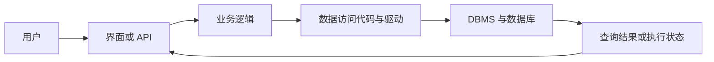

# 4 数据库应用开发

[3 数据库模型](3%20%E6%95%B0%E6%8D%AE%E5%BA%93%E6%A8%A1%E5%9E%8B.md) 解决“业务事实怎样组织成数据库”。本章继续追问：**用户的一次业务操作，怎样通过应用程序变成数据库请求，再得到正确、及时、可理解的结果？**

**本章主线**：应用负责交互与业务流程，DBMS 负责数据管理；双方通过连接、SQL、参数和结果结构协作。开发时先明确接口与事务，再决定职责怎样分层、组件怎样部署，最后用工具链完成测试、发布和维护。Notebook 则把连接、查询和分析过程缩成一个可以逐步观察的小实验。

来源：《第4章 数据库应用开发》课件。新增例子标为“说明例”，对简化表述的解释标为“补充理解”；软件接口和部分概念补充官方资料。课件末尾的 AI 内容主要涉及 SQL 生成和报错解释。

## 4.1 数据库应用的特性

### 4.1.1 应用程序在用户与数据库之间做什么

**数据库应用**是围绕数据库实现业务操作的软件。它把用户的业务意图转换为数据请求，并把执行结果转换成用户能够理解的界面或反馈。

考虑“查看数据库课程中成绩不低于 80 分的学生”：

1. 用户在界面选择课程，输入最低成绩。
2. 应用检查输入和访问权限，确定要执行的业务操作。
3. 数据访问代码建立连接，提交 SQL 与参数。
4. DBMS 执行查询，返回结果集。
5. 应用读取结果，组织为表格、页面或 API 响应。



课件把应用的作用归纳为：提供业务操作界面，用 SQL 表达数据操作，展示操作结果。对于插入、更新和删除，结果也可以是影响行数、生成的标识或错误状态，不一定总是一张查询表。

用户通常用业务语言表达“查成绩”“办理借阅”“修改订单”，应用则要明确这些操作需要哪些数据、哪些约束，以及失败后怎样反馈。

### 4.1.2 数据库表与用户业务表为什么不同

课件从两种用途区分表的特征：

| 对象 | 课件概括 | 理解方式 |
| --- | --- | --- |
| 数据库基础表 | 专一性、全局性、联系性 | 分别保存相对明确的事实，供多个应用共享，通过键关联 |
| 用户业务表／报表 | 综合性、局部性、多样性 | 为某个岗位或任务组合信息，按不同条件和形式展示 |

**说明例**：基础表分别保存 `Student`、`Course`、`SC`，教师希望看到的却是“姓名、课程名、成绩”。这个展示结果需要连接三张表，再筛选当前课程和成绩范围。

```sql
SELECT s.Sname AS student_name,
       c.Cname AS course_name,
       sc.Grade AS grade
FROM Student AS s
JOIN SC AS sc ON sc.Sno = s.Sno
JOIN Course AS c ON c.Cno = sc.Cno
WHERE c.Cname = :course_name
  AND sc.Grade >= :min_grade
ORDER BY s.Sno;
```

这里使用 SQLAlchemy 文本 SQL 的命名参数写法。SQL 结构固定，课程名和分数作为参数另行传入。

业务表可以是查询结果、视图或页面中的表格，不要求再保存一份同样的数据。关系代数与连接的详细机制见 [2 数据模型](2%20%E6%95%B0%E6%8D%AE%E6%A8%A1%E5%9E%8B.md)。

### 4.1.3 连接、语句与结果集

课件用 JDBC 展示应用访问数据库的基本对象：

| 对象 | 承担什么职责 |
| --- | --- |
| Driver／驱动 | 实现访问某类数据库所需的接口与通信适配 |
| Connection／连接 | 提供一次数据库会话的访问上下文，承载语句执行与事务操作 |
| Statement／语句对象 | 提交 SQL；参数化语句还负责绑定输入值 |
| ResultSet／结果集 | 提供查询返回的列信息和结果行，供应用读取 |

访问过程可以概括为：准备驱动与配置 → 获取连接 → 执行语句或调用存储过程 → 读取结果／状态 → 处理事务与异常 → 释放资源。

连接配置通常包括数据库类型、主机、端口、数据库名及身份凭据。应用还需要知道结果的字段结构，以及操作成功、失败的含义。

**补充理解：课件中的旧驱动写法。** 课件使用 `Class.forName("com.mysql.jdbc.Driver")`。MySQL Connector/J 的驱动类名已改为 `com.mysql.cj.jdbc.Driver`；支持 JDBC 自动注册且驱动已正确加入运行环境时，通常不必手动加载。学习重点是区分“驱动可用”“成功连接”和“查询得到预期结果”这几个状态。[Connector/J 驱动类名](https://dev.mysql.com/doc/connector-j/en/connector-j-reference-driver-name.html)、[Connector/J 概述](https://dev.mysql.com/doc/connector-j/en/connector-j-overview.html)

### 4.1.4 应用与数据库怎样保持可对接

**可对接性**要求应用发出的操作能够在目标数据库执行，返回的结构也符合应用预期。

例如应用期望结果有 `student_name、course_name、grade` 三列。若 SQL 仍能执行，但列名改为 `name、title、score`，按原字段读取的代码仍可能失败。

对接至少包含：

- **请求约定**：SQL、存储过程名、输入参数及其含义。
- **结果约定**：字段名、类型、可空性，以及一行表示什么事实。
- **行为约定**：权限、事务、错误状态和操作的业务效果。

相同的结果结构可以容纳不断变化的数据。结构兼容只说明应用能够读取，查询含义、权限和数据正确性还要另行保证。

### 4.1.5 开放接口与数据库模式演化

课件强调：已经向外开放的视图、存储过程等对象，不应随意删除或修改，因为可能有多个应用依赖它们。

**补充理解**：这是公共接口兼容性问题。对象在技术上可以修改，修改时需要识别依赖、维护映射、安排版本过渡并验证已有应用。

**说明例**：学生表中的姓名字段由 `Sname` 改为 `full_name`，而旧应用仍依赖 `Sname`。可以在视图中把 `full_name` 映射为旧列名，维持旧接口，同时向新应用提供新接口。

```text
内部表发生变化
    ↓ 调整视图／存储过程的映射
对外接口保持兼容
    ↓
旧应用继续按原约定工作
```

“只添加”是保守的演化策略，也要检查兼容性。例如应用使用 `SELECT *` 或按列的位置读取数据，新增列同样可能改变它看到的结构。

内部表未直接开放，也不等于没有依赖；它仍可能被视图、存储过程、报表或其他程序间接使用。模式演化应检查整个依赖链。

这与前几章的**数据独立性**相连：通过稳定接口和映射，减少底层变化向应用传播。跨 DBMS、跨操作系统运行则还依赖运行时、SQL 方言、驱动和具体功能；统一访问接口并不自动消除全部移植成本。

### 4.1.6 快速响应为什么也取决于应用

数据集中后，数据库承担多个应用的访问。响应速度既取决于 DBMS，也取决于应用怎样组织请求。

**说明例：N+1 查询。** 查询一页 20 个订单，先查一次订单，再为每个订单单独查询客户，合计发出 21 次查询。即使单次查询很快，往返、连接和执行开销也会累积。

可以根据结果粒度选择连接、批量查询或 ORM 的合适加载方式，减少不必要的请求。连接后也要检查是否因一对多展开导致重复行或统计错误。

应用侧还可以：只取需要的列和行，在数据库中先筛选、聚合，按业务分页，避免长时间占用连接，并结合实际查询分析索引需求。

课件提出功能完备、界面友好、响应快、安全可靠和稳定鲁棒等目标。性能优化应围绕明确工作负载：处理什么请求、数据规模多大、并发多少、允许多长延迟，而不是仅比较工具名称。

### 4.1.7 按业务负载理解数据库应用的分类

课件图片把数据库生态按事务、分析、专用存储以及工具与消息通道划分。先区分它们服务的工作负载：

| 场景 | 操作特点 | 课件中的方向与例子 |
| --- | --- | --- |
| 事务处理／OLTP | 频繁处理订单、转账、库存等具体业务，关心事务和及时响应 | MySQL、PostgreSQL、Oracle 等关系数据库 |
| 分析处理／OLAP | 扫描和汇总较多历史数据，分析条件与维度较复杂 | 数据仓库、列式分析；ClickHouse、Redshift、Spark SQL 等 |
| 混合事务与分析／HTAP | 希望同时支持业务更新和分析，协调两类负载 | 图中将其列为事务与分析之间的方向 |
| NoSQL、缓存与专用存储 | 根据访问模式选择键值、文档、图、时序等结构 | Redis、MongoDB、Neo4j、InfluxDB 等 |
| 数据集成与消息通道 | 负责同步、传输、采集、管理等配套工作 | DataX、canal、Kafka 等 |

这些例子中既有数据库，也有查询引擎和中间件；不能把它们都看成同类 DBMS。

**补充理解**：SQL／NoSQL、行存／列存、事务能力和一致性保证是不同维度。不能由“NoSQL”直接推出“没有事务”或“只能弱一致”。例如 MongoDB 支持多文档事务，具体保证与部署及读写设置有关。[MongoDB 事务文档](https://www.mongodb.com/docs/manual/core/transactions/)

本节关注“业务需要怎样访问数据”，前一章的数据模型分类则关注“数据用什么结构表示”。

## 4.2 数据库应用开发方法与过程

### 4.2.1 开发方法与开发过程

**数据库应用开发**把数据库技术与程序设计结合，构建用于收集、保存、管理、查询和分析数据的信息系统。

**开发方法**提供组织工作的思路；**开发过程**说明需求、设计、实现、测试、发布和维护怎样开展。方法与过程不是同一个层次，同一个项目也可以组合使用多种方法。

课件列出的方法及其侧重点，可以作如下理解：

| 方法 | 主要关注什么 |
| --- | --- |
| 结构化开发 | 从业务功能与数据流逐步分解系统 |
| 面向对象开发 | 用对象、类及其协作组织状态与行为 |
| 原型开发 | 先做可操作的简化版本，帮助发现与澄清需求 |
| 敏捷开发 | 以小步迭代和反馈持续调整需求与实现 |
| 领域驱动设计／DDD | 围绕业务领域的概念、规则与边界组织模型和协作 |
| DevOps 与数据库即代码 | 让开发、交付和运行协作，把数据库定义与变更纳入版本化流程 |

例如先用原型确认成绩页面，再迭代开发，并用版本化迁移发布数据库变更，三种做法可以同时存在。

### 4.2.2 开发生命周期与输出物

| 阶段 | 关键问题 | 典型输出 |
| --- | --- | --- |
| 需求分析 | 谁要完成什么业务，数据与质量要求是什么 | 需求规格、用例、数据字典 |
| 系统设计 | 模块怎样划分，接口、数据库和关键流程怎样实现 | 架构图、关系／物理模型、接口与详细设计文档 |
| 系统实现 | 怎样把设计变成可以运行的程序与数据库 | 程序、DDL、初始化数据、迁移脚本 |
| 系统测试 | 功能、交互、事务、性能与安全是否满足要求 | 测试结果、缺陷与修复记录 |
| 部署与发布 | 新版本怎样进入运行环境并与旧版本协调 | 发布方案、迁移与恢复安排 |
| 运维与维护 | 系统运行得怎样，故障如何定位与恢复 | 指标、告警、审计和变更记录 |

开发过程可以迭代。测试中发现“学生能看到别人的成绩”，可能需要同时修改接口鉴权、数据查询条件与测试用例。

### 4.2.3 需求分析：功能与非功能要求

**功能需求**说明系统要完成的操作，例如增删改查、办理业务、生成报表。**非功能需求**说明这些操作应达到的质量，例如并发、响应时间、可靠性与安全要求。

**说明例**：

- 功能：教师查询某课程成绩，学生查询自己的成绩。
- 数据：学生、课程、选修和成绩，以及它们之间的关联。
- 权限：教师只能操作授权课程，学生只能读取自己的记录。
- 质量：在约定的数据量与并发下，达到约定的响应目标。

“速度快”还不能直接验收，需要给出测量口径与阈值。数据范围、访问角色、异常情况和性能条件，都应进入需求定义。

### 4.2.4 架构设计与详细设计

**架构设计**确定系统整体结构、职责边界、技术路线、数据流与部署关系。**详细设计**在这些边界内定义模块逻辑、接口、数据结构、事务和异常处理。

| 维度 | 架构设计 | 详细设计 |
| --- | --- | --- |
| 问题 | 哪些组件承担哪些职责，怎样协作与部署 | 组件内部具体怎样完成一次操作 |
| 例子 | 浏览器访问应用服务器，由应用服务器访问数据库 | 成绩接口有哪些参数、执行什么查询、返回什么错误码 |
| 数据设计 | 集中还是分布，数据由哪个模块负责 | 字段、键、约束、索引及迁移细节 |
| 输出 | 系统架构图、技术选型、部署拓扑、质量目标方案 | API 文档、类图／时序图、数据字典、流程与异常定义 |

架构设计要同时考虑功能划分、技术栈、数据架构、安全、性能和容灾。详细设计则进一步明确：

- 数据库字段与约束、视图、存储过程及索引。
- API 的请求方法、参数、返回字段、状态码与错误含义。
- 模块间调用顺序、业务状态变化与事务边界。
- 数据访问、连接池、缓存、日志和审计规则。
- 如何测试，以及用什么证据判断设计有效。

课件提到 REST、GraphQL 与 OpenAPI：前两者是设计或组织接口的不同方式，OpenAPI 用于描述 HTTP API。选择其中一种并不能代替业务参数、权限与错误语义的定义。

设计原则也应落实到这些边界：**高内聚**让相关职责集中，**低耦合**让模块通过明确接口协作；单一职责与开闭原则帮助控制变化影响。保留有依据的扩展点，配合文档与评审，使后续修改能够被理解和检查。

### 4.2.5 事务与业务操作边界〔补充理解〕

**事务（transaction）**把一组数据库操作组织成一个需要共同完成的工作单元。事务边界要从业务规则出发确定。

**说明例**：创建订单需要写入订单、订单明细，并扣减库存。如果写入订单成功后扣库存失败，却只保留了前面的修改，系统可能留下无法履行的订单。

在一个数据库事务中，可以按规则执行这些操作，成功则提交，失败则回滚。ACID 分别关注原子性、一致性、隔离性与持久性；其中业务一致性仍依赖正确的逻辑、约束及合适的并发控制。

还需要确认：库存检查与扣减之间是否可能被其他请求插入，重复提交会不会创建两个订单，以及调用外部服务失败后如何协调。这些问题不能仅靠“代码里有事务”判断。

若操作跨越多个服务或数据库，本地事务不会自动覆盖全部参与方，需要进一步设计跨边界的一致性方案。

### 4.2.6 数据访问、安全与连接管理

#### 4.2.6.1 参数绑定与 SQL 注入

**参数化查询**把 SQL 结构与输入值分开提交。输入被作为数据处理，避免把用户值拼接成 SQL 代码。

```text
语句：... WHERE Cname = :course_name AND Grade >= :min_grade
参数：{"course_name": "数据库", "min_grade": 80}
```

SQLAlchemy `text()` 使用 `:name`；JDBC `PreparedStatement` 常用 `?`；Python 底层驱动的写法还可能是 `%s` 等。占位符依接口而定，原则是通过接口绑定值，而不是自行拼接或格式化 SQL。[SQLAlchemy 参数绑定](https://docs.sqlalchemy.org/en/20/tutorial/dbapi_transactions.html#sending-parameters)、[JDBC PreparedStatement](https://docs.oracle.com/javase/tutorial/jdbc/basics/prepared.html)

表名、列名和排序方向通常不能直接当作普通值参数绑定。若允许用户选择排序列，应把选择映射到预先允许的标识符。输入校验、参数绑定与访问授权各自解决不同问题，需要配合。

#### 4.2.6.2 认证、授权与令牌

课件并列提到 OAuth2、JWT 和 RBAC，补充区分如下：

| 对象 | 主要回答什么 |
| --- | --- |
| 身份认证 | 当前请求者是谁 |
| 授权 | 该请求者能访问哪些资源、执行哪些操作 |
| OAuth 2.0 | 授权框架，用于获得受限的资源访问权限 |
| OpenID Connect／OIDC | 建立在 OAuth 2.0 之上的身份认证层 |
| JWT | 表示声明信息的令牌格式，可用于不同协议 |
| RBAC | 按角色分配权限的访问控制模型 |

OAuth、OIDC、JWT 的定义分别见 [OAuth 2.0](https://www.rfc-editor.org/info/rfc6749/)、[OIDC Core](https://openid.net/specs/openid-connect-core-1_0.html)、[JWT](https://www.rfc-editor.org/rfc/rfc7519.html)。采用 JWT 格式不自动完成身份认证；签名令牌也不等于内容已加密。

**说明例**：请求携带一个有效身份，仍要检查它是否有权查看 `Sno=s1` 的成绩。身份认证成功与这一行数据可访问，是两个判断。

SQL 注入发生在数据库语句解释环节，XSS 发生在浏览器解释页面内容的环节，不能用“统一过滤输入”替代各自需要的正确处理。

课件还区分传输与存储保护：TLS 保护传输通道，存储加密保护相应的落盘数据；两者仍需配合权限与审计，日志中也应避免暴露凭据等敏感信息。

#### 4.2.6.3 连接池与资源释放

**连接池**维护可重复使用的数据库连接，减少频繁建连成本。一次请求从池中借用连接，完成后归还；它不会让数据库获得无限处理能力。

连接数过大可能加重数据库竞争，过小则可能让请求等待。应结合数据库容量、请求耗时和并发目标配置，并避免事务或结果读取长期占用连接。

课件把 ORM、SQL 规范和连接池放在数据访问层中讨论：ORM 可以减少重复映射代码，仍然需要检查实际 SQL、查询次数、事务和结果规模。

### 4.2.7 测试：检查什么，在哪里检查

| 测试类型 | 关注的问题 | 说明例 |
| --- | --- | --- |
| 单元测试 | 一小段业务逻辑是否正确 | 权限判断、输入检查、状态转换 |
| 数据库集成测试 | 应用和真实数据库交互是否正确 | SQL 方言、约束、映射、提交与回滚 |
| 数据一致性与并发测试 | 失败或竞争下是否仍满足业务规则 | 两个请求争用最后一件库存 |
| 性能测试 | 指定数据与并发下延迟、吞吐和资源使用怎样 | 批量查询、慢 SQL、锁等待、连接池等待 |
| 安全测试 | 是否越权，输入是否改变 SQL 或页面解释 | 学生能否读取别人的成绩 |

**Mock**用受控替身模拟依赖的行为，例如模拟数据库超时。它便于测试应用如何处理异常，但不能证明真实 SQL、索引或约束正确；这些问题应通过相应集成环境检查。

### 4.2.8 发布、维护与恢复

部署可以采用物理机、虚拟机、容器或托管服务。发布还要协调应用版本与数据库版本。

- **蓝绿发布**：准备两套应用环境，验证新环境后切换流量。
- **金丝雀发布**：先让部分流量使用新版本，观察后逐步扩大。

**补充理解**：这两种策略主要安排应用流量。若新旧应用共用一个数据库，它们仍需同时兼容当前模式；切回旧程序，也不会自动恢复被删除的字段或已经转换的数据。

日常维护应观察响应延迟、查询量、连接数、锁等待、错误与资源使用，结合日志和追踪定位问题，再决定是否调整 SQL、索引、容量或架构。

备份与恢复目标需要区分：

| 指标 | 含义 | 说明例 |
| --- | --- | --- |
| RTO：恢复时间目标 | 故障后希望在多长时间内恢复所需服务 | 目标是在 30 分钟内恢复服务 |
| RPO：恢复点目标 | 最多可容忍丢失多长时间范围的数据 | 最多容忍丢失最近 5 分钟的数据 |

备份成功还需要通过恢复演练确认可用。索引重建、表结构调整和分库分表应由实际问题与证据驱动，不能把它们当成所有系统都要定期执行的维护动作。

## 4.3 数据库应用程序体系架构

### 4.3.1 逻辑分层与物理部署

课件从功能上把应用分成三部分：

| 功能层 | 职责 | 成绩查询例子 |
| --- | --- | --- |
| 表示层 | 输入、展示与交互 | 课程选择框、成绩表格 |
| 应用／业务层 | 业务规则、流程和权限 | 判断教师是否可查询该课程 |
| 数据层 | 数据访问、保存与管理 | 执行查询，由 DBMS 管理数据 |

数据层还可以细分为数据访问层和数据库层，于是得到课件后面介绍的四层结构。

**逻辑层**描述职责；**物理层级／部署单元**描述程序运行在哪里。多个逻辑层可以放在同一进程，一层也可以由多台机器共同承担。

这里的应用分层还不同于“外模式—概念模式—内模式”的数据库模式结构。二者可以配合，但不能按名称一一对应。

### 4.3.2 集中式、两层 C/S 与三层结构

| 结构 | 功能怎样分配 | 获得什么 | 主要代价 |
| --- | --- | --- | --- |
| 集中式／主机—终端 | 主机承担业务与数据处理，终端主要输入输出 | 数据与程序集中管理 | 主机负载与故障影响集中 |
| 两层 C/S | 客户端直接与数据库服务器交互，业务逻辑分配在两端 | 交互直接，适合一定范围的客户端应用 | 客户端维护、连接管理和安全边界较分散 |
| 三层 | 表示端、应用服务器、数据库服务器分开 | 业务逻辑可集中维护并独立部署 | 增加网络调用、组件运维与故障处理 |

两层 C/S 中，业务逻辑较多放在客户端时称“胖客户端”；较多放到服务器或存储过程时，客户端相对较“瘦”。靠近数据执行可以减少部分传输，但性能收益仍取决于具体操作；存储过程语言也可能增加跨 DBMS 迁移成本。

B/S 是浏览器／服务器交互方式，常采用浏览器—应用服务器—数据库的部署。浏览器免去独立桌面客户端的安装，但 B/S 与三层不是同义词；B/S 系统仍可包含更多服务层级。

### 4.3.3 不同架构术语属于不同维度

课件还介绍单体、分层、微服务、事件驱动和云原生。它们可以组合：

| 维度 | 术语 | 主要说明什么 |
| --- | --- | --- |
| 用户端交互与访问方式 | C/S、B/S | 用什么客户端，如何与服务器交互 |
| 内部职责组织 | 分层架构 | 表示、业务、数据访问等职责如何分开 |
| 业务服务的部署边界 | 单体、微服务 | 整体发布，还是由多个自治服务分别发布 |
| 组件协作方式 | 同步调用、事件驱动 | 等待直接响应，还是通过事件触发后续处理 |
| 运行与交付方式 | 云原生相关实践 | 如何自动化部署、编排、伸缩和管理资源 |

**说明例**：一个 B/S 系统可以把后端做成单体，单体内部仍分表示、业务和数据访问层；也可以把后端拆成多个服务，每个服务内部继续分层。

#### 4.3.3.1 单体与分层

单体以整体作为主要发布单元，初期开发、测试与部署通常较直接。单体内部可以保持清楚的模块边界，也可以运行多个实例。

课件提醒单体可能在规模增长后遇到耦合和扩展问题。应具体判断哪个模块需要独立变化或扩容，不能从“单体”直接推出“必然代码混乱”“只能手动部署”或“不能水平扩展”。

分层通过明确职责和依赖方向减少混杂。例如表示层不应绕过业务权限检查直接执行数据库操作。

#### 4.3.3.2 微服务与事件驱动

微服务把系统拆成可独立部署的业务服务，常由各服务管理自己的数据，并通过接口或消息协作。

“服务拥有数据”强调访问与模式变更的责任边界，不要求每个服务必定独占一台数据库服务器。其他服务直接修改它的表，会重新形成模式与业务耦合。

独立部署和扩展的收益，需要交换服务间通信、可观测性、失败处理与跨服务一致性的复杂度。事件驱动可以解耦部分耗时流程，还要处理消息重复、顺序与处理失败。

#### 4.3.3.3 云原生与基础设施即代码

课件以容器、动态编排、声明式配置、DevOps 和 GitOps 等说明云原生实践。

**基础设施即代码（IaC）**用可版本化配置描述资源与部署；**数据库即代码**侧重数据库定义、迁移及相关变更的可追踪交付。二者可以相互配合，但不等于把生产数据直接提交到 Git。

云原生可以服务于单体或微服务；是否采用容器、Kubernetes、Operator 或 Serverless，应与部署和运维需求相匹配。

### 4.3.4 数据分布：复制、分片与自治

应用功能放在哪里，与数据放在哪里，是两个相关但不同的问题。

| 机制 | 解决什么问题 | 要检查的代价 |
| --- | --- | --- |
| 复制 | 在多个节点保存相关数据副本，用于读取或故障切换 | 延迟、同步开销、切换时的数据保证 |
| 读写分离 | 按规则把写请求与部分读请求路由到不同节点 | 刚写入的数据是否已能从读节点看到 |
| 分片／分库分表 | 按键或规则拆分数据与负载 | 跨片查询、事务、路由和扩容迁移 |
| 分布式数据库 | 多节点共同提供一定程度的逻辑统一数据库能力 | 跨节点协调及具体一致性、可用性保证 |
| 多数据库／联邦系统 | 集成保留一定自治性的多个数据库 | 模式、查询与管理差异 |
| 微服务数据自治 | 各业务服务负责自己的数据与访问规则 | 跨服务查询、事务与数据同步 |

**说明例：读写分离的旧数据。** 主库把成绩从 79 改为 85 并提交；请求马上到异步副本查询，副本尚未应用修改，仍可能返回 79。连接正常、SQL 正确，并不能消除复制延迟。

PostgreSQL 官方说明流复制默认异步，已提交事务在备库可见前会有延迟。是否等待副本、怎样满足读己之写，需要结合具体配置与路由设计。[PostgreSQL 流复制](https://www.postgresql.org/docs/current/warm-standby.html#STREAMING-REPLICATION)

课件提到 Raft、Paxos、2PC 与 CAP 等方向，本章先理解它们关联的是复制协调、跨节点事务及分布式取舍；具体算法和保证条件需要后续展开。多副本、备份和跨地域容灾也各有职责，不能互相代替。

### 4.3.5 架构选择看什么

选择架构时，应围绕实际约束比较：

- **性能**：读写比例、热点、查询范围、延迟和吞吐目标。
- **扩展**：哪些部分增长最快，是否需要独立扩容。
- **可靠性**：允许怎样的故障影响，恢复目标是什么。
- **安全**：身份、权限、网络、数据和审计边界怎样划分。
- **维护与成本**：团队能否部署、监控、排错和持续演化。

课件的演进主线是职责与部署边界逐步分离。每次分离都应对应明确需求：为了让哪些部分独立变化，愿意承担哪些通信和协调成本。

## 4.4 数据库应用开发工具链

### 4.4.1 工具链围绕交付物衔接

**工具链**是覆盖需求、设计、实现、测试、部署和运行的一组协作工具。关键在于上一步的产物，能否成为下一步可检查的输入。

| 环节 | 保存或处理什么 | 课件列举的工具例子 |
| --- | --- | --- |
| 需求与协作 | 任务、用例、业务规则与设计说明 | Jira、Trello、Confluence、Notion |
| 数据建模 | 实体、联系、关系／物理模型 | ER/Studio、PowerDesigner、dbdiagram.io、QuickDBD |
| 数据库开发 | SQL、对象定义、查询结果 | DBeaver、DataGrip |
| 应用与数据访问 | API、业务逻辑、对象映射 | Spring Boot、Express、FastAPI、Django REST Framework；Hibernate、Entity Framework |
| 版本与迁移 | 模式变更脚本、执行历史 | Git、Flyway、Liquibase |
| SQL 与数据质量 | SQL 规范、约束和数据期望 | SQLFluff、Great Expectations |
| 测试环境与负载 | 测试用例、临时数据库、并发请求 | JUnit、pytest、Testcontainers、JMeter、k6 |
| CI/CD | 自动构建、检查和发布步骤 | GitHub Actions、GitLab CI |
| 可观测性 | 指标、日志与追踪 | Prometheus、Grafana、ELK、Jaeger |
| 备份与恢复 | 导出、备份、恢复及演练 | pg_dump、mysqldump、托管备份服务等 |

表中名称用于识别职责，不表示同一行的工具可以完全互换。框架支持的异步、事务与驱动能力，以及备份工具覆盖的数据范围，都要按具体版本与部署核对。

### 4.4.2 数据库变更怎样进入版本控制

**迁移（migration）**是从一个数据库状态／版本演进到另一个版本的一组明确步骤，可能包含模式和数据变更。

```text
需求变化 → 设计变更 → 编写迁移 → 评审与测试
       → 按顺序应用 → 验证应用兼容与数据结果 → 记录执行历史
```

Git 保存脚本和配置的版本；迁移工具管理目标数据库应用过哪些迁移。切换 Git 分支不会自动把一个正在运行的数据库恢复到对应版本。

数据库即代码要让“准备执行的变更”“已经执行的变更”和“实际运行中的结构”能够对应起来，而不只是把若干 SQL 文件放进仓库。

### 4.4.3 兼容性迁移与回滚〔补充理解〕

删除或重命名字段可能同时影响旧应用、数据、视图和查询。常见的渐进思路是 **expand—migrate—contract**：

1. **扩展**：增加新字段或新结构，保留旧接口，使新旧应用暂时都可运行。
2. **迁移**：按明确规则回填数据并切换读写，检查转换结果和过渡期间的一致性。
3. **收缩**：确认旧依赖退出，再删除旧结构。

**说明例**：把姓名字段从 `Sname` 演进到 `full_name`，需要安排旧记录的回填，以及过渡期间新增和修改的数据如何同步。只增加新字段，却让两份姓名分别变化，会产生新的不一致。

这种模式把破坏性变更延后到旧依赖消失后，Prisma 官方迁移指南也用扩展与收缩说明这一做法。[兼容性迁移示例](https://www.prisma.io/docs/guides/database/data-migration)

**回滚要分别看应用和数据。** 旧程序可以重新部署，已经删除的数据却未必能凭反向 DDL 恢复。迁移是否可逆、DDL 是否可事务回滚、恢复是否丢失新写入数据，都要在具体方案中确认；必要时采用前向修复或备份恢复。

### 4.4.4 CI/CD、监控与恢复各验证什么

CI/CD 可以自动执行构建、SQL 检查、应用测试、迁移验证与部署。自动化重复执行的是已定义步骤，步骤本身仍需正确设计。

- SQL 规范检查可以发现部分语法或风格问题，不能证明业务含义正确。
- 数据质量检查验证已声明的数据期望，不能替代全部事务和接口测试。
- 负载测试要使用有意义的数据规模与访问分布。
- 监控发现运行变化，日志与追踪帮助定位请求在哪个环节变慢或失败。
- 备份覆盖哪些数据、如何恢复、何时算恢复成功，需要独立定义并演练。

完整工具链的价值，是能从需求追到代码与迁移，再追到测试证据和运行状态。

## 4.5 面向 Jupyter Notebook 的数据库应用开发

### 4.5.1 Notebook、内核与执行状态

**Jupyter Notebook**把说明文字、代码单元格及执行结果组织在同一文档中。**内核（kernel）**负责运行代码并保存当前执行状态。

课件强调交互执行、多语言内核、Markdown 与可视化。Notebook 适合逐步观察连接、查询、数据处理和展示之间的关系。

**补充理解**：单元格显示的上下顺序，不一定等于实际执行顺序。变量可能来自前面某次运行，数据库也可能已被修改。为了复现过程，应能重启内核并按顺序执行，得到同样的预期结果。

Notebook 中展示的旧结果也不代表数据库当前仍是该状态；需要重新运行相应查询。

### 4.5.2 从连接库到数据分析库

| 层次 | 对象与例子 | 作用 |
| --- | --- | --- |
| 数据库访问规范与驱动 | Python DB-API 2.0；psycopg2、mysql-connector-python 等驱动 | 提供连接、游标、执行、提交等访问能力 |
| SQL 抽象与对象映射 | SQLAlchemy Core／ORM | 组织引擎、连接、SQL 表达或对象映射，适配底层驱动 |
| 专用数据库客户端 | pymongo、redis-py | 对接对应数据库的数据模型和操作 |
| Notebook SQL 扩展 | ipython-sql 等 | 用 SQL magic 在单元格中连接并执行 SQL |
| 数据处理 | pandas、NumPy、Dask | 表格处理、数值计算或分块／并行计算 |
| 可视化 | Matplotlib、Seaborn、Plotly、GeoPandas 等 | 将查询与分析结果转成图表或地图 |

DB-API 2.0 是接口规范，不是一个“自带所有数据库驱动的标准库”。底层驱动、SQLAlchemy、pandas 与 Notebook 扩展处在不同层面。[PEP 249](https://peps.python.org/pep-0249/)

SQLAlchemy 的 `Engine` 保存数据库方言、驱动和连接管理配置，通常在真正需要连接时才建立数据库连接；`Connection` 用于具体执行；`Result` 表示查询结果。[SQLAlchemy Engine](https://docs.sqlalchemy.org/en/20/tutorial/engine.html)

### 4.5.3 最小查询实验〔说明例〕

下面使用 Python、SQLAlchemy 2.x 写法和 pandas，在内存 SQLite 中建立一个小型成绩数据集。它不需要远程数据库，也不保存持久数据。

若当前 Notebook 内核缺少依赖，可在一个单元格中安装：

```python
%pip install sqlalchemy pandas
```

然后按顺序执行以下初始化与查询。每次重新运行完整初始化代码，都会创建新的内存数据库。

```python
from sqlalchemy import create_engine, text
import pandas as pd

engine = create_engine("sqlite+pysqlite:///:memory:")

with engine.begin() as conn:
    conn.exec_driver_sql("PRAGMA foreign_keys = ON")
    conn.exec_driver_sql(
        "CREATE TABLE Student (Sno TEXT PRIMARY KEY, Sname TEXT NOT NULL)"
    )
    conn.exec_driver_sql(
        "CREATE TABLE Course (Cno TEXT PRIMARY KEY, Cname TEXT NOT NULL)"
    )
    conn.exec_driver_sql("""
        CREATE TABLE SC (
            Sno TEXT NOT NULL REFERENCES Student(Sno),
            Cno TEXT NOT NULL REFERENCES Course(Cno),
            Grade INTEGER NOT NULL CHECK (Grade BETWEEN 0 AND 100),
            PRIMARY KEY (Sno, Cno)
        )
    """)
    conn.execute(text("INSERT INTO Student VALUES (:id, :name)"), [
        {"id": "s1", "name": "张三"},
        {"id": "s2", "name": "李四"},
        {"id": "s3", "name": "王五"},
    ])
    conn.execute(text("INSERT INTO Course VALUES (:id, :name)"), [
        {"id": "c1", "name": "数据库"},
        {"id": "c2", "name": "高等数学"},
    ])
    conn.execute(text("INSERT INTO SC VALUES (:sno, :cno, :grade)"), [
        {"sno": "s1", "cno": "c1", "grade": 87},
        {"sno": "s2", "cno": "c1", "grade": 92},
        {"sno": "s3", "cno": "c2", "grade": 95},
    ])

stmt = text("""
    SELECT s.Sname AS student_name,
           c.Cname AS course_name,
           sc.Grade AS grade
    FROM Student AS s
    JOIN SC AS sc ON sc.Sno = s.Sno
    JOIN Course AS c ON c.Cno = sc.Cno
    WHERE c.Cname = :course_name AND sc.Grade >= :min_grade
    ORDER BY s.Sno
""")

with engine.connect() as conn:
    df = pd.read_sql_query(
        stmt, conn, params={"course_name": "数据库", "min_grade": 80}
    )

df
```

预期结果的三列为 `student_name、course_name、grade`：

| student_name | course_name | grade |
| --- | --- | --- |
| 张三 | 数据库 | 87 |
| 李四 | 数据库 | 92 |

这里依次发生了什么：

1. `create_engine` 创建访问配置；本例使用内存 SQLite。
2. `engine.begin()` 获取连接并管理事务块；写入成功后提交，块中出现未处理异常时回滚。
3. DDL 建立结构，参数化插入提供说明例数据；SQLite 的外键检查在本例正在使用的连接上显式开启。该设置按连接生效，多连接应用要为各条连接配置。
4. `text()` 保存 SQL 结构，`params` 单独传入筛选值。
5. DBMS 完成连接、筛选和排序，`read_sql_query` 将结果读入 DataFrame。
6. 退出连接上下文后，SQLAlchemy 将连接交还给引擎的连接管理机制；底层连接可以继续留在池中供复用。`df` 已在 Python 侧保存查询结果。

`engine.begin()` 的事务管理与绑定参数见 [SQLAlchemy 事务文档](https://docs.sqlalchemy.org/en/20/tutorial/dbapi_transactions.html)；读取 DataFrame 的接口见 [pandas.read_sql_query](https://pandas.pydata.org/docs/reference/api/pandas.read_sql_query.html)。具体 DDL 的事务行为依数据库与驱动而异，本例主要演示数据写入和查询路径。

**自测**：把最低分改为 90，结果应只剩李四；把课程名参数改成不存在的课程，结果应为空，但列结构保持不变。

### 4.5.4 写入、提交与 DataFrame 的边界

继续使用上面的 `engine`，可以修改张三的数据库成绩：

```python
with engine.begin() as conn:
    conn.execute(
        text("UPDATE SC SET Grade = :grade WHERE Sno = :sno AND Cno = :cno"),
        {"grade": 90, "sno": "s1", "cno": "c1"},
    )
```

更新提交后，数据库中的值变成 90；已有 `df` 仍是之前查询得到的 87。需要重新查询才能得到新结果。

反过来，在 pandas 中修改 `df`，也不会自动修改数据库。数据库记录、结果对象和 DataFrame 是不同对象，数据变化需要通过明确操作传播。

连接关闭与事务提交也要分别理解：采用 `engine.connect()` 执行写入后，不能仅凭退出连接块就认定写入已提交；应明确调用提交或使用合适的事务上下文。

本例在同一个 Notebook 内核线程中顺序执行，后续单元格继续复用内存数据库。全部实验结束、连接都已归还后，可执行 `engine.dispose()` 释放引擎保留的连接；本例的内存数据随之消失。若要保留数据，应改用持久数据库并明确其管理方式。

### 4.5.5 SQL magic 与结果类型

SQL magic 让 Notebook 单元格直接执行 SQL，`%sql` 处理单行形式，`%%sql` 处理整个单元格。

这一段使用课件中的 ipython-sql 扩展，需在当前内核安装。先显式关闭自动 DataFrame 转换，以观察普通结果对象：

```python
%pip install ipython-sql
%load_ext sql
%config SqlMagic.autopandas = False
%sql sqlite:///:memory:
```

上述命令连接的是另一个独立的内存数据库，不会自动看到前面 `engine` 中的表。可以用常量查询观察结果对象：

```python
result = %sql SELECT 1 AS value
df_magic = result.DataFrame()
df_magic
```

**课件表述校准**：显示成表格不代表结果本身已经是 pandas DataFrame。ipython-sql 文档提供 `.DataFrame()` 显式转换；设置 `SqlMagic.autopandas = True` 后才自动返回 DataFrame。[ipython-sql 文档](https://github.com/catherinedevlin/ipython-sql#pandas)

不同 SQL magic 扩展的配置和行为可能不同。使用前应明确当前内核加载的是哪个扩展、连到哪个数据库，以及当前返回对象的类型。

SQL magic 的连接由扩展管理，可在内核中缓存和复用。关闭其内存数据库连接或重启内核后，该内存库的数据消失；它与前面 `engine` 的生命周期分别管理。

### 4.5.6 查询、分析与可复现性

数据库侧适合先完成所需筛选、连接和聚合，再把适量结果交给 pandas 清洗、统计和可视化。把全部数据读入内存后才筛选，可能增加传输和内存成本。

一次可复现的 Notebook 分析，应能够说明：

- 数据来源与查询时点，以及使用的 SQL 和参数。
- 依赖环境、连接方式和单元格执行顺序。
- 是否发生写入，写入如何提交或回滚。
- DataFrame 与图表分别由哪次查询产生。

连接凭据应通过合适的配置方式提供，避免留在可共享的单元格和输出中。对查询结果的访问与分享也应沿用数据本身的权限要求。

## 4.6 AI 辅助数据库应用开发

### 4.6.1 SQL 生成与错误解释

课件主要列出两项用途：根据自然语言生成 SQL，以及解释 SQL 报错、辅助调试。

**说明例**：“找出数据库课程成绩不低于 80 分的学生。”为了得到正确 SQL，AI 至少需要知道：学生、课程、选修表的字段与关联，成绩的含义，以及当前数据库方言。

若缺少模式，AI 可能假设一个不存在的字段；若业务含义不明确，语法正确的 SQL 也可能回答另一个问题。

### 4.6.2 怎样检查生成结果〔补充理解〕

可以沿着本章的访问路径逐项检查：

1. **业务意图**：查询对象、筛选条件和权限范围是否正确。
2. **模式与连接**：表、字段和键是否真实存在，连接是否造成重复或遗漏。
3. **输入与事务**：变量是否绑定，写操作是否具有正确事务边界。
4. **结果结构**：字段名、类型、可空性与每行粒度是否满足应用约定。
5. **实际行为**：在样例数据与适当测试环境中检查结果、异常和查询成本。

解释报错时，应结合实际 SQL、参数、数据库类型与错误信息定位问题。生成一条建议、语句执行成功和业务结果正确，是需要分别确认的状态。

## 本章复习总表

| 对象／机制 | 核心问题 | 应能回答的自测 |
| --- | --- | --- |
| 数据库应用 | 用户意图怎样变成数据操作 | “查成绩”经过哪些组件，谁做权限判断？ |
| 业务表与基础表 | 展示为何需要组合数据 | 姓名、课程名和成绩怎样从三张表得到？ |
| 连接与结果集 | 程序怎样提交并读取结果 | Driver、Connection、Statement、ResultSet 各负责什么？ |
| 接口兼容性 | 应用依赖什么结构与行为 | SQL 能执行，改了结果列名为什么仍可能失败？ |
| 模式演化 | 底层变化怎样保护旧应用 | 姓名字段改名时，视图和迁移分别解决什么问题？ |
| 应用性能 | 查询组织怎样影响响应 | 一页 20 个订单的 N+1 查询为什么会产生 21 次访问？ |
| 事务 | 哪些修改必须共同完成 | 写订单成功、扣库存失败后应留下什么状态？ |
| 参数绑定 | 输入值怎样与 SQL 结构分离 | `:name`、`?`、`%s` 为什么不能随意互换？ |
| 认证与授权 | 身份与访问权限怎样区分 | 有效 JWT 为什么不能直接证明可读取别人的成绩？ |
| 逻辑层与部署层 | 职责与机器位置怎样区分 | 单体内部能否分层，B/S 后端能否是单体？ |
| 数据分布 | 复制、分片与自治各解决什么 | 主库写入成功后，读副本为何可能还是旧值？ |
| 工具链与迁移 | 变更怎样被检查与追踪 | 切换 Git 分支为什么不会自动切换数据库版本？ |
| 发布与恢复 | 程序回退能否恢复数据 | 蓝绿切回旧版后，被删除的列为何不会自己恢复？ |
| Notebook | 代码、运行状态和结果怎样对应 | 为什么旧输出不等于数据库当前状态？ |
| SQLAlchemy 与 pandas | 执行对象与分析结果怎样区分 | 修改 `df` 为什么不会自动更新数据库？ |
| AI 辅助 | 生成结果怎样获得验证 | SQL 语法正确后，还要检查哪些业务条件？ |

读完应能用一个小型应用说明：请求怎样进入系统，权限与事务在哪里保证，SQL 怎样访问数据，结果怎样被读取，以及模式变化和发布失败时怎样维持正确行为。
