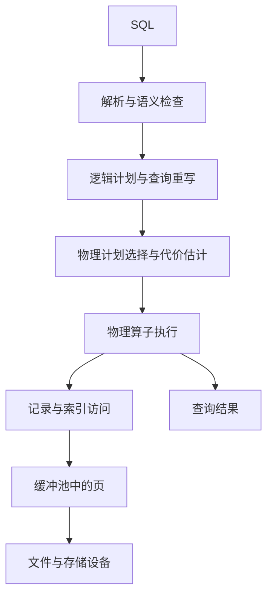

# 5 数据库系统内核

[4 数据库应用开发](4%20%E6%95%B0%E6%8D%AE%E5%BA%93%E5%BA%94%E7%94%A8%E5%BC%80%E5%8F%91.md) 从应用侧解释了连接、SQL、事务与结果。本章进入 DBMS 内部，继续追问：**一条 SQL 怎样变成执行计划，执行计划怎样找到存储设备上的记录，修改的数据又怎样在故障后保留下来？**

**本章主线**：查询模块把业务请求变成数据访问操作；存储模块把表、记录与字段映射成文件、页与字节；缓冲池减少慢速 I/O；日志、并发控制与恢复机制共同维护正确性。设计这些机制时，要同时考虑访问成本、地址稳定性、空间利用和故障状态。

本篇结合《第5章 数据库系统内核-1》至《第5章 数据库系统内核-4》，已整理 **5.1 内核概览、5.2 存储与文件结构、5.3 索引与哈希、5.4 查询处理、5.5 查询优化、5.6 查询执行模型**。新增例子标为“说明例”，对课件简化表述的解释标为“补充理解”；实现差异与代价公式按其适用条件区分。

## 5.1 数据库内核概览

### 5.1.1 内核负责什么

**数据库系统内核／数据库引擎**是 DBMS 中负责核心数据处理与管理的组件集合，包括查询解析、优化、执行、存储、事务及相关安全机制。

学习内核，需要把几个层次连起来：

| 层次 | 核心问题 | 主要对象 |
| --- | --- | --- |
| 查询处理 | SQL 表达什么，怎样生成执行方案 | 语法结构、关系代数、计划、统计信息 |
| 查询执行 | 按什么算法产生结果 | 扫描、过滤、连接、聚合等物理算子 |
| 存储管理 | 记录怎样编码、定位、读取和修改 | 文件、页面、记录、索引、缓冲池 |
| 事务与恢复 | 并发和故障下怎样维持规则 | 日志、提交状态、锁／版本、检查点 |
| 安全管理 | 谁能访问什么，操作怎样追踪 | 身份、权限、数据保护、审计 |

不同 DBMS 的模块划分可能不同。“数据库内核”是整体范围，“存储引擎”通常强调其中的数据组织、访问与持久化部分；部分系统还允许选择不同存储引擎。

课件建议先看宏观架构，再沿具体问题进入细节。MiniOB、miniBase 等教学系统适合观察模块之间的关系；学习时关注其简化了什么，而不以代码行数判断系统能力。

### 5.1.2 从 SQL 到数据页

沿用学生、课程与选修关系，查询赵宇的数据库成绩：

```sql
SELECT s.Sname, c.Cname, sc.Grade
FROM Student AS s
JOIN SC AS sc ON sc.Sno = s.Sno
JOIN Course AS c ON c.Cno = sc.Cno
WHERE s.Sname = '赵宇'
  AND c.Cname = '数据库';
```



这条路径中，同一个查询有不同表达：SQL 描述要什么结果，逻辑计划描述关系操作，物理计划指定算法与访问路径，存储请求再落实到具体页。

例如可以先筛选姓名为赵宇的学生、名称为数据库的课程，再与选修记录连接。**提前筛选可能减少后续处理的数据，但改写必须保持查询语义。** 关系代数中的选择与投影见 [2 数据模型](2%20%E6%95%B0%E6%8D%AE%E6%A8%A1%E5%9E%8B.md)；课件示意图末尾列出输出属性的操作应记为投影 $\pi$，$\rho$ 通常用于重命名。

### 5.1.3 解析、逻辑优化与物理优化

| 环节 | 输入与输出 | 需要区分什么 |
| --- | --- | --- |
| 解析与语义检查 | 从 SQL 得到内部表示，核对表、列与类型等信息 | 语法正确还不等于对象存在、含义正确 |
| 查询重写／逻辑优化 | 在保持语义的条件下改变逻辑表达式 | 例如视图展开、条件组织和可成立的等价变换 |
| 物理优化 | 为操作选择算法、访问路径与执行次序 | 扫描还是索引，采用何种连接算法 |
| 代价估计 | 根据统计信息估计候选计划的资源消耗 | 估计值依赖模型与统计，不等于实际运行时间 |

**逻辑计划**描述要执行的关系操作；**物理计划**进一步说明如何执行。例如同一个逻辑连接，可以使用不同连接算法。

课件把物理优化概括为选择代价最小的计划。**补充理解**：实际是在搜索到的候选计划中，按代价模型选择估计较优的方案，不意味着穷尽所有方案并找到真实耗时的全局最小值。

### 5.1.4 查询执行的几种组织方式

**物理算子**是执行计划中具有具体算法的处理单元，例如表扫描、谓词过滤、投影、哈希连接和聚合。

课件列出多种执行方式，先理解它们各改变什么：

| 方式 | 基本思路 |
| --- | --- |
| 火山／迭代器模型 | 父算子通过 `next()` 向子算子拉取结果，逐层获得元组 |
| 物化执行 | 某个阶段先产出中间结果，再交给下一阶段 |
| 向量化执行 | 每次处理一批值或元组，减少逐条调用等开销 |
| 编译执行 | 将部分计划转换成专门代码，再执行这些代码 |
| 并行执行 | 将可并行的任务分配给多个执行单元 |
| 推送式执行 | 下游结果由上游算子在产生数据时向后续算子推送 |

这些维度可以组合。例如向量化管线也可以并行，某些算子需要物化或缓存中间状态。不能把表中每一项当成彼此完全互斥的整套系统。

这里先建立执行模型的轮廓；物理算子与代价见 5.4，优化与执行模型分别见 5.5、5.6。

### 5.1.5 存储、事务与安全怎样参与查询

执行器通常通过**访问方法（access method）**读取或修改记录，例如顺序扫描或索引定位；存储模块再处理页内布局、空间分配和缓冲。

修改数据时，还会涉及日志、事务状态与并发控制。持久化需要考虑断电后什么仍然存在，并发控制则需要考虑多个操作之间会不会互相干扰。

安全机制贯穿访问过程：认证确认身份，权限控制限定操作范围，数据保护和审计降低泄露与追踪风险。前一章已经区分认证、授权和令牌，本章关注它们也属于 DBMS 的整体职责。

## 5.2 存储与文件结构

### 5.2.1 存储系统的三个问题

数据库存储管理需要同时回答：

1. **怎样定位**：从表、记录和字段，找到对应文件、页和字节。
2. **怎样读写得快**：减少不必要 I/O，利用局部性、缓冲与适当组织方式。
3. **怎样安全复用空间**：插入、删除、更新、并发访问和故障后，结构与引用仍然有效。

“把数据写入一个文件”只是开始。还需要确定记录格式、页面布局、空闲空间、索引引用、缓存状态及恢复规则。

### 5.2.2 存储介质与 I/O 成本

#### 5.2.2.1 存储层次与持久性

| 对象 | 基本特点 | 数据库中的作用 |
| --- | --- | --- |
| CPU 高速缓存 | 容量小、访问快，通常易失 | 缓存 CPU 正在处理的数据与指令 |
| DRAM 主存 | 访问快，通常断电丢失 | 缓冲池、执行状态、中间结果 |
| 非易失性内存 | 保留数据，访问与编程方式依技术而异 | 持久内存相关设计 |
| 闪存设备／SSD | 无机械寻道，仍有设备访问与写入管理成本 | 数据与日志的持久存储 |
| 机械硬盘／HDD | 有寻道和旋转成本，顺序访问通常更有利 | 容量型持久存储 |

**闪存是介质，SSD 是设备**，常见 SSD 使用 NAND 闪存。介质、接口和组织方式也应分开：SATA、NVMe 属于设备连接／访问体系，SAN、NAS 描述网络存储形态，RAID 描述多盘组织方案。

课件中的容量、接口速率和访问延迟带有年份、设备与负载假设。这里保留设计上的相对关系：**主存与持久设备存在明显访问成本差异，因此数据库要管理数据移动，而不是每次访问都直接读盘。**

#### 5.2.2.2 HDD 的组成与容量

机械硬盘包含旋转盘片与读写磁头。**磁道**是盘面上的环形区域，**扇区**是进一步划分的存储单位，**柱面**对应多个盘面上位置相同的一组磁道。

按课件的简化磁盘参数：

- 8 个盘片、16 个盘面。
- 每面 $2^{16}$ 个磁道。
- 每磁道平均 $2^8$ 个扇区。
- 每扇区 $2^{12}$ 字节。

容量为：

$$
16\times2^{16}\times2^8\times2^{12}
=2^{40}\ \text{bytes}=1\ \text{TiB}
$$

这是给定参数下的容量计算；TiB 使用二进制单位，不能直接把 $2^{40}$ 字节写成十进制的 $10^{12}$ 字节。

#### 5.2.2.3 一次机械磁盘访问包含什么

一次 I/O 的耗时可近似拆成：

$$
T_{\mathrm{I/O}}\approx
T_{\mathrm{queue}}+T_{\mathrm{seek}}+
T_{\mathrm{rotation}}+T_{\mathrm{transfer}}
$$

分别是排队、磁头寻道、等待目标扇区转到磁头下，以及实际传输数据的时间；具体测量还可能包含控制器等开销。

7200 转／分钟的磁盘，每转一圈需要：

$$
T_{\mathrm{turn}}=\frac{60\times1000}{7200}
\approx8.33\ \text{ms}
$$

若目标位置近似均匀分布，平均旋转等待约半圈，即 $4.17$ ms。

课件在一个 16 KiB 块的说明例中列出平均寻道 $6.36$ ms、旋转 $4.17$ ms、传输 $0.13$ ms。**按这三项相加应为 $10.66$ ms，课件写成的 $10.76$ ms 与所列数字不符。** 这些值用于理解成本分解，不是所有硬盘的统一性能。

当定位开销明显大于实际传输时间时，减少 I/O 次数、让访问更连续、预读可能用到的页，就能产生收益。SSD 没有机械寻道与旋转，仍需考虑访问粒度、并行度和写放大等成本。

#### 5.2.2.4 调度怎样减少磁头移动

课件给出磁头起点 53，请求序列为：

```text
98, 183, 37, 122, 14, 124, 65, 67
```

- **FCFS**：按请求到达顺序处理。
- **SSTF**：每次选择距离当前位置最近的待处理请求。
- **SCAN／电梯算法**：沿一个方向服务请求，到边界后反向。

**说明例计算**：只以柱面移动距离计成本，并假定请求集合保持不变。FCFS 总移动距离为 640；SSTF 的顺序为 `65,67,37,14,98,122,124,183`，总距离为 236。

这比较的是磁头移动量，不是完整响应时间。SCAN 还需要给定初始方向和磁盘边界，才能算出确定轨迹；调度的吞吐收益也要与请求等待和公平性一起考虑。

### 5.2.3 从逻辑记录到文件、页与字节

#### 5.2.3.1 不同层次的地址

```text
表／索引中的逻辑对象
    ↓ 文件与记录管理
文件中的页号、页内槽号
    ↓ 缓冲管理
缓冲帧中的页与记录位置
    ↓ 文件系统／设备访问
文件偏移及底层存储块
```

**页面（page）**是数据库组织与读写数据的基本单位，通常包含页头与若干记录。课件以 8 KiB、16 KiB 等固定页大小说明其机制，具体大小依系统配置与实现而定。

**记录（record／tuple）**是按关系模式编码的一组字段值；一页可以包含多条记录。**字段**是记录中的一个属性值，解释它还需要模式、类型及格式信息。

**补充理解**：数据库页、文件系统块、硬件扇区和内存地址处于不同层次，不要求一一相等。课件用 `Page = Block` 简化 I/O 模型；理解时要保留各层的映射关系。

操作系统的文件系统继续把数据库文件偏移映射到块／簇；课件用 FAT 与目录作这一层映射的回顾示例，数据库文件并不要求都放在 FAT 文件系统上。

若一个简化文件由等长页连续组成，且没有额外文件头，则从 0 开始计数的页号 $p$ 对应文件偏移 $pP$，其中 $P$ 是页大小。实际系统还可能把一个关系拆成多个文件或其他分配单元。

#### 5.2.3.2 表空间、段与区

课件介绍一种空间管理层次：

```text
表空间 → 段 segment → 区 extent → 页 page → 记录
```

- **表空间**提供存储对象与底层空间的组织范围。
- **段**用于组织一类对象的存储，如数据段、索引段等。
- **区**是一次分配的一组页。

成批分配页可以减少反复申请空间的成本，并争取更好的访问局部性。逻辑上相邻的页最终是否物理连续，还要经过文件系统与设备映射。

这些名称与层级不是所有 DBMS 的强制统一格式；重点是把“对象拥有的空间”“批量分配单位”和“读写单位”分开理解。

### 5.2.4 定长记录与页内空位

#### 5.2.4.1 记录头、字段与偏移

**定长记录**在选定存储格式下占用固定字节数，因此可按固定步长定位。记录通常由记录头和字段组成；头部可能包含事务信息、状态和 NULL 位图。

```text
记录头 | 字段1 | 字段2 | 字段3 | ...
```

课件用 `char`、数值字段等说明定长布局。实际占用还受编码、对齐、类型实现、可空性和记录头影响，不能仅按 SQL 类型名字推断所有字节数。

若记录区起点为 $D$，每条记录占 $R$ 字节，槽从 0 编号，则第 $i$ 槽的记录起点为：

$$
\mathrm{offset}(i)=D+iR
$$

#### 5.2.4.2 页面头与占用位图

页头可以记录页类型、记录数、空闲空间、相邻页或校验等信息，具体字段由页格式定义。**校验和（checksum）**帮助发现某些损坏，不能单靠它防止所有读写错误或自动修复数据。

**页面占用位图（bitmap）**为每个记录槽保存一个占用状态：空槽可插入，已用槽可读取。它与记录内部标识字段是否为 NULL 的位图用途不同。

**说明例**：一页 8192 字节，页头预留 128 字节，槽占用位图预留 16 字节，每条定长记录为 80 字节。忽略额外对齐与其他结构，则：

$$
N=\left\lfloor\frac{8192-128-16}{80}\right\rfloor=100
$$

位图有 $16\times8=128$ 位，足够标记 100 个槽；记录区之外还剩 48 字节。记录区起点为 144，第 3 号槽（第四个槽）的起点为 $144+3\times80=384$。

分配位图本身也要占空间，不能只用“页大小÷记录长度”计算容量。

#### 5.2.4.3 删除记录的不同办法

| 办法 | 怎样处理空位 | 代价与引用问题 |
| --- | --- | --- |
| 后续记录前移 | 把后面的记录向前压紧 | 需要移动多条记录，其物理位置改变 |
| 末条记录补空位 | 用最后一条填补被删除位置 | 移动较少，但被移动记录的位置改变 |
| 空闲槽链表 | 保留空位，串联可复用槽 | 插入时可快速找到空槽 |
| 占用位图 | 清除对应占用标记 | 槽位置可保留，后续重新使用 |

课件展示的是不同组织选择，不能把“压紧移动”和“固定槽地址”同时当成无条件成立的性质。若索引或其他结构保存物理定位，记录搬动后必须维护引用。

### 5.2.5 变长记录与槽式页面

#### 5.2.5.1 为什么需要间接定位

**变长记录**的字节数可以不同，例如姓名、说明文字等字段长度不一。若直接把记录首尾连接，就不能用统一的 $D+iR$ 计算第 $i$ 条记录的位置。

课件在记录内用属性的位置与长度描述变长字段，在页面内再用槽目录描述每条记录的位置。要分清两种间接层次：

- **字段目录／属性槽**：找到一条记录中的字段。
- **页面槽目录**：找到一页中的记录。

#### 5.2.5.2 槽目录与“两头挤”

**槽式页面（slotted page）**由页头、槽目录、空闲区和记录区等部分组成。槽目录保存记录的页内偏移、长度及必要状态。

```text
低地址                                                 高地址
页头 | 槽0 槽1 槽2 ... → |      空闲区      | ← 记录内容
```

槽目录向后增长，记录区从页尾向前分配。新增记录既要容纳记录体，也可能要增加一个槽项。

**说明例**：`槽2=(offset=3000, length=120)`。索引引用“页7、槽2”，读取时先找页7，再从槽2得到实际字节位置。若页内整理把记录移到 2800，只需在该页把槽2改为 `(2800,120)`，页与槽的引用可以保持。

PostgreSQL 的页布局就使用包含偏移与长度的 item 标识；记录在页内压缩移动时，未释放的 item 标识索引可以保持稳定。[PostgreSQL 页布局](https://www.postgresql.org/docs/current/storage-page-layout.html)

#### 5.2.5.3 RID 与业务主键

**记录定位符（record identifier，RID）**用于在存储结构中找到记录，一种常见形式是 `(页号, 槽号)`。它与学号等业务主键的作用不同。

| 标识 | 表达什么 | 变化风险 |
| --- | --- | --- |
| 学号等业务键 | 业务中是哪一个对象 | 按业务标识规则维护 |
| `(页号, 槽号)` | 存储中的哪个记录位置 | 记录跨页搬迁、槽释放或复用时需维护 |
| 裸字节偏移 | 当前记录体在哪里 | 页内移动后就可能改变 |

槽目录提供页内间接定位，不保证记录跨页移动后原 RID 自动有效；删除后复用槽，也不表示旧引用仍指向原对象。更新、索引与版本管理必须共同维护引用正确性。

#### 5.2.5.4 删除、增长与大记录

删除记录时，可以标记或释放槽，之后回收记录体空间；可能需要整理碎片才能得到连续空闲区。

更新变长记录时，若原位置容得下，可以原位修改；若变长后放不下，可能在页内重排或搬到其他页。课件用“清槽再插入”说明位置变化，真正实现还需要维护索引、引用和事务状态。

若一条记录超过页大小，课件列出跨页链接或专门存储方式。**补充理解**：也可把大字段放在外部存储中，记录内保存引用。采用哪种办法，取决于系统页格式与访问需求。

NULL 位图则用紧凑标记描述哪些字段没有值，字段数据区是否省略、怎样解码，仍由记录格式决定。

### 5.2.6 文件组织：页之间怎样安排记录

#### 5.2.6.1 堆表、顺序表、哈希与 B+ 树

**文件组织**规定数据记录和页面之间的安排方式，影响定位、扫描与维护成本。

| 组织方式 | 布局与访问思路 | 适合什么，付出什么 |
| --- | --- | --- |
| 堆表／heap file | 不要求记录按某个键有序，有空间即可放入 | 插入灵活；无索引的条件查找通常需扫描 |
| 顺序／有序文件 | 记录按一个或多个字段有序组织 | 便于按序和范围访问；插入需维护有序性 |
| 哈希组织 | 对键计算哈希值，将记录分到桶或页集合 | 适合等值定位；冲突、溢出及范围查询需额外处理 |
| B+ 树组织 | 通过有序、多路平衡结构管理访问 | 适合等值和范围定位；更新需维护树结构 |
| 多表聚簇 | 把经常一起使用的不同表记录放近 | 某些关联访问更局部；其他访问和维护可能受影响 |

堆表的“堆”表示无指定键序的记录组织，不是优先队列中的二叉堆。

**说明例**：记录键为 `3,5,1,4`，堆表可保留这样的排列；有序文件按 `1,3,4,5` 组织；若按 $h(k)=k\bmod3$ 分桶，则键 1 和 4 落入同一桶。哈希值相同还需在桶内比较原键。

#### 5.2.6.2 有序性与插入成本

有序文件插入新键，需要确定顺序位置。若目标页有空闲，可以插入并维护顺序；若页满，可能申请新页、设置溢出链或重新组织。

课件展示使用链式连接保持记录的逻辑顺序。这种顺序不一定等于字节完全连续；长期插入形成额外跳转后，扫描局部性也可能下降。

B+ 树可以作为堆表上的辅助索引，也可以参与组织记录的布局。**“堆表＋B+ 树索引”与“数据本身按树组织”不是同一种布局。**

#### 5.2.6.3 怎样理解查询与更新代价

先统一比较口径。设 $N$ 为数据页数，$h$ 为索引树高度，$B$ 为结果实际涉及的数据页数。在简化的页访问模型中：

| 访问方式 | 典型定位／读取代价 | 条件 |
| --- | --- | --- |
| 无索引堆表扫描 | 最坏约 $O(N)$ | 逐页检查，若提前找到可结束则实际可能更少 |
| 支持页级二分的有序文件 | 定位约 $O(\log_2N)$，再读范围结果页 | 需要可有效随机定位有序页，不能直接套到任意链表 |
| B+ 树路径 | 从根到叶定位约 $O(h)$ | 实际 I/O 还取决于路径页是否已缓存 |
| 哈希等值访问 | 定位桶后，再访问桶与溢出页 | 取决于分布、装填率和冲突链 |

若有效扇出为 $F$、索引条目数为 $M$，树高常按 $\log_FM$ 的量级估计，具体还依赖装填率。范围结果在物理上相邻时，定位后可按结果页数 $B$ 增加扫描成本；若辅助索引命中的记录散落在许多堆页，回表成本会更高。返回相同数量的行，不代表读取相同数量的页。

**补充理解课件的性能表**：插入、删除、更新应拆成“定位目标”与“维护结构”。无索引堆表删除若先按条件寻找，可能扫描整表；已有 RID 后清理记录槽的成本则不同。顺序文件找到插入点后，还可能搬动记录或维护溢出页，不能把定位复杂度当作整个操作复杂度。

这里先建立代价来源；B+ 树分裂、哈希扩展等结构与算法见 5.3。

### 5.2.7 空闲空间管理与记录操作

#### 5.2.7.1 怎样找到放得下记录的页

设新记录体需要 $x$ 字节。可用页不仅要容纳记录体，还需考虑新槽项、对齐或其他页内开销。

课件列出维护每页空闲量、按空闲量分组、多级数组及堆等方法。分组方法可将“空闲字节范围”映射到候选页列表，减少逐页检查。

**说明例**：某页空闲 100 字节，新记录体也长 100 字节，但还需要新建 4 字节槽项，实际就放不下。若只保存粗粒度的空间等级，找到候选页后还需检查实际可用空间。

课件对堆的方向有两种说法：前面用大根堆，后面写小顶堆。若按空闲量建最大堆，根页能直接回答“当前最大空闲量是否足够”；最小堆的根页放不下，并不能推出其他页也放不下。**应根据要支持的查找操作选择结构，不能只记一个堆名称。**

#### 5.2.7.2 插入与查找

插入可以按下列路径理解：

1. 根据文件组织和空闲空间信息选择候选页。
2. 获取该页，检查真实空间与并发状态。
3. 若没有合适页，申请新页或新的分配单元。
4. 分配槽并写入记录，更新空闲空间与相关索引。
5. 按事务和日志规则管理这次修改。

无索引查找通常扫描页和记录；有索引时先沿索引定位，再按定位信息访问记录页。索引减少的通常是候选范围与访问页数，不代表数据可以绕过页和缓冲机制直接出现。

#### 5.2.7.3 删除与更新后的空间

删除需要先定位记录，再按记录格式标记或回收空间；更新则可能原位完成，也可能产生搬迁或新版本。

“业务上删除了记录”与“空间立即可以复用”也可能不同。并发事务仍需读取旧版本或恢复机制仍需相关信息时，回收需要等待合适条件。

因此空闲空间管理、索引引用、事务可见性和垃圾回收需要协作，不能只操作一块字节区域就认定完成了更新。

### 5.2.8 元数据：DBMS 怎样理解这些字节

**元数据（metadata）**是描述数据库对象的结构、规则与管理信息的数据。

| 类型 | 课件中的例子 | 用在哪里 |
| --- | --- | --- |
| 模式定义 | 表名、列名、类型、长度 | 解析 SQL，解码字段，检查引用 |
| 视图定义 | 视图名与查询定义 | 展开视图与维护外部接口 |
| 完整性约束 | 主键、外键及其他限制 | 检查合法状态与操作 |
| 索引信息 | 索引关联的对象与属性 | 选择访问路径、维护索引 |
| 统计信息 | 行数、属性取值分布等 | 估计选择率、结果规模和计划代价 |

**系统目录／数据字典**集中保存这类描述。课件展示用关系表保存元数据：DBMS 可以像查询关系数据那样组织与访问目录信息，同时维护专门的启动与缓存机制。

**说明例**：同一串字节若不知道字段类型、长度、NULL 标记和编码，就无法正确解释成学号、姓名或成绩。索引也需要知道比较规则，优化器则需要统计来判断某个条件大约筛出多少行。

模式通常描述规则，统计描述对当前数据分布的估计；更新了数据而统计未及时更新，可能影响计划选择，但不会因此自动改变字段定义。

### 5.2.9 缓冲池：页面怎样进入内存

#### 5.2.9.1 页与缓冲帧

**缓冲池（buffer pool）**是在主存中保存数据库页面的一组空间。**缓冲帧（frame）**是其中可容纳一页的内存位置。

页是被管理的数据单位，帧是装载页的内存容器。某帧今天可以装页7，淘汰后又装页12；页号不应直接等同于帧号或内存指针。

缓冲管理通常维护：

- **页表／映射表**：页号当前位于哪个帧。
- **空闲帧信息**：哪些内存位置可以直接使用。
- **脏标记**：内存内容是否比磁盘对应页更新。
- **固定计数／pin count**：是否仍有使用者依赖该帧中的页。
- **替换信息**：访问时间、次数或其他淘汰依据。

这里的页表是缓冲池内部映射，不是操作系统虚拟内存页表。页与帧的区分也见 [CMU Buffer Pool Manager](https://15445.courses.cs.cmu.edu/fall2025/project1/)。

#### 5.2.9.2 读页的命中与未命中

请求页 $p$ 时：

1. 若页已在缓冲池，取得对应帧，固定该页后供调用方使用。
2. 若不在，先寻找空闲帧。
3. 若没有空闲帧，在可淘汰集合中选择牺牲页；仍被固定的页不能随意淘汰。若全被固定，应按接口约定等待或报告无法取得页面。
4. 干净页可以丢弃内存副本；脏页需按日志等规则安全写回。
5. 调入目标页，更新映射和状态，再交给调用方。
6. 使用完成后解除固定，允许后续替换。

**命中**表示请求页已经在数据库缓冲池中，通常无需再次从下层调入该页。未命中后的真实设备访问还可能受 OS 缓存、预读等影响；本章的简单 I/O 模型把一次未命中视为一次读页。

#### 5.2.9.3 写页、脏页与索引

**脏页（dirty page）**是内存副本已修改、尚未同步到对应持久页的页面。修改通常先发生在缓冲页，随后由适当时机写回。

课件把数据页、索引和日志一起画出，说明它们需要协作：

- 数据记录改变时，相关数据页变脏。
- 若修改影响索引结构或索引内容，需要维护相应索引页。
- 日志记录需要持久化的修改信息。

并非任何字段更新都必须修改所有索引，也不要求数据页、索引页和日志共用同一个缓存区。关键是它们之间的状态与持久化顺序正确。

#### 5.2.9.4 Pin、闩锁与事务锁

课件把固定页面与共享／排他访问放在一起讲，它们解决的问题不同：

| 机制 | 保护什么 | 不能单独保证什么 |
| --- | --- | --- |
| Pin／固定 | 页面被使用期间不被淘汰、帧不被换成别的页 | 不保证其他线程不会同时修改内容 |
| Latch／短期闩锁 | 线程访问页或缓冲管理结构时的物理结构安全 | 不直接定义完整业务事务的隔离语义 |
| 事务锁／版本等并发控制 | 事务之间允许观察与修改哪些逻辑数据 | 不代替缓冲帧的生命周期管理 |

**说明例**：线程已经拿到页7的内存指针，如果页7被淘汰、同一个帧改装页12，原指针就可能读到错误对象。Pin 防止这种替换；要安全地读取页7内部正在变化的槽目录，还需要相应的访问同步。

课件用共享读、排他写说明基本互斥模式；真实系统可结合行锁、版本和其他机制，并不要求所有读写都锁住整个页面直到事务结束。

Pin、页表和闩锁的区别可对照 [CMU 缓冲池讲义](https://15445.courses.cs.cmu.edu/fall2025/notes/04-bufferpool.pdf)。

### 5.2.10 缓冲页替换策略

#### 5.2.10.1 LRU：最近是否访问过

**LRU（least recently used）**在可淘汰页面中，优先淘汰最近一次访问时间最早的页，依据是近期访问可能再次发生。

以课件访问序列 `1,2,3,1,4,5,3,6` 为例，缓冲池初始为空，容量为 4。下表从左到右按“最近使用 → 最久未用”排列，忽略脏页与固定状态：

| 请求 | 命中？ | 淘汰页 | 访问后的 LRU 次序 |
| --- | --- | --- | --- |
| 1 | 否 | — | 1 |
| 2 | 否 | — | 2,1 |
| 3 | 否 | — | 3,2,1 |
| 1 | 是 | — | 1,3,2 |
| 4 | 否 | — | 4,1,3,2 |
| 5 | 否 | 2 | 5,4,1,3 |
| 3 | 是 | — | 3,5,4,1 |
| 6 | 否 | 1 | 6,3,5,4 |

共 2 次命中、6 次未命中。访问到已缓存页，也必须更新其“最近访问”位置。

#### 5.2.10.2 扫描污染与 LFU

容量仍为 4，访问 `1,2,3,4,5,1,2,3` 时，LRU 每次都未命中：读入第 5 页淘汰第 1 页，再读第 1 页又淘汰接下来需要的第 2 页。

这说明大于缓存的顺序扫描可能把原有热点挤走。最近访问只是一种预测，不代表这页一定会很快再用。

**LFU（least frequently used）**优先淘汰访问次数少的页，关注频率。它要定义计数范围、历史是否衰减，以及相同次数时怎样打破平局。

课件的 LFU 轨迹展示了频率影响，但未完整规定平局规则。不能在没有规则时认定所有 LFU 实现都产生同一轨迹。长期累计频率也可能让过去的热点在负载变化后继续占据缓存。

#### 5.2.10.3 LRU-K：观察多次历史

**LRU-K**使用最近 $K$ 次访问历史，避免仅凭一次近期访问就把一页认定为热点。

**补充理解**：在当前时刻 $t$，设 $t_K(p)$ 是页 $p$ 倒数第 $K$ 次访问的时间，可定义向后 $K$ 距离：

$$
d_K(p,t)=t-t_K(p)
$$

已有 $K$ 次历史时，距离越大表示第 $K$ 次历史越久，通常越适合淘汰。少于 $K$ 次访问的页与平局处理还需要明确规则。

例如 CMU 的 LRU-K 项目规范将不足 $K$ 次历史者的距离设为 $+\infty$，优先淘汰这类页；它们之间再按最早的已记录访问时间决定。这样，一次性扫描进入缓存的页，不会只因刚访问过就获得与反复使用页面相同的保护。[CMU LRU-K 规范](https://15445.courses.cs.cmu.edu/fall2023/project1/)

**说明例**：$K=2,t=10$，A 的最近访问为 `3,9`，B 为 `8,10`，则 $d_2(A)=7$、$d_2(B)=2$。在二者都可淘汰且已有足够历史时，优先淘汰 A。完整替换仍须先排除被 Pin 的页。

### 5.2.11 WAL、提交与故障恢复

#### 5.2.11.1 为什么脏页不立即全部写回

一次事务可能修改多个分散页面。若每次提交都同步写完所有页，会产生较多随机 I/O，也减少把多次修改合并写回的机会。

**预写日志（write-ahead logging，WAL）**先用日志记录修改，并按照持久化顺序约束，让数据页可以延后写回，崩溃后再依据日志恢复尚未完整保存的修改。

这里的“随机页写转为顺序日志写”，主要是把提交的同步持久化路径集中到追加日志；数据页最终仍要写回，索引和页面的随机 I/O 不会因此全部消失。

#### 5.2.11.2 两条持久化顺序规则

在课件讨论的同步持久化提交模型中：

1. **某个脏数据页写入持久存储前，描述该页相关修改的日志必须先持久化。**
2. **向用户确认事务持久化提交前，必须保证恢复该提交所需的日志与提交信息已经持久化。**

第一条中的“先”约束数据页的持久写回，不是要求在任何内存字节修改前都同步刷一次盘。第二条也不要求提交时全部脏数据页都已写回。

PostgreSQL 的 WAL 说明明确指出：数据文件修改应在对应日志持久化之后写入；遵守这一规则，就可在提交时不刷完全部数据页，并在崩溃后重做未保存的修改。[PostgreSQL WAL](https://www.postgresql.org/docs/current/wal-intro.html)

#### 5.2.11.3 从修改到恢复的状态变化〔说明例〕

假设某条成绩从 87 改为 92，只看一个已提交事务的重做路径：

| 时点 | 缓冲数据页 | 持久数据页 | 日志状态 | 含义 |
| --- | --- | --- | --- | --- |
| 初始 | 87 | 87 | 无本次修改 | 内外一致 |
| 执行修改 | 92，脏 | 87 | 修改记录尚可在日志缓存中 | 内存已变，不代表持久化提交 |
| 日志与提交信息持久化 | 92，脏 | 87 | 恢复所需信息已持久化 | 可按该模型确认提交 |
| 此时崩溃 | 内存丢失 | 87 | 持久日志仍在 | 恢复时补上已提交修改 |
| 恢复完成 | 按需重新装入 | 92 | 依据恢复协议处理 | 恢复该事务的持久效果 |

若脏页已经安全写回，恢复过程也需要识别其状态，避免把同一操作错误地执行两次。重做通常依据日志记录、页面状态等恢复信息，不能直接等同于重新提交一遍原始 `INSERT` SQL。

日志可能记录物理变化、逻辑操作或混合信息，也不只是整页副本。未提交事务、撤销和多版本可见性怎样处理，取决于日志与事务设计。

#### 5.2.11.4 检查点、重做与备份

**检查点（checkpoint）**记录恢复所需的位置与状态，并与页面写回等工作配合，帮助限制崩溃后需要扫描和重做的范围。

课件把它简化为：较早的修改已经写回，后续修改不一定写回，因此从相应日志位置继续恢复。实际恢复起点与必须保留的日志，还受未完成事务、脏页、归档和复制等要求影响。

例如 PostgreSQL 通过检查点信息定位 redo 起点，旧 WAL 段的回收还需满足归档、复制等保留条件。[PostgreSQL 检查点与 WAL 管理](https://www.postgresql.org/docs/current/wal-configuration.html)

课件的“Redo All”和“只重做部分修改”是简化示意。它表达的是日志能补足尚未落盘的效果，不应理解为“对所有日志无条件重放全部事务”或“每次都从日志第一条开始”。

**备份**保存一个可恢复的数据基础，**WAL**记录相应变化，**复制**把状态传到其他节点，它们用途不同。日志在内存中、写入 OS 缓存和按持久化协议完成落盘，也不能当成同一种状态。

### 5.2.12 行存储、列存储与混合布局

#### 5.2.12.1 数据相邻关系怎样改变

**行存储**把一条记录的多个字段放在一起；**列存储**把同一列的多个值集中组织。两者改变的是访问数据时哪些字节更接近。

**说明例**：三条记录为 `(s1,张三,87)`、`(s2,李四,92)`、`(s3,王五,95)`：

```text
行式： [s1,张三,87] [s2,李四,92] [s3,王五,95]
列式： [s1,s2,s3]   [张三,李四,王五]   [87,92,95]
```

若查询一名学生的完整信息，行式布局容易把所需字段一起取出；若扫描大量记录只计算平均成绩，列式可以主要访问成绩列，并利用相似类型值的编码和压缩。

列式读取多列时，要通过行位置或相应标识把值对应起来，不能只看各列中独立的一组值。

#### 5.2.12.2 负载倾向与条件

| 维度 | 行式通常更有利的情况 | 列式通常更有利的情况 |
| --- | --- | --- |
| 访问粒度 | 少量行、每行多个字段 | 大量行、其中少量列 |
| 更新模式 | 高频处理完整业务记录 | 批量装入、分析为主 |
| 计算 | 点查与事务性读写 | 扫描、过滤、聚合与向量化计算 |
| 额外成本 | 扫描窄列时可能读入无关字段 | 多列重组及单条修改可能更复杂 |

课件把行存关联 OLTP、列存关联 OLAP，这是工作负载倾向，不是功能上的禁止。索引、压缩、缓存、批处理与更新机制都会改变实际表现。

“行存扫描时可能读到同一页中的其他字段”，也不等于所有行式查询都必须读整张表或全部列；覆盖索引等访问路径可能改变读取内容。

#### 5.2.12.3 PAX、Parquet 与 ORC〔补充理解〕

**PAX（partition attributes across）**在一页内部把同一属性的值分组，让一个页容纳一组记录，同时改善页内按列访问的局部性。

```text
同一页中的记录组：
页头 | 这一组的学号值 | 这一组的姓名值 | 这一组的成绩值
```

课件将 PAX 与 ORC、Parquet 放在一起介绍。应区分：经典 PAX 是页内布局思想，广义的混合布局也可按“先分行组、组内按列”理解；Parquet 与 ORC 是具体列式文件格式，而不是完整的数据库存储引擎。

Parquet 的层次是“文件 → 行组 → 列块 → 页”，ORC 以 stripe 组织列数据等内容。它们与经典 PAX 在分组粒度、编码和元数据上都有具体差异，应按各自格式理解。[CMU 存储模型讲义](https://15445.courses.cs.cmu.edu/spring2026/notes/06-storage3.pdf)、[Parquet 层次定义](https://parquet.apache.org/docs/concepts/)、[ORC 格式规范](https://orc.apache.org/specification/ORCv1/)

行／列／混合是布局维度，磁盘／内存是存储介质和工作集管理维度，两者可以组合。文件格式也不自动提供完整的事务、并发控制或 SQL 执行能力。

### 5.2.13 存储引擎怎样把模块组合起来

课件最后用存储引擎示意图把前面的机制连成一个系统：

| 模块／任务 | 负责什么 | 必须协作的对象 |
| --- | --- | --- |
| 堆表与记录访问 | 保存记录格式，提供定位和读写接口 | 页、索引、事务状态 |
| 索引 | 缩小查找范围，提供访问路径 | 数据记录与索引页 |
| 数据页缓冲池 | 缓存页，管理装入、固定、修改和淘汰 | 页表、替换策略、I/O |
| WAL 缓存与刷盘 | 记录修改，推进日志持久化 | 提交、脏页写回 |
| 事务并发控制 | 控制可见性、冲突与提交状态 | 锁、版本、日志等 |
| 刷脏页 | 将需要保存的数据页写回 | WAL 持久化进度 |
| 检查点 | 保存恢复相关位置与状态 | 页面写回、日志管理 |
| 垃圾回收 | 回收安全可复用的空间 | 旧版本、事务与引用 |
| 日志归档与复制 | 保存历史日志、传送日志到其他节点 | 恢复、备份、复制进度 |

这些工作可以由后台线程或任务承担，具体线程数量和职责划分不是统一标准。课件单独画出的提交日志用于表达事务状态与提交时间等信息，也不意味着所有 DBMS 都采用完全相同的文件结构。

课件还列出多版本并发控制（MVCC）、乐观并发控制（OCC）与行锁等思路：分别借助版本、冲突验证和锁粒度来组织并发访问。这部分在本材料中只作方向性介绍，完整协议与隔离保证还需继续学习。

引擎设计可以回到三组取舍：

1. **I/O 与局部性**：缓冲、日志、文件布局怎样减少不必要的数据移动。
2. **并发与正确性**：页内结构、记录可见性、锁与版本怎样协作。
3. **空间与更新**：原位修改、搬迁、旧版本与空闲空间怎样安全管理。

课件把不同行数据的读写尽量少互相阻塞作为目标。实际系统仍可能因索引页、空间分配、约束、锁或资源竞争而等待，不能把“不同主键”当成绝不会发生竞争的保证。

## 5.3 索引与哈希

### 5.3.1 索引解决的是哪一段访问成本

**索引（index）**是根据查找键组织的辅助访问结构，用于缩小需要检查的数据范围，并获得记录位置或查询所需的值。

课件把它概括为：

$$
\langle\text{查找键},\text{数据位置}\rangle
$$

**查找键（search key）**是用来查找的一个或多个属性，不一定是唯一的候选键。例如按姓名、成绩建立索引，可能有多条记录对应同一个查找值。

**说明例**：按书名查询图书。如果没有索引，要检查很多图书记录；书名索引先定位候选条目，再由条目找到记录。数据位置可以是 RID、页号、主键或其他定位信息，取决于存储组织。

索引本身也占空间、需要缓存，并随数据变化维护。判断索引是否有利，要比较定位、读取结果、回表及维护成本，不能只看树高。

### 5.3.2 索引的分类与回表

#### 5.3.2.1 稠密与稀疏：覆盖到什么粒度

**稠密索引**为所有需要索引的查找键值提供索引条目；重复键可以对应多个 RID、一个位置列表，或结合其他标识进一步区分。

**稀疏索引**只为部分键值保存条目，例如为有序数据文件的每个页保存边界键和页位置。查询先定位候选页，再在页内或相邻范围继续查找。

**说明例**：数据按学号有序，每页最小学号分别为 `100、200、300`。稀疏目录保存这三个边界；查学号 240，可先定位边界 200 对应的页，再检查页内记录。

课件用“稠密指向记录、稀疏指向页面”展示典型实现。核心还在于覆盖范围与数据组织：若数据完全无序，只保存每页一个任意键，不能据此排除其他页。

#### 5.3.2.2 聚集与非聚集：记录按什么组织

| 分类 | 主要含义 | 查询代价的差别 |
| --- | --- | --- |
| 聚集／聚簇组织 | 数据记录按某个查找键组织，键相近的记录有较好局部性 | 范围命中的记录可能集中在较少的数据页中 |
| 非聚集／辅助索引 | 索引与基础记录的组织可以不同，保存进一步定位信息 | 索引条目相邻，所指记录却可能散落在许多页 |

在课件的一份基础记录组织模型中，一张表只有一种主要聚集顺序，但可以有多种辅助索引。聚集顺序不等于设备上所有字节始终物理连续，分裂、碎片与下层映射仍会影响布局。

**稠密／稀疏**讨论条目的覆盖粒度，**聚集／非聚集**讨论索引键与记录组织的关系，二者不是同一组分类。

**补充理解：具体引擎的差异。** InnoDB 的聚集索引叶记录保存行数据，二级索引保存二级键及主键，必要时再通过主键访问聚集索引。SQLite 普通表通常以 rowid 组织；`WITHOUT ROWID` 表则按声明的主键组织，不能把所有 SQLite 表都描述为“按业务主键聚集”。[InnoDB 索引组织](https://dev.mysql.com/doc/refman/8.4/en/innodb-index-types.html)、[SQLite WITHOUT ROWID](https://www.sqlite.org/withoutrowid.html)

#### 5.3.2.3 回表与覆盖查询

**回表**是先通过索引定位，再访问基础记录以取得信息的过程。**覆盖索引**包含某类查询所需要的值，使查询有机会主要从索引中得到答案。

**说明例**：有 `(学号, 姓名)` 索引：

- 按学号查姓名，所需值都在索引中。
- 按学号查住址，若索引没有住址，还需访问基础记录。

Index-only scan 不只取决于输出列。条件涉及的值、索引类型以及事务可见性也可能影响能否避免访问数据页。例如 PostgreSQL 即使使用 index-only scan，仍需结合可见性映射判断，必要时访问堆页。[PostgreSQL 覆盖索引与 index-only scan](https://www.postgresql.org/docs/current/indexes-index-only-scans.html)

#### 5.3.2.4 主键、唯一与多列索引

| 维度 | 分类 | 要区分什么 |
| --- | --- | --- |
| 完整性目的 | 主键索引、唯一索引、普通索引 | 主键／唯一约束与加速查找的结构相关，但概念不同 |
| 键列数量 | 单列索引、多列／复合索引 | 多列索引将一组列共同作为查找键 |
| 层数 | 单级、多级索引 | 多级结构为大量索引条目继续建立导航层 |
| 驻留与存储 | 内存索引、磁盘索引 | 访问粒度、持久化和恢复要求不同 |

主键按关系设计要求唯一且非空，可以由多列组成；唯一索引对 NULL 的具体处理依 DBMS 与索引定义而定。主键也不必在所有引擎中都直接决定物理聚集顺序。

**补充理解：复合 B+ 树的顺序。** `(院系, 成绩, 学号)` 通常按字典序排列：先比较院系，相同再比较成绩，最后比较学号。

因此“院系固定、成绩落在一个范围内”容易对应连续键区间；只限定成绩，可能需要跨越多个院系分组。最左列条件影响能缩小多少扫描范围，但不能概括为“缺最左列就绝对无法使用索引”；部分系统还有 skip scan 等方案。[PostgreSQL 多列索引](https://www.postgresql.org/docs/current/indexes-multicolumn.html)

#### 5.3.2.5 倒排索引：从词到文档集合

**正排**记录一篇文档包含哪些词；**倒排索引（inverted index）**记录一个词出现在哪些文档中。

```text
正排：Doc1 → {数据库, 索引}
      Doc2 → {数据库, 事务}

倒排：数据库 → {Doc1, Doc2}
      索引   → {Doc1}
      事务   → {Doc2}
```

倒排项可以进一步包含出现次数或位置。多个关键词的查找可从相应文档列表的交、并等操作出发；它与按一个标量键导航的 B+ 树解决不同的访问模式。

### 5.3.3 B+ 树的结构与不变量

#### 5.3.3.1 内部节点导航，叶节点保存条目

**B+ 树**是有序的平衡多路查找树，根到所有叶子的路径长度相同。内部节点保存分隔键与孩子指针，叶节点保存索引条目或行数据，并通过叶链支持顺序访问。

本节统一采用“分隔键是右侧范围的下界”这一读法：

```text
               [20 | 40]
              /    |    \
           x<20  20≤x<40  x≥40
```

因此等于分隔键时走右侧范围。不同图示可以用别的边界约定，算法与指针必须始终配套。

内部出现的键主要用于导航。它可以是复制的边界，甚至在允许保留旧分隔边界的实现中不再对应当前真实记录，**存在性判断要到叶子确认**。

#### 5.3.3.2 阶数、叶容量与根节点例外

课件用 $m$ 表示内部节点的最大孩子数／扇出。按常见半满约定，非根内部节点满足：

$$
\lceil m/2\rceil\le\#\text{children}\le m
$$

$$
\lceil m/2\rceil-1\le\#\text{separators}\le m-1
$$

有 $c$ 个孩子时，只需 $c-1$ 个分隔键。根如果不是叶子，通常至少有两个孩子；小树的根可以直接是一片叶子。

叶子按能容纳的条目数 $L$ 单独计算；采用半满规则时，非根叶至少有 $\lceil L/2\rceil$ 条。本节后面的说明例取 **叶容量 $L=3$、非根叶至少 2 条、内部最多 4 个孩子**。

课件删除算法处把内部节点的最少键数直接用于叶子，与图例中“叶容量3、至少2条”的规则不一致。计算下溢时应分别核对内部孩子数与叶条目数，不混用两个下界。

节点分裂、借位与合并，都是在维护有序范围、指针关系、占用下界及统一叶深度。

#### 5.3.3.3 为什么树通常很矮

磁盘索引常把一个节点组织成一页。若页大小为 $P$、页头为 $H$、每个键为 $K$ 字节、每个孩子指针为 $A$ 字节，忽略其他开销，则内部节点满足：

$$
H+(m-1)K+mA\le P
$$

**说明例**：$P=8192,H=128,K=16,A=8$，则 $m\le\lfloor(8192-128+16)/24\rfloor=336$。真实扇出还受对齐、压缩、变长键和装填率影响。

高扇出使树高按对数量级增长。课件的“扇出约 200–300、十亿记录约 4–5 层”是参数化粗估；缓存中的上层节点还可能减少真实设备 I/O。

### 5.3.4 B+ 树的查找、插入与删除

#### 5.3.4.1 点查与范围查找

点查从根开始：比较分隔键，选择孩子，逐层到叶子，再检查目标键并取得记录位置或数据。

范围查找 `[a,b)` 则先定位第一个不小于 $a$ 的叶条目，再沿叶链扫描，遇到不小于 $b$ 的键时停止。定位与结果扫描是两段成本：路径按树高增长，随后还要读取命中的索引页和必要的数据页。

重复键需要规定如何组织，例如在条目中附上 RID，或为一个键保存位置列表，范围边界和删除目标也要按这一规则识别。

#### 5.3.4.2 插入：叶分裂复制，内部分裂提升

1. 找到目标叶，在有序位置插入条目。
2. 若叶仍能容纳，维护必要边界后结束。
3. 若叶溢出，将条目分到两个叶子，连接叶链。
4. 将右叶的首键**复制**到父节点作为分隔键，键仍留在叶子中。
5. 若父节点溢出，分裂内部节点，将中间分隔键**提升**到更高层；该键不再留在分裂后的这两个内部节点中。
6. 若根也分裂，建立新根，树高增加一层。

**为什么叶与内部不同？** 叶子需要保留完整数据条目；内部键负责在孩子范围之间分隔，提升后就在更高层承担这一职责。

**说明例**：内部节点原有键 `[20,40,60]`，孩子分裂后加入 50，成为 `[20,40,50,60]`、共 5 个孩子。若提升 50，则左内部节点保留 `[20,40]`，右内部节点保留 `[60]`，分别管理 3 个与 2 个孩子。

#### 5.3.4.3 删除：先借位，再合并并向上传播

先在叶子找到并删除目标条目，然后检查占用：

- **未下溢**：可以结束；若实现维护精确的右侧最小键，删除首键后还需更新相应父边界。
- **兄弟有富余**：从同一父节点下的相邻兄弟借条目，重新分配范围并更新父分隔键。
- **兄弟也接近下界**：合并节点，修复叶链，从父节点删除相应分隔键与孩子指针。
- **父节点下溢**：继续在父层借位或合并。
- **根只剩一个孩子**：可以让该孩子成为根，树高降低。

合并叶子时，父分隔键只是边界，不要当作一条新数据重复插入叶子。合并内部节点时，则需要把两个内部节点之间的父分隔键下拉，连接原有孩子范围。

#### 5.3.4.4 一组连续操作〔说明例〕

采用前面的容量约定，初始根为 `[40]`，两片叶是 `[10,20,30] → [40,50]`：

| 操作 | 叶链 | 内部结构与原因 |
| --- | --- | --- |
| 插入 25 | `[10,20] → [25,30] → [40,50]` | 左叶溢出，分裂；根变为 `[25,40]` |
| 删除 20 | `[10,25,30] → [40,50]` | 左叶只剩 10，邻叶恰好 2 条，无法借出；合并后根为 `[40]` |
| 删除 50 | `[10,25] → [30,40]` | 右叶只剩 40，从左叶借入 30；根分隔键改为 30 |
| 删除 40 | `[10,25,30]` | 两叶无法继续借位，合并；原根只剩一个孩子，直接由叶子成为根 |

每一步都可以检查：条目没有丢失或重复，叶链仍有序，每个父边界仍把查找带到正确孩子，占用下界满足所选约定。

### 5.3.5 索引维护与并发边界

数据记录与索引必须保持事务一致性：不能长期出现“记录已经存在却永远查不到索引”或“索引指向已失效位置”的状态。

分裂、合并还会改变父指针和叶链。并发读写要保护这些结构，并处理事务可见性；页面 Pin、短期闩锁与事务锁的区别见 5.2.9。

这份课件目录列出“B+ 树并发控制”，正文主要强调索引也需要并发保护，没有系统展开闩锁耦合等协议。本篇先保留这一职责边界。

### 5.3.6 静态哈希：键怎样落到桶

#### 5.3.6.1 桶、哈希值与冲突

**哈希索引**用哈希函数将键映射到桶，在桶内保存条目或进一步定位信息。

设桶数为 $M$，典型路由是：

$$
b=h(k)\bmod M
$$

**桶（bucket）**可以是一页，也可以包含多页。不同键可能落入同桶，因此找到桶后仍要比较键；哈希冲突不是“两个不同键被数据库认成同一条记录”。

**说明例**：$M=4$，若键 $a$ 的桶号为 3，先读 3 号桶，再找到其中的 $a$ 条目。桶已缓存时也未必发生一次真实磁盘读取。

#### 5.3.6.2 插入、删除与溢出链

桶有空位时直接插入；桶满时，可以申请**溢出桶**并连入链。查找需要检查主桶和必要的溢出桶。

课件例子中，桶1已有 `b,f`，插入也落到桶1的 `s` 后，需要溢出页；删除 `f` 后，可把 `s` 移回主桶，回收不再使用的溢出页。

静态哈希保持桶数固定。桶数过少会增加溢出与链扫描，过多则可能浪费空间；键偏斜或不合适的哈希函数也会造成热点。

#### 5.3.6.3 点查与范围查询

哈希适合等值条件，因为能够由完整查找键计算桶。哈希值通常不保留原键大小关系，查 `60≤成绩<90` 不能直接靠连续桶范围完成。

哈希函数也有不同目标。数据库分桶重视速度、分布和访问特征；校验与密码学哈希还承担其他要求。课件列举的函数不能按名称排出对所有键和硬件都成立的速度顺序。MD5 已不适用于要求抗碰撞的安全用途。[RFC 6151](https://www.rfc-editor.org/rfc/rfc6151.html)

### 5.3.7 可扩展哈希：目录与数据桶分开增长

#### 5.3.7.1 全局深度与局部深度

**可扩展哈希（extendible hashing）**增加一层目录：先取哈希值的一部分位定位目录项，再由目录指针找到数据桶。

- **全局深度 $d$**：目录当前使用的哈希位数，目录有 $2^d$ 项。
- **局部深度 $\ell$**：某个桶目前用多少位区分自己的数据范围，满足 $\ell\le d$。
- 多个目录项可以指向同一个桶，因此**目录项数量不等于实际数据桶数量**。

可以使用高位或低位，但要统一。本节沿用课件的高位前缀例子。

#### 5.3.7.2 桶满时何时扩目录

1. 若目标桶已满且 $\ell<d$，目录已有足够的位：只分裂这个桶，局部深度加一，重分该桶记录并修改有关目录指针。
2. 若 $\ell=d$，先把目录扩倍，使 $d$ 加一，再分裂目标桶。
3. 其他桶中的记录通常不需要整体重新哈希。

分裂后仍可能集中到同一桶，需要继续处理，或在达到深度限制时采用相应冲突策略。

#### 5.3.7.3 沿课件哈希值看状态变化

每桶容量为 2，使用 4 位哈希值。初始 $d=1$，桶 `0` 有 `0010`，桶 `1` 有 `1011`，两桶局部深度均为 1：

| 插入哈希值 | 发生什么 | 全局深度／目录项数／实际桶数 |
| --- | --- | --- |
| `1110` | 桶1仍能装下 | `1 / 2 / 2` |
| `1010` | 桶1满且局部深度等于全局深度，扩目录并分成 `10`、`11` | `2 / 4 / 3` |
| `0000` | 原前缀0的桶加入记录，无需分裂 | `2 / 4 / 3` |
| `0101` | 前缀0桶已满，但局部深度1小于全局深度2，只分成 `00`、`01` | `2 / 4 / 4` |
| `0001` | `00` 桶满且局部深度2等于全局深度2，扩目录并分成 `000`、`001` | `3 / 8 / 5` |

最后 `010、011` 两个目录项共同指向局部深度2的 `01` 桶；`100、101` 共同指向 `10` 桶，其他桶也按相同规则共享目录指针。

这种间接层避免每次增长都搬动全表，却可能在许多键共享长前缀时产生很大的目录。课件的极端例子应理解为目录膨胀，不是申请了同样数量的独立数据页。

### 5.3.8 线性哈希：按顺序每次分裂一个桶

#### 5.3.8.1 分裂指针与桶数

**线性哈希（linear hashing）**按预定次序逐桶扩展，不需要每次将目录整体扩倍。它允许暂时存在溢出桶，再随负载触发渐进分裂。

**补充理解：用分裂指针统一描述课件过程。** 设初始基数为 $M_0$，当前轮次为 $\ell$：

$$
M=M_0\,2^{\ell},\qquad N=M+s,\qquad0\le s<M
$$

$M$ 是本轮基础桶数，$s$ 是下一次要分裂的桶，$N$ 是当前实际桶数。`0…s−1` 已经分裂，`s…M−1` 尚未分裂。

#### 5.3.8.2 寻址与分裂规则

查找键 $k$ 时：

1. 先算 $b=h(k)\bmod M$。
2. 若 $b<s$，该桶已经分裂，再用 $h(k)\bmod2M$ 确定目标。
3. 否则直接访问桶 $b$，必要时继续检查溢出页。

增长时分裂桶 $s$，新增桶 $s+M$，按模 $2M$ 将桶 $s$ 及其溢出条目分到这两个桶。随后 $s$ 加一；若 $s=M$，这一轮完成，令 $\ell$ 加一、$s$ 归零。

**触发增长的桶与被分裂的桶不一定相同。** 这是线性哈希和“满哪个桶就立即分裂哪个桶”的重要差别。

#### 5.3.8.3 校准课件中的增长例子

每桶容量为2，初始 $M_0=2$，哈希值为 `0、10、15`，课件要求记录数 $r$ 满足 $r\le1.7N$。这相当于不计溢出页时，将平均装填率控制在约 85% 以下，是此例的阈值。

| 操作 | 增长前是否超阈值 | 分裂完成后的状态 |
| --- | --- | --- |
| 初始3条 | `3/2≤1.7` | 两桶：0=`{0,10}`，1=`{15}` |
| 插入5 | `4/2>1.7` | 分裂桶0，新增桶2；0=`{0}`，1=`{15,5}`，2=`{10}`；$N=3,s=1$ |
| 插入1 | `5/3<1.7` | 桶1暂有溢出；仍是3个桶 |
| 插入7 | `6/3>1.7` | 分裂桶1，新增桶3；1=`{5,1}`，3=`{15,7}`；$N=4$，进入下一轮 |

课件图中插入1后的桶数标注与文字不一致；这里按其阈值与实际分裂步骤统一：**5条时3桶，6条触发分裂后4桶。**

可扩展哈希通过目录共享和局部分裂处理增长；线性哈希通过轮次与分裂指针平滑增加桶数。它们都要继续管理装填率、偏斜和溢出成本。

### 5.3.9 跳表：用随机层级加速有序链表

#### 5.3.9.1 结构与查找路径

**跳表（skip list）**是一组层叠的有序链表：底层包含全部元素，上层是下层的稀疏子集，利用较长跳跃加快查找。

```text
高层： -∞ ─────────── 30 ─────────── +∞
中层： -∞ ─── 10 ─── 30 ─── 50 ─── +∞
底层： -∞ ─ 10 ─ 20 ─ 30 ─ 40 ─ 50 ─ +∞
```

查找40时，从高层开始：在不越过目标的前提下向右；下一键大于目标时下降，最终在底层或某个已有节点确认目标。

这不是数组中反复随机访问中点的二分查找，而是沿分层指针向右、向下缩小范围。

#### 5.3.9.2 插入、删除与随机晋级

插入先查找并记录各层的前驱位置，再选择新节点高度，连接各层指针。删除则找到对应节点，解除它在所参与层上的链接，必要时移除多余空顶层。

为避免硬币次数的起点混淆，可统一约定：底层编号0；每次以概率 $p$ 晋升一层，失败即停止。节点高度 $H$ 满足：

$$
\Pr(H\ge j)=p^j
$$

$p=1/2$ 时，约一半节点进入第1层，约四分之一进入第2层。节点可用一个前向指针数组表示，不要求真的复制多份完整业务数据或必须显式保存上下指针。

#### 5.3.9.3 期望效率与最坏情况

在标准独立随机晋级模型下，查找、插入、删除的期望时间为 $O(\log n)$，期望空间为 $O(n)$。忽略哨兵，平均前向指针数量约为：

$$
n\sum_{j\ge0}p^j=\frac{n}{1-p}
$$

课件一张特点表把最坏时间也写成 $O(\log n)$。对于通常的随机跳表，极端层级分布下查找可以退化到 $O(n)$；期望保证与每次操作的确定性最坏保证要分开。[Pugh：A Skip List Cookbook](https://drum.lib.umd.edu/items/56c44671-3973-46b6-9e52-f71dc95af178)

跳表常用于内存有序结构。基本跳表也不会自动具备线程安全，具体并发实现仍需维护指针更新与内存回收。

### 5.3.10 LSM 树：把分散更新积累成有序合并

#### 5.3.10.1 从原位更新到批量组织

**日志结构合并树（log-structured merge-tree，LSM-tree）**通过内存中的有序更新结构与磁盘上的有序层次／文件积累数据，再批量合并，减少每次更新都直接改动磁盘随机位置的需求。

课件的两阶模型包含：

- **$C_0$**：内存中的有序索引，可由平衡树等结构实现。
- **$C_1$**：磁盘上的有序索引，通过滚动合并接收 $C_0$ 的更新。
- **WAL**：为尚在内存中的更新提供相应恢复信息。

现代常见实现则以 **MemTable** 保存内存更新，以静态有序的 **SSTable** 文件保存已刷出的数据，通过 **Compaction** 整理文件和版本。它们是同一类思想下的具体实现路径，不要求磁盘部分一定采用一棵原位修改的 B+ 树。

#### 5.3.10.2 写入、刷出与查询

可以沿下列路径理解典型实现：

```text
写请求 → WAL 与内存有序结构
                     ↓ 达到阈值后冻结、刷出
                 新有序文件
                     ↓ 与相关旧文件合并
                 新的一组有序文件
```

持久化提交仍要遵循 5.2.11 的日志与配置要求，不能仅因“先写入内存”就确认数据不会丢失。

查询需要在内存与相关磁盘文件中查找，并根据序列号／版本判断哪个值对当前读操作可见。课件用“从 $C_0$ 向下查找”展示简化的新旧顺序；多文件重叠、快照和不同合并策略还会影响实际查找路径。

顺序写入来自刷出和合并后的有序批次，不是保证每一个底层写请求都只有一次连续追加，也不是“LSM 不支持修改”。修改可以保存为新版本。

#### 5.3.10.3 删除标记为什么不能过早丢弃

**墓碑／删除标记（tombstone）**表示某个键在某个版本被逻辑删除，用于遮蔽较旧层中的值。

**说明例**：磁盘旧文件保存 `k→87`；内存写入更新 `k→92`；随后用户删除 `k`。如果只把内存中的92移除，再向下查找，就会重新看到旧值87。

因此，较旧版本可能仍存在时，删除需要保留能遮蔽它的标记。墓碑只有在不会让更低层旧值重新可见、相关快照也不再需要时才可回收，例如能证明输出层以下没有该键的旧版本。旧值也需按可见性与保留要求清理。

课件“若 $C_0$ 中有条目就直接删除”的规则，只有在不会暴露更旧值等条件下才成立；不能作为一般 LSM 删除算法。RocksDB 的实现说明也将静态有序文件、版本清理和快照保护放在一起讨论。[RocksDB Overview](https://github.com/facebook/rocksdb/wiki/RocksDB-Overview)

#### 5.3.10.4 滚动合并与层级比例

课件的滚动合并从磁盘读取一段连续有序内容，与内存中相应键范围合并，再写出新内容。它利用了两个输入已有序这一条件，不需要对全部条目重新做任意顺序排序。

课件使用简化参数：

$$
M=\frac{S_p}{S_e}\cdot\frac{S_0}{S_0+S_1}
$$

其中 $S_p$ 为页面字节数，$S_e$ 为单个索引项字节数，$S_0,S_1$ 是两个索引部分以一致单位计的内容量。第一项估计每页条目数，第二项描述合并内容中来自 $C_0$ 的比例；在条目等宽、忽略去重与页头等装填损失的模型中，$M$ 可理解为整体输出页上来自内存部分的平均条目数，不表示每页都有完全相同的组成。

内存部分固定而磁盘部分不断增长时，这个比例下降：为合并同样多的新条目，需要处理更多旧内容。引入多个层级、分区和适当容量比例，可以控制每次合并涉及的范围。

实际合并不一定扫描整层；也可以只合并某些文件及其在下一层重叠的文件。层间固定比例是常见策略，不是对所有负载都成立的无条件全局最优结论。

#### 5.3.10.5 读、写与空间放大

| 放大 | 来自哪里 | 常见控制思路 |
| --- | --- | --- |
| 读放大 | 一次查询可能检查多个层、文件或版本 | 文件范围元数据、索引、过滤器与缓存 |
| 写放大 | 数据刷出后，还会在合并中被再次读取和写出 | 合并策略、层级比例与分区 |
| 空间放大 | 旧版本、墓碑和临时合并文件暂时共存 | 满足安全条件后清理，管理文件与快照生命周期 |

课件的 `LSM 写入 O(1)` 表适合作为“更新先积累”的直觉，不能理解为端到端写入永远常数成本。有序内存结构、WAL、刷出、后台合并、限速与写停顿都要计入相应口径。

B+ 树倾向在一棵结构中导航和维护页面，LSM 倾向积累版本并批量合并。二者的性能需要结合读写比例、缓存、范围查询、更新分布和合并成本比较。

### 5.3.11 位图索引：把条件转换成集合运算

#### 5.3.11.1 一个值对应哪些行

**位图索引（bitmap index）**用位数组标记某个属性值对应的记录位置。假设记录位置编号为 `0…n−1`，对值 $v$ 建立位图 $B_v$：第 $i$ 位为1表示第 $i$ 条记录满足该值条件。

它要求位位置能够稳定地映射到记录。这里的位图表示一组匹配记录，不同于页内槽占用位图、字段 NULL 位图和概率过滤器。

值种类相对较少时，多个条件可以通过紧凑的位运算组合；高基数、压缩与更新频率会改变空间和维护成本。

#### 5.3.11.2 AND、OR、NOT 与 SQL NULL

课件的六位例子：

```text
100110 AND 110011 = 100010
100110 OR  110011 = 110111
NOT 100110       = 011001
```

AND 对应交集，OR 对应并集。NOT 需要先明确是哪一组合法记录上的补集。

设 $E$ 为仍然有效的记录位图，$B_{A=v}$ 为值匹配位图，$B_{A=\mathrm{NULL}}$ 为属性缺失的位图。SQL 的 `NOT (A=v)` 不选出 NULL 行，可以表示为：

$$
(\neg B_{A=v})\land E\land(\neg B_{A=\mathrm{NULL}})
$$

这里所有位图使用相同记录编号和有效位长度。仅把匹配位图取反，可能把已删除位置和 NULL 行也算进答案。

#### 5.3.11.3 空间与计算成本

若一行记录100字节，一个未压缩位图每行用1位，则单个位图约占原记录空间的 $1/800$；8种值各有一张位图，合计约1%，忽略头部与其他管理成本。

CPU 可以按机器字批量计算位运算。100万位按32位一组，有31,250组字操作；这不等于整个查询恰好只执行31,250条机器指令，还要考虑读取、循环、计数和结果访问。

若某个值匹配 $t$ 行，记录总数为 $n$，比较“未压缩 $n$ 位位图”和“每个 RID 为64位的 $t$ 个位置列表”，位图更省的条件是：

$$
n<64t\quad\Longleftrightarrow\quad t>n/64
$$

这是只比较有效载荷的空间判断；压缩、编码和头部会改变实际临界点。位图也可以与 B+ 树中的重复键条目结合，而不一定独立替代整棵树。

### 5.3.12 Bloom 与指纹过滤器：先排除不可能的访问

#### 5.3.12.1 Bloom Filter 的两种答案

**布隆过滤器（Bloom filter）**用 $m$ 位数组和 $k$ 个哈希映射，近似表示一个集合。

插入元素时，将其 $k$ 个映射位置为1；查询时检查同样的位置：

- 至少一个为0：在过滤器与源集合维护正确的前提下，可以确定不在其覆盖集合中。
- 全部为1：只能说明**可能存在**，仍需访问真实数据确认。

多个元素可以共同把某个未插入元素需要的位都置为1，这就是**假阳性（false positive）**。标准插入型 Bloom Filter 不因正常查询产生假阴性，但错误删除、遗漏插入或维护不同步会破坏这一性质。

**说明例**：元素 A 占用 `{1,4,7}`，B 占用 `{2,4,8}`。查询 C 映射到 `{1,4,8}`，这些位全为1，但 C 从未插入，仍会得到“可能存在”。

在 LSM 中，可先查询某个文件的过滤器；若确定没有该键，跳过这个文件。若返回可能存在，再查索引与数据。过滤器排除的是自己的覆盖范围，不是直接判定整个数据库没有该键。[RocksDB Bloom Filter](https://github.com/facebook/rocksdb/wiki/RocksDB-Bloom-Filter)

#### 5.3.12.2 从位为0的概率推到误判率

设插入 $n$ 个不同元素，哈希近似独立且均匀。某一位在一次映射后不被选中的概率为 $1-1/m$，经过 $kn$ 次映射后仍为0的概率：

$$
q=\left(1-\frac1m\right)^{kn}\approx e^{-kn/m}
$$

对一个不存在的键，$k$ 个位置都为1的常用近似误判率为：

$$
f\approx(1-q)^k\approx\left(1-e^{-kn/m}\right)^k
$$

这里用 $q$ 表示一个位仍为0的概率，用 $f$ 表示查询假阳性率，避免课件中同一个 $p$ 被用于两种含义。

固定 $m,n$，对近似式选择 $k$，可得：

$$
k^*\approx\frac mn\ln2
$$

最优附近约一半位为0。把它代回，给定目标误判率 $f$，所需位数近似为：

$$
m\approx-\frac{n\ln f}{(\ln2)^2}
\approx1.44n\log_2\frac1f
$$

哈希次数并不是越多越好：次数增加既增加查询成本，也更快填满位数组；当数组接近全1，过滤能力就下降。

#### 5.3.12.3 空间说明例与容量增长

**说明例**：$n=10^8$，目标误判率约1%。近似计算得到每个元素约9.59位、最优哈希次数约6.64。可按整数参数选 $k=7$、$m=9.6\times10^8$ 位，数组约120 MB（约114.4 MiB），按近似式误判率约1%。

这只是位数组，不包括实现元数据。与完整哈希表比较时，还需统一键长度、装填率、指针等开销，不能把位数和字节数直接混算。

当实际元素数超过设计容量，假阳性率会上升。课件列出的拆分、动态和可扩展 Bloom 思路，都是调整数组组织或增加过滤层来管理增长，具体方案有自己的合并与查询成本。

#### 5.3.12.4 删除与合并的条件

标准 Bloom 不能直接清除一个键对应的位，因为这些位可能也被其他键使用。

**计数型 Bloom**把每位换成计数器，插入增加、合法删除减少，再按是否为零查询。它仍需处理计数器溢出和删除语义，不能因为一次“可能存在”就任意减少计数。

参数兼容的两个普通 Bloom Filter——数组大小、哈希函数与种子等一致——可以按位 OR 表示集合并集。课件“Bloom 合并困难”不适合作为一般性质；具体 SST 文件中的过滤器可能参数不同，合并输出时通常需要重新构建合适的过滤器。[RocksDB 过滤器合并说明](https://github.com/facebook/rocksdb/wiki/RocksDB-Bloom-Filter)

#### 5.3.12.5 商过滤器：把指纹分成商和余数

**商过滤器（quotient filter，QF）**保存元素的短哈希指纹。将 $p$ 位指纹拆成 $q$ 位商和 $r$ 位余数，$p=q+r$：商确定规范桶位置，余数保存在对应的连续 run 中，冲突可能使数据向后移动。

**说明例**：8位指纹 `1011 0110` 拆成商 `1011`（11）和余数 `0110`（6）；另一条商也为11、余数为9的指纹，可以进入同一个 run。

课件列出的三类元信息分别说明：是否有元素以该槽为规范桶、该条目是否延续同一 run、条目是否偏离规范位置。它们帮助在移动和冲突后恢复“这段余数属于哪个商”，不能把 `occupied` 简单看成当前物理格里有没有数据。

QF 可以支持删除、调整容量与兼容表示的合并。课件给出的“比 Bloom 大约多20%空间、访问更快”等数字取决于误判率、装填和实现，不能作为固定比例。原始研究只在特定参数下作这种比较。[QF 原始论文](https://www.vldb.org/pvldb/vol5/p1627_michaelabender_vldb2012.pdf)

课件还列出自适应 QF、Vector QF 等扩展。自适应过滤器关注减少同一假阳性的重复出现，例如在确认碰撞后调整指纹；它仍是近似成员结构，不等于所有未来查询都绝无误判。[Adaptive Quotient Filters](https://arxiv.org/abs/2405.10253)

#### 5.3.12.6 布谷鸟过滤器：两个候选桶与可逆搬迁

**布谷鸟过滤器（cuckoo filter）**在桶数组中保存短指纹，每个元素通常有两个候选桶。它保存的是成员近似信息，不是完整键值记录。

设桶数 $B$ 为2的幂，常见位置计算为：

$$
f=\mathrm{fingerprint}(x),\quad
i_1=h(x)\mathbin{\&}(B-1)
$$

$$
\Delta=h(f)\mathbin{\&}(B-1),\qquad i_2=i_1\oplus\Delta
$$

$\oplus$ 表示异或，掩码保证结果在桶编号范围内。因为 $i_2\oplus\Delta=i_1$，被踢出的指纹即使没有原始键，也能由当前桶和指纹计算另一个候选桶。

**说明例**：8个桶，$i_1=3,\Delta=6$，则 $i_2=5$；从桶5再异或6，又回到桶3。

插入先尝试两个候选桶的空槽；都满时，搬迁一个已有指纹到它的另一个桶，必要时继续。实际算法要有搬迁上限，超限应报告失败或采取扩容／重建等措施，不能无条件“一直踢到成功”。

查询只检查两个候选桶，匹配指纹表示可能存在。删除则移除匹配指纹的一份副本，**安全使用的前提是删除对象确实此前插入且尚未被删除**；若只是因假阳性而误认为存在，再删除，就可能破坏其他真实成员的表示。[Cuckoo Filter 原始论文](https://www.cs.cmu.edu/~dga/papers/cuckoo-conext2014.pdf)

每桶 $b$ 个槽且两个候选桶不相同时，同一项直接重复插入最多只能占据这两个桶的 $2b$ 个位置，实际还会与其他项竞争。桶数、指纹长度、装填率和重复语义都影响容量，不能把论文中的95%装填或某个空间优势当成所有实现的保证。

### 5.3.13 多维索引：空间范围与最近邻

#### 5.3.13.1 为什么一维顺序不够

二维位置需要同时满足多个坐标条件，例如“经度在某范围、纬度也在某范围”。将所有点仅按经度排序，可能仍需检查许多纬度不合适的点。

多维索引利用空间划分、包围区域或空间填充顺序缩小候选集合，支持点查、区域相交、范围与最近邻等操作。

#### 5.3.13.2 四叉树、KD 树与 R 树

| 结构 | 怎样组织空间 | 主要代价来源 |
| --- | --- | --- |
| 四叉树／Quadtree | 二维区域每次分成四块；推广到 $d$ 维可分成 $2^d$ 块 | 稀疏或偏斜数据可能造成空区和较深划分 |
| KD 树 | 每层沿一个维度做二分，再继续划分子集 | 平衡与维度选择影响路径和剪枝效果 |
| R 树 | 用最小包围矩形 MBR 组织对象与子树，形成多路层级 | 子树矩形可能重叠，一次查询可能访问多条分支 |

R 树具有与 B+ 树相似的多路平衡组织思想，但多维包围矩形不能完全按一个标量键分成不相交区间。节点分裂通常通过启发式控制面积、重叠或其他指标。

范围查询从根向下：若节点 MBR 与查询区域不相交，可以跳过整棵子树；相交则继续检查，并在需要时验证具体对象。

课件“内存／磁盘、平衡／不平衡”的比较描述典型组织，不能理解为 KD 树只能在内存、永远不能构造平衡，或所有空间树都有同样的性能保证。

#### 5.3.13.3 KNN：按距离下界扩展候选

**KNN（$k$ 近邻）**寻找与查询对象距离最小的 $k$ 个对象。R 树可以用优先队列进行 best-first 搜索。

对节点包围矩形 $R$，$\mathrm{MinDist}(q,R)$ 是查询点 $q$ 到矩形的最小距离，是其内部对象距离的下界。若 $R=\prod_j[a_j,b_j]$，使用欧氏距离，则：

$$
\mathrm{MinDist}(q,R)=
\sqrt{\sum_j\left(\max\{a_j-q_j,0,q_j-b_j\}\right)^2}
$$

查询点位于矩形内时，下界为0，不表示里面必有一个距离为0的对象。

算法维护按距离递增的队列：

1. 将根按其距离下界入队；课件用0初始化也是一个较松的合法下界。
2. 弹出非叶节点时，把孩子按各自下界入队。
3. 弹出叶节点时，把其中对象按**实际距离**入队。
4. 弹出数据对象时，才把它加入结果，直到获得 $k$ 个对象或队列为空。

**为什么不能看到 $k$ 个候选就停？** 其他尚未展开节点可能包含更近对象。只有对象以实际距离成为队列最小项时，剩余候选的下界才足以保证其顺序。这里得到精确 KNN 的前提，是节点下界有效、对象距离计算正确且完整维护队列。

#### 5.3.13.4 Z 曲线：把坐标交错成一维键

**Z-order／Morton 编码**交错多维坐标的二进制位，将网格位置映射为一维整数，再使用 B+ 树等一维索引。

**说明例**：对3位二维坐标，把 $x$ 位放在结果偶数位、$y$ 位放在奇数位：

```text
x = x2 x1 x0
y = y2 y1 y0
z = y2 x2 y1 x1 y0 x0
```

在这个约定下，课件的网格范围明确写成半开矩形：

$$
x\in[0,4),\qquad y\in[2,5)
$$

也就是12个网格单元的坐标：$x=0,1,2,3$，$y=2,3,4$。它们的 Morton 码恰好分成：

$$
[8,15]\ \cup\ [32,33]\ \cup\ [36,37]
$$

这里一维整数区间含端点；二维使用半开边界。如果把课件的二维标注当成两端都包含的整数点区间，就不是这12个坐标，结果也会改变。

矩形通常需要多个 Z 区间；为了降低分解成本，也可扫描较宽的候选区间后再验证原空间条件。一维顺序改善部分局部性，却不等于保持全部几何距离，不能直接把一维相邻当成空间最近邻。

### 5.3.14 高维与学习型索引

#### 5.3.14.1 高维近邻检索

维度升高后，空间划分和包围区域可能难以有效剪枝，需要根据距离、分布和精度要求选择结构。

| 课件列出的方向 | 理解入口 |
| --- | --- |
| LSH：局部敏感哈希 | 让距离相近的对象有较高概率进入共同候选范围，再验证距离 |
| M-tree | 在满足相应度量性质的对象空间中按距离组织与剪枝 |
| 层次 K-means | 用逐层聚类缩小候选集合，结果与访问策略有关 |
| HNSW、NSG 等图结构 | 沿邻近关系导航，常用于近似向量近邻检索 |

本课件只列出这些方向。近似检索要进一步考察召回、延迟、内存、构建和更新成本，不能把它与前面精确 KNN 队列的保证直接混用。

#### 5.3.14.2 学习型索引预测什么

**学习型索引（learned index）**利用数据分布模型预测查找位置或范围，再结合验证、局部查找及误差处理完成定位。

课件用“预测 key 所在页面”说明直觉。经典研究首先把有序索引理解为从键映射到排序数据中位置／秩的模型，再设计模型层级与误差补偿；不是只凭 AI 猜一个页面，就认定记录已经正确找到。[The Case for Learned Index Structures](https://dspace.mit.edu/entities/publication/0f956fcf-4cfa-4977-962b-2b96c3421d14)

数据分布变化、重复键、插入删除、误差界和恢复仍要由完整结构处理。这里保留概念入口，不把课件最后的示意图扩展成所有学习型索引的统一实现。

## 5.4 查询处理：物理算子与访问代价

### 5.4.1 SQL 怎样成为可以执行的计划

**查询处理**将 SQL 转换为内部表达，选择执行方案，并运行方案得到结果。解析、优化与执行分别负责理解请求、选择办法和实际处理数据。

| 阶段 | 处理对象 | 成绩查询中的例子 |
| --- | --- | --- |
| 词法分析 | 从字符识别关键字、标识符、常量和运算符 | `SELECT`、`SC`、`Cno`、`=`、`'1'` |
| 语法分析 | 按语言规则形成语法树 | `FROM`、`JOIN`、`WHERE` 的组成关系 |
| 语义分析／绑定 | 解析名称、作用域、类型等含义 | `SC.Sno` 是否存在，未限定的 `Sno` 是否有歧义 |
| 生成与优化计划 | 构造逻辑操作，再选择物理实现 | 先筛选1号课程，选择一种连接算法 |
| 执行 | 调用算子和存储接口，产生结果 | 扫描页面、读取元组、连接并输出 |

**逻辑算子**规定操作含义，**物理算子**规定实现算法。同一个等值连接，可以由嵌套循环、索引查找、排序归并或哈希实现。执行计划也可以由解释器运行，生成机器码是其中一种执行路线，详见 5.6。

沿用贯穿例子：

```sql
SELECT s.Sno, s.Sname, sc.Grade
FROM Student AS s
JOIN SC AS sc ON sc.Sno = s.Sno
WHERE sc.Cno = '1';
```

逻辑层回答“哪些学生—选课配对满足条件”，物理层回答“怎样找到这些配对而少做无用访问”。

### 5.4.2 先统一代价模型

本节沿用课件以**页面 I/O 次数**比较磁盘型算法。一次读页或写页计一次 I/O；这是一种可手算模型，不直接等于毫秒数。

| 符号 | 含义 |
| --- | --- |
| $T(R)$ | 关系 $R$ 的元组条数 |
| $B(R)$ | 保存关系 $R$ 所需的数据页数 |
| $M$ | 当前算子可用的缓冲页数量 |
| $h$ | 一次索引定位所经过的索引页层数 |
| $b$ | 本次结果实际涉及的数据页数 |
| $n$ | 本次满足条件的元组数 |
| $c$ | 一次内表索引查找的平均页访问成本 |

除排序明确说明写回结果外，下面的扫描与连接公式主要统计**输入访问及算法必需的临时文件 I/O**，不计最终结果写盘。若结果必须落盘，还要增加结果页写入；若上层直接消费结果，则可能省去物化。

CPU 比较、哈希计算、网络传输、缓存命中及随机／顺序访问的差别，也会影响真实性能。公式用于解释成本来源，比较计划时必须保持同一计量口径。

### 5.4.3 选择：扫描还是索引访问

#### 5.4.3.1 线性扫描

线性扫描按页读取关系，在内存中检查每条元组的条件。若要找出全部匹配记录，通常扫描完整关系：

$$
C_{\mathrm{scan}}=B(R)
$$

若条件作用于唯一键，并且目标确定存在、所在位置近似均匀、找到即可停止，平均约读一半页面。目标不存在时仍需扫描全表；非唯一属性需要全部结果时，也不能在发现第一条后就结束。

这里的 $B(R)/2$ 是上述提前停止情形的近似，不是任意等值选择的平均代价。

#### 5.4.3.2 索引扫描与回表

索引先定位满足条件的条目，再读取需要的数据。采用“索引页与数据页分离、索引路径未缓存”的课件模型：

| 情形 | 简化代价 | 成立条件 |
| --- | --- | --- |
| 命中的唯一键等值查找 | $h+1$ | 找到一个索引条目，再读一页数据；未命中时无需这次数据页访问 |
| 聚集的多个匹配／范围结果 | 约 $h+b$ | 匹配记录较集中，按结果页访问 |
| 非聚集结果散落在不同页 | 最坏可近似 $h+n$ | 每条匹配记录都带来一次数据页访问 |

聚集性与唯一性是不同性质：聚集索引也可以有重复键，非聚集的唯一索引也只会匹配至多一条记录。

实际还要考虑额外索引叶页扫描、缓存与页复用。若索引组织表的叶页已经包含所需行数据，或能够执行 index-only scan，不应再机械增加一次回表；相关条件见 5.3.2。

范围查询先定位边界，不要求数据库中恰好存在与边界相等的键。例如查 `21≤x<61`，应从第一个不小于21的条目开始，在第一个不小于61的条目前停止。

**说明例**：$B(R)=1000,h=3$。若10条结果集中在2页，简化成本约5；若800条结果散落于大量页面，索引访问未必比一次顺序扫描更划算。有索引不等于应该使用索引。

#### 5.4.3.3 多个条件的 AND 与 OR

对 `p AND q`，可以扫描后同时判断，也可以选一个代价合适的索引产生候选，再检查另一个条件；多个索引还可以按记录标识求交。复合索引是否能缩小范围，要看列顺序、操作符与具体访问能力。

对 `p OR q`，若两支都能高效索引，可将两支命中的**记录标识**求并，避免同一条记录因同时满足两支而被输出两次。仅有一支索引时，还要处理另一支，不能把它省略。

这里避免的是同一输入记录被访问路径重复输出，不是擅自删除原表中值相同但本来应保留的不同记录。

### 5.4.4 嵌套循环连接与块复用

#### 5.4.4.1 元组嵌套循环

**嵌套循环连接（nested-loop join）**把一个关系作为外表，对外表每条元组检查内表的匹配元组。

```text
for r in R:
    for s in S:
        if join_condition(r, s):
            emit(r, s)
```

外表只需按页读一次；如果每条外表元组都使内表完整读一次，则：

$$
C_{\mathrm{tuple\ NL}}=B(R)+T(R)B(S)
$$

它可直接实现一般连接条件，但这里假定内表不能一直保留在内存中。若内表可完全缓存，实际读页次数会下降。

#### 5.4.4.2 一页外表与多页外表

**块嵌套循环**把一组外表元组留在内存，让一次内表扫描服务更多外表元组。

若每次留一页外表，则：

$$
C_{\mathrm{page\ NL}}=B(R)+B(R)B(S)
$$

若为外表分配 $q$ 个缓冲页，每批处理至多 $q$ 页，内表重复扫描次数变成 $\lceil B(R)/q\rceil$：

$$
C_{\mathrm{block\ NL}}=
B(R)+\left\lceil\frac{B(R)}q\right\rceil B(S)
$$

课件取 $q=M-1$，把一页留给内表，未单独预留结果缓冲。若总共 $M$ 页还需一页输出缓冲，则取 $q=M-2$。两种公式对应不同内存分配约定；不足一批的最后一组也要计一次，不能省掉向上取整。

块复用减少的是内表反复读取的次数。朴素块内比较仍可能遍历很多元组对，I/O 下降不等于所有 CPU 工作同比例消失。

#### 5.4.4.3 外表选择与计算例子

**说明例**：$B(R)=100,T(R)=10000,B(S)=1000$，可留 $q=10$ 页外表：

| 方式 | 代入 | 页 I/O |
| --- | --- | --- |
| 元组嵌套循环 | $100+10000\times1000$ | 10,000,100 |
| 一页外表 | $100+100\times1000$ | 100,100 |
| 十页外表 | $100+\lceil100/10\rceil\times1000$ | 10,100 |
| 交换两表后仍留十页外表 | $1000+\lceil1000/10\rceil\times100$ | 11,000 |

本例较小的表作外表更便宜，但精确比较应代入两个方向的公式。**补充例**：页数为11和20、$q=10$ 时，小表作外表是 $11+2\times20=51$，反向是 $20+2\times11=42$；批次数取整会改变判断。

### 5.4.5 索引嵌套循环：把内表扫描换成定位

若内表连接属性上存在可用索引，可以对每条外表元组直接查找匹配范围：

$$
C_{\mathrm{index\ NL}}=B(R)+T(R)c
$$

$c$ 包括一次内表查找的索引和必要回表成本，受索引高度、聚集性、重复值与缓存影响。

**说明例**：外表经过选择后只有20条、占1页，若每次内表定位平均4页，则成本约 $1+20\times4=81$ 页。若外表有10000条，同样的重复查找就可能很贵。

因此这种算法是否合适，要看**筛选后的外表规模**与内表访问成本。交换两表还会改变哪一侧需要索引，不能只按原始表大小决定方向。

### 5.4.6 排序归并连接：对齐有序键组

#### 5.4.6.1 归并阶段怎样前进

**排序归并连接（sort-merge join）**先按连接键排序，再对齐两边相同键的区间。以等值连接为例：

1. 左键较小时，推进左侧。
2. 右键较小时，推进右侧。
3. 键相等时，找到两侧这一键的全部匹配元组组，输出这些组之间的配对。
4. 处理完该键，再继续到下一键。

**说明例**：R中键2有 `r1,r2`，S中键2有 `s1,s2,s3`。结果必须包含六对，而不是只把当前两条配成一对后同时前进。

“完整元组没有重复”也不意味着连接键唯一：同一学号的多条不同选课记录仍属于同一个连接键组。

#### 5.4.6.2 排序代价与重复键代价

若两边已经按连接键有序，且匹配组可以妥善缓冲、无需额外溢写或反复读盘，归并的输入读取约为：

$$
B(R)+B(S)
$$

若尚未排序，总成本还要加上两边排序。若排序结果先落盘、再由连接读取，可写为：

$$
C_{\mathrm{sort}}(R)+C_{\mathrm{sort}}(S)+B(R)+B(S)
$$

重复键组过大时，组内缓存、回扫或临时文件会带来额外成本。大量匹配也会产生很大的输出，不能把 $B(R)+B(S)$ 当作包含全部输出工作的无条件总成本。

### 5.4.7 哈希连接：相等的键必须进入同一分区

#### 5.4.7.1 构建与探查

**哈希连接（hash join）**利用连接键相等时哈希结果相同，将候选配对集中起来。若一侧能放入内存，可先为它构建哈希表，再扫描另一侧探查。

哈希值相同只是候选条件，还需比较真实连接键；同键多条元组也必须产生全部匹配。普通哈希连接主要用于等值连接，不能直接靠分桶解决任意 `<` 或 `>` 连接。

#### 5.4.7.2 外部划分与两遍代价

当构建侧放不下时，课件采用外部划分方案：

1. 用相同的分区哈希规则，把 R 与 S 分成 $R_i,S_i$，写入相应分区文件。
2. 对每对同号分区，将一侧构建为内存哈希表，扫描另一侧探查。

不同分区可以跳过互相配对，因为相等键必定落在同号分区中。一次划分后各构建分区都能放入内存时：

$$
\begin{aligned}
C_{\mathrm{partition}}&=2\bigl(B(R)+B(S)\bigr),\\
C_{\mathrm{probe}}&=B(R)+B(S),\\
C_{\mathrm{Grace}}&=3\bigl(B(R)+B(S)\bigr).
\end{aligned}
$$

前面的2来自读原数据和写分区，后面的1来自再读分区。最终结果写盘仍未包含在这里。课件汇总表中括号容易误读，应保持 $3(B(R)+B(S))$。

#### 5.4.7.3 内存条件从哪里来

若分区阶段留一页输入缓冲，则至多同时使用 $M-1$ 个输出分区缓冲。探查阶段若留一页读另一侧、一页输出，构建哈希表可使用约 $M-2$ 页。

以下令 R 为构建侧，通常优先考虑占用较小的输入。

因此关键条件是：**最大的构建分区及其哈希结构能够装入分配的内存**。在均匀分区、忽略哈希结构膨胀的理想模型中，可用：

$$
\left\lceil\frac{B(R)}{M-1}\right\rceil\le M-2
$$

近似写为 $B(R)\lesssim(M-1)(M-2)$，这就是可处理规模约随内存页数平方增长的来源。若沿课件不单独预留输出页的口径，则会得到 $B(R)<(M-1)^2$，即课件所写的 $M>\sqrt{B(R)}+1$ 这一简化条件。

这里限制的是每次需要在内存构建的分区，不要求所有分区同时驻留。数据偏斜时，平均分区大小足够小也不保证最大分区能装下；需要继续划分、处理热点或采用其他方案。重复的同一键不会仅靠更换普通哈希函数就自动均匀散开。

### 5.4.8 外部归并排序：用多轮读写换取全局有序

#### 5.4.8.1 初始归并段

**外部排序**处理无法完全放入当前内存的数据。**归并段（run）**是已经有序的一段数据，初始段通常由一次内存排序产生。

若关系有 $B=B(R)>0$ 页，内存可容纳 $M$ 页，则先每次读至多 $M$ 页，排序后写出，得到：

$$
r_0=\left\lceil\frac BM\right\rceil
$$

个初始段。所有数据经历一次读和一次写，成本为 $2B$。

#### 5.4.8.2 多路归并

给每个输入段保留一页，再留一页输出缓冲，可同时归并至多 $M-1$ 个段。比较各段当前首元组，每次取最小者输出，耗尽一个输入页后继续读该段下一页。

段数按下式逐轮减少：

$$
r_{j+1}=\left\lceil\frac{r_j}{M-1}\right\rceil
$$

当 $M\ge3$ 时，归并轮数为：

$$
p=\left\lceil\log_{M-1}r_0\right\rceil
$$

每轮均完整读写数据，若最终有序结果也落盘，总成本为：

$$
C_{\mathrm{sort}}(R)=2B(R)(1+p)
$$

若 $r_0=1$，则 $p=0$，只需初始排序阶段。空关系无需套用对数公式。

#### 5.4.8.3 逐轮算一个例子

**说明例**：$B=1000,M=12$，初始段数 $\lceil1000/12\rceil=84$，每轮最多归并11段：

| 阶段 | 段数变化 | 本轮页 I/O |
| --- | --- | --- |
| 内存排序并写出初始段 | 形成84段 | 2000 |
| 第一轮归并 | $84\to8$ | 2000 |
| 第二轮归并 | $8\to1$ | 2000 |
| 合计 | 最终结果已落盘 | 6000 |

若最后一轮直接把有序流交给上层，省去本轮最终结果写盘，本排序过程减少 $B$ 次写页。若同时避免上层随后重读这个文件，还可省去相应读页；比较组合计划时要保持边界一致。

### 5.4.9 去重、集合与分组聚集

#### 5.4.9.1 用排序或哈希让“相同”聚在一起

**去重**可以排序后保留每段相同元组的一份，也可以哈希到分区后比较完整元组。哈希相同不等于元组相同，仍需处理碰撞。

集合并、交、差也可复用这两种组织方式：

- 排序后同步扫描，识别只在左侧、只在右侧或两侧都存在的值。
- 使用兼容的哈希规则划分，再在对应分区中比较真实元组。

以集合语义为例，`R={a,b}, S={b,c}`：并为 `{a,b,c}`，交为 `{b}`，差 `R−S` 为 `{a}`。实现并集时，S中独有的c也必须进入结果，不能只输出R分区内已有条目。

SQL 的 `UNION` 与 `UNION ALL` 对重复的处理不同；`INTERSECT ALL`、`EXCEPT ALL` 等多重集操作还需要维护重复次数。算子实现必须与目标语义一致。

#### 5.4.9.2 分组键与聚集状态

**分组聚集**按分组键把记录归到同一组，再维护该组的聚集状态。组内记录只需分组键相同，其他列可以不同。

| 聚集 | 可维护的状态 |
| --- | --- |
| `MIN`、`MAX` | 当前最小／最大有效值 |
| `SUM` | 累计和及是否已有有效输入等必要状态 |
| `COUNT(*)` | 组内行数 |
| `COUNT(A)` | A 非 NULL 的行数 |
| `AVG(A)` | 非 NULL 值的和与数量，最终相除 |

排序分组可以在同组连续出现时逐组处理；哈希分组按组键维护哈希状态，组太多或状态太大时可能溢写。

**说明例**：一批数据只有一个80，另一批有三个100。合并平均值应为 $(80+300)/(1+3)=95$，不能直接对两批平均值求平均得到90。可合并的部分状态应保留总和与计数。

NULL 在普通等值比较中与分组／去重中的处理方式不同。`AVG(A)` 的分母不是 `COUNT(*)`；无输入且没有 `GROUP BY` 的聚集通常仍产生一行，`COUNT` 为0、`SUM/AVG` 等为 NULL，而有分组键的空输入没有分组结果。

### 5.4.10 把公式放回同一场景比较

继续使用 $B(R)=100,T(R)=10000,B(S)=1000,M=12$ 的说明例，结果直接交给上层：

| 算法 | 模型中的页 I/O | 附加前提 |
| --- | --- | --- |
| 元组嵌套循环 | 10,000,100 | 每条外表元组完整重读内表 |
| 块嵌套循环 | 10,100 | 外表10页、内表1页、输出1页 |
| 两遍外部哈希连接 | 3300 | 均匀划分，构建分区及哈希结构可放入分配内存 |
| 两边先排序落盘再归并 | $400+6000+1100=7500$ | R产生9个初始段、一次归并；S需两次归并；匹配组无需额外溢写 |

这张表用于练习统一计量。若输入已有序、内表有选择性好的索引、缓存命中高，或数据高度偏斜，比较会改变。优化器的任务就是结合这些信息选择候选物理计划，下一节进一步讨论它怎样估计。

## 5.5 查询优化

一条 SQL 通常对应许多逻辑表达和物理执行方案。查询优化器先在保持查询结果语义的前提下改写逻辑计划，再为逻辑算子选择物理实现和执行顺序。筛选、连接和投影的次序会改变中间结果大小；统计信息和代价模型据此估算资源消耗，帮助系统挑选候选计划。

本节的主线是：**先用等价改写减少不必要的数据，再估计剩余运算的基数，最后比较连接顺序与物理算子。** 估计依赖分布假设，优化器选中的是代价模型下的计划；实际运行代价还会受数据倾斜、缓存、并行和统计信息新旧影响。

### 5.5.1 逻辑优化与物理优化

逻辑计划描述要做哪些关系操作；物理计划进一步指定每个操作怎样执行。逻辑优化用关系代数等价规则变换计划，例如把选择提前执行、删去后续不需要的列。物理优化枚举逻辑算子的实现方式和连接顺序，再按代价估计模型选出一个计划。

```text
SQL
  ↓ 解析与语义检查
查询树
  ↓ 等价改写
逻辑执行计划
  ↓ 选择访问路径、算子与连接顺序
候选物理计划 → 基数估计与代价估计 → 选定计划
```

例如，等值连接可以采用嵌套循环、索引嵌套循环、排序归并或哈希连接。多表连接还要决定先连接哪几张表。两类选择会影响中间结果大小、内存占用、磁盘 I/O 与 CPU 运算次数。课件把磁盘 I/O 视为大型数据库中的主要代价；实际代价模型也可纳入 CPU、内存、并行和通信成本。

### 5.5.2 选择下推：尽早过滤行

选择运算以谓词筛选关系中的元组，记为 $\sigma_p(R)$。若一个条件只涉及关系 $R_1$ 的属性，就可以将它从连接结果移到 $R_1$ 一侧：

$$
\sigma_p(R_1 \bowtie R_2)
=
\sigma_p(R_1)\bowtie R_2
$$

这里的收益来自减少后续连接要处理的行。若筛选条件将输入从 $T(R_1)$ 行降到 $sT(R_1)$ 行，其中 $s$ 是选择率，则后续算子面对的左输入也缩小到原来的 $s$ 倍。

课件以学生表 Student 和选课表 SC 为例，查询选修 1 号课程的学号、姓名与成绩。原始逻辑表达式先连接，再筛选，再投影：

$$
\Pi_{\text{Sno,Sname,Grade}}
\left(
\sigma_{\text{Cno}=\text{'1'}}
\left(
\text{Student}\bowtie_{\text{Student.Sno=SC.Sno}}\text{SC}
\right)
\right)
$$

Cno 属于 SC，因此可先过滤 SC，再按 Sno 连接 Student：

$$
\Pi_{\text{Sno,Sname,Grade}}
\left(
\text{Student}\bowtie_{\text{Student.Sno=SC.Sno}}
\sigma_{\text{Cno}=\text{'1'}}(\text{SC})
\right)
$$

两种表达保留相同的连接条件与输出列，第二种先排除了其他课程的选课记录。若 Student.Sno 与 SC.Sno 上有合适索引，物理优化阶段还可以进一步选择访问方式。

复合条件可以拆分并调整顺序：

$$
\sigma_{p_1\land p_2}(R)
=
\sigma_{p_1}(\sigma_{p_2}(R))
=
\sigma_{p_2}(\sigma_{p_1}(R))
$$

条件只依赖一个输入时，可在连接前推到该输入；笛卡尔积上的条件连接也可改写成连接算子：

$$
\sigma_p(R_1\times R_2)=R_1\bowtie_p R_2
$$

将两个关系的所有元组配对再筛选，可能产生很大的笛卡尔积。直接执行连接可避免显式构造这些无用配对。

**集合语义边界。** 这些等式按关系代数的集合语义书写。SQL 默认保留重复行，且 NULL 使谓词具有 TRUE、FALSE、UNKNOWN 三种结果；优化器需要按 SQL 的具体算子语义保持行的重复次数和 UNKNOWN 处理。普通内连接上，将只涉及一侧的确定性筛选下推通常成立；外连接上不能直接套用同一改写。例如，LEFT JOIN 之后在 WHERE 中筛右表列会过滤掉 NULL 扩展行，把筛选移到 ON 中却会保留这些左表行，结果不同。NOT p 的基数也不能在含 NULL 时简单写成总行数减去 p 为真的行数。

### 5.5.3 投影下推与其他逻辑改写

投影保留指定属性，记为 $\Pi_S(R)$。投影下推可以减少中间关系的列数和元组宽度。下推时必须保留后续仍会用到的属性：

- 查询输出列；
- 选择条件中的列；
- 连接键；
- 分组、排序及表达式计算所需的列。

课件示例中，筛选 SC 的 Cno 后，只需把 SC 的 Sno 与 Grade 送入连接；Student 一侧仍要保留 Sno 作为连接键和 Sname 作为输出。于是中间列数可以缩减为：

$$
\text{Student}[\text{Sno,Sname}]
\bowtie_{\text{Sno}}
\Pi_{\text{Sno,Grade}}
\left(\sigma_{\text{Cno}=\text{'1'}}(\text{SC})\right)
$$

常用投影规则包括：

$$
\Pi_{S_1}(\Pi_{S_2}(R))=\Pi_{S_1}(R),
\quad S_1\subseteq S_2
$$

$$
\sigma_p(\Pi_S(R))=\Pi_S(\sigma_p(R)),
\quad \text{若 }p\text{ 所需属性均属于 }S
$$

连接两侧的投影还需留下连接键；省略连接键会使连接条件无法执行。投影对列存储和窄元组尤其有利，减少列数不一定减少行数，所以效果取决于数据布局与中间结果规模。

课件还列出几种常见改写：

- 将复合选择谓词拆开，按条件依赖关系下推。
- 根据等值连接条件传播谓词。例如 A=B 且 A<100，可在相应类型、比较语义一致时推出 B<100。
- 将笛卡尔积与选择条件合并为显式连接。
- 将子查询转换为连接或半连接。
- 传播常数条件。例如 Student.Sno=SC.Sno 且 Student.Sno<100，可以对 SC.Sno 加上同一上界条件。
- 删除对结果无影响的去重。例如 MAX(DISTINCT Grade) 与 MAX(Grade) 相同，因为最大值不受重复值影响。

**SQL 改写边界〔补充理解〕。** IN 子查询改写为普通连接时，右侧若有多个匹配行，SQL 连接会重复输出左侧行，而 IN 只判断是否存在匹配；需要用半连接、去重或约束保证结果一致。NOT IN 遇到 NULL 时尤其不能直接改成普通反连接。UNION 与 UNION ALL 的重复语义不同；将 WHERE p1 OR p2 拆成两个分支时，重叠行和源表重复行都要计入，不能机械替换成 UNION 或 UNION ALL。DISTINCT 可跨连接、投影和聚合移动的条件，也取决于是否需要保留重复计数。

分组聚集为每个分组产生一行；若输出保留全部分组键，各组就能被区分。若只输出聚集值，不同组可能输出相同值，例如两个组的 COUNT 都为2，因此不能无条件删除最终 DISTINCT。对最大值或最小值，输入先去重不改变聚集值；对 SUM、COUNT、AVG 等，重复行会改变结果。提前裁列必须保留全部分组键和聚集表达式依赖的列。

### 5.5.4 重写顺序与查询例子

等价规则可以反复应用，逐个枚举会让搜索空间迅速增大。课件给出一个常见顺序：

1. 拆开 AND 连接的复合谓词。
2. 利用连接等式传播可推出的条件。
3. 将选择尽可能推向输入关系。
4. 把“笛卡尔积加连接谓词”改成连接。
5. 加入并下推投影，保留连接与后续运算所需列。

以课程查询为例，先写出 Student × SC，再筛 Student.Sno=SC.Sno 和 SC.Cno='1'，最后投影 Sno、Sname、Grade。重写时先拆条件，把 Cno='1' 推入 SC，把 Sno 等值条件改成连接，再裁去无关属性。每一步都要维持输出字段、重复次数和谓词语义。

优化器可按规则重要性确定枚举次序，也可限制搜索预算。先做高概率减少输入规模的改写，通常能尽早得到较小的中间关系；重写规则本身也有匹配与执行成本。

### 5.5.5 统计信息、基数与直方图

代价估计需要预估每个算子的输入、输出行数。关系的基数记为 $T(R)$；选择结果的基数为 $T(\sigma_p(R))$，选择率为：

$$
\operatorname{sel}(p)=\frac{T(\sigma_p(R))}{T(R)}
$$

数据库会维护或抽样估计的统计信息包括。NDV（number of distinct values）指不同值数：

| 统计量 | 含义 |
| --- | --- |
| $T(R)$ | 关系元组数 |
| $B(R)$ | 关系占用的页面数 |
| $L(R)$ | 元组平均字节数 |
| $f(R)$ | 每页可存放的平均元组数 |
| $\min(R,A),\max(R,A)$ | 属性 A 的最小值与最大值 |
| $V(R,A)$ | 属性 A 的不同取值个数 |
| $V(R,\mathcal A)$ | 属性集合投影后的不同元组数 |
| $\operatorname{MCV}(R,A)$ | 属性 A 中出现频率最高的常见值及其频率 |

统计信息把完整数据分布压缩成优化器可快速使用的摘要。它无法记录所有列间相关性，因此估计误差会随选择与连接层层传递。

课件介绍两类直方图。**等宽直方图**按值域宽度划分桶，每桶宽度相同、频数可以不同；**等深直方图**按频数划分桶，每桶约含相同数量的行，桶的值域宽度随数据分布变化。对值 1,4,6,7,7,7,8,8,8,9,10,12，按每桶 3 行分成四桶，可以是 [1,6]、[7,7]、[8,8]、[9,12]；等宽分桶 [1,3]、[4,6]、[7,9]、[10,12] 的行数则为 1、2、6、3。直方图因此能保留一部分偏斜信息。

课件的简化估计依赖两个假设：

- **均匀分布**：给定属性范围内，各个值的频率相同。
- **属性独立**：不同属性的取值与谓词结果相互独立。

偏斜值可用 MCV 单独记录；属性相关性强或统计过期时，均匀与独立假设会产生明显误差。

### 5.5.6 选择基数与 NDV 更新

以下简化公式先假设关系非空、相关属性无 NULL，且 NDV 大于0。对值域内的单属性等值谓词 $A=x$，若取值均匀分布，可估计：

$$
T(\sigma_{A=x}(R))\approx\frac{T(R)}{V(R,A)}
$$

直方图可以判断值是否落在取值范围，并使用 MCV 修正热门值的估计。若 NDV 只计非 NULL 值，而总行数包含 NULL，应先用非 NULL 行数参与等值估计。不同统计字段的口径要统一。

对范围谓词 $A\le x$，课件按属性范围作线性插值：

$$
T(\sigma_{A\le x}(R))\approx
\begin{cases}
0, & x<\min(R,A)\\
T(R), & x\ge\max(R,A)\\
T(R)\dfrac{x-\min(R,A)}{\max(R,A)-\min(R,A)}, & \text{其他}
\end{cases}
$$

上式是连续值域的线性近似；已知离散值域时，应按包含的可能取值数计算。例如均匀取值于1至10时，A≤5对应5/10，不是将连续插值机械算成4/9。

用直方图时，完整落在范围内的桶计入全部频数，边界桶按桶内均匀假设估算部分频数。课件的例子估计 A≤25：取 [1,10] 与 (10,20] 两桶的全部频数，再取 (20,30] 桶频数的一半：

$$
\operatorname{freq}(A\le25)=
\frac{T(1\le A\le10)+T(10<A\le20)+0.5T(20<A\le30)}
{T(R)}
$$

合取与析取在谓词独立假设下可用：

$$
\operatorname{sel}(p_1\land\cdots\land p_k)
\approx\prod_i\operatorname{sel}(p_i)
$$

$$
\operatorname{sel}(p_1\lor\cdots\lor p_k)
\approx1-\prod_i(1-\operatorname{sel}(p_i))
$$

取反可用 $1-\operatorname{sel}(p)$。这些是估计公式，不是数据事实；同一列上的条件通常相关，SQL 中含 NULL 的谓词也不满足简单二值补集关系。

**课件手算例。** 关系 $R(A,B,C)$ 有 10,000 行，$V(R,A)=5$、$V(R,B)=10$、$V(R,C)=20$。假设各列分别取值于 {1,…,5}、{1,…,10}、{1,…,20}，并满足均匀与独立假设。估计 $A=5\land B\le5$：

$$
T(\sigma_{A=5}(R))=10000/5=2000
$$

$$
T(\sigma_{B\le5}(R))=10000\times\frac{5}{10}=5000
$$

$$
T(R')\approx10000\times\frac{2000}{10000}\times
\frac{5000}{10000}=1000
$$

其中 $R'=\sigma_{A=5\land B\le5}(R)$。对结果中不同值数的估计要区分属性是否出现在筛选条件中：

$$
V(R',A)\approx\operatorname{sel}(A=5)V(R,A)=1
$$

$$
V(R',B)\approx\operatorname{sel}(B\le5)V(R,B)=5
$$

A、B 均出现在谓词中，使用均匀分布估计；C 未出现在谓词中，按独立假设保留其不同值数，并受结果行数上限约束：

$$
V(R',C)\approx\min(V(R,C),T(R'))=\min(20,1000)=20
$$

因此，属性未出现在选择条件中时使用 $\min(V,T_{\text{结果}})$；按选择率缩放 NDV 的公式用于谓词涉及的属性。这组公式依赖课件的分布假设，实际数据中的 A、B、C 相关性会改变结果。

### 5.5.7 连接基数：估计中间结果

两个关系在单属性 A 上等值连接时，课件假设取值范围较小一侧的不同值都能在另一侧找到匹配，并按均匀分布估算：

$$
T(R_1\bowtie R_2)
\approx
\frac{T(R_1)T(R_2)}
{\max(V(R_1,A),V(R_2,A))}
$$

连接结果的连接键 NDV 估计为：

$$
V(R_1\bowtie R_2,A)
\approx
\min(V(R_1,A),V(R_2,A))
$$

推导时，若 $V(R_1,A)\ge V(R_2,A)$，假设 R2 的键值都能在 R1 中找到。R1 均匀分布时，每个键有 $T(R_1)/V(R_1,A)$ 条记录；R2 每行都匹配这么多行，再乘 $T(R_2)$ 就得到上式，另一种大小关系对称处理。

公式把两个属性取值集合的重叠近似成较小集合完全包含于较大集合；实际也可能不相交或部分重叠。若外键非空、约束有效且父表没有被额外过滤，主键—外键连接中每条子表记录恰好匹配一个父表记录，结果行数就是子表行数。

连接属性没有共同取值时，结果基数为 0；若两个关系的连接属性都只有同一个取值，所有行都匹配，结果基数为 $T(R_1)T(R_2)$。若 R1 的 A 是主键、R2 的 A 是有效外键且非 NULL，每条 R2 记录恰好匹配一条 R1，结果基数为 $T(R_2)$。这些是边界情形，也说明连接键取值集合的重叠会直接影响估计。

以 $R_1:(T=100,V_A=10)$、$R_2:(T=500,V_A=20)$、$R_3:(T=1000,V_A=50)$ 为例：

$$
T(R_1\bowtie R_2)=\frac{100\times500}{20}=2500,\qquad
V(R_1\bowtie R_2,A)=10
$$

$$
T((R_1\bowtie R_2)\bowtie R_3)
=\frac{2500\times1000}{50}=50000
$$

另一顺序先算：

$$
T(R_2\bowtie R_3)=\frac{500\times1000}{50}=10000,\qquad
V(R_2\bowtie R_3,A)=20
$$

$$
T(R_1\bowtie(R_2\bowtie R_3))
=\frac{100\times10000}{20}=50000
$$

在这组公式下，两种顺序的最终估计相同；第一种先产生 2,500 行的中间结果，第二种先产生 10,000 行。中间规模会影响连接代价，具体优劣仍要结合页面数、连接算法、索引和可用内存估算。

多属性连接时，可将每个共同属性的匹配概率相乘。若两个关系在 A、B 上自然连接：

$$
T(R_1\bowtie R_2)\approx
\frac{T(R_1)T(R_2)}
{\max(V(R_1,A),V(R_2,A))
 \max(V(R_1,B),V(R_2,B))}
$$

课件例中，$R_1$ 有 100 行、$(V_A,V_B)=(10,5)$；$R_2$ 有 500 行、$(V_A,V_B)=(20,10)$，所以：

$$
T(R_1\bowtie R_2)\approx
\frac{100\times500}{20\times10}=250
$$

课件原式的第二个分母误重复了 A；此处应使用属性 B 的 NDV。

三个关系在 A、B 上自然连接的例子中，表格为：

| 关系 | $T$ | $V_A$ | $V_B$ |
| --- | ---: | ---: | ---: |
| $R_1$ | 100 | 10 | 2 |
| $R_2$ | 500 | — | 4 |
| $R_3$ | 1000 | 50 | 5 |

A 只在 $R_1,R_3$ 中出现，B 在三个关系中都出现。按课件的独立匹配近似：

$$
P(A)=\frac{\min(10,50)}{10\times50}=\frac1{50}
$$

$$
P(B)=\frac{\min(2,4,5)}{2\times4\times5}=\frac1{20}
$$

$$
T(R_1\bowtie R_2\bowtie R_3)
\approx100\times500\times1000\times\frac1{50}\times\frac1{20}
=50000
$$

跨属性的匹配事件若相关，概率乘积不再可靠；NDV 估计应视作基数估计的假设，而不是唯一结果。

### 5.5.8 其他算子的基数估计与上下界

关系代数中的投影默认去重，因此单属性投影的 $T(\Pi_A(R))$ 可用 $V(R,A)$ 估计；投影到属性集合时，应使用该属性集合的联合 NDV $V(R,\mathcal A)$。SQL 的普通 SELECT 默认保留重复行，只有 SELECT DISTINCT 才对应这里的去重投影。

多集并保留重复行，基数是 $T(R_1)+T(R_2)$。集合并的精确基数为：

$$
T(R_1\cup R_2)=T(R_1)+T(R_2)-T(R_1\cap R_2)
$$

不知道交集时，课件用下式作估计：

$$
\widehat T(R_1\cup R_2)=
\frac{\max(T(R_1),T(R_2))+T(R_1)+T(R_2)}{2}
$$

集合并必有：

$$
\max(T(R_1),T(R_2))
\le T(R_1\cup R_2)
\le T(R_1)+T(R_2)
$$

该经验值落在这个上下界内。集合交的估计是 $\min(T(R_1),T(R_2))/2$，范围在 0 与较小输入基数之间；集合差 $R_1-R_2$ 的估计为 $(2T(R_1)-T(R_2))/2$，应限制在 $[0,T(R_1)]$，避免出现负数或超过左输入的结果数。

课件将去重和分组的规模粗略估为：

$$
\widehat T(\delta(R))
\approx
\min\left(\frac{T(R)}2,\prod_{A\in S}V(R,A)\right)
$$

$$
\widehat T(\mathcal G_G(R))
\approx
\min\left(\frac{T(R)}2,\prod_{A\in G}V(R,A)\right)
$$

这里 NDV 乘积是把分组属性近似视为独立；这是经验估计，真实联合 NDV可能更小。结果基数必须满足 $0\le T(\delta(R))\le T(R)$，有分组键且输入非空时分组结果至少有一组。SQL 的无 GROUP BY 聚合是特殊情况：即使输入为空也返回一行，COUNT(*) 为 0，其他聚合值依各函数的空输入规则返回 NULL 等结果，不能套用普通分组数公式。

这些启发式公式用于给计划排序，不能取代结果基数的合法范围。非空输入的去重结果至少有一行，NDV 是否计入 NULL 也会影响组数上界。输入规模极小、偏斜严重或包含 NULL 时，应结合算子语义和数据库实际统计口径处理。

### 5.5.9 连接树与搜索空间

对 n 个关系做二元连接，可以用一棵满二叉树表示连接次序：n 个叶子各对应一个基本关系，内部节点对应连接运算。

- **左深树**：每个连接的右孩子都是基本关系，例如 $((R_1\bowtie R_2)\bowtie R_3)\bowtie R_4$。
- **右深树**：每个连接的左孩子都是基本关系，例如 $R_1\bowtie(R_2\bowtie(R_3\bowtie R_4))$。
- **浓密树（bushy tree）**：左右孩子都可能是中间连接结果，例如 $(R_1\bowtie R_2)\bowtie(R_3\bowtie R_4)$。

n 个叶子的满有序二叉树结构数是第 $n-1$ 个 Catalan 数：

$$
C_{n-1}=\frac1n\binom{2n-2}{n-1}
=\frac{(2n-2)!}{n!(n-1)!}
$$

若把 n 个不同关系分配给叶子，结构数再乘 $n!$：

$$
N_{\text{tree}}(n)=n!C_{n-1}=\frac{(2n-2)!}{(n-1)!}
$$

这里按左右孩子有序、叶子分别标记不同关系计数，尚未按交换对称性去重。当 $n=10$ 时，共有 17,643,225,600 棵标记了关系的二叉连接树。左深树只有 $n!$ 个，10 个关系时为 3,628,800 个，仅占全部树的 $1/4862$。搜索空间还未计入每个连接节点可选的多种物理算法。

课件指出左深树便于连接算法把基本关系作为内层输入，例如利用其已有索引的索引嵌套循环连接；流式执行时也可减少中间结果物化。左深限制大幅缩小了候选空间，但可能排除代价更低的 bushy 计划。

**动态规划算法〔补充理解〕。** 课件列出动态规划、贪心和遗传算法的名称，没有给出 DP 推导。在不区分额外物理属性的简化模型中，一个左深 DP 方式是按关系子集保存最优计划：单关系集合的最优计划是扫描该关系；对更大的集合 S，枚举最后加入的关系 R，比较上一子集（S 去掉 R）的最优计划与 R 的每一种合法连接，再保留总代价最低者。相同子集只需计算一次，因此把 n! 个顺序中的重复子问题合并；仍要评估指数级数量的子集和扩展。允许 bushy 计划时，还要枚举 S 的不同非空划分 A∪B=S，并组合两个子集的最优计划。贪心只按当前局部代价选下一步，遗传算法通过候选次序的迭代搜索；它们属于搜索策略，不能仅凭算法名称断定找到全局最优计划。

实际系统常按输出顺序、分区等物理属性分别保留候选。例如局部更贵但已经有序的子计划，可能让后续少做一次排序；只保留一个局部最便宜计划可能丢掉它。

### 5.5.10 物化视图与增量维护

普通视图保存查询定义，调用时重新执行定义查询。**物化视图**把查询结果存到持久介质，以存储空间和更新维护成本换取重复查询时的读取速度。若后续查询能由该结果满足，优化器可以使用物化结果避免重做底层扫描和计算。

维护有两个独立选择：

- **立即维护**：基表事务修改时同步更新视图；读到的是最新结果，写入需承担维护成本。
- **延迟维护**：先记录变化，在刷新点更新视图；降低每次写入成本，查询结果可能落后于基表。
- **全量重算**：重新执行视图定义。
- **增量维护**：根据基表增量只更新受影响的结果。

课件给出 BUILD IMMEDIATE 与 REFRESH FAST ON DEMAND 的声明示例。该语法和刷新选项随数据库产品而异；例子说明初始化与刷新时机，不是通用 SQL 语法。

设物化结果为 $M$，基表增量为 $T$。

以下并与差的符号沿用关系代数写法。SQL 查询通常保留重复行，实际维护还需要记录每个结果的重数，并把插入和删除作为带正负计数的增量处理。

选择视图 $M=\sigma_p(R)$：

$$
\text{插入 }T:\quad M'=M\cup\sigma_p(T)
$$

$$
\text{删除 }T:\quad M'=M-\sigma_p(T)
$$

筛选条件沿用视图定义中的谓词 p。课件删除式的下标写作 C，整理时统一为 p。多行批量插入或删除时，按增量中的行数和重复次数更新相应结果。

投影视图 $M=\Pi_S(R)$ 需要保存投影元组的支持计数。插入一行时，将对应投影值的计数加 1；旧计数为 0 时把投影行加入 M。删除一行时计数减 1；新计数为 0 时才从 M 移除该投影行。若只保存投影结果而不保存计数，删除某个重复源行时可能误删仍有其他源行支持的投影值。

连接视图 $M=R_1\bowtie R_2$，仅 R1 发生增量 T 时：

$$
\text{插入 }T:\quad M'=M\cup(T\bowtie R_2)
$$

$$
\text{删除 }T:\quad M'=M-(T\bowtie R_2)
$$

对称地，R2 的变化由 $R_1\bowtie T$ 计算。若两侧在同一批次都发生变化，完整增量还需计入两侧增量之间的连接项；课件示例逐次只考虑一侧更新。

去重视图 $M=\delta(R)$ 可以看成对 R 全部属性做投影，维护方式与投影视图相同：计数从 0 增到 1 时加入结果，降到 0 时删除结果。以上差集、并集和计数描述需要与实际数据库的集合或多集语义一致；物化视图的正确维护既要保留结果，也要维护每个结果出现的次数。


### 5.5.11 用执行计划检查估计〔补充理解〕

实际学习时，可以用 `EXPLAIN` 观察扫描方式、连接算法、估计行数和行宽；`EXPLAIN ANALYZE` 会真正执行语句，再显示实测信息。PostgreSQL 的 `cost` 是按代价参数定义的估计单位，不直接等于毫秒；节点的 `rows` 是预计输出行数，也不等于扫描过的全部行数。[PostgreSQL EXPLAIN](https://www.postgresql.org/docs/current/using-explain.html)

比较估计行数与实际行数，可以定位误差首先从哪个选择或连接节点出现，再检查统计新旧、偏斜与相关性。性能分析要同时看执行计划和实际工作负载，不能只凭一条理论复杂度判定整个查询快慢。

## 5.6 查询执行模型

前面的查询优化器负责选择逻辑操作与物理算法；查询执行器接过物理计划，把扫描、过滤、连接、聚合等算子按规则运行，最终产生结果。本节关注一个核心问题：**算子之间怎样传递数据，以及何时把中间结果留在内存、写入临时结构或编译成专用代码。**

继续使用学生选课模式：

- `Student(Sno, Sname, Sdept)`：学生学号、姓名、院系。
- `SC(Sno, Cno, Grade)`：选课关系中的学号、课程号和成绩。这里 `Cno` 按文本值使用。

用下面的查询查找选修 1 号课程的学生及成绩：

```sql
SELECT s.Sno, s.Sname, sc.Grade
FROM Student AS s
JOIN SC AS sc ON sc.Sno = s.Sno
WHERE sc.Cno = '1';
```

假设本次执行从 `SC` 中读到 `(1001, '1', 92)`、`(1002, '2', 87)` 和 `(1003, '1', 75)`。课程过滤会跳过第二行；连接再按学号匹配 `Student`，最后只输出学号、姓名和成绩。逻辑结果相同，物理执行过程可以采用不同的数据交付方式。

**说明例：先看逻辑结果。** 假设 Student 有三行：1001／林／CS、1002／王／Math、1003／陈／CS；SC 中有 1001／'1'／92、1002／'2'／87、1003／'1'／75。课程过滤后只留下学号1001与1003，再与 Student 按 Sno 内连接，最后输出林的92分与陈的75分。下面几种模型改变的是这些中间行如何产生和交付，不改变这两行查询结果。

### 5.6.1 执行器接收什么、产出什么

**物理执行计划**把逻辑计划落实为具体算子与算法，例如顺序扫描、索引扫描、哈希连接或排序。执行器按计划运行这些算子，并把最终结果交给客户端或上层调用者。

一个算子通常负责一项关系操作，同时管理执行该操作需要的状态。以哈希连接为例，它需要知道：

1. 哪个输入用于建立哈希表，哪个输入用于探测；
2. 连接键是什么；
3. 当前扫描到了哪条记录；
4. 命中的连接记录怎样与另一侧组合；
5. 后续是否还有匹配项。

算子之间的接口规定谁发起下一步、一次交付多少数据，以及中间状态怎样保存。这些选择会影响函数调用次数、内存占用、缓存局部性、并行调度与算子组合能力。执行模型因此是物理计划的运行机制，不改变 SQL 的逻辑结果。

### 5.6.2 Volcano：父算子逐条向子算子取数

**迭代器模型（iterator model）**把每个物理算子设计成可被反复调用的对象。典型接口包含 `open()`、`next()` 和 `close()`：

- `open()` 初始化算子状态，并打开或初始化子算子；
- `next()` 请求下一条结果，若已无结果则返回结束标记；
- `close()` 释放扫描器、缓冲区、哈希表等资源。

不同系统的接口名称和错误处理方式会变化；核心是算子可以用统一接口组合成树。Volcano 系统将这种风格系统化，并把并行通信封装在 `Exchange` 等算子中。[Goetz Graefe, *Volcano—An Extensible and Parallel Query Evaluation System*](https://doi.org/10.1109/69.273032)

**控制调用自上而下，元组通常自下而上。** 查询结果根节点需要一行，就调用它的 `next()`；根节点如果是投影，会向过滤或连接算子请求数据；请求继续向扫描算子传递。扫描返回一行，经过连接、过滤和投影后，再逐层返回给根节点。

对选课查询，可以设定一种教学用物理计划：

```text
Project(Sno, Sname, Grade)
└─ HashJoin(sc.Sno = s.Sno)
   ├─ Filter(sc.Cno = '1')
   │  └─ Scan(SC)
   └─ Scan(Student)
```

若该哈希连接选择 `Student` 为 build side，则在产生连接结果前，先完整读取这侧记录并建立哈希表。随后每次 `next()` 从 `SC` 侧取下一行，先判断课程号；不匹配就继续取下一行，匹配则按学号探测哈希表。命中后组合字段并向上返回。实际优化器可能反过来选择连接两侧，取决于基数估计、内存与访问路径。

过滤算子的 `next()` 不会因为第一条记录不匹配就结束整个扫描。正确的逻辑是反复向子节点取数，直到找到一条满足条件的记录或子节点到达 EOF：

```text
while true:
    row = child.next()
    if row == EOF:
        return EOF
    if predicate(row):
        return row
```

迭代器的优点是局部、组合性强：过滤算子只要从子算子拿一行，判断是否保留；投影算子只要读取所需字段并生成输出。消费者可以按需请求结果，因此 `LIMIT` 在可流水执行的部分有机会提前停止上游工作。

代价来自逐条调用：一条记录可能跨越多个算子边界，经历多次 `next()`、虚函数分派、状态检查或类型解释。返回一行也不代表整个计划始终逐行运行：算子内部仍可批量读页、预取、建立哈希表，或在局部缓存多条记录。

### 5.6.3 物化：先形成完整中间关系

**物化执行（materialization）**把某一算子的输出保存成一个完整的中间关系，再让后续算子读取它。算子通常先读完输入，完成所有处理并构造输出，之后下游才开始读取该输出。

对前面的查询，简化的全物化过程可以写成：

```text
扫描 SC → 将 Cno='1' 的行保存为 R1
扫描 Student → 保存为 R2
连接 R1 与 R2 → 保存结果 R3
投影 R3 → 返回结果
```

以上例看，R1只保留SC中Cno为'1'的两行；R2保存Student中的三行；连接R1与R2得到两条匹配记录，之后才投影字段。若所有步骤都按全物化实现，下一步开始前必须把当前关系完整生成并保存。若关系超出内存，R1、R2或连接结果可能转入临时文件；磁盘往返会增加，而物化的中间表也可被后续多次读取。实践中常保留某个边界的状态，比如仅把Student建成哈希表，随后让SC侧结果连续探测，这就是局部物化与流水执行的组合。

实际方案可以按计划选择连接次序，也可以用哈希表等结构避免比较所有行对。这里强调的是完整中间结果的交付方式：输入阶段结束后，下一阶段才消费该关系。

全物化使阶段边界清楚，中间结果可以重复扫描，也便于某些算子实现；代价是写入、读取中间数据，占用内存，数据较大时还可能产生临时文件 I/O。全物化算子也会阻止下游在输入完成前看到输出。

“物化”也可以只发生在特定边界。哈希连接会把 build side 保存到哈希表，但 probe side 的结果可边计算边交给父算子；这并不等于把整个查询结果先写成完整关系。现代引擎通常只在需要保存状态、排序或跨阶段调度时物化，而不是每个算子都完整落地中间表。MonetDB/X100 的论文把列式全量物化与 Volcano 风格的增量流水处理作了比较，并提出在小批向量上处理、同时保留流水的设计。

### 5.6.4 向量化：每次交付一批数据

**向量化执行（vectorized execution）**让算子一次处理一批值或元组，而非每次只处理一条。每批大小由实现配置或运行状态决定，批太小会保留较多调用开销，批太大则可能超出缓存、增加中间数据搬运。

将上面的批次写成列向量，可见过滤怎样减少无效工作：

| 批次字段 | Sno | Cno | Grade |
| --- | --- | --- | --- |
| 扫描结果 | [1001, 1002, 1003] | ['1', '2', '1'] | [92, 87, 75] |
| 选择位置 | [0, 2] |  |  |
| 过滤后 | [1001, 1003] | ['1', '1'] | [92, 75] |

后续连接可以只对两个选中位置的Sno探测Student哈希表，再将匹配行写入输出批次。选择位置也可以是位图；具体表示由实现决定。向量通常要在多个算子间复用，批太小会增加调用和调度成本，批太大又可能让活跃数据超过缓存容量，因此批大小会根据算子、数据类型和硬件调节。X100把向量当作数据库算子的输入单位，并在向量上运行紧凑循环；这解释了它为什么能摊薄tuple-at-a-time的解释开销。

向量化降低了每行一次的算子调用与解释成本，也让连续循环更容易利用缓存。**向量化不等于 SIMD。** 向量化首先是数据库一次交付和处理一批数据的执行粒度；内层循环可以使用普通标量指令，也可以在数据类型、对齐和谓词等条件允许时由编译器或手写代码生成 SIMD 指令。SIMD 是硬件指令层面的并行方式，向量化算子可以使用它，但两者不是同一个定义。

向量化与物化也要分开理解。向量算子可以把一批结果写入下游批次，再继续读下一批，保持流水；也可以把许多批次累积成完整临时关系。批处理描述“每次搬多少”，物化描述“是否必须先形成完整中间结果”。

| 模型 | 典型交付单位 | 中间数据 | 主要收益 | 主要代价 |
| --- | --- | --- | --- | --- |
| Volcano 迭代器 | 一条元组 | 可按需传递 | 接口简洁，易组合、易早停 | 每行多次调用，控制开销较高 |
| 全物化 | 一段完整关系 | 先保存再读取 | 阶段清楚，便于重读或保存结果 | 内存与临时 I/O 成本，延迟下游启动 |
| 向量化 | 一批元组或列值 | 可流水，也可物化 | 摊薄调用开销，便于紧凑循环 | 批大小影响缓存和延迟，算子实现更复杂 |

这三种并非严格互斥的数据库架构。向量化算子可以由拉取或推送驱动，也可以在某些节点使用物化状态。

### 5.6.5 拉取与推送：谁启动下一步工作

**拉取式（pull-based）**由消费者向数据源索取数据。Volcano 中，根算子发起 `next()`，调用沿计划树向子节点传递；数据再从子节点返回。它适合按需读取，也容易在结果够用时停止继续请求。

**推送式（push-based）**由数据源或生产者在产生数据时，把数据交给下游消费者。扫描器把记录交给过滤器，过滤器把符合条件的记录交给连接算子，连接结果再交给投影或聚合。推送的控制方向自下而上，数据同样从输入流向输出。

推送不等于完整物化。生产者可以把一行或一批数据直接推给消费者，也可以通过有界队列传递；当下游暂时无法接收时，执行器可暂停生产或施加 backpressure。反过来，拉取也可以每次拉一批，并不必定“一次一行”。

Volcano 通过 `Exchange` 元算子说明了这两种控制方式可以在并行边界间转换：进程内使用需求驱动的迭代器，进程间使用生产者向消费者发送数据，并可配合流控。

拉取的早停很自然：根节点不再调用 `next()`，可流水执行的子树就不再产生更多数据。推送执行也能实现取消、限量与反压，但需要将消费者状态反馈给生产者，避免不必要的继续工作。“推送的 `LIMIT` 一定低效”不是普遍结论；成本取决于推送框架是否能及时传播停止信号，以及计划中是否已经发生必须完成的构建或排序。

### 5.6.6 Pipeline：哪些算子能边读边交付

**执行流水线（pipeline）**是物理计划中一段可连续处理数据的算子区域：记录从 source 进入若干过滤、投影、表达式或连接步骤，直到 sink 接收结果或中间状态。只要中间算子不要求先读完整输入，执行器就能让其边读取边向下游交付。

**流水线阻塞点（pipeline breaker）**是需要先累积状态或输入、使下游必须等待的操作。阻塞性属于具体物理实现，不只由 SQL 中的算子名字决定。

- 哈希连接的 build side 通常要先读完，构建哈希表；probe side 在哈希表完成后可逐行或逐批探测并继续流水。
- 排序通常需要先读取输入并构建排序结构，才能有序输出。`ORDER BY ... LIMIT k` 可用 top-k 堆降低保存与排序成本，但仍要检查所有候选输入，除非索引已提供所需顺序或另有界限。
- 哈希聚合通常先把输入累积为分组状态，完成输入后再扫描哈希表输出分组；若使用按分组键有序的流式聚合，则可在键变化时完成并输出前一组。
- 嵌套循环连接可以逐条读取外侧记录并重扫或查找内侧；若内侧可索引访问，它不需要先把两侧都完整物化。Sort-merge join 在两输入已排序时可顺序推进；若必须先排序输入，排序阶段才会形成阻塞点。

用同一条连接计划，可以把阶段与状态对应起来：

| 阶段 | 扫描输入 | 更新或读取的状态 | 下游何时可运行 |
| --- | --- | --- | --- |
| build | Student | 按Sno建立连接哈希表 | 哈希表就绪后，probe阶段启动 |
| probe | 过滤后的SC | 查询Student哈希表并生成匹配行 | 每次命中都可交给Project或下一算子 |
| 输出 | 连接结果 | 选择字段并写结果缓冲 | 缓冲可按批或按行返回 |

阻塞点指向具体输入边界：build侧必须读完才能构建完整哈希表，但probe侧可以边读边输出。若换成索引嵌套循环连接，外侧每行都可驱动内侧索引查找；若两侧已按Sno排序，sort-merge join也能逐段比较和推进。因而同一个逻辑Join是否需要等待，取决于它采用什么算法、输入是否已有序、是否需要先构建内部状态。

所以不能把“Join”统一标成完全阻塞。Neumann 的 HyPer 论文明确指出，连接至少有一侧可以流水；哈希连接在 build side 物化到哈希表，probe side 则继续处理。论文把 pipeline breaker 进一步定义为在某个输入侧将元组从寄存器状态移出的算子，并区分需要先读完该侧输入的 full pipeline breaker。

### 5.6.7 Pipeline 调度：边界形成依赖图

推送式和编译执行常把计划拆分为多个 pipeline，再由调度器安排运行。一个 pipeline 通常包括 source、若干可流水的算子和 sink：

- **Source**：从表扫描器、中间关系或上一阶段保存的结果读取数据。
- **Operator**：执行过滤、投影、表达式、hash probe 等连续操作。
- **Sink**：保存跨阶段需要的状态，如哈希表、分组状态、排序结果或结果缓冲区。

一个 pipeline 产出的中间状态成为另一个 pipeline 的输入，因此调度器要维护依赖关系。哈希连接的 build pipeline 完成后，probe pipeline 才能使用已构建哈希表；彼此无数据依赖的 pipeline 可并行候选，但能否并行还取决于线程、内存、I/O、算子共享状态与工作负载。

事件驱动的执行器会记录 pipeline 是“还有输出”“需要更多输入”“已结束”还是“阻塞等待资源／依赖”，只有在依赖满足时才继续调度。这样能避免让每个算子都管理完整的线程调度逻辑，也便于在异步 I/O、并行扫描或队列满时暂停和恢复。

调度器按依赖唤醒工作：build完成后probe进入可运行状态；若probe的下游是HashAggregate，probe把行更新到聚合表，输入耗尽后聚合阶段再扫描分组结果。彼此无依赖的扫描或分区任务可以同时运行，不过共享哈希表、内存配额、I/O队列和结果顺序可能限制并行度。pipeline DAG表达依赖，不承诺所有非祖先任务必然并行。


### 5.6.8 编译执行：把通用算子专门化

**查询编译（query compilation）**将物理计划中的算子与表达式转换为可执行代码。传统解释式迭代器通过通用接口运行：每行调用算子、动态判断类型、查找列偏移并执行表达式。对于大查询，这些重复分派与分支成本会累积。

查询编译可针对已知计划生成专用循环。例如，对：

```sql
SELECT Sno, Grade
FROM SC
WHERE Cno = ?;
```

执行器已知 `SC` 的列布局、字段类型与谓词结构后，可把列偏移、类型检查和比较逻辑专门化进紧凑循环，减少每行重复的通用函数调用与表达式解释。生成代码仍要遵守 NULL、类型转换和比较规则，也可能调用哈希表、内存管理或 I/O 运行时；目标是缩短热路径。

常见生成路径有两种：

1. 物理计划生成 C/C++ 等高级语言代码，再调用常规编译器生成可执行目标。
2. 物理计划生成 LLVM IR，由 LLVM 优化并 JIT 编译为目标机器代码。

**LLVM 是编译器基础设施**：它提供 IR、优化和机器码生成等能力，不负责理解完整 SQL 语义或替代数据库优化器。数据库系统仍需把物理计划映射成 IR/代码，并处理运行时状态。 优化 pass 在给定规则与预算内改进代码，不保证得到全局最优机器码。

**AOT（提前编译）**在程序运行前生成代码；**JIT（即时编译）**在运行期间根据查询或计划生成代码。查询级 JIT 的好处是可以利用具体算子、类型和谓词组织代码；代价是编译本身消耗时间和资源。大型分析查询或重复执行的计划有机会把编译成本摊到后续运行；很短的一次性查询则需要权衡编译成本与节省的执行时间。 PostgreSQL 的 JIT 文档同样指出，短查询的编译开销可能超过收益。[JIT 的适用条件](https://www.postgresql.org/docs/current/jit-decision.html)

### 5.6.9 HIQUE 与 HyPer：两种专用代码生成路径

**HIQUE（Holistic Integrated Query Engine）**展示了源到源编译：系统用算子代码模板，把物理计划实例化为查询专用的 C/C++ 代码，再编译为共享对象并动态链接运行。它不是 LLVM 的别名；其重点是模板专门化与常规编译链。[Krikellas、Viglas、Cintra，*Generating Code for Holistic Query Evaluation*（ICDE 2010）](https://doi.org/10.1109/ICDE.2010.5447892)

课件给的学生学号条件：

```sql
WHERE Student.Sno = '2021' + ?
```

若想表达“学号以 2021 开头”，等号表示整值相等，`+` 也不通用地表示字符串连接。可以改成：

```sql
WHERE Student.Sno LIKE ?;
```

绑定参数为 `2021%`。若目标是精确学号匹配，则写 `Student.Sno = ?` 并绑定完整学号。编译器可以预先确定学号列的偏移和比较类型，再生成相应循环；实际比较仍须遵守 SQL 的类型、排序规则和通配符语义。

**HyPer**展示了 LLVM JIT 与 push-style 代码生成的组合。编译器从物理计划生成 produce/consume 代码，并把扫描、过滤、连接和投影拼成紧凑流水。查询值尽可能在寄存器或局部状态中传递，到哈希表、聚合表等必须保存状态的边界才物化。[Neumann, *Efficiently Compiling Efficient Query Plans for Modern Hardware*](https://www.vldb.org/pvldb/vol4/p539-neumann.pdf)

为展示多个 pipeline 的依赖，在 Student/SC 模式上增加 `Dept(Dname, Campus)`，并使用一致的表名：

```sql
SELECT s.Sno, s.Sname, g.course_count
FROM Student AS s
JOIN Dept AS d ON d.Dname = s.Sdept
JOIN (
    SELECT Sno, COUNT(*) AS course_count
    FROM SC
    WHERE Grade = ?
    GROUP BY Sno
) AS g ON g.Sno = s.Sno
WHERE d.Campus = 'North';
```

该计划可以拆成四段：

| Pipeline | 工作 | 依赖关系 |
| --- | --- | --- |
| A | 扫描 Dept，过滤 `Campus='North'`，按 Dname 建立 `H_dept` | A 可与 B 并行准备 |
| B | 扫描 SC，过滤 `Grade=?`，按 Sno 统计选课数 | B 完成分组后进入 C |
| C | 扫描 B 的聚合结果，按 Sno 建立 `H_count` | 需等待 B；与 A 结果一起供 D 使用 |
| D | 扫描 Student，先用 Sdept 探测 `H_dept`，再用 Sno 探测 `H_count`，输出匹配行 | 需等待 A 与 C |

这里 A 与 B 读取不同关系、没有输入依赖，可作为并行候选；C 依赖 B，D 依赖 A 与 C。真正是否并行还受线程、内存、I/O 和实现策略约束。这个流水切分展示了依赖图怎样来自 sink/source 边界，而不是要求整棵查询树一次性物化。

HyPer 论文中的哈希连接实现还讨论了 build 输入无法放入内存时的溢写：系统把 build 侧分区写到磁盘，必要时也分区 probe 侧，再按分区处理。这是该论文描述的具体实现路径；寄存器内传递是热流水段的目标，遇到状态规模或内存边界时仍需要内存结构或磁盘分区。

### 5.6.10 怎样选择与组合

| 维度 | 主要选择 | 关键权衡 |
| --- | --- | --- |
| 控制方向 | 拉取、推送 | 拉取自然按需；推送可让 source 驱动紧凑循环，但要管理反压和取消 |
| 交付粒度 | 元组、批次 | 批次可摊薄调用成本；批过大则增大缓存压力和首结果延迟 |
| 中间数据 | 流水、部分物化、完整物化 | 流水省中间 I/O；物化支持重读、状态保存与阶段解耦 |
| 执行代码 | 通用解释、预编译、查询级 JIT | 专门化减少通用开销；编译时间和代码缓存需要成本 |

这些维度可以混合：一个系统可以用 pull 驱动 vectorized batches，在 hash join build side 局部物化；另一个系统可以用 push 与 JIT 在 pipeline 内传递数据，再于 hash aggregation 处保存分组状态。比较执行器时，重点看它的算子边界、交付粒度、状态保存位置和调度方式，而不只看名称。

### 5.6.11 读完要能做到

- 沿 `Student` 与 `SC` 的连接计划，说明拉取调用方向、元组返回方向，以及过滤不匹配时为何继续取到 EOF。
- 用同一计划区分逐条迭代、全物化和批量向量化，并说明向量化与 SIMD 是两个层次。
- 判断某个具体 Join 是否阻塞：指出是哪一侧要构建或排序，哪一侧仍可流水。
- 画出 HyPer 例子的 A/B/C/D pipeline 依赖，并解释 pipeline sink 为什么形成阶段边界。
- 区分 HIQUE 的模板源到源编译与 HyPer 的 LLVM JIT；把 `Sno = '2021' + ?` 改成正确的前缀条件。

## 本次复习总表

| 对象／机制 | 核心问题 | 应能回答的自测 |
| --- | --- | --- |
| 内核路径 | SQL 怎样变成数据访问 | 逻辑计划、物理计划与数据页分别表达哪一层？ |
| 优化与执行 | 选择方案与运行方案怎样区分 | 估计代价最低是否等于实际全局最快？ |
| 存储介质 | 为什么不能每次都直接读盘 | HDD 寻道、旋转与传输分别是什么成本？ |
| 页与地址 | 逻辑对象怎样找到字节 | 数据库页为什么不必等于硬件扇区？ |
| 定长记录 | 如何用固定步长定位 | 页头与位图占空间后，一页还能放多少槽？ |
| 变长槽页 | 怎样在移动记录后维护引用 | 记录体页内移动时，为什么可以只改槽目录？ |
| RID 与键 | 存储位置和业务身份怎样区分 | 槽被删除后复用，旧 RID 还能代表原对象吗？ |
| 文件组织 | 记录顺序怎样影响访问 | 堆表、顺序、哈希与 B+ 树的范围访问有什么差别？ |
| 空闲空间 | 怎样找到放得下记录的页 | 100 字节空闲一定放得下 100 字节新记录吗？ |
| 元数据 | DBMS 怎样解释字段与选择路径 | 数据字典、索引信息和统计分别用在哪里？ |
| 缓冲页与帧 | 页怎样留在内存 | 页号、帧号与内存指针有什么区别？ |
| Pin 与同步 | 防淘汰是否等于防并发修改 | 固定页面后，为什么仍可能需要闩锁？ |
| LRU／LFU／LRU-K | 怎样预测未来访问 | 为什么大于缓存的循环扫描能让 LRU 连续未命中？ |
| 脏页与日志 | 修改怎样变成持久状态 | 日志已持久化、数据页未写回时，为何仍可确认某些模型下的提交？ |
| 恢复与检查点 | 崩溃后从哪里补足修改 | 为什么不能把恢复理解为重新执行全部原 SQL？ |
| 行、列与 PAX | 哪些字段和记录放在一起 | 扫描平均成绩与点查完整学生信息，为何偏好不同布局？ |
| 存储引擎协作 | 局部机制怎样共同维护系统 | 刷脏页、提交和日志持久化之间有哪些先后条件？ |
| 索引分类 | 键、记录与数据组织怎样关联 | 稠密／稀疏和聚集／非聚集为何是不同维度？ |
| 覆盖与回表 | 索引已经包含哪些值与状态 | 所需列都在索引中，是否就保证完全不访问堆页？ |
| B+ 树不变量 | 内部范围与叶条目怎样配合 | 根、内部节点和叶子的占用下界分别怎么算？ |
| B+ 树分裂 | 父分隔键从哪里来 | 叶分裂为何复制键，内部分裂为何提升键？ |
| B+ 树删除 | 怎样恢复占用与边界 | 借位、叶合并、内部合并和根收缩各改变什么？ |
| 静态哈希 | 桶满后怎样继续查找 | 为什么哈希值相同还要比较原键？ |
| 可扩展哈希 | 目录位数与桶前缀如何对应 | 局部深度小于全局深度时，为什么不用扩目录？ |
| 线性哈希 | 怎样渐进增加桶数 | 新插入发生溢出的桶，为何不一定是下一次分裂的桶？ |
| 跳表 | 随机层级怎样缩短路径 | 期望对数时间为什么不等于确定性最坏对数时间？ |
| LSM | 更新怎样积累、刷出和合并 | 写入成本为什么不能只看前台 MemTable 操作？ |
| 删除标记 | 怎样防止旧版本复活 | 删除内存新值后，磁盘旧值为什么仍需被遮蔽？ |
| 位图索引 | 条件怎样变成集合运算 | 求补为什么还要排除已删除位置和 SQL NULL？ |
| Bloom Filter | 空间与误判怎样关联 | 给定 n 和目标 f，怎样估计 m 与 k？ |
| QF 与 Cuckoo | 指纹怎样支持动态维护 | 为什么一次“可能存在”不足以授权安全删除？ |
| R 树 | 包围区域怎样帮助剪枝 | 为什么一个空间查询可能进入多条分支？ |
| KNN | 下界怎样保证输出顺序 | 为什么要弹出 k 个真实对象，而不只发现 k 个候选？ |
| Morton 编码 | 多维范围怎样变成一维范围 | 二维半开边界与一维闭整数区间怎样对齐？ |
| 高维与学习索引 | 预测和近似怎样获得验证 | 模型预测了位置后，系统还要完成哪些查找工作？ |
| 查询解析 | SQL 怎样被识别和绑定 | 语法树与逻辑计划为何不是同一个对象？ |
| 代价口径 | 哪些读写被计入 | 为什么输出是否物化、缓冲怎样分配会改变公式？ |
| 选择访问 | 索引与扫描怎样取舍 | 匹配800条记录为何未必比扫1000页便宜？ |
| 嵌套循环 | 怎样减少内表重读 | 每元组、每页、每批外表分别让内表扫描多少次？ |
| 索引连接 | 外表规模怎样影响定位成本 | 筛选后的20条外表记录与原10000条记录有何差别？ |
| 归并连接 | 重复连接键怎样配对 | 两侧同键各有2、3条时，为何必须输出6对？ |
| 哈希连接 | 分区怎样保证不漏配对 | 3(B(R)+B(S)) 包含哪些读写，内存不足后还成立吗？ |
| 外部排序 | 有序段怎样逐轮归并 | B=1000、M=12为何经历84→8→1个段？ |
| 聚集状态 | 部分结果怎样正确合并 | AVG为什么要同时维护SUM与非NULL计数？ |
| 等价重写 | 哪些含义必须保留 | IN改普通连接、OR改UNION时要检查哪些重复条件？ |
| 谓词与投影下推 | 怎样减少中间结果 | 为何必须保留连接键、分组键和后续条件所需列？ |
| 基数估计 | 统计如何变成行数预测 | 均匀、独立与值域包含假设分别用在什么地方？ |
| 连接顺序 | 同一最终结果为何有不同代价 | 中间结果2500行和10000行会怎样影响后续处理？ |
| 物化视图 | 预存结果怎样保持一致 | 删除一条基表记录后，去重投影值为何可能仍需保留？ |
| 迭代器 | next怎样产生下一条有效结果 | 一条记录不满足过滤条件时，为何必须继续取而非直接EOF？ |
| 批量与物化 | 每次传递多少数据 | 向量化、SIMD、整段物化分别改变了什么？ |
| Pipeline | 状态与依赖在哪里形成边界 | 哈希连接的build和probe为何具有不同的流水性质？ |
| JIT | 哪些运行信息可被专门化 | 已知类型和字段偏移怎样减少循环内判断，何时编译不划算？ |

读完已整理的部分，应能沿 SQL、索引、记录与页面说明一次访问路径，解释插入删除怎样维护树与桶，以及缓冲、日志、版本和过滤器如何共同影响正确性与访问成本。 还应能推导主要物理算子的访问代价，检查逻辑改写是否保留语义，并解释一个物理计划如何通过迭代、批处理、流水线或编译代码产生结果。
