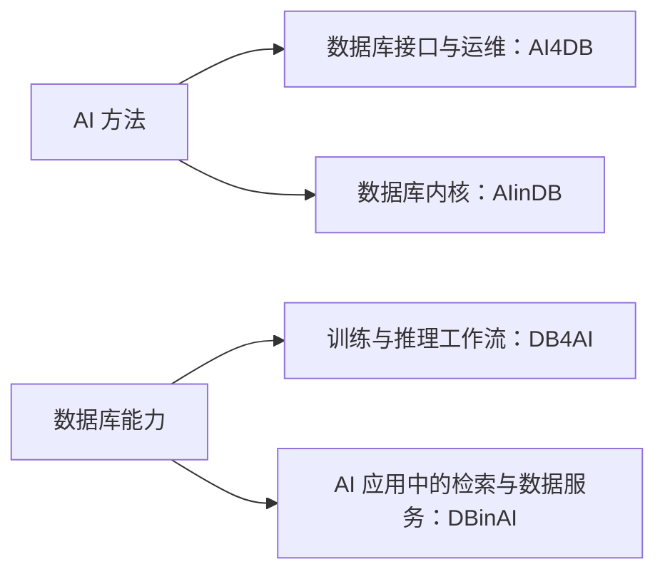
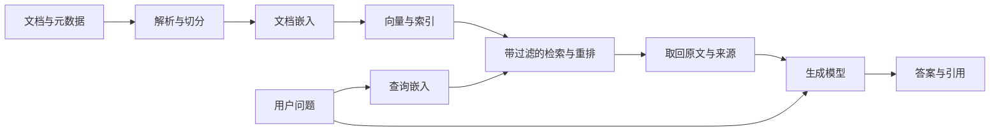

# 6 AI数据库

[5 数据库系统内核](5%20%E6%95%B0%E6%8D%AE%E5%BA%93%E7%B3%BB%E7%BB%9F%E5%86%85%E6%A0%B8.md) 讨论数据库怎样存储记录、建立索引、选择计划并执行查询。本章沿这条主线继续追问：**AI 能改善数据库的哪些环节，数据库又要增加哪些能力，才能支撑模型训练、推理与知识检索？**

**本章主线**：先区分 AI 与数据库结合的位置，再理解模型怎样把内容转换为表示，最后把向量、索引、检索和生成连接成一个可更新、可评估的数据系统。向量相似度、检索命中与答案正确性，是需要分别检查的结果。

来源：《第6章 AI数据库》课件。新增推导与例子标为“补充理解”或“说明例”；产品图按课件中的架构案例理解，关键技术表述结合所引原始研究与官方资料校准。

## 6.1 概述：AI 工作流提出了什么数据问题

### 6.1.1 从查询记录到检索知识

考虑一个课程学习系统中的两种问题：

- “列出1号课程成绩不低于80分的学生”：需要明确表、字段、条件与权限，用 SQL 查询结构化记录。
- “为什么哈希连接能减少反复扫描”：需要找到相关课件片段，再组织成解释，可能用到语义检索和生成模型。

两种请求都依赖数据，却要求不同的查询接口和结果检查。第一种主要检查精确条件与返回记录；第二种还要检查检索材料是否相关、解释是否被材料支持。

文本、图像、音频等内容可以保存到文件或对象存储中。困难在于怎样为内容建立可检索表示，怎样把它与来源、版本、访问范围和结构化条件联系起来，以及怎样让更新及时进入查询链路。

### 6.1.2 本章中的 AI 数据库

本章用 **AI 数据库**描述围绕 AI 工作流组织数据管理与计算能力的一类系统方向。它可以包含模型数据、特征、向量、训练与推理接口，也可以利用学习方法改进数据库自身。

需要区分几类对象：

| 对象 | 保存或处理什么 | 课程学习系统说明例 |
| --- | --- | --- |
| 原始数据 | 业务记录、文档、图片等 | 学生成绩、课程讲义和课件 |
| 特征／嵌入 | 从原始数据产生的模型输入或数值表示 | 讲义片段的检索向量 |
| 模型与配置 | 参数、版本、输入输出约定及评估信息 | 嵌入模型版本、回答模型版本 |
| 索引与统计 | 为查找、计算和规划提供访问结构 | 标量索引、向量索引、列统计 |
| 推理与查询结果 | 根据指定数据和模型得到的输出 | 近邻片段、成绩列表、生成答案 |

“AI 数据库”不是一种统一的物理文件格式，也不表示每个相关产品都实现上表全部能力。学习和比较系统时，应先看它管理什么对象、承担哪一段工作，以及怎样与其他组件协作。

### 6.1.3 工作流对系统的要求

课件归纳的大规模处理、并行计算、模型管理、安全可靠与灵活查询，可以落实为更具体的问题：

| 要求 | 实际需要解决的问题 |
| --- | --- |
| 多种数据统一管理 | 原文、标量、向量和来源如何关联，哪些内容保存在数据库内、哪些由外部存储承载 |
| 训练与推理数据供给 | 清洗、采样、特征计算和数据搬运是否成为瓶颈 |
| 高效相似性检索 | 在延迟、召回、内存、构建和更新成本之间怎样取舍 |
| 模型生命周期管理 | 使用哪一版模型，输入特征与输出含义是否可复现 |
| 数据治理 | 谁能读取哪些资料，修改与删除怎样传播，结果能否追溯 |
| 资源与可靠性 | AI 计算是否挤占正常查询资源，组件故障后怎样恢复 |

这些要求把前五章的索引、代价模型、事务、权限与运行维护延伸到了 AI 工作流。增加一个向量字段或调用一个模型，只完成了其中一部分。

### 6.1.4 自动化程度与职责边界

课件引用一套人机协作分级，从功能辅助、任务执行、协同自治、专业指导到自主智能，强调系统承担的工作会随自动化程度增加而变化。它是所引报告的分类视角，不能直接当作某个现有模型已经达到的能力证明。

对数据库而言，最重要的是明确自动化对象：生成一个 SQL 建议、选择一个执行计划、修改生产参数和恢复数据库，具有不同的验证条件与影响范围。

**说明例**：模型建议为慢查询建索引，系统仍需比较查询收益、额外空间、写入维护成本，以及当前工作负载。能够生成建议，与建议在这个数据库上有效，是两项不同结果。

## 6.2 AI 数据库技术体系

### 6.2.1 四类融合位置

本节沿用课件的四个名称，通过“AI 服务谁、接入哪一层”区分路线：

| 路线 | 课件中的主要位置 | 典型任务 | 输出 |
| --- | --- | --- | --- |
| **AI4DB** | 数据库接口、管理与运维平台 | NL2SQL、异常检测、诊断、参数调优和索引建议 | 查询或运维建议、可验证的配置决策 |
| **AIinDB** | 数据库内核 | 学习型基数／代价估计、计划选择、学习索引、缓存预测 | 内核执行所需的估计或策略 |
| **DB4AI** | 数据库对 AI 工作流提供服务 | 特征计算、库内训练／推理、模型与数据集管理 | 特征、模型、预测结果 |
| **DBinAI** | AI 应用链路中的数据库组件 | 向量检索、RAG 外部知识、混合查询 | 检索上下文和受管理的数据访问 |

这是一种教学分工，边界可以重叠。例如同一个系统可以用学习模型估计行数，同时为 RAG 保存向量；其他文献也可能把内核学习能力统称为 AI4DB。判断时回到实际机制，而不只看缩写。



### 6.2.2 AI4DB：从运行数据到运维决策

#### 6.2.2.1 采集、诊断与反馈

课件的智能运维平台从 OS、数据库实例、SQL、日志和审计中收集信息，再进行趋势判断、故障定位与调优。

```text
指标与日志 → 检测异常 → 定位可能原因 → 生成策略
        → 校验并按策略实施 → 观察效果 → 更新判断
```

**说明例**：查询延迟突然上升，可能来自连接等待、锁等待、计划变化、数据量增长或存储访问变慢。只看“CPU很高”不足以确定原因，需要把请求、计划、锁和资源的时间关系联系起来。

规则、统计模型、监督学习、强化学习与语言模型都可以参与。并不是每一项自动化都需要大语言模型，也不是检测到相关指标变化就已经证明因果关系。

#### 6.2.2.2 NL2SQL 的输入和检查

**自然语言转 SQL（NL2SQL／Text-to-SQL）**将用户问题转换为数据库查询。模型至少需要理解表结构、列含义、关联、业务口径和访问范围。

“统计优秀学生”如果没有明确成绩阈值、课程范围和重复计数规则，就存在需求歧义。正确流程应将业务含义与模式对应，再检查 SQL 的对象、条件、连接和结果。

第五章已经说明：语法可执行不等于语义正确，模型生成的 SQL 也要遵守这一点。执行计划和结果样例能帮助验证查询成本与含义；数据库的授权机制仍需约束实际访问。

#### 6.2.2.3 自调优的评价对象

调优建议应围绕完整工作负载评价。例如增加一个索引可能缩短某条查询，却增加写入、空间和维护成本；修改缓存策略也可能改善热点访问，却损害其他请求。

课件展示的“效率提升10倍”等平台表述没有在本材料中给出完整对照负载和测量方法，适合用来识别产品目标。可检查的结论需要给出数据规模、并发、基线、延迟分布和资源成本。

### 6.2.3 AIinDB：学习方法进入内核

#### 6.2.3.1 优化器中的学习位置

[5 数据库系统内核](5%20%E6%95%B0%E6%8D%AE%E5%BA%93%E7%B3%BB%E7%BB%9F%E5%86%85%E6%A0%B8.md) 的查询优化已经包含重写、统计、基数估计、代价估计与计划搜索。课件把这些环节分别对应到可学习的组件：

| 环节 | 传统困难 | 学习方法可以提供什么 |
| --- | --- | --- |
| 查询重写 | 等价规则很多，应用次序影响中间规模和规划时间 | 推荐规则或应用顺序 |
| 基数估计 | 均匀、独立等假设难以表达偏斜与列间关联 | 对谓词或连接结果规模作数据驱动预测 |
| 代价估计 | CPU、I/O、缓存与硬件交互难以完全手工建模 | 估计执行时间或资源消耗，校正传统模型 |
| 计划搜索 | 候选连接顺序与算法组合迅速增长 | 引导搜索、剪枝或候选排序 |
| 计划反馈 | 数据分布、参数与负载会变化 | 比较预测与实际结果，调整模型或计划选择 |

**说明例**：两个列分别统计时看起来独立，实际上“城市”几乎决定“邮政区域”。对两列条件直接相乘会低估或高估结果行数。联合统计、概率模型或学习型估计器可以表达一部分关联，随后仍需比较估计与实际行数。

学习模型输出的通常是估计或策略，不是等价证明。SQL 改写仍须保持查询语义；用 AI 引导组合搜索，也不意味着已经消除了搜索空间或获得无条件全局最优保证。

#### 6.2.3.2 内核中的训练与推理成本

内核组件会频繁调用，模型本身的开销可能影响整体收益。课件特别强调高效算法、轻量模型、接口易用、可解释性以及自适应更新。

**补充理解**：比较一种新规划方法时，可以先把单次路径拆成：

$$
T_{\mathrm{总}}=T_{\mathrm{规划其他步骤}}+
T_{\mathrm{模型推理}}+T_{\mathrm{执行}}
$$

缩短执行时间要与新增推理时间一起计算；训练、模型维护和内存占用还需单独核算。小而快的统计或学习模型，有时比能力更强但调用昂贵的大模型更适合内核热路径。

#### 6.2.3.3 漂移、反馈与回退

**数据／负载漂移**是训练或校准时的分布与当前运行分布发生变化，例如热点键改变、表规模增长、查询模板变化。

课件通过实际查询耗时、算子信息和行数反馈校正模型，并讨论模型更新与淘汰。工程上还需要评估模型在新负载上的表现，保留可用的基线策略，在模型失效时维持查询正确执行。

缓存预测、页预取与学习型索引也遵循相同思路：预测帮助减少访问或缩小查找范围，底层结构仍要确认记录与维护更新。学习型索引的误差处理已在第五章讨论。

### 6.2.4 DB4AI：把 AI 计算放到数据附近

#### 6.2.4.1 特征工程与训练输入

**特征工程**将原始数据处理为模型使用的输入，包括清洗、连接、聚合、编码和时间窗口计算。数据库已经擅长其中许多结构化操作，可以减少反复导出和重复计算。

**说明例**：预测某本书未来一周的借阅量，需要在某个历史时点计算过去7天借阅次数、馆藏数量和节假日等特征。训练样本的特征应只使用该时点之前可获得的信息；把未来一周的真实借阅次数混入特征，会造成数据泄漏。

这也说明数据管理要记录时间、来源与版本。训练侧和在线推理侧应统一特征定义、字段顺序、编码与缺失值处理；一致的是计算口径，不要求不同时点的特征值相同。

#### 6.2.4.2 SQL 接口、AI 算子与资源调度

课件的库内 AI 架构包括：

- **接口层**：SQL 扩展或 UDF，将训练、预测等任务暴露给用户。
- **SQL 引擎**：解析任务，评估资源与代价，选择计算路径。
- **执行引擎**：运行 AI 算子，安排并行训练、推理及异构硬件。
- **存储与管理层**：组织数据集、模型版本、导入导出及相关元数据。

把任务表达成 SQL 可以降低接口切换成本，但不会代替特征选择、数据划分、评估指标和模型验证。库内执行也不意味着模型所有计算必然发生在同一个数据库进程里，具体系统可以调用外部服务或加速设备。

GPU、NPU 等硬件适合部分计算；收益还受数据传输、批大小和并行方式影响。资源管控需要防止训练或大批推理占满正常数据库查询所需的内存、CPU 或 I/O。

#### 6.2.4.3 模型管理也是数据管理

模型管理至少需要把“模型”与“产生模型的条件”联系起来：

| 记录 | 为什么需要 |
| --- | --- |
| 模型版本与位置 | 知道当前调用哪个参数文件或服务 |
| 特征定义和输入模式 | 保证字段顺序、类型、编码与训练时一致 |
| 训练数据版本和时间范围 | 重现训练条件、分析变化来源 |
| 评估结果与适用任务 | 判断模型在哪些数据上达到什么效果 |
| 部署状态与调用记录 | 追溯预测输出并支持版本切换 |

模型参数本体可以由合适的存储保存，数据库管理其标识、引用和状态。只有保存了一个模型文件，还不足以复现它的全部训练与预测过程。

### 6.2.5 DBinAI：数据库成为 AI 应用的外部数据层

在课件的 DBinAI 路线中，应用负责处理问题、调用嵌入模型与生成模型，数据库负责组织、检索和管理外部知识。

```text
内容处理 → 嵌入表示 → 向量与标量数据管理
                          ↓
用户问题 → 检索与筛选 → 相关内容 → 模型生成回答
```

这里可以采用独立向量数据库，也可以在关系型或其他数据库中增加向量检索能力。系统选择要比较查询表达力、标量过滤、索引、事务与更新、可靠性、权限、运维和整体成本。

课件按产品类型归纳优劣，适合作为检查维度；是否可靠、是否支持复杂混合查询，要看具体实现和版本。单独做向量检索的算法库，也不自动等于具有持久化、并发访问与恢复能力的完整数据库。

## 6.3 AI 大模型与向量数据库

### 6.3.1 从大模型到向量检索

大语言模型能够根据上下文生成文本，但它的参数不会因一本新手册进入企业资料库而自动更新。假设用户问“空调显示 E4 应该检查什么”，应用可以先从手册中找出相关段落，再把段落和问题一起交给模型回答。这条链路涉及三个不同的工作：

1. **嵌入模型**把手册片段与问题转换成可比较的向量。
2. **向量数据库**保存和管理向量、相关标识及元数据，并按相似度检索候选片段。
3. **生成模型**根据用户问题和取回的内容组织回答。

向量检索为生成提供证据；生成模型负责利用证据。最终效果同时取决于文档质量、嵌入模型、检索、上下文组织和生成过程。

### 6.3.2 大模型的训练与生成

#### 6.3.2.1 模型、参数与训练

人工智能包含机器学习，深度学习是机器学习中使用多层神经网络的一类方法。**模型**可以看作一个带参数的计算函数：输入数据经过多层运算，得到预测结果；**参数**是训练过程中调整的数值，模型结构则规定这些参数如何参与计算。

“大模型”通常指参数、训练数据和计算投入较大的模型，并没有适用于所有领域的统一参数数量门槛。语言大模型主要处理语言；多模态模型还可以处理图像、音频等其他类型的输入或输出。模型学到的模式可能迁移到不同任务，但表现取决于训练数据、结构、任务和使用条件。

训练时，模型先对样本做预测，用**损失函数**衡量预测与训练目标的差异，再通过反向传播和优化算法调整参数。这个过程重复很多次，目标是让模型在训练目标上形成有用的预测能力。例如，自监督语言建模可以从文本本身构造训练信号：给定前文，预测后续词元。

- **预训练**：在较大范围的数据上学习通用表示和模式。
- **微调**：在预训练基础上，继续用特定任务或指令数据调整参数，使模型更适应目标用途。
- **推理**：使用训练好的参数处理新输入、产生输出；普通的一次对话通常不会直接改写模型参数。

训练与推理都需要计算资源，但工作不同。训练需要根据损失更新参数；推理主要执行前向计算。RAG 在推理时提供外部资料，通常无需因每次知识更新都重新训练生成模型；它也可以与微调结合，例如先训练检索器，再在回答时检索外部资料。

#### 6.3.2.2 Token 与逐步生成

模型通常先用分词器把文本切成 **Token（词元）**。一个 token 可以是字符、词的一部分、一个词或其他文本片段；具体切分取决于分词器，不能把 token 数量简单等同于中文字数或英文单词数。每个 token 被映射为数值向量，并结合位置信息送入模型。

对于自回归语言模型，生成过程可以表示为：

$$
P(x_1,\ldots,x_T)=\prod_{t=1}^{T}P(x_t\mid x_1,\ldots,x_{t-1})
$$

其中 $x_t$ 是第 $t$ 个 token。模型根据已有上下文计算下一个 token 的概率分布，按解码策略选出一个 token，接着把它加入上下文，重复这一过程。生成的句子看起来连贯，不代表每一条陈述都有事实依据；回答还受知识时效、输入和生成方式影响。

#### 6.3.2.3 怎样阅读模型规模与历史案例

课件用参数、数据与计算资源说明“大”，并介绍预训练迁移、多模态和“涌现”等特点。规模增加能否改善某项能力，要结合任务、训练方式和评估指标判断；模型更大也可能带来更高推理成本。“涌现”所指的明显能力变化，应在明确任务和测量口径下观察，不能单凭参数量判定。

阅读历史模型与产品资料时，需要区分模型、应用产品及测量结论：

- GPT 等名称用于模型系列，ChatGPT 则是应用产品；产品体验还受检索、工具和服务配置影响。
- GPT-4 技术报告未公开模型参数规模，课件中的“1.8万亿”不能作为官方已披露数据。[GPT-4 技术报告](https://arxiv.org/abs/2303.08774)
- Word2Vec 推动了高效词向量学习与应用；更早的神经语言模型已经学习分布式词表示，不能将2013年写作词向量的首次出现。[Bengio 等，2003](https://www.jmlr.org/papers/v3/bengio03a.html)
- 视频生成能力的进展可以说明多模态建模方向，不能仅凭 Sora 发布推出 AGI 已实现。[Sora 技术报告](https://openai.com/index/video-generation-models-as-world-simulators/)

产品排名和性能倍率需要具体日期、模型版本、任务、指标与对照设置。课件的“第一”榜单与宣传数字没有给出完整口径，不据此判断某个模型在所有任务上领先。

### 6.3.3 Transformer 与自注意力

课件先回顾了神经网络的几种结构：前馈网络按层变换输入，CNN 用局部卷积和参数共享提取特征，RNN 用递归状态处理序列。它们也能产生数据表示，并非所有 AI 模型都采用同一种架构。

Transformer 是常见的神经网络架构，其关键组件是**注意力**：对当前位置而言，计算输入中其他位置与它的相关权重，再对这些位置提供的信息做加权汇总。原始 Transformer 使用编码器和解码器；后续语言模型有三种常见组织方式：

| 结构 | 信息处理方式 | 代表与常见用途 |
| --- | --- | --- |
| Encoder-only | 编码输入，通常可以结合左右上下文 | BERT：文本理解、分类及表示学习 |
| Decoder-only | 按因果顺序利用当前位置及之前的信息 | GPT 类模型：逐 token 生成文本 |
| Encoder–Decoder | 编码器处理输入，解码器结合输入表示生成输出 | T5 等：翻译、摘要等输入到输出任务 |

这三类模型都能使用 Transformer 组件，具体训练目标和下游用法仍取决于模型设计。[Transformer 原论文](https://arxiv.org/abs/1706.03762)

#### 6.3.3.1 自注意力如何计算

考虑一句话“机器读取手册，它回答问题”。理解“它”时，模型需要结合前面的上下文。自注意力为句中的每个位置生成三个向量：查询 $q$、键 $k$ 和值 $v$。查询与各个键的匹配程度决定权重，再用权重汇总各位置的值。

把所有位置的查询、键、值分别写成矩阵 $Q$、$K$、$V$，一种常见计算形式是：

$$
\operatorname{Attention}(Q,K,V)=\operatorname{softmax}\!\left(\frac{QK^{\mathsf T}}{\sqrt{d_k}}\right)V
$$

这里 $d_k$ 是键向量的维度；$QK^{\mathsf T}$ 计算位置之间的匹配分数，缩放后经 softmax 转成每行之和为 1 的权重，最后与 $V$ 相乘得到加权结果。$Q$、$K$、$V$ 由输入表示经过不同的可学习变换得到。

**说明例**：某个位置对两个可见位置分配的权重为 $0.8$ 和 $0.2$，对应值向量为 $(1,0)$ 和 $(0,1)$，则汇总结果是 $0.8(1,0)+0.2(0,1)=(0.8,0.2)$。权重由模型计算，并会随输入和层次变化。

多头注意力并行计算多组这样的表示，再进行组合。位置编码让模型获得顺序信息；解码器中的因果掩码限制生成当前位置时访问未来 token。注意力是上下文计算机制，整个 Transformer 还包含前馈网络、残差连接等组件。

### 6.3.4 嵌入：把数据表示为空间中的点

**嵌入（Embedding）**是模型把对象映射为数值向量的一种表示方式。对于一段文本，可以写成：

$$
f(\text{文本})=\mathbf{x}=(x_1,x_2,\ldots,x_d)\in\mathbb{R}^{d}
$$

其中 $f$ 是嵌入模型，$d$ 是输出维度。模型经过合适的训练后，向量间的几何关系可以反映任务关心的相似性。例如，两段表述不同但都讨论制冷故障的文字，可能比一段讨论制冷、另一段讨论数据库索引的文字更接近。每一维通常不必单独解释为某个人类可读的属性。

文本、图像、音频都可以使用各自的编码模型得到向量。跨模态检索还要求不同模态的编码器经过对齐，使文本和图像等表示处于可比较的空间；图像向量与文本向量即使维数相同，也不会自动具有可比性。

**查询与文档需要使用相兼容的向量空间和度量方式**。有些检索模型分别使用配对的查询编码器和文档编码器；它们可以不是同一个函数，但必须按设计对齐。更换模型或版本后，旧文档向量与新查询向量可能无法直接比较，需要重新编码或迁移索引。

向量维度由模型决定，并无“固定为 20–128 维”的通用规则。向量越长，原始存储与距离计算通常越昂贵；检索质量也取决于训练目标和数据，并非维度越大就一定越好。用于生成的模型和用于检索的嵌入模型可以不同，单个 token 的上下文向量也不自动等于适合整段检索的向量。句子、段落级表示可由专门的嵌入模型产生。参见[双编码器密集检索](https://arxiv.org/abs/2004.04906)。

**说明例**：若保存 100 万条 768 维向量，每个分量使用 4 字节的 float32，光是原始向量就约需 $10^6\times768\times4=3.072\times10^9$ 字节，即 3.072 GB。主键、元数据、索引和副本还会占空间。这个估算说明维度、数量与精度怎样共同影响存储，并不是数据库的完整容量预算。

### 6.3.5 相似度与距离

设查询向量为 $\mathbf{q}$，候选向量为 $\mathbf{x}$。距离或相似度函数定义了“相近”的计算方式；检索的排序由该函数和模型共同决定。

#### 6.3.5.1 常见度量

**欧氏距离**衡量两点之间的直线距离，越小表示越近：

$$
d_{L2}(\mathbf{q},\mathbf{x})=\sqrt{\sum_{i=1}^{d}(q_i-x_i)^2}
$$

**余弦相似度**衡量两个非零向量的方向一致程度，越大表示方向越接近：

$$
\cos(\mathbf{q},\mathbf{x})=\frac{\mathbf{q}\cdot\mathbf{x}}{\|\mathbf{q}\|\,\|\mathbf{x}\|}
$$

内积 $\mathbf{q}\cdot\mathbf{x}$ 同时受方向和向量长度影响。二值向量也可以使用汉明距离，计算对应位置上不同的位数；集合可以用 Jaccard 相似度，计算交集大小占并集大小的比例。

**说明例**：令 $\mathbf{q}=(1,0)$，$\mathbf{a}=(2,0)$，$\mathbf{b}=(0.8,0.6)$。余弦相似度分别为 $1$ 和 $0.8$，因此 $\mathbf{a}$ 更接近查询方向；欧氏距离分别为 $1$ 和 $\sqrt{0.4}\approx0.632$，因此 $\mathbf{b}$ 的位置更近。同一组向量在不同度量下可能得到不同排序。

若所有比较向量都经过 L2 归一化，成为长度为 1 的非零向量，则：

$$
\|\mathbf{q}-\mathbf{x}\|^2=2-2(\mathbf{q}\cdot\mathbf{x})=2-2\cos(\mathbf{q},\mathbf{x})
$$

因此在这种条件下，按欧氏距离从小到大、按内积或余弦相似度从大到小得到相同排序。是否归一化以及使用哪种度量，应遵循嵌入模型的设计和具体任务；不能仅凭“文本”或“图像”判定唯一正确的距离函数。零向量没有定义良好的余弦相似度。

### 6.3.6 精确最近邻与近似最近邻

**最近邻查询**给定查询向量，在候选集合中按指定距离或相似度排序。Top-$K$ 查询返回最相近的 $K$ 个候选；范围查询也可以返回距离不超过某个阈值的候选。向量查询既可以精确执行，也可以使用近似方法。

#### 6.3.6.1 精确 KNN

精确的 $K$ 近邻（K-nearest neighbors, KNN）搜索可以逐个计算所有候选与查询的距离，再选出最优的 $K$ 个。若有 $N$ 个 $d$ 维稠密向量，逐个算距离的主要计算量约为 $O(Nd)$，还需维护和排序候选。它能得到指定度量下的真实 Top-$K$，适合数据量较小的查询，也可作为评估其他方法的基准。

**说明例**：5 条向量到查询的距离依次为 $0.1,0.4,0.2,0.8,0.3$。精确 Top-2 扫描全部 5 条后，返回距离为 $0.1$ 和 $0.2$ 的两条。

#### 6.3.6.2 ANN 的取舍

**近似最近邻（Approximate Nearest Neighbor, ANN）**通过索引或压缩等方法减少搜索开销，可能漏掉真实最近邻，或因近似距离改变顺序。ANN 追求的通常是：在可接受的召回率下，降低延迟、计算量或内存开销。具体性能必须在数据、索引和查询负载下测量。

可用精确搜索的结果作为基准，比较时固定数据快照、过滤条件、距离函数和 K。设候选至少有 $K$ 条，且并列分数采用一致处理规则；$E_K$ 为精确 Top-$K$ 的 ID 集合，$A_K$ 为 ANN 返回的 ID 集合，则：

$$
\mathrm{Recall@}K=\frac{|A_K\cap E_K|}{K}
$$

**说明例**：精确 Top-5 为 $\{a,b,c,d,e\}$，ANN 返回 $\{a,b,c,d,f\}$，则 Recall@5 为 $4/5=0.8$。这里衡量的是 ANN 对精确向量排序的还原程度；即使 Recall@5 为 1，也不能单凭这一点证明结果对用户问题有用，因为嵌入和距离本身可能没有反映用户意图。

#### 6.3.6.3 三类常见索引思路

1. **HNSW：基于图导航。** 将向量作为节点，建立多层近邻图；高层节点稀疏，便于快速接近查询所在区域，随后逐层下降并在底层扩大搜索。搜索探索得越充分，通常越可能找到好的邻居，也会增加耗时；图连接带来额外内存和维护成本。
2. **IVF：基于聚类和倒排列表。** 先将向量划入若干簇并为每个簇维护列表；查询时先找到靠近查询的若干簇，只扫描这些列表。搜索更多簇通常提高召回，也增加计算。对于存储原向量的 IVF-Flat，扫描全部列表并按同一度量计算时可退化为穷举；实际只扫描部分列表时可能漏掉其他簇中的近邻。
3. **PQ：基于乘积量化压缩。** 把向量切为若干子向量，各自用训练得到的码本中的代表值近似，以短编码替代原始数据的一部分。距离可以基于压缩表示近似计算，节省存储和计算，但量化误差可能影响排序；必要时可对候选使用原向量精排。PQ 可以与 IVF 等结构组合，也可以扫描全部压缩编码，所以“是否穷举”和“距离是否精确”是两个不同问题。

**说明例：IVF 为什么可能漏掉近邻。** 设二维空间中两个簇中心为 $(0,0)$、$(10,0)$，查询为 $(4,0)$。若只搜索离查询中心较近的第一个簇，就不会查看第二个簇。第二个簇中即使存在向量 $(5.1,0)$，它距查询仅 $1.1$，也可能被漏掉；多搜索一个簇可以检查这条候选。

**说明例：PQ 如何压缩。** 将四维向量 $(0.11,0.12,1.01,1.03)$ 分成 $(0.11,0.12)$ 和 $(1.01,1.03)$，假设两个子空间的码本中最近代表分别为 $(0.1,0.1)$ 和 $(1,1)$，就可以存储对应的码本编号。恢复或计算距离时使用代表值近似原值，因此会产生量化误差。这里的码本由训练数据构建，示例只展示编码过程。

LSH 使相似对象有较高概率进入同一候选桶；KD 树、球树等通过空间划分缩小候选，高维或特定分布下剪枝效率可能下降。不同方法的效果受维度、数据分布、更新频率和资源约束影响。第五章的通用索引与代价分析见 [5 数据库系统内核](5%20%E6%95%B0%E6%8D%AE%E5%BA%93%E7%B3%BB%E7%BB%9F%E5%86%85%E6%A0%B8.md)。

**Faiss 的位置**：Faiss 是用于向量相似性搜索和聚类的库，包含 Flat、HNSW、IVF、PQ 等多种索引实现，并支持部分 GPU 实现；它不是与 HNSW、IVF 同一层级的单一索引算法。向量数据库可以在检索库之上提供数据管理和服务能力。[Faiss 索引说明](https://github.com/facebookresearch/faiss/wiki/Faiss-indexes)

### 6.3.7 向量数据库与数据管理

**向量数据库**是支持向量存储、索引、相似性检索与管理的数据库系统。它可以管理向量、主键、标量字段、元数据以及原始内容或内容引用。例如，一条记录可以包含片段 ID、文本、向量、所属文档、更新时间和访问权限；原文也可以保存在其他存储中，再通过 ID 取回。

实现方式包括独立的向量数据库，以及在关系型或其他数据库中加入向量类型和检索索引。是否适合某个系统，应看数据规模、查询、运维及一致性需求，不能规定统一的最低数据规模。关系数据库也能支持低延迟、高并发或向量扩展；向量数据库也可能支持精确查询和标量过滤。[pgvector](https://github.com/pgvector/pgvector) 是关系数据库扩展的例子，支持向量与其他字段协同存储，也提供精确与近似检索。

| 查询需求 | 示例 | 所关心的结果 |
| --- | --- | --- |
| 标量条件查询 | `device_id = 17` 或 `year >= 2025` | 满足条件的记录 |
| 精确向量查询 | 按指定距离寻找最相近的 5 条 | 全部候选下的真实 Top-5 |
| 近似向量查询 | 使用 HNSW 搜索相近的 5 条 | 在资源约束下近似真实 Top-5 |
| 组合查询 | 在可访问手册中搜索相似片段 | 既满足标量条件又按相似度排序 |

除相似性搜索外，数据库还需要解决：

- **数据操作**：插入、更新、删除、按 ID 获取记录，以及维护数据与索引的对应关系。
- **查询组合**：把向量相似度与标量过滤、关键词等条件组合。
- **持久化与恢复**：数据、索引及必要的日志或快照如何保存、备份和恢复。
- **并发与一致性**：写入之后何时能被查询看到，删除如何生效；具体保证由产品及配置决定。
- **权限与运维**：身份认证、访问控制、监控、容量规划、扩缩容和故障恢复。

向量检索并不替代事务需求：如果业务要求多个写操作满足原子性等事务性质，应核对所用数据库的事务范围和一致性保证，必要时与其他数据库协作。

### 6.3.8 过滤、混合检索与重排

向量检索回答“哪些内容在向量空间里相似”；真实查询往往还带有明确条件。例如，查找“2025 年后发布、且当前用户有权访问的 E4 故障说明”，既要匹配语义，也要满足时间和权限约束。

**标量过滤**按字段条件筛选候选，例如 `year >= 2025` 或 `tenant_id = 当前租户`。可以先过滤再搜索，也可以在向量搜索过程中结合过滤，或先生成较多候选再过滤。先筛选可能缩小搜索范围；先取少量近邻再过滤可能不足 $K$ 条，甚至错过符合条件的结果。权限必须在内容返回给用户或模型之前正确执行，具体实现和索引计划需要按系统验证。

**混合检索**组合不同的检索信号。例如：

- 向量检索可以找到“设备显示异常代码”与“空调报错”这类表达相近的内容。
- 关键词检索可以保留型号、错误码 `E4` 等需要精确匹配的词。
- 合并两路候选后，可以用规则、融合排序或重排模型进一步排序。不同分数的尺度可能不同，不能未经处理就简单相加。

初次检索关注从大量数据中快速找到候选；**重排（reranking）**对较少的候选做更细致的相关性判断，再选出最终提供给模型的片段。向量相似、关键词命中与用户真正需要的答案之间仍可能有差距，因此要在真实问题上评估。

### 6.3.9 检索增强生成 RAG

**检索增强生成（Retrieval-Augmented Generation, RAG）**在生成答案前取回外部资料，把它们和用户问题一起提供给生成模型。资料可以来自向量检索、关键词检索、数据库查询等；向量数据库是常见组件之一。[RAG 原论文](https://arxiv.org/abs/2005.11401)



#### 6.3.9.1 知识入库：准备可检索的证据

1. **加载与解析**：从手册、网页等来源提取内容，保留来源、版本、权限与更新时间。
2. **切分**：将长文档划分为适合检索和模型上下文的片段，可按标题、段落或长度切分；相邻片段可以适当重叠，减少关键信息被边界截断。
3. **向量化**：用文档编码器为片段生成嵌入，记录模型和版本。
4. **写入与建索引**：保存片段 ID、向量、元数据，以及原文或其引用；按数据规模和查询需求选择索引。

切块太大，检索结果可能混入大量无关信息；太小，答案所需的上下文可能被拆散。切块大小和重叠量需要结合文档结构及实际问题调整。

#### 6.3.9.2 在线问答：检索并利用证据

1. 接收问题和用户身份，用兼容的查询编码器生成查询向量。
2. 结合权限和元数据条件检索候选，必要时加入关键词检索、融合及重排。
3. 取回用户有权访问的原文片段、来源和版本；把问题与选中的证据组织成提示，交给生成模型。
4. 生成答案，并在应用需要时附上来源，方便用户核对。

**说明例**：用户问“E4 出现后先检查哪里”。关键词检索可以锁定错误码，向量检索补充措辞不同的故障说明；系统根据设备型号与权限筛选，把相关手册段落交给模型，再由模型根据该段落回答。若不同型号的 E4 含义不同，型号过滤会直接影响答案。

#### 6.3.9.3 更新与评估

手册更新时，应重新处理受影响的片段、更新向量与索引，并处理被删除或失效的旧内容。更换嵌入模型时，要考虑新旧向量空间兼容性、重新编码、索引切换和回滚。知识库更新并不等于模型参数更新。

RAG 可以让模型使用较新的领域资料并提供可核对的来源，但效果依赖检索是否找到正确片段、资料是否可信、模型是否忠实使用证据；它不能保证消除幻觉。隐私也取决于文档权限、部署位置、数据传输和模型服务等环节，不能因为使用 RAG 就自动得到保障。

评估时应分开看：

- **向量索引质量**：相同数据和距离下，ANN 相对于精确结果的 Recall@K、延迟、吞吐量与资源消耗。
- **检索相关性**：正确证据是否出现在候选中，排序是否靠前；需要有标注的问题与相关文档。
- **生成质量**：答案是否回应问题、是否得到检索证据支持、引用是否对应、资料过期或缺失时如何处理。

只看模型答案无法定位问题来自切分、检索还是生成；只看 ANN 召回率也无法证明答案正确。

### 6.3.10 向量数据服务的架构案例

#### 6.3.10.1 Milvus 的分层职责

Milvus 是面向向量数据管理与相似性搜索的开源数据库。它把数据组织为 **Collection（集合）**，集合中可包含向量及标量字段；**Partition（分区）**可将集合中的数据进一步划分。这个例子用来观察数据库如何把向量索引组织成可供多个客户端使用的服务。

课件展示的 Milvus 历史架构分为四层：

| 层次 | 主要职责 |
| --- | --- |
| 接入层 | 接收、校验和转发客户端请求，汇总并返回结果 |
| 协调服务层 | 管理集群、任务调度、数据与查询等协调工作 |
| 执行节点层 | 执行数据写入、索引构建和查询等任务 |
| 存储服务层 | 保存元数据、对象文件以及持久化所需的日志等 |

这种分层将请求接入、协调、计算与持久化区分开，便于理解扩展和恢复如何分工。实际组件划分会随版本演进，部署时应查对应版本的文档，而不是将历史架构视为当前所有版本的固定实现。[Milvus 架构说明](https://milvus.io/docs/v2.5.x/architecture_overview.md)

课件把部分工作节点称为“无状态”，应理解为持久数据不只依赖某个工作节点本地内存，系统可按其架构从持久存储与日志恢复。运行中的节点仍可能持有缓存、加载的索引或中间状态，不能把“无状态”理解为不使用内存状态。

#### 6.3.10.2 托管服务、对象管理与算法库

课件还用 Pinecone 展示托管的向量检索 API 服务，用 Weaviate 展示对象、倒排与向量检索的结合。这里重点识别分工：

| 层次 | 课件中的案例 | 需要检查的能力 |
| --- | --- | --- |
| 检索算法库 | Faiss | 索引、度量、精确或近似搜索及硬件适配 |
| 向量数据系统 | Milvus、Weaviate | 数据组织、索引更新、过滤、持久化、并发和权限 |
| 托管数据服务 | Pinecone | 通过服务接口交付检索与管理能力，结合其服务配置评估运行保证 |

产品可跨越多个层次；嵌入生成可能由外部模型或集成模块完成。选用时要把查询要求、数据治理和运维责任逐项对应，产品名称本身不能代替能力与负载测试。

## 本章复习总表

| 对象／机制 | 核心问题 | 应能回答的自测 |
| --- | --- | --- |
| AI 数据库 | 新增哪些工作流能力 | 精确查成绩与解释课程知识，分别需要什么数据访问？ |
| 四类融合位置 | AI与数据库怎样分工 | NL2SQL、学习型代价估计、库内预测和RAG分别落在哪个位置？ |
| 自治运维 | 建议怎样变成可验证决策 | 新索引改善一条查询后，还要检查哪些成本？ |
| 学习型内核 | 预测怎样帮助规划 | 行数估计准确是否就保证计划执行一定最快？ |
| 特征工程 | 数据怎样进入模型 | 为什么不能把预测时点之后的数据用于历史样本特征？ |
| 模型生命周期 | 怎样追溯一次预测 | 模型文件之外，还需要记录哪些数据与特征版本？ |
| 训练与推理 | 参数何时变化 | 上传新文档、微调与一次问答分别改变什么？ |
| Token 与架构 | 文本怎样被模型处理 | Token为何不等于完整词，GPT的因果掩码限制什么？ |
| 注意力 | 怎样聚合上下文 | Q、K、V分别承担什么，softmax之后为什么是加权汇总？ |
| 嵌入空间 | 表示怎样变得可比较 | 相同维度的两个模型输出为何未必能直接比较？ |
| 距离与归一化 | 排序依据是什么 | 余弦与L2何时排序不同，何时可得到相同排序？ |
| 精确与近似搜索 | 用什么换取检索速度 | ANN的Recall@K为1，为什么仍不能保证片段相关？ |
| HNSW／IVF／PQ | 搜索与压缩怎样减少开销 | 增大搜索范围与使用原向量重排，分别缓解什么误差？ |
| 过滤与混合检索 | 语义和精确条件怎样组合 | 只取K条近邻再过滤，为什么可能得不到K个合格结果？ |
| RAG 入库与问答 | 外部资料怎样成为生成上下文 | 文档更新或删除后，哪些片段、向量和索引需要同步？ |
| RAG 与微调 | 外部上下文与参数怎样配合 | 为什么两者可以共同使用，知识库更新不等于参数更新？ |
| 系统与算法库 | 检索怎样成为数据库服务 | Faiss提供索引后，还缺少哪些持久化与服务管理工作？ |
| 分层与状态 | 计算与持久化怎样分工 | 工作节点无状态是否意味着没有缓存或内存索引？ |

读完应能从一个 AI 应用需求出发，说明数据、模型、索引与查询各自承担什么，并沿“表示—检索—生成”定位结果误差和系统成本。
