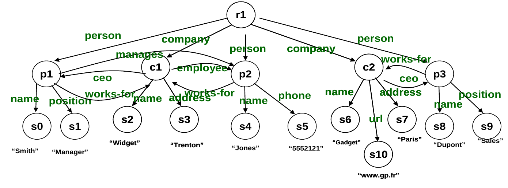
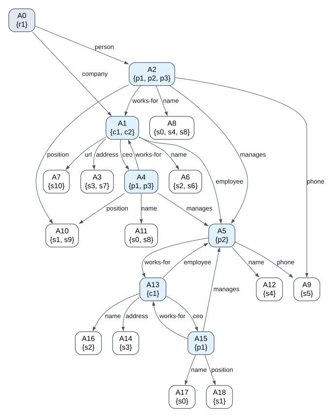
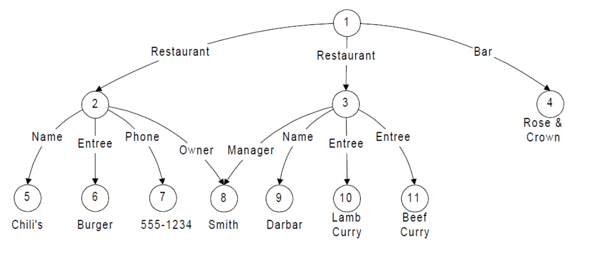
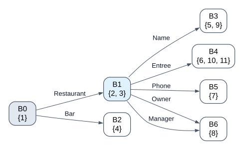
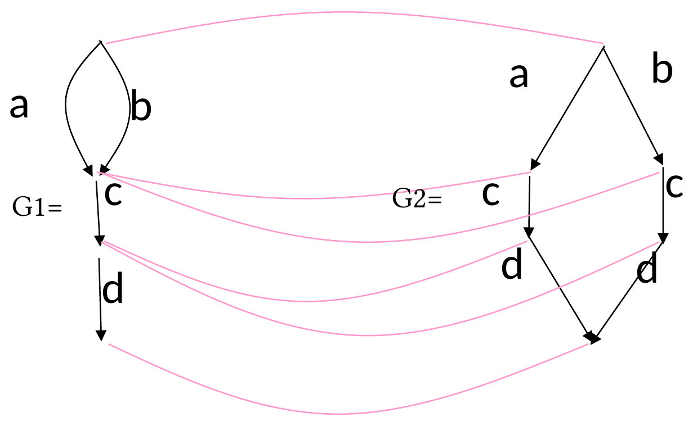
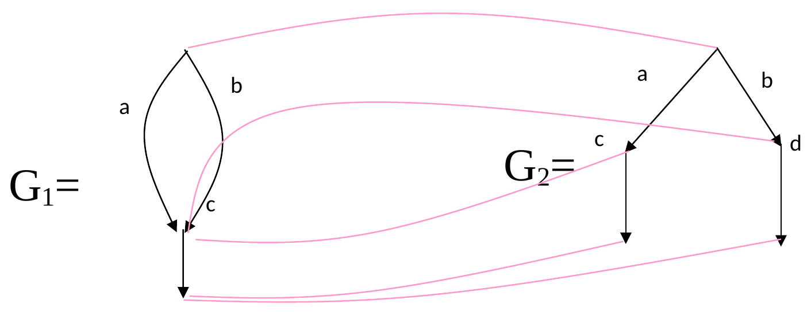
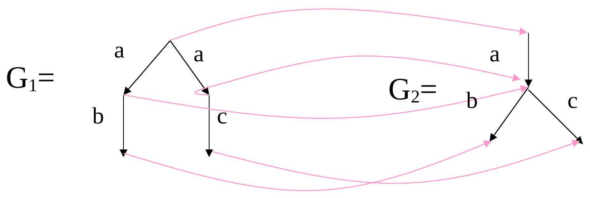
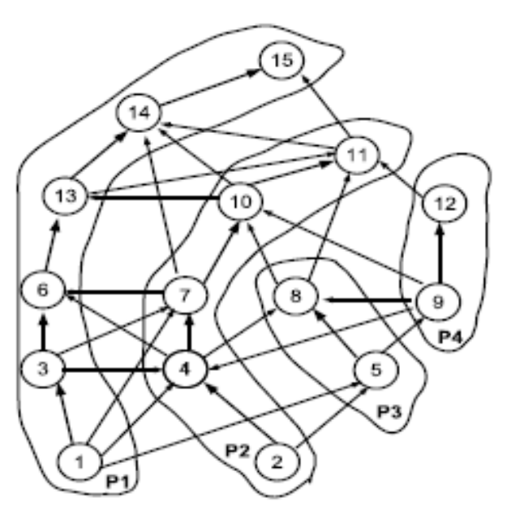

## 一、DataGuide 构造

**原题**

给定如下数据图(Data Graph)，试分别画出其DataGuide 图。

### 1 数据图 A

**原图**

**答案**

按目标集合构造的**强 DataGuide** 如下，共 **19 个节点、27 条边**。A0 为根；花括号中的编号来自原图。

**解析**

DataGuide 把从根出发的相同标签路径归并起来：原图中存在的每条标签路径，在 DataGuide 中恰有一条对应路径。下面按**可达目标集合**构造强 DataGuide，图中花括号标出它对应的原图结点集合；这是本题的一种完整答案。[Goldman 与 Widom，DataGuides，§2.3–2.7](https://www.vldb.org/conf/1997/P436.PDF)

设当前节点代表集合 $S$，沿标签 $\ell$ 的下一个目标集合为

$$
\delta(S,\ell)=\{v\mid \exists u\in S,\ u\xrightarrow{\ell}v\}.
$$

从根的单元素集合开始，对每种出边标签计算这个集合；非空且未出现过的集合建立新节点，已出现过的集合直接复用。这样，同一节点的每种出边标签至多出现一次，原图中的环也能用有限的回边表示。

**第一步：按根的边标签归并。** 原图根 $r1$ 的三条 `person` 边到达 $p1,p2,p3$，两条 `company` 边到达 $c1,c2$，所以有

$$
A0=\{r1\},\qquad A1=\{c1,c2\},\qquad A2=\{p1,p2,p3\}.
$$

对应两条边：$A0\xrightarrow{company}A1$、$A0\xrightarrow{person}A2$。

**第二步：对目标集合的每种标签分别求并集。** 例如，从 $A2$ 沿 `name` 可以到达 $s0,s4,s8$，沿 `phone` 只到达 $s5$，沿 `works-for` 到达 $c1,c2$。因此：

$$
\begin{aligned}
\delta(A2,\text{name})&=\{s0,s4,s8\}=A8,\\
\delta(A2,\text{phone})&=\{s5\}=A9,\\
\delta(A2,\text{works-for})&=\{c1,c2\}=A1.
\end{aligned}
$$

最后一条边直接指回已有的 A1。

**第三步：保留不同路径得到的不同目标集合。** `person` 的目标集合是 $\{p1,p2,p3\}$，而 `company.ceo` 的目标集合是 $\{p1,p3\}$。后者没有 `phone` 出边，所以必须分别用 A2、A4 表示。若把它们合成一个人物节点，就会错误地允许原图不存在的 `company.ceo.phone` 路径。

**第四步：继续展开直到没有新集合。** `company.employee` 与 `person.manages` 都到达 $\{p2\}=A5$，可以复用 A5。随后：

$$
A5\xrightarrow{works\text{-}for}A13=\{c1\},
\qquad A13\xrightarrow{ceo}A15=\{p1\}.
$$

A15 的 `works-for` 回到 A13，`manages` 回到 A5；A13 的 `employee` 也回到 A5，至此保留了原图相关的循环结构。

下面的节点表和边表与答案图一一对应，便于逐项核对。

#### 1.1 节点与目标集合

| 节点 | 对应的原图结点集合 |
| --- | --- |
| A0 | $\{r1\}$ |
| A1 | $\{c1,c2\}$ |
| A2 | $\{p1,p2,p3\}$ |
| A3 | $\{s3,s7\}$ |
| A4 | $\{p1,p3\}$ |
| A5 | $\{p2\}$ |
| A6 | $\{s2,s6\}$ |
| A7 | $\{s10\}$ |
| A8 | $\{s0,s4,s8\}$ |
| A9 | $\{s5\}$ |
| A10 | $\{s1,s9\}$ |
| A11 | $\{s0,s8\}$ |
| A12 | $\{s4\}$ |
| A13 | $\{c1\}$ |
| A14 | $\{s3\}$ |
| A15 | $\{p1\}$ |
| A16 | $\{s2\}$ |
| A17 | $\{s0\}$ |
| A18 | $\{s1\}$ |

#### 1.2 完整边表

| 起点 | 标签 | 终点 |
| --- | --- | --- |
| A0 | `company` | A1 |
| A0 | `person` | A2 |
| A1 | `address` | A3 |
| A1 | `ceo` | A4 |
| A1 | `employee` | A5 |
| A1 | `name` | A6 |
| A1 | `url` | A7 |
| A2 | `manages` | A5 |
| A2 | `name` | A8 |
| A2 | `phone` | A9 |
| A2 | `position` | A10 |
| A2 | `works-for` | A1 |
| A4 | `manages` | A5 |
| A4 | `name` | A11 |
| A4 | `position` | A10 |
| A4 | `works-for` | A1 |
| A5 | `name` | A12 |
| A5 | `phone` | A9 |
| A5 | `works-for` | A13 |
| A13 | `address` | A14 |
| A13 | `ceo` | A15 |
| A13 | `employee` | A5 |
| A13 | `name` | A16 |
| A15 | `manages` | A5 |
| A15 | `name` | A17 |
| A15 | `position` | A18 |
| A15 | `works-for` | A13 |

### 2 数据图 B

**原图**

**答案**

答案图共有 **7 个节点、7 条边**。B0 为根。

**解析**

根的两条 `Restaurant` 边合成一条，目标集合为 $\{2,3\}$；`Bar` 的目标集合为 $\{4\}$。

从 $\{2,3\}$ 继续按标签分组：

| 路径 | 原图中的目标集合 | DataGuide 终点 |
| --- | --- | --- |
| `Restaurant.Name` | $\{5,9\}$ | B3 |
| `Restaurant.Entree` | $\{6,10,11\}$ | B4 |
| `Restaurant.Phone` | $\{7\}$ | B5 |
| `Restaurant.Owner` | $\{8\}$ | B6 |
| `Restaurant.Manager` | $\{8\}$ | B6 |

`Owner` 和 `Manager` 保留为两条不同标签的边，但都指向 B6，因为它们在原图中都到达结点 8。DataGuide 记录路径结构，`Chili's`、`Smith` 等具体数据值保留在原数据中。

## 二、互模拟判断

**原题**

试分别判断下列图中的G1和G2之间的映射R是否互模拟(bisimulation)，并说明理由。

### 1 第 1 组图

**原图**

**答案**

**是，给定的关系 R 是互模拟。** 双方每一层的 `a`、`b`、`c`、`d` 边都能匹配，匹配后的节点仍在 R 中。

**解析**

对每个 $(x,y)\in R$，同时检查两件事：

1. $x$ 的每条出边，在 $y$ 处都有同标签出边可以匹配，且后继仍属于 $R$。
2. $y$ 的每条出边，在 $x$ 处也满足同样条件。

写成公式，正向条件是

$$
x\xrightarrow{\ell}x'
\Longrightarrow
\exists y'\;\bigl(y\xrightarrow{\ell}y'\land(x',y')\in R\bigr),
$$

反向交换左右两图。**检查对象是图中给定的粉色关系 $R$，标签和后继配对都必须满足条件。**

把左图从上到下的四个结点依次记为 $x_0,x_1,x_2,x_3$。右图的根记为 $y_0$，左、右分支第一层记为 $y_1,y_2$，第二层记为 $y_3,y_4$，底部汇合点记为 $y_5$。粉色关系为

$$
\begin{aligned}
R=\{&(x_0,y_0),(x_1,y_1),(x_1,y_2),\\
    &(x_2,y_3),(x_2,y_4),(x_3,y_5)\}.
\end{aligned}
$$

| 关联节点对 | 双向匹配情况 |
| --- | --- |
| $(x_0,y_0)$ | 两边都有 `a` 和 `b` 边；右图分别到达 $y_1,y_2$，它们均与左图的 $x_1$ 关联 |
| $(x_1,y_1)$、$(x_1,y_2)$ | 两边都沿 `c` 前进，后继分别为 $(x_2,y_3)$、$(x_2,y_4)$ |
| $(x_2,y_3)$、$(x_2,y_4)$ | 两边都沿 `d` 前进，后继均落入 $(x_3,y_5)$ |
| $(x_3,y_5)$ | 两边都没有出边 |

因此每一对都满足两个方向的条件。左图共享后继、右图复制分支后再汇合，这种节点数量与共享方式的差别不妨碍本图的互模拟。

### 2 第 2 组图

**原图**

**答案**

**否，给定的关系 R 不是互模拟。** 左图中间节点被关联到右图的 `b` 后继，但前者只有 `c` 出边，后者只有 `d` 出边，两个方向都无法匹配。

**解析**

将左图根、中间点、叶结点依次记为 $x_0,x_1,x_2$；右图根记为 $y_0$，`a`、`b` 后继分别记为 $y_1,y_2$，它们各自的叶结点记为 $y_3,y_4$。图中的关系为

$$
R=\{(x_0,y_0),(x_1,y_1),(x_1,y_2),(x_2,y_3),(x_2,y_4)\}.
$$

只需检查 $(x_1,y_2)$ 就能否定互模拟：

- 正向：$x_1\xrightarrow{c}x_2$，但 $y_2$ 没有 `c` 出边。
- 反向：$y_2\xrightarrow{d}y_4$，但 $x_1$ 没有 `d` 出边。

根的 `a`、`b` 边虽然都能找到第一步对应，但对应后的节点必须继续满足条件；这一对在下一步失败。

### 3 第 3 组图

**原图**

**答案**

**否，给定的关系 R 不是互模拟。** 右图中间节点同时有 `b`、`c` 出边，左图两个中间节点各只有一种；而且原图的末端交叉映射使正向匹配的后继也不属于 R。

**解析**

记左图根为 $r$，左、右两个 `a` 后继为 $u,v$，它们经 `b`、`c` 到达的叶结点为 $u_b,v_c$。记右图根为 $s$，`a` 后继为 $w$，其 `b`、`c` 后继为 $w_b,w_c$。

**按原图粉色箭头，两个叶结点交叉对应：**

$$
R=\{(r,s),(u,w),(v,w),(u_b,w_c),(v_c,w_b)\}.
$$

在 $(u,w)$ 处可同时看到两个方向的失败：

1. **正向失败**：$u\xrightarrow{b}u_b$，右图的唯一 `b` 边是 $w\xrightarrow{b}w_b$。它要求 $(u_b,w_b)\in R$，而原图给的是 $(u_b,w_c)$。
2. **反向失败**：$w\xrightarrow{c}w_c$，但 $u$ 没有 `c` 出边。

$(v,w)$ 也同样失败：正向的 `c` 后继配错，反向的 `b` 出边无从匹配。

若把两个叶结点改为按相同标签对应，可以建立从左图到右图的单向模拟；但反向仍失败，因为 $w$ 的两种选择无法同时由只有一种出边的 $u$ 或 $v$ 匹配。因此，这两张有根图本身也不互模拟。

## 三、图的可达性查询（复习题3-1）

**原题**

[图的可达性查询]设有向图 $G$ 被分解为4条不相交的链(如下图所示)，结点编码规则为：每个结点 $v$ 编码 $\{(1,p_{i1}),\ldots,(k,p_{ik})\}$，其中 $(j,p_{ij})$ 的 $j$ 表示链的编码，$p_{ij}$ 表示 $v$ 在 $j$ 链中可达的最小链内编码。试求出结点3，结点8，结点9，结点10，结点12，结点14的编码，并判断结点3是否可达结点8？结点14是否可达节点9？结点10是否可达节点12？

**答案**

链内位置从 **1** 开始，按箭头方向递增；可达包括结点自身，没有可达结点的链记为 $\infty$。

### 1 链与链内编号

| 链 | 沿有向路径的结点顺序 | 对应的链内位置 |
| --- | --- | --- |
| $P_1$ | 1 → 3 → 6 → 13 → 14 → 15 | 1，2，3，4，5，6 |
| $P_2$ | 2 → 4 → 7 → 10 → 11 | 1，2，3，4，5 |
| $P_3$ | 5 → 8 | 1，2 |
| $P_4$ | 9 → 12 | 1，2 |

### 2 六个结点的编码

| 结点 | 完整编码 |
| --- | --- |
| 3 | $\{(1,2),(2,3),(3,\infty),(4,\infty)\}$ |
| 8 | $\{(1,2),(2,2),(3,2),(4,\infty)\}$ |
| 9 | $\{(1,2),(2,2),(3,2),(4,1)\}$ |
| 10 | $\{(1,4),(2,4),(3,\infty),(4,\infty)\}$ |
| 12 | $\{(1,5),(2,5),(3,\infty),(4,2)\}$ |
| 14 | $\{(1,5),(2,\infty),(3,\infty),(4,\infty)\}$ |

### 3 可达性判断

| 查询 | 答案 |
| --- | --- |
| 结点 3 是否可达结点 8？ | **否** |
| 结点 14 是否可达结点 9？ | **否** |
| 结点 10 是否可达结点 12？ | **否** |

### 4 解析

#### 4.1 为什么只保存每条链的最小位置

一条链上的结点按有向路径排列。如果 $v$ 能到达该链位置 $p$，就能继续沿链到达后面的所有位置。因此，每条链只需保存最早能到达的位置。

设 $t\in P_j$，其链内位置为 $\operatorname{pos}_j(t)$，则

$$
v\leadsto t\quad\Longleftrightarrow\quad p(v,j)\leq\operatorname{pos}_j(t).
$$

这里用 $\leq$：最早可达的那个结点本身也可达。链内位置与图上原结点编号是两个不同的编号，例如结点 14 在 $P_1$ 中的位置是 5。

#### 4.2 六个编码的推导

| 起点 | $P_1$ 中最早可达结点 | $P_2$ 中最早可达结点 | $P_3$ 中最早可达结点 | $P_4$ 中最早可达结点 |
| --- | --- | --- | --- | --- |
| 3 | 3，位置 2 | 7，位置 3 | 无 | 无 |
| 8 | 3，位置 2 | 4，位置 2 | 8，位置 2 | 无 |
| 9 | 3，位置 2 | 4，位置 2 | 8，位置 2 | 9，位置 1 |
| 10 | 13，位置 4 | 10，位置 4 | 无 | 无 |
| 12 | 14，位置 5 | 11，位置 5 | 无 | 12，位置 2 |
| 14 | 14，位置 5 | 无 | 无 | 无 |

逐个看路径：

- **结点 3**：本身在 $P_1$ 的位置 2；通过 $3\to7$ 进入 $P_2$ 的位置 3。其余可达结点为 6、7、10、11、13、14、15，均在 $P_1$ 或 $P_2$ 中。
- **结点 8**：通过 $8\to4\to3$ 到达 $P_1$ 的位置 2，通过 $8\to4$ 到达 $P_2$ 的位置 2；自身在 $P_3$ 的位置 2，不能进入 $P_4$。
- **结点 9**：通过 $9\to4\to3$ 到达 $P_1$ 的位置 2，通过 $9\to4$ 到达 $P_2$ 的位置 2，通过 $9\to8$ 到达 $P_3$ 的位置 2；自身在 $P_4$ 的位置 1。
- **结点 10**：通过 $10\to13$ 到达 $P_1$ 的位置 4；自身在 $P_2$ 的位置 4。之后可以继续到达 11、14、15，不能进入 $P_3,P_4$。
- **结点 12**：通过 $12\to11\to14$ 到达 $P_1$ 的位置 5，通过 $12\to11$ 到达 $P_2$ 的位置 5；自身在 $P_4$ 的位置 2，不能进入 $P_3$。
- **结点 14**：可达结点为自身和 15，都在 $P_1$，最小位置为 5。

图中的关键方向是 $4\to3$、$9\to8$、$9\to10$、$12\to11$ 和 $11\to14$。按箭头方向读图即可得到上表。

#### 4.3 三个可达性判断

1. **$3\not\leadsto8$**：结点 8 在 $P_3$ 的位置 2，而 $p(3,3)=\infty$，所以不可达。
2. **$14\not\leadsto9$**：结点 9 在 $P_4$ 的位置 1，而 $p(14,4)=\infty$，所以不可达。
3. **$10\not\leadsto12$**：结点 12 在 $P_4$ 的位置 2，而 $p(10,4)=\infty$，所以不可达。
