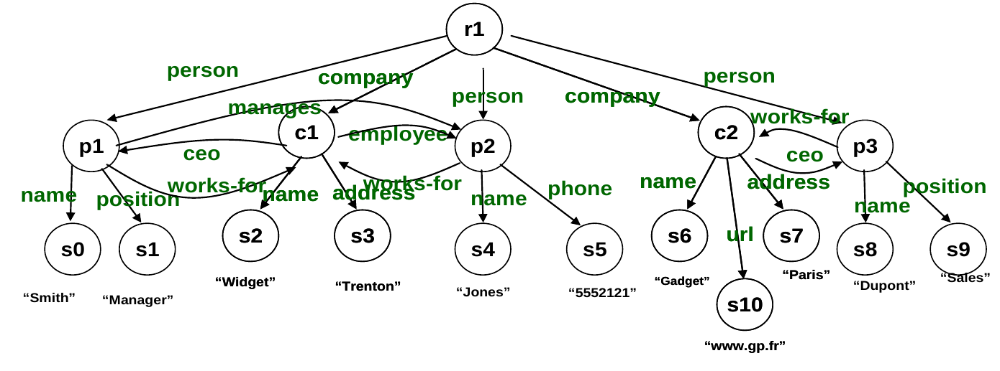
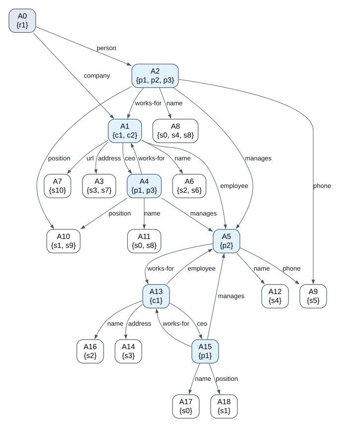
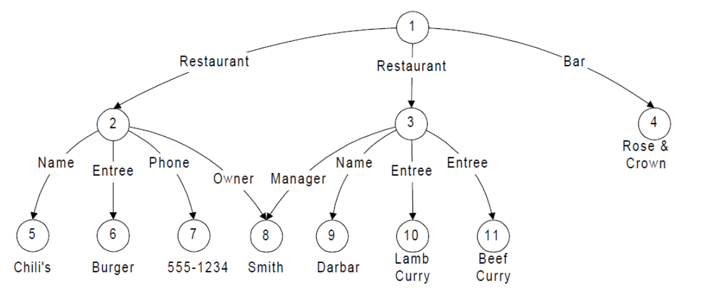
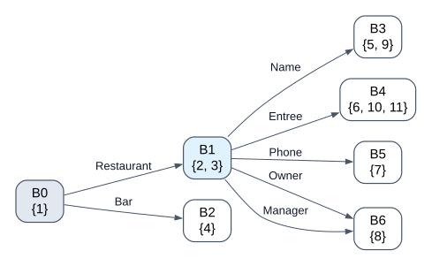
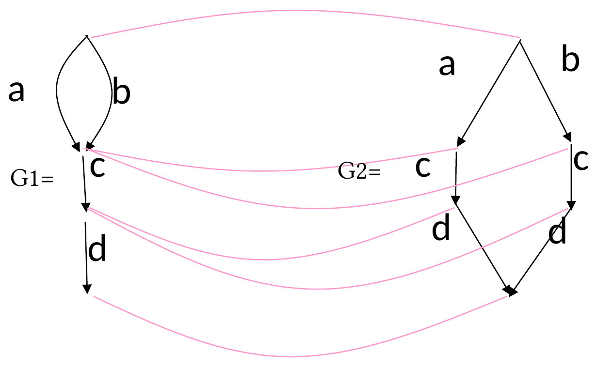
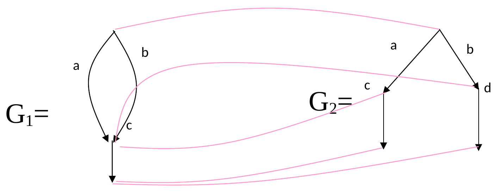
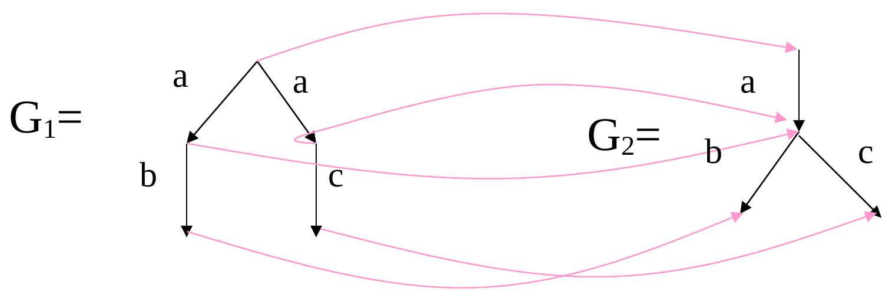
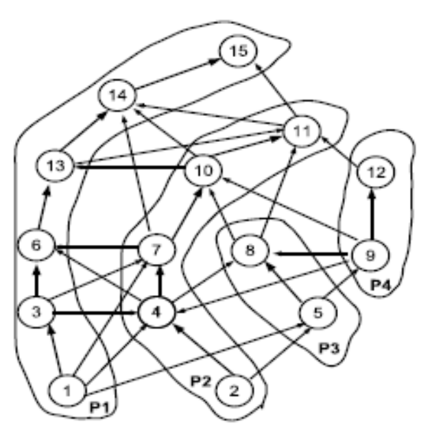

## 一、DataGuide 构造

**原题**

给定如下数据图(Data Graph)，试分别画出其DataGuide 图。

### 1 数据图 A

**原图**

**答案**

按目标集合构造的**强 DataGuide** 如下，共 **19 个节点、27 条边**。A0 为根；花括号中的编号来自原图。

### 2 数据图 B

**原图**

**答案**

答案图共有 **7 个节点、7 条边**。B0 为根。

## 二、互模拟判断

**原题**

试分别判断下列图中的G1和G2之间的映射R是否互模拟(bisimulation)，并说明理由。

### 1 第 1 组图

**原图**

**答案**

**是，给定的关系 R 是互模拟。** 双方每一层的 `a`、`b`、`c`、`d` 边都能匹配，匹配后的节点仍在 R 中。

### 2 第 2 组图

**原图**

**答案**

**否，给定的关系 R 不是互模拟。** 左图中间节点被关联到右图的 `b` 后继，但前者只有 `c` 出边，后者只有 `d` 出边，两个方向都无法匹配。

### 3 第 3 组图

**原图**

**答案**

**否，给定的关系 R 不是互模拟。** 右图中间节点同时有 `b`、`c` 出边，左图两个中间节点各只有一种；而且原图的末端交叉映射使正向匹配的后继也不属于 R。

## 三、图的可达性查询（复习题3-1）

**原题**

[图的可达性查询]设有向图 $G$ 被分解为4条不相交的链(如下图所示)，结点编码规则为：每个结点 $v$ 编码 $\{(1,p_{i1}),\ldots,(k,p_{ik})\}$，其中 $(j,p_{ij})$ 的 $j$ 表示链的编码，$p_{ij}$ 表示 $v$ 在 $j$ 链中可达的最小链内编码。试求出结点3，结点8，结点9，结点10，结点12，结点14的编码，并判断结点3是否可达结点8？结点14是否可达节点9？结点10是否可达节点12？

**答案**

链内位置从 **1** 开始，按箭头方向递增；可达包括结点自身，没有可达结点的链记为 $\infty$。

### 1 链与链内编号

| 链 | 沿有向路径的结点顺序 | 对应的链内位置 |
| --- | --- | --- |
| $P_1$ | 1 → 3 → 6 → 13 → 14 → 15 | 1，2，3，4，5，6 |
| $P_2$ | 2 → 4 → 7 → 10 → 11 | 1，2，3，4，5 |
| $P_3$ | 5 → 8 | 1，2 |
| $P_4$ | 9 → 12 | 1，2 |

### 2 六个结点的编码

| 结点 | 完整编码 |
| --- | --- |
| 3 | $\{(1,2),(2,3),(3,\infty),(4,\infty)\}$ |
| 8 | $\{(1,2),(2,2),(3,2),(4,\infty)\}$ |
| 9 | $\{(1,2),(2,2),(3,2),(4,1)\}$ |
| 10 | $\{(1,4),(2,4),(3,\infty),(4,\infty)\}$ |
| 12 | $\{(1,5),(2,5),(3,\infty),(4,2)\}$ |
| 14 | $\{(1,5),(2,\infty),(3,\infty),(4,\infty)\}$ |

### 3 可达性判断

| 查询 | 答案 |
| --- | --- |
| 结点 3 是否可达结点 8？ | **否** |
| 结点 14 是否可达结点 9？ | **否** |
| 结点 10 是否可达结点 12？ | **否** |
