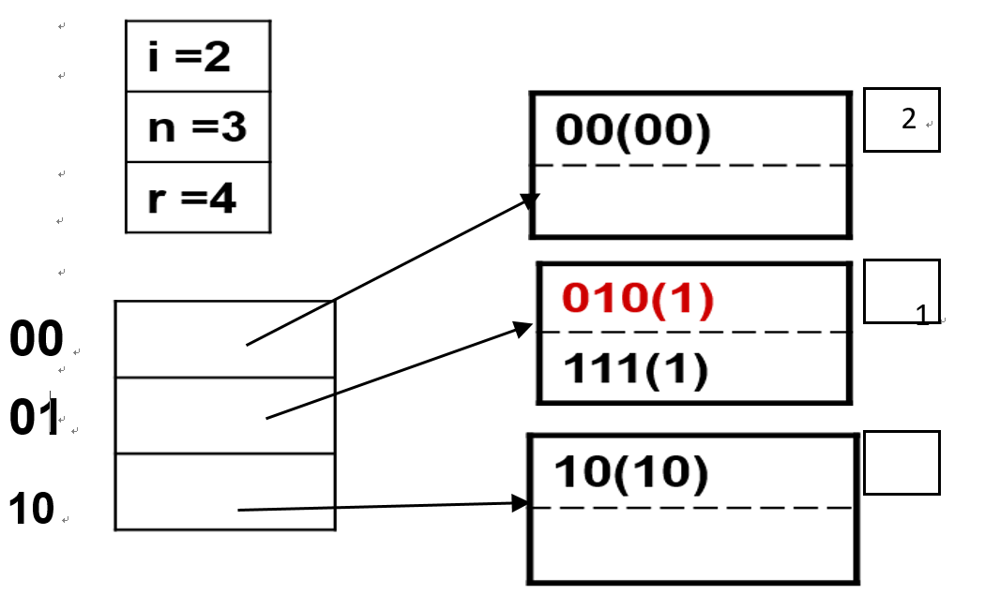

## 1 磁盘容量与柱面数

### 原题

[Disks and Access Time]

Consider a disk with a sector size of 512 bytes, 63 sectors per track, 16,383 tracks per surface, 8 double-sided platters (i.e., 16 surfaces). Suppose that a page size of 4096 bytes is chosen. Suppose that a file containing 1,000,000 records of 256 bytes each is to be stored on such a disk. No record is allowed to span two pages,use these numbers in appropriate places in your calculation.

1) What is the capacity of the disk?

2) If the file is arranged sequentially on the disk, how many cylinders are needed?

### 答案

（1）磁盘容量为 **8,455,200,768 B**，约 **8.4552 GB**，或 **7.8745 GiB**。

（2）文件需要 **62,500 页**。所需柱面数为：

| 页面布局 | 所需柱面数 |
| --- | --- |
| 允许一页跨磁道连续存储 | **497** |
| 一页必须完整放在同一条磁道内 | **559** |

原题限制的是“记录不能跨页”，没有明确“页能否跨磁道”，因此两种布局分别列出。

### 解析

**容量。** 每个盘片有两个盘面，8 个盘片共 16 个盘面。每面有 16,383 条磁道，每条磁道有 63 个 512 B 的扇区：

$$
\begin{aligned}
C&=512\times63\times16{,}383\times16\\
 &=8{,}455{,}200{,}768\ \mathrm{B}.
\end{aligned}
$$

GB 按 $10^9$ B 换算，GiB 按 $2^{30}$ B 换算。

**先算文件页数。** 按题目给定容量，每页可容纳的完整记录数为

$$
b=\left\lfloor\frac{4096}{256}\right\rfloor=16,
\qquad
N_{\mathrm{page}}=\left\lceil\frac{1{,}000{,}000}{16}\right\rceil=62{,}500.
$$

每页占 $4096/512=8$ 个扇区；一个柱面包含 16 条磁道。

**布局 A：页允许跨磁道。** 一个柱面有 $63\times16=1008$ 个扇区，可连续容纳 $1008/8=126$ 页：

$$
N_{\mathrm{cyl}}=\left\lceil\frac{62{,}500}{126}\right\rceil=497.
$$

**布局 B：页不跨磁道。** 每条磁道只能放 $\lfloor63/8\rfloor=7$ 个完整页面，余下的 7 个扇区不能独立放下一页。每柱面容纳 $7\times16=112$ 页：

$$
N_{\mathrm{cyl}}=\left\lceil\frac{62{,}500}{112}\right\rceil=559.
$$

两种结果的差异来自磁道尾部能否被跨磁道页面利用。

## 2 按升序构造 B+ 树

### 原题

Construct a B+-tree for the following set of key values:

(24, 29, 2, 17,5, 19,3, 18, 7, 11, 37,15,23, 31)

Assume that the tree is initially empty and values are added in ascending order. Construct B+-trees for the cases where the number of pointers that will fit in one node is as follows:

a). Four     b). Six     c). Eight

### 答案

**作答约定**：$m$ 表示一个内部节点最多的子指针数；叶节点最多 $m-1$ 个键。分隔键取右子树的最小键。叶溢出时左右各放 $m/2$ 个键；内部节点溢出为 $m+1$ 个子指针时，左留 $m/2$ 个、右留 $m/2+1$ 个。删除下溢时优先与左兄弟处理：能合并则合并，否则借值，并更新分隔键。

树图中的 `leaf` 表示叶节点；全部叶节点按从左到右的顺序连接成有序叶链。

### 构造方法

原题要求 **ascending order**，所以实际插入顺序为

```text
2, 3, 5, 7, 11, 15, 17, 18, 19, 23, 24, 29, 31, 37
```

这里逐个插入，叶节点满后才分裂。采用《Database System Concepts》第七版讲义的分裂规则：叶节点的右侧最小键复制到父节点；内部节点的边界分隔键提升到父节点。[官方 B+ 树讲义，14.30、14.33](https://db-book.com/slides-dir/PDF-dir/ch14.pdf)

| 最大子指针数 $m$ | 叶最多键数 | 非根叶最少键数 | 非根内部节点最少子指针数 |
| --- | --- | --- | --- |
| 4 | 3 | 2 | 2 |
| 6 | 5 | 3 | 3 |
| 8 | 7 | 4 | 4 |

各分隔键在叶层仍有对应的数据键，内部节点只负责导航。

### 2.1 最大 4 个指针

```text
[11 | 19]
├── [5]
│   ├── leaf [2 | 3]
│   └── leaf [5 | 7]
├── [17]
│   ├── leaf [11 | 15]
│   └── leaf [17 | 18]
└── [24 | 31]
    ├── leaf [19 | 23]
    ├── leaf [24 | 29]
    └── leaf [31 | 37]
```

**解析**：每当叶中出现 4 个键，就拆成左右各 2 个。升序插入后的叶分组为 `[2,3]`、`[5,7]`、`[11,15]`、`[17,18]`、`[19,23]`、`[24,29]`、`[31,37]`。构造期间内部节点两次溢出，按左 2、右 3 个子指针分裂，最后根的分隔键为 11、19。

### 2.2 最大 6 个指针

```text
[7 | 17 | 23]
├── leaf [2 | 3 | 5]
├── leaf [7 | 11 | 15]
├── leaf [17 | 18 | 19]
└── leaf [23 | 24 | 29 | 31 | 37]
```

**解析**：叶容量为 5；叶中出现第 6 个键时，左右各保留 3 个。插入完成后有 4 个叶节点，右侧三个叶的最小键分别为 7、17、23，直接构成根的三个分隔键。

### 2.3 最大 8 个指针

```text
[11 | 19]
├── leaf [2 | 3 | 5 | 7]
├── leaf [11 | 15 | 17 | 18]
└── leaf [19 | 23 | 24 | 29 | 31 | 37]
```

**解析**：叶容量为 7；叶中出现第 8 个键时，左右各保留 4 个。插入完成后，三个叶节点分别有 4、4、6 个键，根的分隔键为 11、19。

## 3 B+ 树的连续插入与删除

### 原题

For each B+-tree of Exercise 1, show the form of the tree after each of the following series of operations:

a. Insert 9.    b. Insert 10.    c. Insert 8.    d. Delete 24.    e. Delete 37.

### 答案

原文的 “Exercise 1” 按本卷第 2 题理解。分别接续上面的三棵树，**a–e 按顺序连续执行**。

### 3.1 最大 4 个指针

#### a. Insert 9

```text
[11 | 19]
├── [5]
│   ├── leaf [2 | 3]
│   └── leaf [5 | 7 | 9]
├── [17]
│   ├── leaf [11 | 15]
│   └── leaf [17 | 18]
└── [24 | 31]
    ├── leaf [19 | 23]
    ├── leaf [24 | 29]
    └── leaf [31 | 37]
```

**解析**：9 插入叶 `[5,7]`，得到 `[5,7,9]`，达到容量 3。

#### b. Insert 10

```text
[11 | 19]
├── [5 | 9]
│   ├── leaf [2 | 3]
│   ├── leaf [5 | 7]
│   └── leaf [9 | 10]
├── [17]
│   ├── leaf [11 | 15]
│   └── leaf [17 | 18]
└── [24 | 31]
    ├── leaf [19 | 23]
    ├── leaf [24 | 29]
    └── leaf [31 | 37]
```

**解析**：叶 `[5,7,9,10]` 溢出，分成 `[5,7]` 与 `[9,10]`。把右叶最小键 9 加入父节点，父节点由 `[5]` 变为 `[5,9]`。

#### c. Insert 8

```text
[11 | 19]
├── [5 | 9]
│   ├── leaf [2 | 3]
│   ├── leaf [5 | 7 | 8]
│   └── leaf [9 | 10]
├── [17]
│   ├── leaf [11 | 15]
│   └── leaf [17 | 18]
└── [24 | 31]
    ├── leaf [19 | 23]
    ├── leaf [24 | 29]
    └── leaf [31 | 37]
```

**解析**：8 插入 `[5,7]`，得到 `[5,7,8]`，其余结构保持。

#### d. Delete 24

```text
[11 | 19]
├── [5 | 9]
│   ├── leaf [2 | 3]
│   ├── leaf [5 | 7 | 8]
│   └── leaf [9 | 10]
├── [17]
│   ├── leaf [11 | 15]
│   └── leaf [17 | 18]
└── [31]
    ├── leaf [19 | 23 | 29]
    └── leaf [31 | 37]
```

**解析**：删除 24 后，叶 `[24,29]` 只剩 `[29]`，低于最少 2 个键。与左兄弟 `[19,23]` 合并成 `[19,23,29]`，父节点移除分隔键 24，只剩 `[31]`。

#### e. Delete 37

```text
[11 | 19]
├── [5 | 9]
│   ├── leaf [2 | 3]
│   ├── leaf [5 | 7 | 8]
│   └── leaf [9 | 10]
├── [17]
│   ├── leaf [11 | 15]
│   └── leaf [17 | 18]
└── [29]
    ├── leaf [19 | 23]
    └── leaf [29 | 31]
```

**解析**：删除 37 后，右叶只剩 `[31]`。左兄弟 `[19,23,29]` 可借出最大键 29，调整为 `[19,23]` 和 `[29,31]`，父分隔键由 31 更新为 29。

### 3.2 最大 6 个指针

#### a. Insert 9

```text
[7 | 17 | 23]
├── leaf [2 | 3 | 5]
├── leaf [7 | 9 | 11 | 15]
├── leaf [17 | 18 | 19]
└── leaf [23 | 24 | 29 | 31 | 37]
```

**解析**：9 插入叶 `[7,11,15]`，得到 `[7,9,11,15]`。

#### b. Insert 10

```text
[7 | 17 | 23]
├── leaf [2 | 3 | 5]
├── leaf [7 | 9 | 10 | 11 | 15]
├── leaf [17 | 18 | 19]
└── leaf [23 | 24 | 29 | 31 | 37]
```

**解析**：再插入 10，得到 `[7,9,10,11,15]`，恰好有 5 个键。

#### c. Insert 8

```text
[7 | 10 | 17 | 23]
├── leaf [2 | 3 | 5]
├── leaf [7 | 8 | 9]
├── leaf [10 | 11 | 15]
├── leaf [17 | 18 | 19]
└── leaf [23 | 24 | 29 | 31 | 37]
```

**解析**：插入 8 后有 6 个键，分成 `[7,8,9]` 与 `[10,11,15]`，把右叶最小键 10 加入根。

#### d. Delete 24

```text
[7 | 10 | 17 | 23]
├── leaf [2 | 3 | 5]
├── leaf [7 | 8 | 9]
├── leaf [10 | 11 | 15]
├── leaf [17 | 18 | 19]
└── leaf [23 | 29 | 31 | 37]
```

**解析**：右端叶删除 24 后剩 4 个键，仍满足最少 3 个键的要求。

#### e. Delete 37

```text
[7 | 10 | 17 | 23]
├── leaf [2 | 3 | 5]
├── leaf [7 | 8 | 9]
├── leaf [10 | 11 | 15]
├── leaf [17 | 18 | 19]
└── leaf [23 | 29 | 31]
```

**解析**：右端叶删除 37 后剩 `[23,29,31]`，恰好达到最少 3 个键，结构无需调整。

### 3.3 最大 8 个指针

#### a. Insert 9

```text
[11 | 19]
├── leaf [2 | 3 | 5 | 7 | 9]
├── leaf [11 | 15 | 17 | 18]
└── leaf [19 | 23 | 24 | 29 | 31 | 37]
```

**解析**：9 插入最左叶，叶中有 5 个键。

#### b. Insert 10

```text
[11 | 19]
├── leaf [2 | 3 | 5 | 7 | 9 | 10]
├── leaf [11 | 15 | 17 | 18]
└── leaf [19 | 23 | 24 | 29 | 31 | 37]
```

**解析**：10 插入最左叶，叶中有 6 个键。

#### c. Insert 8

```text
[11 | 19]
├── leaf [2 | 3 | 5 | 7 | 8 | 9 | 10]
├── leaf [11 | 15 | 17 | 18]
└── leaf [19 | 23 | 24 | 29 | 31 | 37]
```

**解析**：8 插入最左叶，叶中有 7 个键，恰好达到容量。

#### d. Delete 24

```text
[11 | 19]
├── leaf [2 | 3 | 5 | 7 | 8 | 9 | 10]
├── leaf [11 | 15 | 17 | 18]
└── leaf [19 | 23 | 29 | 31 | 37]
```

**解析**：最右叶删除 24 后有 5 个键，满足最少 4 个键。

#### e. Delete 37

```text
[11 | 19]
├── leaf [2 | 3 | 5 | 7 | 8 | 9 | 10]
├── leaf [11 | 15 | 17 | 18]
└── leaf [19 | 23 | 29 | 31]
```

**解析**：最右叶删除 37 后剩 `[19,23,29,31]`，恰好达到最少 4 个键。

## 4 可扩展散列的初始结构

### 原题

Suppose that we are using extendable hashing on a file that contains records with the following search-key values:

24, 29, 2, 17, 5, 19,3, 18, 7, 11, 37,15,23, 31

Show the extendable hash structure for this file if the hash function is h(x) = x mod 8 and    buckets can hold three records.

### 答案

**严格按固定散列函数与每桶容量，无法构造无溢出页的完整结构。** 因为

$$h(7)=h(15)=h(23)=h(31)=7=(111)_2,$$

同一完整散列值对应 4 条记录，超过每桶 3 条。扩展目录无法从相同的散列值中获得新的区分位。

**下面补充允许溢出页，给出一种可存储全部记录的结构。** 使用散列值的低位作为目录索引，按题目列出的次序插入；全局深度 $d=3$。每个主桶和溢出页最多放 3 条记录。

| 目录项 | 桶 | 局部深度 | 主桶内容 | 溢出页 |
| --- | --- | --- | --- | --- |
| 000、010、100、110 | B0 | 1 | [24, 2, 18] | — |
| 001 | B1 | 3 | [17] | — |
| 011 | B3 | 3 | [19, 3, 11] | — |
| 101 | B5 | 3 | [29, 5, 37] | — |
| 111 | B7 | 3 | [7, 15, 23] | [31] |

### 解析

散列值分布如下：

| $h(x)$ | 三位二进制 | 对应搜索键 |
| --- | --- | --- |
| 0 | 000 | 24 |
| 1 | 001 | 17 |
| 2 | 010 | 2、18 |
| 3 | 011 | 19、3、11 |
| 4 | 100 | 无 |
| 5 | 101 | 29、5、37 |
| 6 | 110 | 无 |
| 7 | 111 | 7、15、23、31 |

**目录共享。** 偶数记录共有 3 条，按最低 1 位就能一起存入 B0，因此 B0 的局部深度为 1。全局目录使用 3 位，所有末位为 0 的目录项都指向同一 B0，记录只存一份。

**奇数桶分裂。** 插入 19 时，低 1 位为 `1` 的桶有 4 条记录，按低 2 位分为 `01:{29,17,5}` 和 `11:{19}`。插入 11 后，`11` 桶分裂为 `011:{19,3,11}` 和 `111:{7}`；插入 37 后，`01` 桶分裂为 `001:{17}` 和 `101:{29,5,37}`。

**最后的冲突。** 继续加入 15、23、31 后，`111` 有 4 条。后三位已是 $h(x)$ 的全部有效信息，故将第 4 条放入补充的溢出页。若改用更长的散列值，可能继续分裂，但那会改变本题的 $h(x)=x\bmod8$。

## 5 可扩展散列的连续删除与插入

### 原题

Show how the extendable hash structure of Exercise 3 changes as the result of each of the following steps:

a. Delete 11.    b. Delete 31.    c. Insert 1.d. Insert 15.

### 答案

原文的 “Exercise 3” 按本卷第 4 题的可扩展散列结构理解。以下接续第 4 题**允许溢出页**的方案，a–d 连续执行，删除时保留目录和桶划分。

下表采用允许重复搜索键的文件语义，最后一次 `Insert 15` 表示插入另一条键为 15 的记录。

| 操作后 | B1 | B3 | B7 主桶 | B7 溢出页 | 总记录数 |
| --- | --- | --- | --- | --- | --- |
| a. Delete 11 | [17] | [19, 3] | [7, 15, 23] | [31] | 13 |
| b. Delete 31 | [17] | [19, 3] | [7, 15, 23] | — | 12 |
| c. Insert 1 | [17, 1] | [19, 3] | [7, 15, 23] | — | 13 |
| d. Insert 15 | [17, 1] | [19, 3] | [7, 15, 23] | [15] | 14 |

各步均有：$d=3$，B0=`[24,2,18]`、B5=`[29,5,37]`，目录引用与局部深度同第 4 题。

若把文件解释为**搜索键必须唯一的集合**，则 `Insert 15` 为重复插入，最后一步不改变 c 步状态，仍为 13 条记录。

### 解析

- 删除 11：$h(11)=3$，从 B3 移除 11。
- 删除 31：$h(31)=7$，移除 B7 溢出页中的唯一记录 31，该溢出页可以释放。
- 插入 1：$h(1)=1$，写入 B1，主桶内有 2 条记录。
- 再插入 15：$h(15)=7$，B7 主桶已有 3 条，新增的 15 放入溢出页。两个 15 表示两条记录，它们的搜索键相同。

采用允许重复搜索键的文件语义时，总记录数依次为 $14\to13\to12\to13\to14$。

## 6 线性散列的三种扩容阈值

### 原题

下图为插入关键字0000、0101、1111、1010后的线性散列索引结果，其中：i-当前使用的散列函数的位数，n-当前的桶，r-当前散列表中的记录总数。试分别按照 r<=1.6n、r<=1.7n、r<=1.8n给出插入以下关键字后的线性散列索引结果。



a) 0001    b) 0111     c)1011

### 答案

三种阈值都从题图独立开始，分别连续执行 a、b、c：插入 `0001`、`0111`、`1011`。初始状态为 $i=2,n=3,r=4$，每个主桶有 2 个记录槽。桶地址取关键字的低位；$i=\lceil\log_2 n\rceil$。桶内 `[a,b] → 溢出[c]` 表示主桶的两个槽与一个溢出页，`∅` 表示空桶。

### 6.1 阈值 $r\leq 1.6n$

| 插入后 | $(i,n,r)$ | 本步分裂 | 完整桶内容 |
| --- | --- | --- | --- |
| 0001 | (2, 4, 5) | 桶 1 分裂，新增桶 3 | `00`：[0000]<br>`01`：[0101, 0001]<br>`10`：[1010]<br>`11`：[1111] |
| 0111 | (2, 4, 6) | 无 | `00`：[0000]<br>`01`：[0101, 0001]<br>`10`：[1010]<br>`11`：[1111, 0111] |
| 1011 | (3, 5, 7) | 桶 0 分裂，新增桶 4 | `000`：[0000]<br>`001`：[0101, 0001]<br>`010`：[1010]<br>`011`：[1111, 0111] → 溢出[1011]<br>`100`：∅ |

### 6.2 阈值 $r\leq 1.7n$

| 插入后 | $(i,n,r)$ | 本步分裂 | 完整桶内容 |
| --- | --- | --- | --- |
| 0001 | (2, 3, 5) | 无 | `00`：[0000]<br>`01`：[0101, 1111] → 溢出[0001]<br>`10`：[1010] |
| 0111 | (2, 4, 6) | 桶 1 分裂，新增桶 3 | `00`：[0000]<br>`01`：[0101, 0001]<br>`10`：[1010]<br>`11`：[1111, 0111] |
| 1011 | (3, 5, 7) | 桶 0 分裂，新增桶 4 | `000`：[0000]<br>`001`：[0101, 0001]<br>`010`：[1010]<br>`011`：[1111, 0111] → 溢出[1011]<br>`100`：∅ |

### 6.3 阈值 $r\leq 1.8n$

| 插入后 | $(i,n,r)$ | 本步分裂 | 完整桶内容 |
| --- | --- | --- | --- |
| 0001 | (2, 3, 5) | 无 | `00`：[0000]<br>`01`：[0101, 1111] → 溢出[0001]<br>`10`：[1010] |
| 0111 | (2, 4, 6) | 桶 1 分裂，新增桶 3 | `00`：[0000]<br>`01`：[0101, 0001]<br>`10`：[1010]<br>`11`：[1111, 0111] |
| 1011 | (2, 4, 7) | 无 | `00`：[0000]<br>`01`：[0101, 0001]<br>`10`：[1010]<br>`11`：[1111, 0111] → 溢出[1011] |

### 6.4 定位与分裂规则

设关键字按当前 $i$ 位得到地址 $a=x\bmod2^i$：

$$
\operatorname{bucket}(x)=
\begin{cases}
a,&a<n,\\
a-2^{i-1},&a\geq n.
\end{cases}
$$

例如，初始状态没有 `11` 号桶，`1111` 的低两位为 `11`，所以它放入 $3-2=1$ 号桶。

每插入一条记录，先令 $r\leftarrow r+1$；只有在 $r>\alpha n$ 时才新增一个主桶。按轮转次序分裂，设分裂前

$$
B=2^{\lfloor\log_2n\rfloor},\qquad p=n-B.
$$

新增桶号为旧的 $n$，分裂旧桶 $p$，以模 $2B$ 的结果重分配这一个桶及其溢出链的记录。这里 $n=3$ 时分裂桶 1、新增桶 3；$n=4$ 时分裂桶 0、新增桶 4。

**位数在新增桶需要时才增长。** 4 个桶的地址为 `00`～`11`，仍用 $i=2$；出现桶 4 后，$n=5$，才用 $i=3$。

### 6.5 阈值怎样决定分裂时机

| 阈值 | 插入 0001 后，$r=5$ | 插入 0111 后，$r=6$ | 插入 1011 后，$r=7$ |
| --- | --- | --- | --- |
| $\alpha=1.6$ | $5>1.6\times3=4.8$，分裂到 4 桶 | $6\leq1.6\times4=6.4$，保持 4 桶 | $7>1.6\times4=6.4$，分裂到 5 桶 |
| $\alpha=1.7$ | $5\leq1.7\times3=5.1$，保持 3 桶 | $6>1.7\times3=5.1$，分裂到 4 桶 | $7>1.7\times4=6.8$，分裂到 5 桶 |
| $\alpha=1.8$ | $5\leq1.8\times3=5.4$，保持 3 桶 | $6>1.8\times3=5.4$，分裂到 4 桶 | $7\leq1.8\times4=7.2$，保持 4 桶 |

第一次分裂把原 1 号桶中的记录按低两位分开：`0101`、`0001` 留在桶 1；`1111`、`0111` 按它们当时是否已插入，进入桶 3。

第二次分裂处理的是桶 0，它只有 `0000`，因此仍留在桶 0，新桶 4 为空。此时 `1111`、`0111`、`1011` 仍属于桶 3，所以该桶仍需溢出页。

**桶溢出与全局扩容是两个判断。** 本题按全局记录数阈值决定是否分裂，按轮转次序决定拆哪个桶；一个桶可以暂时使用溢出页。
