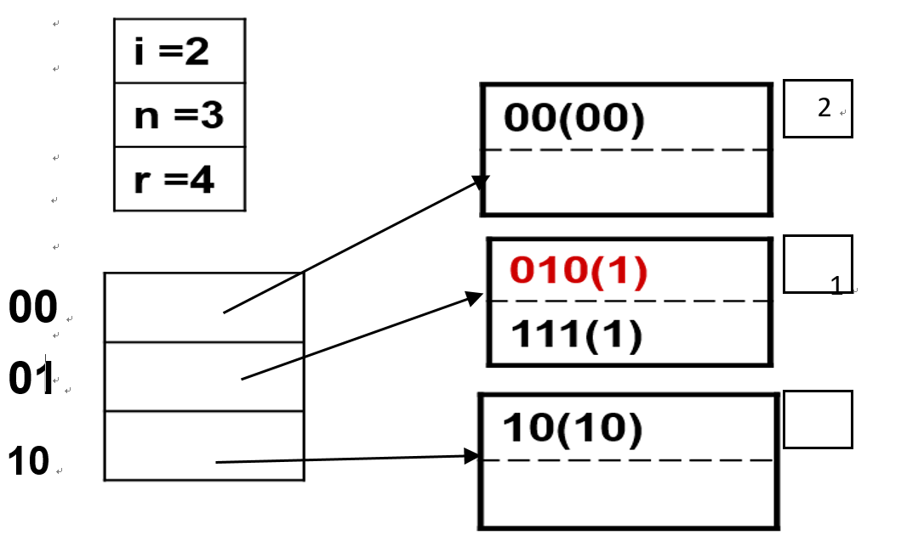

### 原题

[Disks and Access Time]

Consider a disk with a sector size of 512 bytes, 63 sectors per track, 16,383 tracks per surface, 8 double-sided platters (i.e., 16 surfaces). Suppose that a page size of 4096 bytes is chosen. Suppose that a file containing 1,000,000 records of 256 bytes each is to be stored on such a disk. No record is allowed to span two pages,use these numbers in appropriate places in your calculation.

1) What is the capacity of the disk?

2) If the file is arranged sequentially on the disk, how many cylinders are needed?

### 答案

（1）磁盘容量为 **8,455,200,768 B**，约 **8.4552 GB**，或 **7.8745 GiB**。

（2）文件需要 **62,500 页**。所需柱面数为：

| 页面布局 | 所需柱面数 |
| --- | --- |
| 允许一页跨磁道连续存储 | **497** |
| 一页必须完整放在同一条磁道内 | **559** |

原题限制的是“记录不能跨页”，没有明确“页能否跨磁道”，因此两种布局分别列出。

## 2 按升序构造 B+ 树

### 原题

Construct a B+-tree for the following set of key values:

(24, 29, 2, 17,5, 19,3, 18, 7, 11, 37,15,23, 31)

Assume that the tree is initially empty and values are added in ascending order. Construct B+-trees for the cases where the number of pointers that will fit in one node is as follows:

a). Four     b). Six     c). Eight

### 答案

**作答约定**：$m$ 表示一个内部节点最多的子指针数；叶节点最多 $m-1$ 个键。分隔键取右子树的最小键。叶溢出时左右各放 $m/2$ 个键；内部节点溢出为 $m+1$ 个子指针时，左留 $m/2$ 个、右留 $m/2+1$ 个。删除下溢时优先与左兄弟处理：能合并则合并，否则借值，并更新分隔键。

树图中的 `leaf` 表示叶节点；全部叶节点按从左到右的顺序连接成有序叶链。

### 2.1 最大 4 个指针

```text
[11 | 19]
├── [5]
│   ├── leaf [2 | 3]
│   └── leaf [5 | 7]
├── [17]
│   ├── leaf [11 | 15]
│   └── leaf [17 | 18]
└── [24 | 31]
    ├── leaf [19 | 23]
    ├── leaf [24 | 29]
    └── leaf [31 | 37]
```

### 2.2 最大 6 个指针

```text
[7 | 17 | 23]
├── leaf [2 | 3 | 5]
├── leaf [7 | 11 | 15]
├── leaf [17 | 18 | 19]
└── leaf [23 | 24 | 29 | 31 | 37]
```

### 2.3 最大 8 个指针

```text
[11 | 19]
├── leaf [2 | 3 | 5 | 7]
├── leaf [11 | 15 | 17 | 18]
└── leaf [19 | 23 | 24 | 29 | 31 | 37]
```

## 3 B+ 树的连续插入与删除

### 原题

For each B+-tree of Exercise 1, show the form of the tree after each of the following series of operations:

a. Insert 9.    b. Insert 10.    c. Insert 8.    d. Delete 24.    e. Delete 37.

### 答案

原文的 “Exercise 1” 按本卷第 2 题理解。分别接续上面的三棵树，**a–e 按顺序连续执行**。

### 3.1 最大 4 个指针

#### a. Insert 9

```text
[11 | 19]
├── [5]
│   ├── leaf [2 | 3]
│   └── leaf [5 | 7 | 9]
├── [17]
│   ├── leaf [11 | 15]
│   └── leaf [17 | 18]
└── [24 | 31]
    ├── leaf [19 | 23]
    ├── leaf [24 | 29]
    └── leaf [31 | 37]
```

#### b. Insert 10

```text
[11 | 19]
├── [5 | 9]
│   ├── leaf [2 | 3]
│   ├── leaf [5 | 7]
│   └── leaf [9 | 10]
├── [17]
│   ├── leaf [11 | 15]
│   └── leaf [17 | 18]
└── [24 | 31]
    ├── leaf [19 | 23]
    ├── leaf [24 | 29]
    └── leaf [31 | 37]
```

#### c. Insert 8

```text
[11 | 19]
├── [5 | 9]
│   ├── leaf [2 | 3]
│   ├── leaf [5 | 7 | 8]
│   └── leaf [9 | 10]
├── [17]
│   ├── leaf [11 | 15]
│   └── leaf [17 | 18]
└── [24 | 31]
    ├── leaf [19 | 23]
    ├── leaf [24 | 29]
    └── leaf [31 | 37]
```

#### d. Delete 24

```text
[11 | 19]
├── [5 | 9]
│   ├── leaf [2 | 3]
│   ├── leaf [5 | 7 | 8]
│   └── leaf [9 | 10]
├── [17]
│   ├── leaf [11 | 15]
│   └── leaf [17 | 18]
└── [31]
    ├── leaf [19 | 23 | 29]
    └── leaf [31 | 37]
```

#### e. Delete 37

```text
[11 | 19]
├── [5 | 9]
│   ├── leaf [2 | 3]
│   ├── leaf [5 | 7 | 8]
│   └── leaf [9 | 10]
├── [17]
│   ├── leaf [11 | 15]
│   └── leaf [17 | 18]
└── [29]
    ├── leaf [19 | 23]
    └── leaf [29 | 31]
```

### 3.2 最大 6 个指针

#### a. Insert 9

```text
[7 | 17 | 23]
├── leaf [2 | 3 | 5]
├── leaf [7 | 9 | 11 | 15]
├── leaf [17 | 18 | 19]
└── leaf [23 | 24 | 29 | 31 | 37]
```

#### b. Insert 10

```text
[7 | 17 | 23]
├── leaf [2 | 3 | 5]
├── leaf [7 | 9 | 10 | 11 | 15]
├── leaf [17 | 18 | 19]
└── leaf [23 | 24 | 29 | 31 | 37]
```

#### c. Insert 8

```text
[7 | 10 | 17 | 23]
├── leaf [2 | 3 | 5]
├── leaf [7 | 8 | 9]
├── leaf [10 | 11 | 15]
├── leaf [17 | 18 | 19]
└── leaf [23 | 24 | 29 | 31 | 37]
```

#### d. Delete 24

```text
[7 | 10 | 17 | 23]
├── leaf [2 | 3 | 5]
├── leaf [7 | 8 | 9]
├── leaf [10 | 11 | 15]
├── leaf [17 | 18 | 19]
└── leaf [23 | 29 | 31 | 37]
```

#### e. Delete 37

```text
[7 | 10 | 17 | 23]
├── leaf [2 | 3 | 5]
├── leaf [7 | 8 | 9]
├── leaf [10 | 11 | 15]
├── leaf [17 | 18 | 19]
└── leaf [23 | 29 | 31]
```

### 3.3 最大 8 个指针

#### a. Insert 9

```text
[11 | 19]
├── leaf [2 | 3 | 5 | 7 | 9]
├── leaf [11 | 15 | 17 | 18]
└── leaf [19 | 23 | 24 | 29 | 31 | 37]
```

#### b. Insert 10

```text
[11 | 19]
├── leaf [2 | 3 | 5 | 7 | 9 | 10]
├── leaf [11 | 15 | 17 | 18]
└── leaf [19 | 23 | 24 | 29 | 31 | 37]
```

#### c. Insert 8

```text
[11 | 19]
├── leaf [2 | 3 | 5 | 7 | 8 | 9 | 10]
├── leaf [11 | 15 | 17 | 18]
└── leaf [19 | 23 | 24 | 29 | 31 | 37]
```

#### d. Delete 24

```text
[11 | 19]
├── leaf [2 | 3 | 5 | 7 | 8 | 9 | 10]
├── leaf [11 | 15 | 17 | 18]
└── leaf [19 | 23 | 29 | 31 | 37]
```

#### e. Delete 37

```text
[11 | 19]
├── leaf [2 | 3 | 5 | 7 | 8 | 9 | 10]
├── leaf [11 | 15 | 17 | 18]
└── leaf [19 | 23 | 29 | 31]
```

## 4 可扩展散列的初始结构

### 原题

Suppose that we are using extendable hashing on a file that contains records with the following search-key values:

24, 29, 2, 17, 5, 19,3, 18, 7, 11, 37,15,23, 31

Show the extendable hash structure for this file if the hash function is h(x) = x mod 8 and    buckets can hold three records.

### 答案

**严格按固定散列函数与每桶容量，无法构造无溢出页的完整结构。** 因为

$$h(7)=h(15)=h(23)=h(31)=7=(111)_2,$$

同一完整散列值对应 4 条记录，超过每桶 3 条。扩展目录无法从相同的散列值中获得新的区分位。

**下面补充允许溢出页，给出一种可存储全部记录的结构。** 使用散列值的低位作为目录索引，按题目列出的次序插入；全局深度 $d=3$。每个主桶和溢出页最多放 3 条记录。

| 目录项 | 桶 | 局部深度 | 主桶内容 | 溢出页 |
| --- | --- | --- | --- | --- |
| 000、010、100、110 | B0 | 1 | [24, 2, 18] | — |
| 001 | B1 | 3 | [17] | — |
| 011 | B3 | 3 | [19, 3, 11] | — |
| 101 | B5 | 3 | [29, 5, 37] | — |
| 111 | B7 | 3 | [7, 15, 23] | [31] |

## 5 可扩展散列的连续删除与插入

### 原题

Show how the extendable hash structure of Exercise 3 changes as the result of each of the following steps:

a. Delete 11.    b. Delete 31.    c. Insert 1.d. Insert 15.

### 答案

原文的 “Exercise 3” 按本卷第 4 题的可扩展散列结构理解。以下接续第 4 题**允许溢出页**的方案，a–d 连续执行，删除时保留目录和桶划分。

下表采用允许重复搜索键的文件语义，最后一次 `Insert 15` 表示插入另一条键为 15 的记录。

| 操作后 | B1 | B3 | B7 主桶 | B7 溢出页 | 总记录数 |
| --- | --- | --- | --- | --- | --- |
| a. Delete 11 | [17] | [19, 3] | [7, 15, 23] | [31] | 13 |
| b. Delete 31 | [17] | [19, 3] | [7, 15, 23] | — | 12 |
| c. Insert 1 | [17, 1] | [19, 3] | [7, 15, 23] | — | 13 |
| d. Insert 15 | [17, 1] | [19, 3] | [7, 15, 23] | [15] | 14 |

各步均有：$d=3$，B0=`[24,2,18]`、B5=`[29,5,37]`，目录引用与局部深度同第 4 题。

若把文件解释为**搜索键必须唯一的集合**，则 `Insert 15` 为重复插入，最后一步不改变 c 步状态，仍为 13 条记录。

## 6 线性散列的三种扩容阈值

### 原题

下图为插入关键字0000、0101、1111、1010后的线性散列索引结果，其中：i-当前使用的散列函数的位数，n-当前的桶，r-当前散列表中的记录总数。试分别按照 r<=1.6n、r<=1.7n、r<=1.8n给出插入以下关键字后的线性散列索引结果。


a) 0001    b) 0111     c)1011

### 答案

三种阈值都从题图独立开始，分别连续执行 a、b、c：插入 `0001`、`0111`、`1011`。初始状态为 $i=2,n=3,r=4$，每个主桶有 2 个记录槽。桶地址取关键字的低位；$i=\lceil\log_2 n\rceil$。桶内 `[a,b] → 溢出[c]` 表示主桶的两个槽与一个溢出页，`∅` 表示空桶。

### 6.1 阈值 $r\leq 1.6n$

| 插入后 | $(i,n,r)$ | 本步分裂 | 完整桶内容 |
| --- | --- | --- | --- |
| 0001 | (2, 4, 5) | 桶 1 分裂，新增桶 3 | `00`：[0000]<br>`01`：[0101, 0001]<br>`10`：[1010]<br>`11`：[1111] |
| 0111 | (2, 4, 6) | 无 | `00`：[0000]<br>`01`：[0101, 0001]<br>`10`：[1010]<br>`11`：[1111, 0111] |
| 1011 | (3, 5, 7) | 桶 0 分裂，新增桶 4 | `000`：[0000]<br>`001`：[0101, 0001]<br>`010`：[1010]<br>`011`：[1111, 0111] → 溢出[1011]<br>`100`：∅ |

### 6.2 阈值 $r\leq 1.7n$

| 插入后 | $(i,n,r)$ | 本步分裂 | 完整桶内容 |
| --- | --- | --- | --- |
| 0001 | (2, 3, 5) | 无 | `00`：[0000]<br>`01`：[0101, 1111] → 溢出[0001]<br>`10`：[1010] |
| 0111 | (2, 4, 6) | 桶 1 分裂，新增桶 3 | `00`：[0000]<br>`01`：[0101, 0001]<br>`10`：[1010]<br>`11`：[1111, 0111] |
| 1011 | (3, 5, 7) | 桶 0 分裂，新增桶 4 | `000`：[0000]<br>`001`：[0101, 0001]<br>`010`：[1010]<br>`011`：[1111, 0111] → 溢出[1011]<br>`100`：∅ |

### 6.3 阈值 $r\leq 1.8n$

| 插入后 | $(i,n,r)$ | 本步分裂 | 完整桶内容 |
| --- | --- | --- | --- |
| 0001 | (2, 3, 5) | 无 | `00`：[0000]<br>`01`：[0101, 1111] → 溢出[0001]<br>`10`：[1010] |
| 0111 | (2, 4, 6) | 桶 1 分裂，新增桶 3 | `00`：[0000]<br>`01`：[0101, 0001]<br>`10`：[1010]<br>`11`：[1111, 0111] |
| 1011 | (2, 4, 7) | 无 | `00`：[0000]<br>`01`：[0101, 0001]<br>`10`：[1010]<br>`11`：[1111, 0111] → 溢出[1011] |
