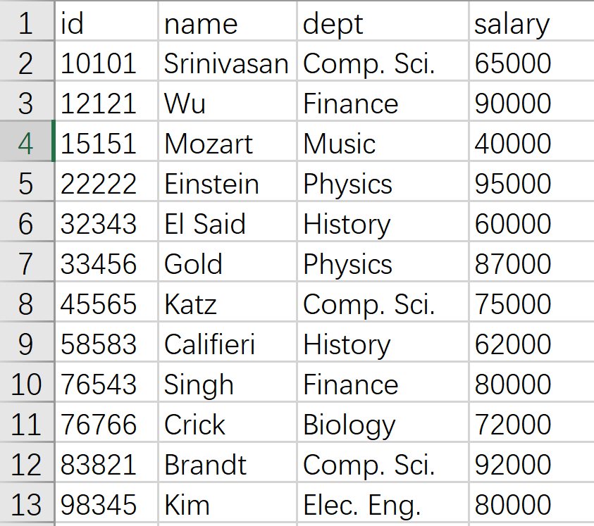

## 1 salary 与 dept 的位图索引

### 原题

Consider the instructor relation shown in the figure below,dividing salary values into 4 ranges: below 50000(L0), 50000 to below 60000(L1), 60000 to below 70000(L2), and 70000 and above(L3) .



Construct bitmap index on the attribute salary and dept separately.

### 答案

每张位图均为 **12 位**，从左到右对应原图的第 1～12 条数据记录，即图中行号 2～13；表头不占位。第 1 位对应 Srinivasan，第 12 位对应 Kim。

**salary 的位图索引**

| 工资区间 | 条件 | 位图 | 对应记录位置 |
| --- | --- | --- | --- |
| L0 | $salary<50000$ | `001000000000` | 3 |
| L1 | $50000\leq salary<60000$ | `000000000000` | 无 |
| L2 | $60000\leq salary<70000$ | `100010010000` | 1、5、8 |
| L3 | $salary\geq70000$ | `010101101111` | 2、4、6、7、9、10、11、12 |

**dept 的位图索引**

| dept | 位图 | 对应记录位置 |
| --- | --- | --- |
| Comp. Sci. | `100000100010` | 1、7、11 |
| Finance | `010000001000` | 2、9 |
| Music | `001000000000` | 3 |
| Physics | `000101000000` | 4、6 |
| History | `000010010000` | 5、8 |
| Biology | `000000000100` | 10 |
| Elec. Eng. | `000000000001` | 12 |

### 解析

位图中，第 $j$ 位为 1 表示第 $j$ 条记录满足该属性条件，为 0 表示不满足。每个工资区间一张位图，每个部门值一张位图。

**工资区间。** Mozart 的 40,000 属于 L0，所以第 3 位为 1。没有工资落入 $[50000,60000)$，故 L1 全为 0。Srinivasan、El Said、Califieri 的工资分别为 65,000、60,000、62,000，属于 L2，对应第 1、5、8 位；其余记录属于 L3。这里 **60,000 计入 L2**。

**部门。** `Comp. Sci.` 出现在第 1、7、11 条记录，因此其位图为 `100000100010`。其他部门按同样方法逐行标记。

可以用两种方法核对：每一条记录在四张工资位图中恰好出现一次，在七张部门位图中也恰好出现一次；同一属性的所有位图按位 OR 后应得到 `111111111111`。

例如，查找“计算机系且工资在 L2 区间”的教师，只需按位 AND：

```text
Comp. Sci.  100000100010
L2          100010010000
AND         100000000000
```

只有第 1 条记录 Srinivasan 满足条件。

## 2 Bloom Filter 的插入与假阳性

### 原题

Suppose that Bloom filter uses m=32 bits, and 3 hash functions h1, h2, and h3, where $h_i(x)=((x^2+x^3)\cdot i)\bmod m$ (i=1,2,3).The HASH function values of the following elements {2013,2010,2037,2074,2401,1998,3034,2317}are shown in the table below:

|  | 2013 | 2010 | 2037 | 2074 | 2401 | 1998 | 3034 | 2317 |
| --- | --- | --- | --- | --- | --- | --- | --- | --- |
| h1 | 14 | 12 | 6 | 12 | 2 | 28 | 12 | 30 |
| h2 | 28 | 24 | 12 | 24 | 4 | 24 | 24 | 28 |
| h3 | 10 | 4 | 18 | 4 | 6 | 20 | 4 | 26 |

a. Show the Bloom filter bits following each of the following 8 elements insertions in order.

b. For the Bloom filter obtained after part a, find one value that is not among the 8 inserted values, but is a false positive.

c. Compute the probability of a false positive f.

### 2.1 a 逐次插入后的位数组

Bloom Filter 的位置编号为 **0～31**。下表从左到右按位号递增，每组 8 位：`b0…b7`、`b8…b15`、`b16…b23`、`b24…b31`；每组的最左位都是该组最小位号。

| 插入后 | b0～b7 | b8～b15 | b16～b23 | b24～b31 |
| --- | --- | --- | --- | --- |
| 初始 | `00000000` | `00000000` | `00000000` | `00000000` |
| 2013 | `00000000` | `00100010` | `00000000` | `00001000` |
| 2010 | `00001000` | `00101010` | `00000000` | `10001000` |
| 2037 | `00001010` | `00101010` | `00100000` | `10001000` |
| 2074 | `00001010` | `00101010` | `00100000` | `10001000` |
| 2401 | `00101010` | `00101010` | `00100000` | `10001000` |
| 1998 | `00101010` | `00101010` | `00101000` | `10001000` |
| 3034 | `00101010` | `00101010` | `00101000` | `10001000` |
| 2317 | `00101010` | `00101010` | `00101000` | `10101010` |

最终为 1 的位置为

$$
\{2,4,6,10,12,14,18,20,24,26,28,30\},
$$

共 **12 位**。

### 2.2 b 一个假阳性值

可取 **$x=1$**。它不在插入集合中，且

$$
h_1(1)=2,\qquad h_2(1)=4,\qquad h_3(1)=6.
$$

最终的第 2、4、6 位均为 1，因此查询 1 返回“可能存在”，构成假阳性。

### 2.3 c 假阳性概率

**按课堂常用的均匀、独立哈希近似模型：**

$$
f\approx\left(1-e^{-kn/m}\right)^k
=\left(1-e^{-3\times8/32}\right)^3
\approx0.1468916\approx\boxed{14.69\%}.
$$

若保留离散项，另一常用估计为

$$
f\approx\left[1-\left(\frac{31}{32}\right)^{24}\right]^3
\approx0.1516355\approx15.16\%.
$$

题目给定的三个哈希函数彼此相关，因此这两个数都是理想哈希模型下的估计。**对题中这个具体过滤器，若非成员查询的 $x\bmod32$ 在 32 个余数上均匀分布，实际误判率为 $16/32=50\%$。** 未指定查询分布时，实际误判率没有唯一数值。

### 2.4 插入与查询解析

插入一个元素 $x$ 时，只把 $h_1(x),h_2(x),h_3(x)$ 指向的位设为 1，已为 1 的位保持不变。原题给出的 24 个哈希值均与公式一致。

每一步新增的置 1 位置如下：

| 插入元素 | 三个哈希位置 | 本步新置为 1 的位置 |
| --- | --- | --- |
| 2013 | 14、28、10 | 10、14、28 |
| 2010 | 12、24、4 | 4、12、24 |
| 2037 | 6、12、18 | 6、18 |
| 2074 | 12、24、4 | 无 |
| 2401 | 2、4、6 | 2 |
| 1998 | 28、24、20 | 20 |
| 3034 | 12、24、4 | 无 |
| 2317 | 30、28、26 | 26、30 |

2010、2074、3034 的三个哈希位置都是 $(12,24,4)$，所以后两次插入不会改变位数组。2401 的位置是 $(2,4,6)$，其中 4、6 已为 1，只有位置 2 新增。

假阳性判断检查的是这些位是否全为 1；过滤器不保存“某一位是由哪一个元素设置的”。

### 2.5 误判率的模型与本例

在理想模型中，一次哈希不命中某一位的概率为 $1-1/m$。插入 $n$ 个元素、共执行 $kn$ 次哈希后，这一位仍为 0 的概率为

$$
q=\left(1-\frac1m\right)^{kn}\approx e^{-kn/m}.
$$

再把查询所需的 $k$ 个位置按独立方式近似，得到 $f\approx(1-q)^k$。上述两种课堂公式分别保留离散项或使用指数近似；它们均属于近似分析。[Bloom Filter 误判率分析](https://tsapps.nist.gov/publication/get_pdf.cfm?pub_id=903775)

**本题具体哈希函数的枚举。** 令 $g(x)=(x^2+x^3)\bmod32$，则

$$
h_1(x)=g(x),\qquad h_2(x)=2g(x)\bmod32,\qquad h_3(x)=3g(x)\bmod32.
$$

因此三个位置由同一个 $g(x)$ 决定；而且 $x^2(x+1)$ 恒为偶数，所有哈希位置都落在偶数位。可以直接枚举 $x\bmod32$，不需要套用独立假设。

最终过滤器接受的余数集合为

$$
\begin{aligned}
R=\{&1,2,6,9,10,11,13,14,\\
    &18,21,22,25,26,27,29,30\}.
\end{aligned}
$$

这 16 个余数中的任意一个，只要对应查询值不在原集合中，就会产生假阳性。如果非成员查询的余数均匀分布，便得到 $50\%$；其他查询分布应按它落入 $R$ 的概率计算。

最终数组中 1 的比例为 $12/32$，但本题的查询位置并非独立均匀抽样，因而不能将 $(12/32)^3$ 当作该实例的实际误判率。

## 3 固定 k 的 Bloom Filter 容量设计

### 原题

假设用Bloom filter存放集合S，hash函数个数k=8，允许的错误率f最大为0.001%，请分别针对元素个数n=（3,400,000,000、3,600,000,000、3,800,000,000），计算该Bloom filter的位数m最小应为多少?(给出计算式子即可)

### 答案

先换算错误率：

$$f_{\max}=0.001\%=10^{-5}.$$

按标准 Bloom Filter 近似模型 $f\approx(1-e^{-kn/m})^k$，固定 $k=8$，所需位数为

$$
\boxed{m_{\min}=\left\lceil\frac{-8n}{\ln\!\left(1-10^{-5/8}\right)}\right\rceil}
=\left\lceil29.555488704606\ldots\,n\right\rceil.
$$

三种 $n$ 的代入式及该模型下的取整结果：

| 元素数 $n$ | 位数计算式 | 取整结果（bit） |
| --- | --- | --- |
| 3,400,000,000 | $\left\lceil\dfrac{-8\times3.4\times10^9}{\ln(1-10^{-5/8})}\right\rceil$ | **100,488,661,596** |
| 3,600,000,000 | $\left\lceil\dfrac{-8\times3.6\times10^9}{\ln(1-10^{-5/8})}\right\rceil$ | **106,399,759,337** |
| 3,800,000,000 | $\left\lceil\dfrac{-8\times3.8\times10^9}{\ln(1-10^{-5/8})}\right\rceil$ | **112,310,857,078** |

### 解析

这是一道固定哈希次数的容量设计题，按均匀、近似独立的哈希模型计算。令 $f_0=10^{-5}$，要求

$$
\left(1-e^{-8n/m}\right)^8\leq f_0.
$$

先开八次方，再移项：

$$
1-e^{-8n/m}\leq f_0^{1/8}
\quad\Longrightarrow\quad
e^{-8n/m}\geq1-f_0^{1/8}.
$$

取自然对数后：

$$
-\frac{8n}{m}\geq\ln(1-f_0^{1/8}).
$$

两边乘以 $-1$，不等号反向；右边此时为正数：

$$
\frac{8n}{m}\leq-\ln(1-f_0^{1/8})
\quad\Longrightarrow\quad
m\geq\frac{8n}{-\ln(1-f_0^{1/8})}.
$$

最后向上取整，因为位数必须为整数，并且所选位数要达到目标。

本题 $k=8$ 已给定，所以直接解上述不等式。公式 $m\approx-n\ln f/(\ln2)^2$ 对应同时选择最优哈希次数的情况，不能直接替代这里的固定 $k$ 计算。
