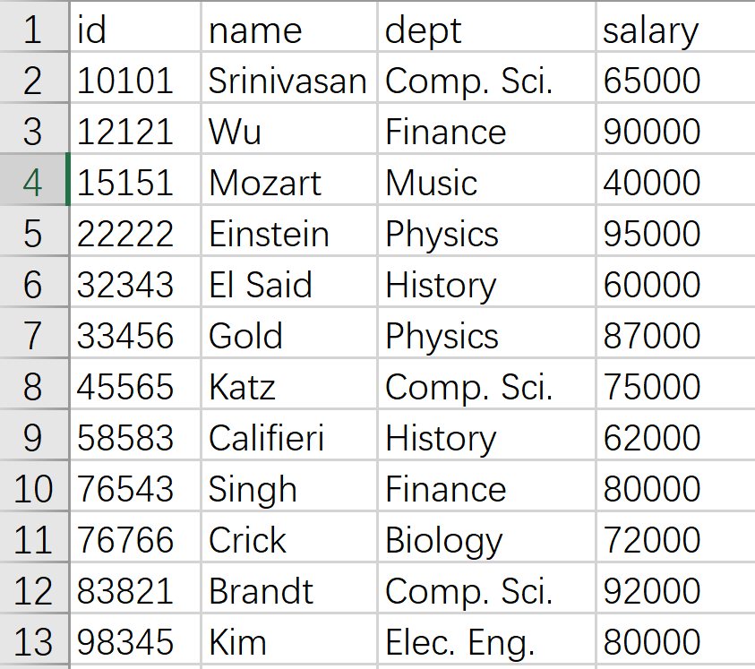

## 1 salary 与 dept 的位图索引

### 原题

Consider the instructor relation shown in the figure below,dividing salary values into 4 ranges: below 50000(L0), 50000 to below 60000(L1), 60000 to below 70000(L2), and 70000 and above(L3) .

Construct bitmap index on the attribute salary and dept separately.

### 答案

每张位图均为 **12 位**，从左到右对应原图的第 1～12 条数据记录，即图中行号 2～13；表头不占位。第 1 位对应 Srinivasan，第 12 位对应 Kim。

**salary 的位图索引**

| 工资区间 | 条件 | 位图 | 对应记录位置 |
| --- | --- | --- | --- |
| L0 | $salary<50000$ | `001000000000` | 3 |
| L1 | $50000\leq salary<60000$ | `000000000000` | 无 |
| L2 | $60000\leq salary<70000$ | `100010010000` | 1、5、8 |
| L3 | $salary\geq70000$ | `010101101111` | 2、4、6、7、9、10、11、12 |

**dept 的位图索引**

| dept | 位图 | 对应记录位置 |
| --- | --- | --- |
| Comp. Sci. | `100000100010` | 1、7、11 |
| Finance | `010000001000` | 2、9 |
| Music | `001000000000` | 3 |
| Physics | `000101000000` | 4、6 |
| History | `000010010000` | 5、8 |
| Biology | `000000000100` | 10 |
| Elec. Eng. | `000000000001` | 12 |

## 2 Bloom Filter 的插入与假阳性

### 原题

Suppose that Bloom filter uses m=32 bits, and 3 hash functions h1, h2, and h3, where $h_i(x)=((x^2+x^3)\cdot i)\bmod m$ (i=1,2,3).The HASH function values of the following elements {2013,2010,2037,2074,2401,1998,3034,2317}are shown in the table below:

|  | 2013 | 2010 | 2037 | 2074 | 2401 | 1998 | 3034 | 2317 |
| --- | --- | --- | --- | --- | --- | --- | --- | --- |
| h1 | 14 | 12 | 6 | 12 | 2 | 28 | 12 | 30 |
| h2 | 28 | 24 | 12 | 24 | 4 | 24 | 24 | 28 |
| h3 | 10 | 4 | 18 | 4 | 6 | 20 | 4 | 26 |

a. Show the Bloom filter bits following each of the following 8 elements insertions in order.

b. For the Bloom filter obtained after part a, find one value that is not among the 8 inserted values, but is a false positive.

c. Compute the probability of a false positive f.

### 2.1 a 逐次插入后的位数组

Bloom Filter 的位置编号为 **0～31**。下表从左到右按位号递增，每组 8 位：`b0…b7`、`b8…b15`、`b16…b23`、`b24…b31`；每组的最左位都是该组最小位号。

| 插入后 | b0～b7 | b8～b15 | b16～b23 | b24～b31 |
| --- | --- | --- | --- | --- |
| 初始 | `00000000` | `00000000` | `00000000` | `00000000` |
| 2013 | `00000000` | `00100010` | `00000000` | `00001000` |
| 2010 | `00001000` | `00101010` | `00000000` | `10001000` |
| 2037 | `00001010` | `00101010` | `00100000` | `10001000` |
| 2074 | `00001010` | `00101010` | `00100000` | `10001000` |
| 2401 | `00101010` | `00101010` | `00100000` | `10001000` |
| 1998 | `00101010` | `00101010` | `00101000` | `10001000` |
| 3034 | `00101010` | `00101010` | `00101000` | `10001000` |
| 2317 | `00101010` | `00101010` | `00101000` | `10101010` |

最终为 1 的位置为

$$
\{2,4,6,10,12,14,18,20,24,26,28,30\},
$$

共 **12 位**。

### 2.2 b 一个假阳性值

可取 **$x=1$**。它不在插入集合中，且

$$
h_1(1)=2,\qquad h_2(1)=4,\qquad h_3(1)=6.
$$

最终的第 2、4、6 位均为 1，因此查询 1 返回“可能存在”，构成假阳性。

### 2.3 c 假阳性概率

**按课堂常用的均匀、独立哈希近似模型：**

$$
f\approx\left(1-e^{-kn/m}\right)^k
=\left(1-e^{-3\times8/32}\right)^3
\approx0.1468916\approx\boxed{14.69\%}.
$$

若保留离散项，另一常用估计为

$$
f\approx\left[1-\left(\frac{31}{32}\right)^{24}\right]^3
\approx0.1516355\approx15.16\%.
$$

题目给定的三个哈希函数彼此相关，因此这两个数都是理想哈希模型下的估计。**对题中这个具体过滤器，若非成员查询的 $x\bmod32$ 在 32 个余数上均匀分布，实际误判率为 $16/32=50\%$。** 未指定查询分布时，实际误判率没有唯一数值。

## 3 固定 k 的 Bloom Filter 容量设计

### 原题

假设用Bloom filter存放集合S，hash函数个数k=8，允许的错误率f最大为0.001%，请分别针对元素个数n=（3,400,000,000、3,600,000,000、3,800,000,000），计算该Bloom filter的位数m最小应为多少?(给出计算式子即可)

### 答案

先换算错误率：

$$f_{\max}=0.001\%=10^{-5}.$$

按标准 Bloom Filter 近似模型 $f\approx(1-e^{-kn/m})^k$，固定 $k=8$，所需位数为

$$
\boxed{m_{\min}=\left\lceil\frac{-8n}{\ln\!\left(1-10^{-5/8}\right)}\right\rceil}
=\left\lceil29.555488704606\ldots\,n\right\rceil.
$$

三种 $n$ 的代入式及该模型下的取整结果：

| 元素数 $n$ | 位数计算式 | 取整结果（bit） |
| --- | --- | --- |
| 3,400,000,000 | $\left\lceil\dfrac{-8\times3.4\times10^9}{\ln(1-10^{-5/8})}\right\rceil$ | **100,488,661,596** |
| 3,600,000,000 | $\left\lceil\dfrac{-8\times3.6\times10^9}{\ln(1-10^{-5/8})}\right\rceil$ | **106,399,759,337** |
| 3,800,000,000 | $\left\lceil\dfrac{-8\times3.8\times10^9}{\ln(1-10^{-5/8})}\right\rceil$ | **112,310,857,078** |
