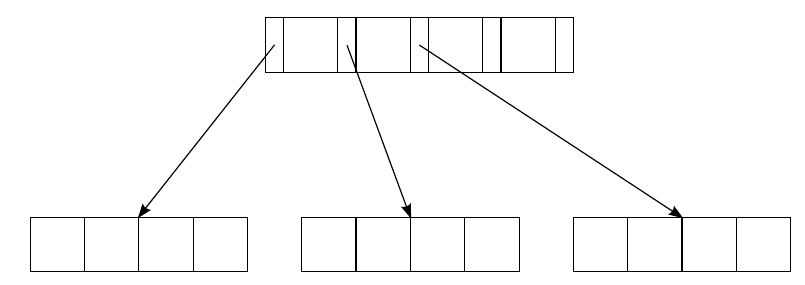

来源：《期末复习题2026.docx》。按原卷编号保留题目；简答第 4 题 IV 问所引用的 Figure 1 缺失，相关位置已注明。

## 一、填空题

### 1

**原题**

衡量半结构化数据模型的三条"公认要求"通常表述为：允许数据模式 \_\_\_\_\_、数据本身 \_\_\_\_\_\_\_、数据中的同名字段语义允许 \_\_\_\_\_\_\_。

**答案**

动态演化（不必预先固定）／自描述、结构可不规则／不同（语义异构）

**解析**

数据携带标签等结构信息；不同记录可包含不同字段或嵌套形式。同名字段不保证同义，需要结合来源与上下文理解。

### 2

**原题**

OEM 的中文全称是 \_\_\_\_\_\_\_，该模型用带 \_\_\_\_\_\_\_ 的有向图表示数据，图中每个对象由\_\_\_\_\_\_\_  、\_\_\_\_\_\_\_和 \_\_\_\_\_\_\_ 三元组构成。

**答案**

对象交换模型（Object Exchange Model）／标签／对象标识符（OID）、类型（type）、值（value）

**解析**

按“标签在边上”的对象三元表示作答：OID 标识对象，类型说明值的类型，值为原子值或复杂对象内容。OEM 表示有不同约定；本课课件也将标签单列，写成标签、OID、类型和值四项。

### 3

**原题**

在 XML 中，元素的并列序列用 \_\_\_\_\_\_\_\_ 表达，元素的强制性用 \_\_\_\_\_\_\_\_ 表达，元素的唯一性用 \_\_\_\_\_\_\_\_ 表达。

**答案**

`xs:sequence`／`minOccurs="1"`／`maxOccurs="1"`。这里按 XSD 的出现次数约束理解；若“唯一性”指取值不重复，则第三空为 `xs:unique`。

**解析**

xs:sequence 指定子元素按次序出现；minOccurs="1" 要求至少一次，maxOccurs="1" 要求至多一次。若“唯一性”是指值不能重复，应使用 xs:unique；DTD 的有序序列通常用逗号，未加出现次数修饰符表示恰好一次。题目未说明使用哪种模式语言及唯一性的含义。 [XML Schema 规范导读](https://www.w3.org/TR/xmlschema-0/)。

### 4

**原题**

图数据模型的两种主流形式是 \_\_\_\_\_\_\_\_ 与 \_\_\_\_\_\_\_\_；前者以 Neo4j 为代表，后者以 \_\_\_\_\_\_\_\_ 为标准数据模型。

**答案**

属性图（Property Graph）／资源描述框架（RDF）图／RDF

**解析**

Neo4j 以属性图为代表；RDF 用带方向的三元组构成图，并是语义网的标准数据模型。

### 5

**原题**

RDF 的基本数据单位是\_\_\_\_\_\_\_ ，其三个组成部分分别称为\_\_\_\_\_\_\_ 、\_\_\_\_\_\_\_、\_\_\_\_\_\_\_。

**答案**

三元组（triple）／主语（subject）／谓词（predicate）／宾语（object）

**解析**

主语是被描述的资源，谓词表示属性或关系，宾语是相关资源或字面值。

### 6

**原题**

本体语义模型的四类核心构件是\_\_\_\_\_\_\_\_、\_\_\_\_\_\_\_\_、\_\_\_\_\_\_\_\_ 和 \_\_\_\_\_\_\_\_。

**答案**

概念（类）／关系（含属性关系）／公理／实例（个体）

**解析**

概念刻画一类对象，关系连接对象或值，公理表达形式化约束，实例指具体对象。这里将属性归入关系；属性也可在更细的分类中单列。

### 7

**原题**

布隆过滤器由长度为 m 的 \_\_\_\_\_\_ 和 k 个相互独立的 \_\_\_\_\_ 组成；查询时若任一对应位为 0，则可判定元素 \_\_\_\_\_\_\_\_ 。

**答案**

位数组（bit array）／哈希函数／一定不存在（于该过滤器所覆盖的已插入集合中）

**解析**

插入时把对应位置设为 1；若查询位置中至少一位为 0，则该元素没有被正常插入。结论以过滤器维护正确为前提。

### 8

**原题**

布隆过滤器只会产生 \_\_\_\_\_\_\_（假阳性/假阴性），不会产生 \_\_\_\_\_\_\_\_；其误判率近似公式为 p ≈ \_\_\_\_\_\_\_\_。

**答案**

假阳性／假阴性／$\left(1-e^{-kn/m}\right)^k$。

**解析**

普通插入型布隆过滤器可能将未插入元素误判为存在，但正常维护下不会把已插入元素判为不存在；公式依赖均匀、近似独立哈希等假设。

### 9

**原题**

给定预期元素数 n 与目标误判率 p，位数组长度 m ≈ \_\_\_\_\_\_\_\_；使误判率最低的哈希函数个数 k = \_\_\_\_\_\_\_\_。

**答案**

$-n\ln p/(\ln2)^2$／$(m/n)\ln2$（实际哈希次数取合适整数）。

**解析**

第一式由目标假阳性率推算所需位数；第二式给出近似最优哈希函数数量，实际需取合适整数。

### 10

**原题**

布谷鸟过滤器存储的不是元素本身而是\_\_\_\_\_\_\_\_ ；每个元素有 \_\_\_\_\_\_\_\_ 个候选桶，其位置关系可由\_\_\_\_\_\_\_\_ 与 \_\_\_\_\_\_\_\_ 异或计算得到，因此桶大小必须是 \_\_\_\_\_\_\_\_。

**答案**

指纹／2／第一个候选桶索引 $i_1$／指纹哈希 $h(f)$／2 的整数次幂。最后一空应约束**桶总数**，原题“桶大小”用词不准确。

**解析**

常见实现用 i₂ = i₁ ⊕ (h(f) & (B−1))，并从 i₂ 用同一掩码反推 i₁。应限定“桶的数量 B”为 2 的幂，而不是每桶槽位数；其他实现也可采用不同映射。 [Cuckoo Filter 原论文](https://www.cs.cmu.edu/~dga/papers/cuckoo-conext2014.pdf)。

### 11

**原题**

布谷鸟过滤器把元素哈希成固定长度的短值存储，该短值称为\_\_\_\_\_\_\_\_；插入冲突时采用\_\_\_\_\_\_\_\_机制，被踢出的元素搬到它的另一个候选桶中。

**答案**

指纹（fingerprint）／踢出（eviction，或搬迁）

**解析**

两个候选桶都满时，随机或按策略踢出一个已有指纹并尝试放入其备用桶；达到搬迁上限仍未成功则报告失败或重建。

### 12

**原题**

跳表在有序链表之上增加多层"\_\_\_\_\_\_\_\_"，每个节点出现在第i+1层的概率为 p，通常取 p = \_\_\_\_\_\_\_\_；当 p = 1/2 时，每个元素的平均指针数约为 \_\_\_\_\_\_\_\_。

**答案**

索引层（或索引）／1/2／2 个

**解析**

已在第 i 层的节点以概率 p 晋升到第 i+1 层。每节点期望前向指针数为 1/(1−p)，p=1/2 时为 2。

### 13

**原题**

跳表的查找、插入、删除的期望时间复杂度为 \_\_\_\_\_\_\_\_，最坏情况为 \_\_\_\_\_\_\_\_；其空间复杂度期望为 \_\_\_\_\_\_\_\_。

**答案**

$O(\log n)$／$O(n)$／$O(n)$。

**解析**

独立随机晋级且层数足够时，查找、插入、删除的期望时间为对数级，空间期望为线性；极端层级分布可能退化为线性时间。

### 14

**原题**

LSM 树的写入路径由内存中的 \_\_\_\_\_\_\_\_ 与磁盘上的 \_\_\_\_\_\_\_\_ 组成，核心思想是把随机写转化为\_\_\_\_\_\_\_\_。

**答案**

内存表（MemTable）／有序字符串表（SSTable）／顺序写

**解析**

先写内存结构，随后刷写为磁盘上的有序文件，并通过合并整理；生产实现通常还使用预写日志（WAL）保证故障恢复。

### 15

**原题**

LSM 树的三种代价放大是\_\_\_\_\_\_\_\_ 、\_\_\_\_\_\_\_\_ 和 \_\_\_\_\_\_\_\_，三者不能同时最小化。

**答案**

写放大／读放大／空间放大

**解析**

多次合并增加写放大，多文件或多层查询增加读放大，旧版本及临时文件占用导致空间放大。策略变化涉及工作负载与资源条件下的权衡。

### 16

**原题**

云原生数据库的核心架构特征是将 \_\_\_\_\_\_\_\_ 与 \_\_\_\_\_\_\_\_ 解耦，并由 \_\_\_\_\_\_\_\_ 完成集群管理；Serverless 形态下可实现 \_\_\_\_\_\_\_\_(指资源可缩到零)。

**答案**

计算／存储／集群编排系统（如 Kubernetes）／缩容至零（Scale to Zero）

**解析**

存算分离便于资源独立伸缩；编排系统负责调度和管理。Kubernetes 是常见方案而非唯一路径；自动缩零取决于具体 Serverless 产品是否支持。

### 17

**原题**

数据库与大模型的双向赋能通常表述为 \_\_\_\_\_\_\_\_ 与 \_\_\_\_\_\_\_\_。

**答案**

AI for DB（AI4DB，AI 赋能数据库）／DB for AI（DB4AI，数据库赋能 AI）

**解析**

前者如智能调优和自然语言查询，后者如为模型训练、推理或 RAG 提供数据与检索服务；不同资料的缩写边界可能不同。

### 18

**原题**

RAG 由 \_\_\_\_\_\_\_\_ 和 \_\_\_\_\_\_\_\_ 两个环节构成，其核心思路是在生成之前先从外部知识源检索相关内容并注入模型的\_\_\_\_\_\_\_\_，使输出基于检索到的材料而非仅依赖模型参数记忆。

**答案**

检索（Retrieval）／生成（Generation）／上下文（提示词）

**解析**

先从外部知识源取回相关材料，再与问题一起提供给生成模型；检索既可以使用向量，也可以使用关键词或其他方法。

### 19

**原题**

大语言模型的两个结构性局限是知识截止与\_\_\_\_\_\_\_\_，RAG 被视为应对这两者的最实用技术路线。

**答案**

幻觉（hallucination）

**解析**

模型知识可能过时，也可能生成无依据或错误的信息。RAG 可引入外部资料以缓解两者，但不能保证资料与生成内容始终正确。

### 20

**原题**

标准 RAG 流程可分为离线与在线两个阶段：离线阶段完成文档加载、清洗、\_\_\_\_\_\_\_\_、嵌入向量化并入库；在线阶段完成查询嵌入、检索、\_\_\_\_\_\_\_\_ 与生成。

**答案**

分块（chunking）／重排（reranking，可结合过滤）

**解析**

离线阶段把文档切成适合检索的片段；在线先生成候选，再按相关性重排并将所选内容交给生成模型。具体流程可因系统设计而异。

### 21

**原题**

向量数据库通过 \_\_\_\_\_（ANN）索引，在\_\_\_\_\_的前提下获得数量级的速度提升。

**答案**

近似最近邻／可接受的召回率或精度损失

**解析**

ANN 通过缩小搜索范围或压缩等方式换取更低开销，可能漏掉真实近邻；加速倍数和召回率须在具体数据与负载下测量。

## 二、选择题

### 1

**原题**

为了减少从存储空间检索记录的开销，通常采用：

- A. 日志
- B. 数据库缓冲区
- C. 中间空间
- D. 下层记录

**答案**

B

**解析**

数据库缓冲区缓存磁盘页，重复访问命中缓存时可减少磁盘 I/O。

### 2

**原题**

数据以“块(blocks)”的形式存储和检索的主要原因是：

- A. 尽量减少实际磁盘访问次数
- B. 节省空间
- C. 使编程更容易
- D. 延长硬件使用寿命

**答案**

A

**解析**

磁盘按块传输数据，一次 I/O 读取多个相邻字节可减少访问次数。

### 3

**原题**

存储跨块记录的文件与存储非跨块记录的文件之间的区别在于：

- A. 如果一个块中无法容纳整数条记录，则包含跨块记录的文件在存储记录时所占用的磁盘空间会比不包含跨块记录的文件少
- B. 一个包含跨磁盘记录的文件可能包含存储在多个磁盘块上的记录
- C. 当记录的大小大于块大小时，必须使用包含跨块记录的文件
- D. 以上全部

**答案**

D（出题预期；A 需要附加假设）

**解析**

跨块记录可以分布在多个块；记录大于块时需跨块或采用其他外部存储机制。若忽略元数据开销、数据量足够，跨块可减少块尾浪费；A 的“必然更省磁盘空间”并不总成立。

### 4

**原题**

下列关于布隆过滤器的说法中，正确的是：

- A. 存在假阴性，且可以删除元素
- B. 不存在假阴性，但不能直接删除元素
- C. 误判率与元素数量无关
- D. 哈希函数越多误判率一定越低

**答案**

B

**解析**

普通布隆过滤器正常维护下无假阴性，也不能直接清除某个元素对应的位，因为其他元素可能共享这些位。

### 5

**原题**

下列关于布隆过滤器的判定说法中，正确的是：

- A. 若k个位置全为 1，则元素一定存在
- B. 若存在一位为 0，则元素一定不存在
- C. 布隆过滤器可能出现假阴性，因此不适合做前置拦截
- D. 位数组越大，k 越小，误判率越低

**答案**

B

**解析**

出现任意 0 位可确定该元素不在过滤器覆盖的已插入集合中；全部为 1 只能表示可能存在。

### 6

**原题**

下列关于计数布隆过滤器(CBF)与布谷鸟过滤器的说法中，正确的是（ ）

- A. CBF与布隆过滤器占用空间完全相同
- B. 布谷鸟过滤器无需计数器即可删除，空间优于CBF
- C. 布谷鸟过滤器插入性能恒优于布隆过滤器
- D. CBF无法支持删除

**答案**

B（最符合题意；空间比较依赖参数）

**解析**

计数布隆用计数器支持删除；布谷鸟过滤器保存指纹并可删除已知存在的项，常见设置下空间较省，但并非所有误判率、装填率和实现下都更省。

### 7

**原题**

布谷鸟过滤器要求桶大小为2的幂，其根本原因是:

- A. 便于用二进制表示指纹
- B. 保证备用桶可由"位置异或指纹哈希"相互推导，且结果仍在桶数组范围内
- C. 便于并行插入
- D. 减少指纹长度

**答案**

B（出题预期；题干应将“桶大小”改为“桶数”）

**解析**

在常见异或掩码实现中，桶数为 2 的幂使候选桶索引仍落在范围内，并可从一个候选桶反推另一个；每桶槽数无此必然要求。

### 8

**原题**

下列关于布谷鸟过滤器删除操作的说法中，正确的是:

- A. 删除永远不会误删其他元素
- B. 若元素未插入而执行删除，可能误删指纹相同的其他元素
- C. 同一元素重复插入次数没有上限
- D. 删除后误判率会上升

**答案**

B

**解析**

若对未插入的元素执行删除，指纹碰撞可能删除其他真实元素的指纹，从而产生假阴性。应确保待删除项确实存在。

### 9

**原题**

某系统需要对缓存穿透做拦截，且需支持元素动态删除，最合适的选择是：

- A. 普通布隆过滤器
- B. 计数布隆过滤器或布谷鸟过滤器
- C. 有序数组 + 二分查找
- D. 哈希表全量存储

**答案**

B

**解析**

计数布隆过滤器和布谷鸟过滤器都能在满足删除条件时支持动态删除，也可做近似成员预筛选。

### 10

**原题**

布谷鸟过滤器在插入时触发“踢巢”连锁搬移，最坏情况可能导致：

- A. 查询出现假阴性
- B. 插入失败，需要扩容或Rehash
- C. 元素被静默丢失且无法察觉
- D. 桶数量必须为质数

**答案**

B

**解析**

连续踢出达到设定上限仍不能安置全部指纹时，插入会失败，系统可扩容、重建或重新哈希；实现须处理被踢出的指纹。

### 11

**原题**

跳表最坏情况退化为 O(n) 的概率约为（设 p = 1/2，n 个元素）：

- A. $2^{-n}$ 量级，极其罕见
- B. 约 1/n
- C. 约 50%
- D. 必然发生

**答案**

A（出题预期；并非一般最坏情况的精确概率）

**解析**

所有 n 个元素均未升入上一层的概率是 (1/2)^n，此时会退化为链表。产生线性级查找的层级分布不止这一种，因此不能将全部最坏情况的概率一概写为 2^(−n)。

### 12

**原题**

下列关于LSM树与B+树比较的说法中，正确的是：

- A. LSM树的写放大通常低于B+树的写放大
- B. LSM 树把随机写转为顺序写，写性能好，但读可能需查多层，读放大较高
- C. LSM 树不支持范围查询
- D. LSM 树的compaction不影响写放大

**答案**

B

**解析**

LSM 常把随机写组织为顺序刷写与合并；读取可能需要检查多个层或文件，产生读放大，实际效果受策略和负载影响。

### 13

**原题**

下列关于LSM树的读路径的说法中，正确的是：

- A. 读操作不需要检查内存
- B. 点查需要依次检查MemTable、不可变MemTable与各级SSTable，布隆过滤器与稀疏索引用于削减无效I/O
- C. LSM 树的读性能恒优于B+树
- D. SSTable内部无序，需全扫描

**答案**

B

**解析**

点查通常先看内存表及不可变内存表，再按版本与层级策略检查可能包含键的 SSTable；过滤器、范围信息和稀疏索引可跳过无关文件或缩小读取范围。

### 14

**原题**

若某 LSM 引擎希望降低写放大、可接受更高的读放大与空间放大，应优先选择：

- A. Leveled Compaction
- B. Size-Tiered Compaction
- C. 关闭 Compaction
- D. 全部写入 L0

**答案**

B

**解析**

Size-Tiered 通常让文件在达到一定规模时合并，可减少反复重写，但会让更多文件暂时共存，增加读和空间放大。

### 15

**原题**

下列关于云原生数据库的说法中，错误的是：

- A. 存算分离后计算节点无状态，可快速扩缩
- B. Serverless 模式下按实际使用量计费，可自动启停
- C. 存算分离后存储层容量与性能不能独立扩展
- D. 计算节点扩缩容不必搬运全量数据

**答案**

C

**解析**

题目要求选错误项：存算分离的目标之一是使计算和存储资源能够按需求分别扩展；具体存储层的容量与性能是否独立仍由产品架构决定。

### 16

**原题**

云原生数据库“存算分离”带来的直接收益不包括：

- A. 计算节点可秒级弹性扩缩容
- B. 存储与计算可独立扩展，只读副本更经济
- C. 使单机事务的写入延迟必然降为常数
- D. 便于多副本与高可用部署

**答案**

C

**解析**

存算分离不保证单机事务写入延迟必然变成常数；网络、持久化、复制和并发等因素仍会影响延迟。

### 17

**原题**

AI Native 数据库的典型能力不包括：

- A. 原生向量数据类型与近似最近邻索引
- B. NL2SQL 自然语言问数
- C. 自动参数调优、索引推荐等自治运维
- D. 以牺牲语义检索为代价换取纯关键字精确匹配

**答案**

D

**解析**

原生向量索引、自然语言查询和自治运维都属于常见 AI 数据库能力；主动牺牲语义检索不是其典型目标。

### 18

**原题**

在AI大模型应用背景下，AI Native数据库与传统数据库的核心差异主要体现在：

- A. 只支持 SQL，不支持向量类型
- B. 原生支持向量检索、多模态数据与库内模型算子，可直接服务RAG与AI Agent
- C. 必须外挂独立向量库才能完成语义检索
- D. 放弃事务能力以换取检索性能

**答案**

B

**解析**

题目强调数据库直接支持向量、多模态及 AI 相关算子，为 RAG 与智能体提供数据服务；不同产品的具体能力并不完全相同。

### 19

**原题**

下列关于RAG(检索增强生成)与传统数据库关系的说法中，正确的是：

- A. RAG 无需向量检索，仅靠关键词匹配即可
- B. RAG 需将文档/知识转为向量并做相似度检索，数据库内置向量能力可避免单独部署向量库带来的数据同步与一致性成本
- C. RAG 检索阶段必须把全部数据搬出数据库
- D. 向量检索天然精确，不存在召回率问题

**答案**

B（出题预期；A 也可成立，题目有歧义）

**解析**

B 对“内置向量能力减少跨系统同步成本”的描述成立，但 RAG 不要求必须向量化，关键词检索也可用于 RAG，因此 A 若理解为一种可行实现也成立。单选题应修改 B 的“需”为“可”。 [RAG 检索方式说明](https://learn.microsoft.com/en-ca/azure/ai-foundry/concepts/retrieval-augmented-generation?view=foundry-classic)。

### 20

**原题**

RAG相比微调(fine-tuning)的主要优势在于：

- A. 能提升模型的推理能力上限
- B. 知识可动态更新、无需频繁重训模型，且便于给出可追溯的来源
- C. 不需要任何向量索引
- D. 能彻底消除幻觉

**答案**

B

**解析**

更新外部知识库不必重新训练模型，检索结果也可附来源；RAG 仍可能引用错误资料或生成幻觉。

### 21

**原题**

在RAG流程中，将用户问题转化为向量的正确做法是：

- A. 换用一个更强的嵌入模型，以提升检索效果
- B. 使用与索引文档相同的嵌入模型
- C. 直接用 LLM 生成一个随机向量
- D. 使用关键词哈希值

**答案**

B（常见实现）

**解析**

查询和文档须处于相互兼容的向量空间；使用同一嵌入模型是一种常见方式，也可以使用专门配对的查询编码器和文档编码器。

### 22

**原题**

下列关于向量检索“近似最近邻（ANN）”的说法中，正确的是：

- A. ANN保证返回100%精确的最近邻
- B. ANN以召回率为代价换取速度，实际系统召回率通常为 95%～99%
- C. ANN只适用于小规模数据集
- D. ANN不需要建立任何索引结构

**答案**

B（出题预期；95%～99% 非通用保证）

**解析**

ANN 通常以一定召回或结果精度换取速度及资源效率。召回率取决于数据、索引、参数、查询和评估方式，不能固定为 95%～99%。

### 23

**原题**

某场景数据规模为上亿条、内存预算紧张且数据相对静态，最合适的索引/方案是：

- A. Flat暴力索引
- B. HNSW
- C. IVF＋PQ，或将图索引与原始数据放到 SSD 的磁盘索引方案
- D. 全量加载到内存的哈希索引

**答案**

C

**解析**

IVF＋PQ 用聚类与量化减少需要扫描或存储的向量数据；磁盘索引也可缓解内存压力。实际性能仍需按数据与硬件测试。

### 24

**原题**

下列关于HNSW结构的描述中，正确的是：

- A. 所有层节点数量相同
- B. 底层包含全部向量节点，越高层越稀疏，查询自顶向下逐层贪心下降
- C. 用 K-means 把向量聚成若干簇
- D. 通过哈希把向量映射到固定桶中

**答案**

B

**解析**

HNSW 的底层包含全部向量，高层越来越稀疏；查询从高层逐层接近目标，在底层搜索候选。

### 25

**原题**

下列关于相似度度量的说法中，错误的是：

- A. 余弦相似度适合文本语义匹配，取值范围为 [-1, 1]
- B. 欧氏距离对方向和模长都敏感，常用于图像特征匹配
- C. 内积结合方向与模长，在向量归一化后与余弦相似度等价
- D. 余弦相似度与内积在任何情况下都完全等价，无需归一化

**答案**

D

**解析**

余弦相似度除以向量模长，普通内积受模长影响；只有在适当归一化等条件下二者才等价。

### 26

**原题**

在向量数据库的完整检索流程中，“结果排序与后置过滤”阶段的主要作用是：

- A. 重新计算所有向量的精确距离
- B. 按距离升序排序候选结果，并结合元数据（时间范围、标签、权限等）剔除不符合业务规则的记录
- C. 压缩向量以减少存储
- D. 重建索引

**答案**

B

**解析**

可按距离升序排列候选，并结合时间、标签、权限等元数据过滤；若使用相似度指标，通常按分数降序排列。

### 27

**原题**

下列关于 RAG 系统质量问题的归因判断中，较为合理的是：

- A. RAG 效果差基本都是生成模型能力不足造成的
- B. 多数 RAG 失败可追溯到摄取（ingestion）阶段，如分块、清洗与嵌入质量问题
- C. 只要增大 top-k 就一定能提升效果
- D. 检索阶段与生成阶段相互独立，互不影响

**答案**

B（出题预期；“多数”缺少普遍证据）

**解析**

清洗、分块和嵌入质量确实可能显著影响 RAG；但失败也可能来自检索、重排、知识源、提示或生成，不能断言多数都来自摄取阶段。

### 28

**原题**

下列关于“数据库内置向量能力”与“独立部署向量数据库”比较的说法中，正确的是：

- A. 独立向量库没有任何运维成本
- B. 数据库内置向量能力可降低架构复杂度、避免多系统间的数据同步与一致性难题，并可用 SQL 统一访问结构化与向量数据
- C. 独立向量库天然保证与业务库的强一致
- D. 内置向量能力意味着不再需要嵌入模型

**答案**

B

**解析**

在业务库中整合向量能力可减少系统和数据同步环节，并可与结构化数据联合查询；并不自动消除所有一致性问题。

### 29

**原题**

下列关于大模型与数据库结合的说法中，正确的是：

- A. NL2SQL 在复杂多表关联与业务口径计算上仍然容易出错，仍需人工审核
- B. RAG完全消除了大模型幻觉
- C. 大模型可以取代 DBA
- D. 向量检索无法与关系数据融合在同一系统中

**答案**

A

**解析**

复杂多表关联及业务口径容易造成 NL2SQL 错误，重要查询需要结合权限、结果核验与必要的人工审核。

## 三、简答题

### 1

**原题**

试对半结构化数据(SSD)"无模式(schema-less)"的准确含义进行说明，并指出SSD模型带来的两点优势与两点代价。

**答案**

“无模式”是指半结构化数据不要求所有记录在写入前遵守同一套固定字段和结构；数据通常通过键、标签、类型和嵌套自描述，不同记录可以有不同字段、层级和可选属性。它仍需符合 JSON/XML 等语法，业务也可以施加模式与校验规则。

优势：①结构灵活，新增字段或融合不同来源的数据时，不必先统一修改全部记录，便于应对业务和数据变化；②支持嵌套和多值，能把经常一起访问的相关信息组织在一个文档中，便于整体读取。

代价：①字段名称、类型或层级可能不一致，查询、清洗和整合需要处理结构差异，也增加了索引与优化难度；②缺少统一强制约束时，完整性和语义一致性需要应用或校验机制额外维护，重复嵌套的信息还可能造成冗余和更新不一致。

**解析**

“无模式”强调不预先强制所有记录采用同一固定模式，不是没有结构、没有类型，也不是禁止使用 JSON Schema 或 XML Schema。答题可按“含义—两项优势—两项代价”组织。

### 2

**原题**

本体语义模型与传统的实体-联系(E-R)模型在语义表达能力上有何本质区别？请结合课程内容，从“概念层次约束”和“推理支持”两个角度加以阐述。

**答案**

本体模型和 E-R 模型都能表达业务概念及其关系；本体的突出之处是用形式化公理明确概念语义，并支持基于这些公理的机器推理。

①概念层次与约束：E-R 模型以实体、属性、联系及其基数、参与约束等表达业务结构；扩展 E-R 也能表达超类、子类及继承。本体通过类、属性和公理进一步表达子类、等价、互斥、属性定义域与值域等，形成可共享、可复用的领域语义。

②推理支持：在本体中声明“研究生是学生的子类”，再给出“小李是研究生”，推理机就能推出“小李是学生”；也可依据关系公理推导关系或检查逻辑一致性。普通 E-R 概念建模侧重显式描述结构与约束，通常不自带统一的本体逻辑推理机制。

例如，在 RDFS/OWL 中，属性的定义域和值域可用于推导实例类型；若要检查“每条记录必须填写某字段”，可配合 SHACL 或数据库完整性约束。

**解析**

比较的是侧重点和形式语义，不要写成“E-R 没有语义、没有层次或约束”。本体推理依赖已声明公理及推理机制；OWL 常用开放世界语义，缺少一条事实不自动等于事实为假。

### 3

**原题**

半结构化数据模型(以 JSON/XML 为代表)与图数据模型在表示“数据间引用”时采用了不同的机制。请回答：（1）关系模型使用外键(FK)、半结构化模型使用嵌套或路径、图模型使用节点标识或边。请分别说明半结构化模型和图模型在表示引用时的典型方式，并指出各自的优缺点。（2）在什么场景下，图模型的引用机制比半结构化模型的嵌套机制更具优势？请举例说明。

**答案**

①半结构化模型：JSON/XML 常把子对象嵌入父对象，用字段、元素层级和路径访问。例如论文文档的 authors 数组嵌入作者信息，可按 papers.authors.name 查找。也可用作者 ID、XML ID/IDREF 或 URI 显式引用独立对象，再按标识解析引用。嵌套使整体读取方便、结构灵活；当同一对象被多处使用时，重复嵌套会带来冗余和更新一致性问题，显式 ID 引用则需要额外解析或关联。

②图模型：用具有身份标识的节点表示对象，用带类型、方向的边直接表示对象间关系；边还可保存作者顺序等属性。例如研究者经 AUTHORED 边连到论文。共享对象、多对多关系、环和多跳路径可以自然表示并沿边遍历；代价是需要维护节点与边、索引及关系更新，简单整体文档读取未必比嵌套文档方便。

③图模型更适合共享关系多、路径查询频繁的场景。例如学术合作网络中，一名研究者可参与多篇论文，一篇论文有多位作者。查“X 的合作者及合写论文”可以从 X 沿 AUTHORED 边到论文，再反向到其他作者；查多跳合作圈也可继续遍历。文档若重复嵌套作者，要处理冗余；若改用 ID 引用，则需要做相应关联。

**解析**

半结构化数据并不限于树形嵌套：ID/引用可以表示共享对象和环。区别在于常用表示及访问机制，不能写成“JSON/XML 不允许引用”或“图查询任何情况下都更快”。

### 4

**原题**

Consider a B+ tree containing the elements 2,4,8,9,11,12,13,14,16,17,18,20. The tree has order d = 2. This means that internal nodes have at least 2 keys and 3 pointers, and at most 4 keys and 5 pointers; leaf nodes have at least 2 data entries and at most 4 data entries.

（I）In the picture below, draw what the tree looks like if the leaves are as densely packed as possible. Draw directly on the picture.



（II）Based on your original tree from 1, what is the minimum number of inserts that could cause a root split?

（III）Draw the tree just after the root has split with a minimum of insertions as you described in 2. Use any value you like that would cause the split. We have started you off by drawing the root and internal nodes; you need to fill them in and draw the leaves.

（IV）Given the B+ tree shown in Figure 1, draw the tree after deleting keys 19, 20, 24 in the given order.

**答案**

**约定**：分隔键取右子树最小键；叶子溢出为 5 项时按左 2、右 3 分裂。`leaf` 表示叶节点，叶节点从左到右连接为有序叶链。

**（I）最密叶布局：**

```text
[11 | 16]
├── leaf [2, 4, 8, 9]
├── leaf [11, 12, 13, 14]
└── leaf [16, 17, 18, 20]
```

**（II）最少 3 次插入。**

**（III）例如依次插入 3、15、19，根刚分裂后为：**

```text
[13]
├── [4 | 11]
│   ├── leaf [2, 3]
│   ├── leaf [4, 8, 9]
│   └── leaf [11, 12]
└── [16 | 18]
    ├── leaf [13, 14, 15]
    ├── leaf [16, 17]
    └── leaf [18, 19, 20]
```

**（IV）缺少初始图，无法唯一给出删除后的树。** 所给 Word 未附题目引用的 Figure 1，前面的空白框架也没有该题键值。需补充 Figure 1 才能按 19 → 20 → 24 逐步作图。

**解析**

每叶最多 4 项，12 个原键正好填满 3 叶。原根有 2 个分隔键，最多容纳 4 个；要使根溢出须增加到 5 个分隔键，因此至少需要 3 次叶分裂。一次插入至多让一个叶分裂，所以至少插入 3 项。

这个下界可以达到：

| 插入 | 叶分裂 | 根中的分隔键 |
| --- | --- | --- |
| 3 | `[2,4,8,9]` → `[2,3]` 与 `[4,8,9]` | `[4,11,16]` |
| 15 | `[11,12,13,14]` → `[11,12]` 与 `[13,14,15]` | `[4,11,13,16]` |
| 19 | `[16,17,18,20]` → `[16,17]` 与 `[18,19,20]` | 临时为 `[4,11,13,16,18]` |

提升中间分隔键 13，左右内部节点各保留 2 个键、3 个孩子，满足题目给出的非根占用下界。

第 IV 问的删除规则是：删除叶中相应条目；不足 2 项时从同父相邻兄弟借项并更新父分隔键，若无法借项则合并并向上处理内部节点不足；根仅剩一个孩子时收缩。具体借位、合并与结果依赖缺失的 Figure 1，不能从待删除的三个键反推初始树。

### 5

**原题**

试解释 LSM 树的写放大、读放大、空间放大分别由什么引起，并说明Compaction如何在三者之间做权衡。

**答案**

①写放大：一次逻辑写入先进入内存并刷成 SSTable，之后数据在多轮 Compaction 中又被读出、合并并重新写入，因此底层实际写入量可能大于用户写入量。

②读放大：同一键的不同版本可能分布在 MemTable 和多个层、多个 SSTable 中；点查或范围查询可能要检查并合并多个文件、索引及版本，实际读取量可能大于返回给用户的数据量。

③空间放大：不同层中可能同时保留新旧版本、删除标记及待合并文件；合并过程中输入和输出文件也可能暂时共存，使实际占用大于当前有效数据的大小。

Compaction 将有序文件合并，并在满足版本可见性和快照等安全条件时回收旧版本与墓碑，可减少待读文件数和空间占用，但会消耗 I/O、CPU 并增加写放大。较积极的 Leveled 合并通常降低读放大和空间放大，却需要更多重写；较延后的 Tiered/Size-Tiered 合并通常降低写放大，却可能保留更多文件及旧版本，增加读放大和空间放大。具体取舍还依赖实现、参数和负载。

**解析**

理解为同一份逻辑数据在物理层产生了更多写入、读取或存储。过滤器与文件范围索引可减少部分无效读取，但不会消除 Compaction 的重写成本；墓碑不能在仍需遮蔽旧值或保护快照时过早丢弃。参考：[RocksDB 合并策略说明](https://github.com/facebook/rocksdb/wiki/Universal-Compaction) 。

### 6

**原题**

某系统需用布隆过滤器对n = 10⁷个 URL 做去重，要求误判率 p ≤ 1%。1) 计算所需位数组长度 m 及最优哈希函数个数 k(要求给出算式与近似取值，ln 2 ≈ 0.693，ln 0.01 ≈ −4.605)。

2) 计算此时的实际内存占用(按 bit 换算为 MB，1 MB = 8×10⁶ bit 亦可自行说明换算)。

3) 若内存预算被压缩到只有 2) 的一半，为保持误判率不变，可采取哪些措施？至少给出两条并简述代价

**答案**

（1）按标准独立、均匀哈希近似模型：

$$
m\approx-\frac{n\ln p}{(\ln2)^2}
\approx\frac{10^7\times4.605}{0.693^2}
\approx9.5888\times10^7\ \text{bit},
$$

$$k\approx\frac mn\ln2\approx6.65.$$

取整数 **$k=7$**，并将位数组向上配置为 **$m=96{,}000{,}000$ bit**。复算

$$p\approx(1-e^{-7\times10^7/(96\times10^6)})^7\approx0.9965\%\leq1\%.$$

（2）位数组占用 **$96{,}000{,}000/(8\times10^6)=12$ MB**。

（3）预算减为 6 MB 时，固定 1,000 万元素的普通 Bloom Filter 不能仅靠调整 $k$ 保持 1%。可采取：

- **缩小活跃去重窗口**，使同时保留的 URL 降至约 500 万；代价是历史范围内的全局去重须另行处理。
- **分片并外存化**：确定性地将 URL 分到多个过滤器分片，内存只缓存一部分，其他放 SSD；总过滤器空间仍按目标配置，代价是外存及额外访问延迟。
- **对“可能存在”再查精确集合**：让数据库核实完整 URL，保持系统最终去重判断准确；代价是更多精确查询。这改善的是系统结果，6 MB 过滤器自身的误判率仍较高。

**解析**

在标准哈希近似模型中，$p\approx(1-e^{-kn/m})^k$。对固定的 $m,n$ 选择近似最优的 $k$，得到 $k^*=(m/n)\ln2$；将它代回并取对数，可解得 $m\approx-n\ln p/(\ln2)^2$。[Bloom Filter 误判率研究](https://cse.usf.edu/~kchriste/energy/ipl10.pdf)

题给近似常数得到连续估计 $m\approx95{,}887{,}758$ bit，而 $k$ 必须取整数。将空间上调到 96,000,000 bit，再用 $k=7$ 复算，可以满足题设的 1% 目标。

若保持 1,000 万元素而将位数减半，$m/n=4.8$，最优整数哈希次数约为 3，近似误判率达到 10.04%。因此，分片必须配套额外总存储，或改变同时覆盖的集合规模；单纯切成多个更小过滤器不能节省一半总位数并维持同一误判率。

### 7

**原题**

设关系r1(A，B，C)，r2(C，D，E)有如下特性：r1有200,000个元组，r2有45,000个元组，一块中可容纳25个r1元组或30个r2元组；试估算以下每一种策略计算r1|><|r2所需存取的块数(假设可用于连接操作的内存数量为300个块):

1) 块嵌套循环连接

2) 归并连接(假设r1,r2已按连接属性排序)

3) 混合散列连接(假设分5路进行散列并且没有偏斜)

**答案**

两表分别占 $b_1=200000/25=8000$ 块、$b_2=45000/30=1500$ 块。按总缓冲 $M=300$ 块、预留输入与输出缓冲，且不计最终结果写出：

| 策略 | 块 I/O 估计 |
| --- | --- |
| 块嵌套循环，$r_1$ 作外表 | $8000+\lceil8000/298\rceil\times1500=\mathbf{48500}$ |
| 块嵌套循环，$r_2$ 作外表 | $1500+\lceil1500/298\rceil\times8000=49500$ |
| 已排序的归并连接 | $8000+1500=\mathbf{9500}$，假定同键组可在缓存中处理 |
| 五路混合散列的课堂理想公式 | $(3-2/5)(8000+1500)=24700$，但所需驻留分区加缓冲超出本题内存 |
| 满足内存限制的一种两级五路方案 | **43700**，第二级也假定均匀分区 |

因此块嵌套循环选 **48500**。混合散列第一次每个小分区为 $1500/5=300$ 块，已用尽全部内存，不能再容纳必要缓冲；实际成本还取决于采用的溢出或递归分区方案。

**解析**

**块嵌套循环。** 将 $M-2=298$ 块用于外表批次，每一批扫描一遍内表。外表取 $r_1$ 时有 27 批，取 $r_2$ 时有 6 批；因为向上取整的影响，本例较大的 $r_1$ 作外表反而少 1,000 次 I/O。[教材块嵌套循环公式](https://www.db-book.com/Previous-editions/db4/slide-dir/ch13-2.pdf)

**归并连接。** 两输入已经排序，通常各扫描一次即为 9500；若相同连接键的重复记录组无法放入缓存，则可能需要额外回读。题目没有给出这种重复组的规模。

**混合散列的可行两级方案。** 忽略分区尾块及哈希表元数据的额外开销：

1. 第一级分成 5 对分区，全部读入并写盘，花费 $2(8000+1500)=19000$。
2. 每对分区为 $(1600,300)$ 块。再均匀分 5 路，得到每对子分区 $(320,60)$ 块；其中一个 60 块的构建子分区可留在内存，另外四对写盘后再读取。
3. 每对原分区需读 1900 块，另写出并读回 $4/5$ 的数据，成本为 $1900+2\times(4/5)\times1900=4940$。
4. 总成本为 $19000+5\times4940=43700$。

若两级都采用全部分区落盘的 Grace Hash Join，则另一可行估计为 $5\times9500=47500$。理想的一次混合散列值 24700 节省了一个分区的写出与回读，但它要求 300 块构建分区之外还有缓冲，不能直接作为题给内存下的可执行结果。

### 8

**原题**

Consider the relations r1(A, B,C), r2(C, D, E), and r3(E, F), with primary keys A, C, and E, respectively. Assume that r1 has 1000 tuples, r2 has 1500 tuples, and r3 has 750 tuples. Estimate the size of r1|><|r2|><|r3.

**答案**

在通常的连接值域包含假设下，估计 **1000 条**。严格只依据所给主键，能确定的是

$$0\leq|r_1\bowtie r_2\bowtie r_3|\leq1000.$$

若每个 $r_1.C$ 都匹配 $r_2.C$，且相应的 $r_2.E$ 都匹配 $r_3.E$，每条 $r_1$ 记录恰好产生一条结果。

**解析**

题给 r1.A、r2.C、r3.E 是主键，但未给 r1.C 引用 r2.C、r2.E 引用 r3.E 的外键或非空约束。两步键连接均不放大 r1。上界 1000 可达到：1000 个 r1.C 分别指向 1000 条 r2，这些 r2.E 可共用一个合法 r3.E；0 也可达到。 主键只保证匹配端的唯一性；它没有同时声明外键、非空和实际匹配。因此不能把 1000 说成不附加假设的精确值。

### 9

**原题**

Consider the relations r1(A, B,C), r2(C, D, E), and r3(E, F). Assume that there are no primary keys, except the entire schema. Let V(C,r1) be 900, V(C,r2) be 1100, V(E,r2) be 50, and V(E,r3) be 100. Assume that r1 has 1000 tuples, r2 has 1500 tuples, and r3 has 750 tuples. Estimate the size of r1|><|r2|><|r3.

**答案**

按连接优化中的常用估算，假设连接键在各自不同值之间均匀分布、较小值域包含于较大值域，且第一次连接保留的 `r2.E` 分布近似不变：

```text
|r1 ⋈ r2| ≈ |r1| × |r2| / max(V(C,r1), V(C,r2))
          = 1,000 × 1,500 / max(900, 1,100)
          ≈ 1,363.64

|r1 ⋈ r2 ⋈ r3|
          ≈ 1,363.64 × 750 / max(50, 100)
          ≈ 10,227 条
```

因此估计约为 **10,227 条**。实际连接值域的重叠程度和键值分布会影响结果。

**解析**

第一次的标准估算为 1,500,000/1,100 = 1363.63636；第二次假设 C 连接不改变 E 的 50 个不同值及其频率，r2.E 的 50 个值均包含于 r3.E 的 100 值中，乘以 750/100=7.5，得到 10227.2727。根据保留全部主键、不同值个数本身不能唯一确定连接结果。

### 10

**原题**

Consider the relation LEG(source, destination), recording non-stop flight-legs from one airport (’source’) to another (’destination’). Assume that it contains n = 1,000 tuples. Consider the query to find all airports within two hops from Pittsburgh (keep the duplicates, for simplicity):

```sql
select L2.destination
from LEG as L1, LEG as L2
where L1.destination = L2.source and
L1.source = ’Pittsburgh’
```

Estimate the number of output tuples for the above query if we have 100 distinct airports, that is V (LEG, source) = V (LEG, destination) = 100.

Hint: First, estimate the number of tuples in the self-join

**答案**

按题目提示先估算自连接，再估算 Pittsburgh 的筛选。假设 100 个机场值均匀出现、Pittsburgh 在 `source` 值域内，且连接后 `L1.source` 的分布仍近似均匀：

```text
|L1 ⋈ L2| ≈ 1,000 × 1,000 / max(100, 100) = 10,000
|结果| ≈ 10,000 / 100 = 100 条
```

也可直观地看：Pittsburgh 平均有 `1,000/100 = 10` 条出发航段，每个中转机场平均有 10 条出发航段，所以约有 `10×10=100` 条结果。这里保留重复目的地；SQL 实际查询的是**恰好两段航程**，不自动包含一段直飞。

**解析**

该估计要求连接值域有充分重合，且连接键和 L1.source 的频率近似均匀、无显著相关性。题目只给不同值数量，不足以确定实际输出，Pittsburgh 缺席或机场度数偏斜都会改变结果。

### 11

**原题**

布谷鸟过滤器使用两个桶(bucket)，每个桶容量为 1 个槽位。元素x的两个候选桶位置为：

i₁ = h(x) mod 4

i₂ = (i₁⊕hash(x)) mod 4

设4个元素 A、B、C、D 的候选桶位置如下表(已给定，无需计算哈希）：

| 元素 | i₁ | i₂ |
| --- | --- | --- |
| A | 0 | 1 |
| B | 0 | 2 |
| C | 1 | 3 |
| D | 2 | 3 |

按A → B → C → D的顺序依次插入。

请推演插入过程，指出在插入哪个元素时发生“踢出”（eviction），并给出每次踢出后各桶的占用情况。

若踢出过程中形成循环（即被踢出的元素又回到其原桶），说明系统应如何处理。

与布隆过滤器相比，布谷鸟过滤器为何天然支持删除？请结合其存储结构说明。

**答案**

**理解桶数。** 题中有编号 `0、1、2、3` 的 **4 个桶**，每个元素有两个候选桶，每桶只有 1 个槽位。题干“使用两个桶”应理解为每个元素有两个候选桶。

**（1）一种会发生踢出的合法插入过程。** 设两个候选桶都有空位时优先选 `i₂`；两个均满时将新元素放进编号较小的候选桶，踢出原元素。对被踢出的元素，尝试放入它的另一候选桶。

| 操作 | 桶 0 | 桶 1 | 桶 2 | 桶 3 | 说明 |
|---|---|---|---|---|---|
| 初始 | 空 | 空 | 空 | 空 | — |
| 插入 A | 空 | A | 空 | 空 | A 选 `i₂=1` |
| 插入 B | 空 | A | B | 空 | B 选 `i₂=2` |
| 插入 C | 空 | A | B | C | C 选 `i₂=3` |
| 插入 D | 空 | A | D | C | D 的 2、3 号候选桶均满，放入 2，踢出 B |
| 搬迁 B | B | A | D | C | B 的另一候选桶 0 为空 |

在这一策略下，**插入 D 时发生 1 次踢出**。踢出是否发生取决于选桶策略：例如 A→0、B→2、C→1、D→3 也完全合法，且不需要踢出。

**（2）循环或搬迁次数达到上限时**，应停止当前搬迁并保留尚未安置的指纹，回滚本次插入或暂存后报告插入失败；可尝试更换搬迁路径、扩容，或在能取得原始元素时重建过滤器。仅看到某个元素回到原桶，还不能单独证明不存在其他可行放置路径。

**（3）删除原理。** 布谷鸟过滤器把元素的短指纹放在两个候选桶之一，删除时可定位候选桶并移除一个匹配指纹；普通布隆过滤器的位可能由多个元素共享，直接清零会影响其他元素。由于不同元素可能有相同指纹，应只删除已确认存在的元素，并正确处理重复项，否则可能误删其他元素的指纹。

**解析**

表中 A 候选 0/1、B 0/2、C 1/3、D 2/3。采用 i2 优先则前三步占 1、2、3，D 替换 2 中 B 后，B 从 2 到 0，最终 [B,A,D,C]。反例 A0,B2,C1,D3 表明是否必须踢出不唯一。仅保存指纹时，实际实现要能由指纹推导备用桶（常见方式对指纹求哈希），不能假设从指纹恢复原始元素；若换哈希方式重建，应能获得原始集合。

### 12

**原题**

设跳表(Skip List)当前结构如下(层数从上到下，每层为有序链表；→ 表示指针）：

```text
L3：head → 10 → null
L2：head → 10 → 30 → null
L1：head → 10 → 20 → 30 → 50 → null
L0：head → 5 → 10 → 20 → 30 → 40 → 50 → null
```

请写出查找关键字 40 的完整搜索路径(从最高层开始，逐层下降)，并统计比较次数。

现要插入关键字 35，假设其随机层数为 2(即出现在L0和L1)。请描述插入操作需要修改哪些指针，并写出插入后 L0 和 L1 的内容。

跳表的期望时间复杂度为 O(log n)，其前提假设是什么？若随机层数生成不均匀(例如绝大多数元素只有 L0)，性能会退化到什么程度？

**答案**

**（1）查找 40。** 从最高层出发，向右比较下一节点；小于 40 就前进，大于 40 或到达空指针就下降。

```text
L3：head → 10，下一节点为空，下降到 L2 的 10
L2：10 → 30，下一节点为空，下降到 L1 的 30
L1：30 的下一节点为 50，50 > 40，下降到 L0 的 30
L0：30 → 40，找到
```

按“每次把一个实际节点键与 40 作一次三向大小比较”计数，依次比较 `10、30、50、40`，共 **4 次**；空指针检查不计入。若程序分别执行 `<` 和最后一次 `==`，则上述过程会进行 5 次键关系运算，计数口径需要写清。

**（2）插入 35。** 35 出现在 L0、L1，搜索确定两层的前驱均为 30：

- L1：将 `30 → 50` 改为 `30 → 35 → 50`。
- L0：将 `30 → 40` 改为 `30 → 35 → 40`。

```text
L1：head → 10 → 20 → 30 → 35 → 50 → null
L0：head → 5 → 10 → 20 → 30 → 35 → 40 → 50 → null
```

**（3）复杂度前提。** 每个节点以固定概率 `0<p<1` 独立逐层晋升，高层因而逐渐稀疏，层数上限足以覆盖当前数据规模；在这些随机化条件下，查找、插入、删除的期望时间复杂度为 `O(log n)`。若高层节点极少或分布严重失衡，缺少有效的高层跳跃，最坏可退化为 `O(n)`。多数节点只在 L0 本身不足以判定退化，关键是高层能否提供足够均匀的跳跃。

**解析**

基于下一节点与目标的三向比较，查找路径实际接触关键字 10,30,50,40，4 次。若伪代码先用 next.key < 40 再在 L0 检查 ==40，则 40 比较两遍、共 5 次原始关系运算。插入前驱在两层皆为30，后继分别为50和40。

### 13

**原题**

某LSM树存储引擎的参数如下：内存表（MemTable）阈值为4条记录；采用分层压缩（leveled compaction），L0 最多允许2个 SSTable，超过则触发压缩合并到 L1。

初始状态为空。依次写入以下键值对(键为整数）：

```text
(1,a) (2,b) (3,c) (4,d) (5,e) (6,f) (2,b') (7,g)
```

请推演写入过程，指出每次 MemTable 刷写产生哪些 SSTable，以及何时触发 L0→L1 的压缩。

写入 (2,b') 后，键 2 存在两个版本（b 和 b'）。在读取键 2 时，引擎如何确定应返回哪个版本？请说明读取路径中“版本判定”的依据。

若压缩策略改为“仅在 L0 达到 4 个 SSTable 时合并”，对读放大和写放大分别有何影响？

**答案**

**（1）写入与刷盘过程。** 内存表达到 4 条记录即刷成一个有序 SSTable；L0 在文件数**超过 2 个**时才触发压缩。

| 写入阶段 | MemTable | 刷写及 L0 状态 |
|---|---|---|
| 写入 `(1,a)、(2,b)、(3,c)` | 3 条记录 | L0 为空 |
| 写入 `(4,d)` | 达到 4 条后刷空 | 产生 `SST₁ = [(1,a),(2,b),(3,c),(4,d)]`，L0 共 1 个文件 |
| 写入 `(5,e)、(6,f)、(2,b′)` | 3 条记录 | L0 仍为 1 个文件 |
| 写入 `(7,g)` | 达到 4 条后刷空 | 产生 `SST₂ = [(2,b′),(5,e),(6,f),(7,g)]`，L0 共 2 个文件 |

**8 次写入只产生两个 L0 文件，尚未超过 2 个，因此本题过程中不发生 L0→L1 压缩。**

**（2）读取键 2。** 在普通最新值读取下，引擎先检查 MemTable 和可能存在的不可变 MemTable，再检查可能含该键的 SSTable，比较版本号或序列号。`SST₂` 中的 `(2,b′)` 写入时间晚于 `SST₁` 中的 `(2,b)`，因此返回 **`b′`**。若是历史快照读取，则应返回对该快照可见的最新版本。

**（3）改成 L0 达到 4 个文件时再合并。** 与原来的第 3 个文件产生后压缩相比，文件会在 L0 停留更久。读操作可能需要检查更多重叠文件，读放大通常增大；更大批次合并可减少重复合并，尤其可提前合并同键旧版本，写放大通常有机会降低。具体结果取决于数据重叠、更新模式和后续层级策略。

**解析**

前四次写入 flush SST1；后四次写入为 5,6,2,7 四个不同键，flush SST2 按键排序。题干为 L0 最多允许2，超过才压缩；2不超过2，L1仍为空。读取 b′ 依据 sequence number/MVCC 以及最新视图，不是笼统认为磁盘一定比内存旧。新阈值为产生第4文件触发，原阈值为第3文件触发，趋势仍依工作负载。

### 14

**原题**

布隆过滤器和布谷鸟过滤器在数据库系统（尤其是 LSM 树的读取路径）中常被用作“预筛选”组件。请回答：

在 LSM 树中，布隆过滤器通常被用来解决什么问题？其作用机制是什么？

布谷鸟过滤器相比布隆过滤器在数据库场景中具有哪些优势？为什么这些优势在实际系统中具有吸引力？

**答案**

①布隆过滤器用于减少 LSM 树中不必要的 SSTable 点查询，尤其适合大量查询不存在键的情况。每个 SSTable 可按所含键构建过滤器；查询键时先检查对应过滤器：若返回“一定不存在”，跳过该文件；若返回“可能存在”，再查文件索引和数据。可能存在是假阳性，最终仍以实际查询结果为准。

②布谷鸟过滤器保存短指纹，通常只需检查两个候选桶；与标准布隆过滤器相比，它支持动态插入和删除，适合集合经常变化的场景，也可在部分配置下提供较好的查询或空间效率。删除时必须确认该元素此前实际插入且尚未删除；布谷鸟过滤器会有插入失败风险，空间与速度优势取决于目标误判率、负载和实现。

对于 LSM 中不可变 SSTable，标准布隆过滤器可以随文件生成、在合并后重建，通常不需要对单个文件频繁删除，因此两种过滤器应按场景选用。

**解析**

过滤器的否定结论只适用于它覆盖的那个文件，不等于整个数据库都没有该键：仍需检查 MemTable 和其他相关文件。文件中的点删除标记键也应纳入过滤器，范围删除还需单独处理；过滤器正常维护时无假阴性，假阳性只会引起一次多余查找。参考：Cuckoo Filter 原论文 [Cuckoo Filter 原论文](https://www.cs.cmu.edu/~dga/papers/cuckoo-conext2014.pdf) 。

### 15

**原题**

从云原生数据库到AI 原生数据库，数据库系统的“用户假设”和“负载假设”正在发生根本性变化。请回答：

云原生数据库的核心架构设计(如计算存储分离、无状态计算层)主要解决了传统数据库在云环境下的哪些问题？

当 AI Agent 成为数据库的重要使用者时，其访问模式与人类开发者有何本质不同？请至少从两个维度加以说明。

基于上述差异，AI Native 数据库在架构设计上需要做出哪些针对性调整？请提出至少两项设计方向并简要解释理由。

**答案**

①云原生数据库：传统存算一体部署中，计算与存储绑定，负载变化时往往需要一起扩容，容易造成资源闲置，故障恢复也受本地状态和数据迁移影响。存算分离让计算与持久化存储按需分别扩缩；无状态计算层使计算节点更容易替换、重启或弹性调度，并可减轻节点与持久数据绑定造成的恢复压力。计算节点仍可能持有会话、缓存和执行中的事务，切换时须处理这些状态。

②Agent 与人类开发者的访问差异：一是访问节奏，Agent 可自动连续调用、多 Agent 并发并形成突发流量，单次任务中可能反复检索和查询；二是访问内容与方式，Agent 经常结合自然语言、向量相似检索、结构化过滤、关联查询和历史上下文，访问模式比固定业务 SQL 更动态。人类和传统服务也可能使用这些方式，差异在于 Agent 将其自动化并可能高频组合。

③AI Native 架构方向：支持结构化数据、原始内容、元数据与向量关联，以及向量、关键词和 SQL 过滤的混合检索，为 Agent 提供有上下文的数据；提供可发现的模式和业务语义、自然语言或结构化工具接口，并对生成的查询做校验；针对突发和多 Agent 并发提供弹性计算、缓存和资源隔离，同时通过最小权限、限流与审计控制自动调用。

**解析**

答题主线是“云原生解决弹性与资源组织，Agent 引入新的访问频率、查询形态及治理需求”。Serverless 与存算分离是相关但不同的概念：前者强调资源由平台管理，后者描述计算与持久化存储如何组织。

## 四、综合设计题

### 1

**原题**

1. 某学术 collaboration 平台需要存储和管理以下数据：

研究人员(Researcher)：属性有姓名(name)、所属机构 (affiliation)

论文(Paper)：属性有标题(title)、发表年份(year)

研究主题(Topic)：有名称(name)

关系：研究者撰写论文(可标注作者顺序)；论文涉及研究主题；研究者合作过其他研究者(合作关系由共同撰写论文隐含产生，也可显式存储合作次数)

平台需要支持以下两类查询：

查询 A：“找出与研究者 X 有合作关系的所有研究者，以及他们合作发表的论文标题”

查询 B：“统计过去五年中，每个研究主题下发表论文的总数”

请完成以下设计任务：

1) 请分别用半结构化数据模型(JSON 文档) 和属性图模型给出上述数据的概念设计草图(文字描述即可)，并指出两种设计在表达“作者顺序”和“合作关系”时的关键差异。2) 针对查询 A 和查询 B，分别判断哪种数据模型更适合，并简要说明理由。

**答案**

（1）数据模型设计

A. JSON 文档：为研究者、论文、主题分别保存带唯一 ID 的文档；论文中的作者数组既可按出现顺序表达署名顺序，也可为作者显式保存 order。示例：

```json
{
  "researchers": [
    {"rid": "R1", "name": "X", "affiliation": "A大学"},
    {"rid": "R2", "name": "Y", "affiliation": "B大学"}
  ],
  "papers": [
    {"pid": "P1", "title": "论文一", "year": 2023,
     "authors": [{"rid": "R1", "order": 1}, {"rid": "R2", "order": 2}],
     "topicIds": ["T1"]}
  ],
  "topics": [{"tid": "T1", "name": "数据库"}]
}
```

作者和主题均用 ID 引用，避免在每篇论文中重复保存完整资料；也可按访问需求冗余少量展示字段。若数组顺序和 order 都保存，二者须保持一致。合作关系可通过共同出现在同一篇论文的 authors 中推导；也可另存合作者 ID 和合作次数，并在论文作者变化时同步更新。

B. 属性图：节点为 Researcher{rid, name, affiliation}、Paper{pid, title, year} 和 Topic{tid, name}；关系为 (Researcher)-[:AUTHORED {order}]->(Paper)，以及 (Paper)-[:ABOUT]->(Topic)。作者顺序作为 AUTHORED 边属性。合作可由两位研究者指向同一 Paper 推导，也可增加表示无向合作的 COAUTHOR 边，并记录 count。对显式合作边按研究者 ID 规范配对，count 按共同论文去重统计并随作者变动维护。

关键差异：JSON 将作者顺序放在有序数组或其中的 order 字段中，合作通常依赖扫描/关联作者 ID 或维护冗余字段；属性图将署名顺序放在研究者—论文边上，可通过两条署名边直接遍历得到合作关系，合作次数可作为显式边属性缓存。

（2）查询选型

查询 A：偏向属性图。从研究者 X 出发，沿 AUTHORED 边找到论文，再沿同类边反向找到其他作者，返回作者及共同论文标题，并以研究者 ID 和论文 ID 去重。对于多跳合作关系，这种遍历表达尤其自然。若已有合作边，找合作者可先走 COAUTHOR 边，仍需通过共同论文取得标题。

查询 B：偏向以论文为中心的 JSON 文档及聚合。明确口径：设当前年份为 Y，过去五年按包含本年的五个自然年处理，即 year ∈ [Y−4, Y]；按年份过滤论文，展开 topicIds，按主题 ID 分组统计不同论文数，再关联主题名称。为 year 和 topicIds 建立适合该引擎的索引，可利用年份过滤和聚合；若需输出零篇主题，以主题集合为基准并保留未匹配项。一篇论文属于多个主题时，在每个主题下各计一次。

两种模型都能实现两类查询；实际效率取决于数据规模、索引、执行引擎与负载。若“过去五年”要求精确到日的滚动窗口，需保存发表日期并明确起止时间，单独的 year 字段不足以精确判断。

**解析**

设计检查要点：①节点及 ID、论文与主题之间的多对多关系齐全；②作者顺序属于“研究者对某篇论文的署名”而非研究者个人属性；③合作和共同论文能从同一论文的两条署名关系推导，显式 count 属于需要维护的派生数据；④A 侧重关系遍历，B 侧重年份过滤、展开和聚合。B 不依赖多跳遍历，但索引和执行引擎足以改变性能，因此不要宣称 JSON 必然快于图数据库。

### 2

**原题**

2.某团队要搭建一个 AI 智能运维平台，需支撑以下四类负载：

负载 ①(时序指标)：每秒数百万条监控指标写入，几乎不更新，偶发按时间范围与标签查询；

负载 ②(日志与告警文本)：写入量大，需支持关键词检索与语义检索；

负载 ③(缓存穿透防护)：海量不存在的租户ID/设备ID查询需在数据库前拦截，且设备会随时上下线(需要能在集合中删除)；

负载 ④(自然语言问数)：运维人员用自然语言询问"上周哪些实例的慢SQL最集中"，需生成 SQL 并给出解释。

请完成以下任务：

(1)存储引擎与数据结构选型为负载①、②、③ 各选择合适的技术并说明理由；其中负载 ① 请说明为何选 LSM 类引擎而非B+树，并说明应偏好哪种Compaction策略。

(2)过滤器选型与设计

针对负载③，说明应选布隆过滤器还是布谷鸟过滤器，给出理由；若采用布谷鸟过滤器，说明"桶大小必须为 2 的幂"这一限制来自哪里，以及高负载因子(如 95%)下有何风险。

(3)AI能力设计针对负载④，说明 NL2SQL 的主要技术环节(至少三步)，并指出这类能力在生产环境中的两项主要局限及应对措施。

(4)架构选型论证若平台需在业务潮汐波动下控制成本，说明采用云原生存算分离 + Server-less 数据库能带来哪些具体收益(至少两条)，并指出需要配套关注的一项风险。

**答案**

（1）存储引擎与数据结构

①时序指标：采用 LSM 类时序存储，按租户/设备及时间组织键、做时间分区，并为常用标签建立合适索引。写入先追加 WAL 和写入 MemTable，再批量刷写有序 SSTable，适合高吞吐、近乎追加的负载；B+ 树需要维护树和页，写入分散时可能产生更多页访问及页分裂。范围读取、顺序主键和缓存也会影响 B+ 树表现，LSM 仍需付出后台合并成本。

Compaction 优先考虑按时间窗口的 TWCS，适合近乎不变、可按窗口保留或过期的数据；也可选 Size-Tiered，将相近大小文件批量合并，以较低写放大换取更多待读文件和临时空间。若查询延迟和空间更关键，可评估 Leveled 策略。要为合并 I/O 留预算，并处理乱序、迟到数据和过期数据跨窗口混杂。

②日志与告警：将原文、时间、租户等元数据持久化，以倒排索引支持关键词/错误码检索；用文本嵌入模型生成向量并建向量索引，如 HNSW，支持语义检索。查询可结合时间、租户和权限过滤，再融合关键词与向量候选；要同步文本与向量的更新、删除和模型版本。

③缓存穿透：在数据库前放置支持动态增删的布谷鸟过滤器。不存在的 ID 若被判定为“不存在”，可直接拦截；返回“可能存在”则继续查缓存/数据库。过滤器覆盖租户、设备 ID 时应做好命名空间隔离。

（2）过滤器设计

选择布谷鸟过滤器：标准布隆过滤器不支持直接安全删除，而设备上线、下线需要增删；布谷鸟过滤器保存指纹，可动态插入、删除。计数布隆过滤器也可删除，但需要计数器及额外维护，可按误判率和空间成本比较。

题目中“桶大小必须为 2 的幂”应修正：在常见 XOR 候选桶实现中，设桶总数 B=2^q，指纹 f=fp(x)，第一桶 i₁=h(x) & (B−1)，另一桶 i₂=i₁ XOR (h(f) & (B−1))。q 位掩码使编号落在 0～B−1，异或可逆，因此只凭当前桶和指纹即可得到另一桶。这里的 2 的幂是桶总数，不是每桶槽位数；其他映射方案未必采用这一约束。

装填率很高（如 95%）时，空槽减少，插入可能经历更多踢出与迁移，达到迁移次数上限后失败，导致插入延迟上升；95% 并非所有实现的统一失败阈值。应预留容量并监控装填率和失败率，必要时扩容/重建或使用可靠的溢出处理；插入失败须保留未安置指纹并保证数据不丢失。只对确认真实插入、且尚未删除的 ID 执行删除；重复上线/下线需做去重或计数。过滤器与真实数据的更新须协调：新增 ID 在可查询前必须已纳入有效过滤器；过滤器不完整或状态不确定时，旁路过滤器直接查数据库，避免把存在的 ID 错误拦截。数据库仍是最终事实来源。

（3）NL2SQL 设计

第一步，解析用户意图与口径：识别时间范围、实例、慢 SQL 和“集中”的统计方式。依据已配置语义将“上周”解析为明确时间边界，确认慢 SQL 阈值及按次数、耗时或占比排序；口径不明确时要求澄清。
第二步，检索表结构、字段含义、连接关系、业务口径和当前用户权限，将概念映射到数据库对象，生成包含时间过滤、实例分组、聚合和排序的候选 SQL。
第三步，校验 SQL 的语法、表列与连接、口径、只读性质和权限；结合执行计划限制资源与超时，在授权范围内执行。最后核查结果并给出排序依据、时间范围、SQL 和解释。

两项主要局限及应对：①自然语言有歧义，模型可能选错表、关联或统计口径；使用业务语义层与示例、询问关键歧义、对照样例结果进行人工或规则校验。②生成 SQL 可能越权或消耗大量资源；使用独立于模型的最小权限、只读账户和行列权限，配合执行计划检查、超时、资源配额与审计。

（4）云原生架构

存算分离可在查询高峰单独增加计算资源、低谷缩减计算，而数据仍保留在存储层；存储增长时也可独立扩容，减少计算和存储被迫一起扩容的浪费。Serverless 由平台按负载自动分配计算容量，并按服务的实际计费规则为资源付费，可降低潮汐负载下的闲置成本及容量管理工作。

需关注计算与远端存储的网络延迟/带宽及扩容或冷启动延迟，利用缓存、预热、监控和容量下限等手段满足时延目标；同时核对具体产品的计费和弹性规则。

**解析**

时序负载的核心是“高写入、少更新、偶发查询”：时间窗口或分组压缩通常更符合写入优先需求，Leveled 是读与空间压力较大时的备选。TWCS 的窗口与 TTL 配合有利于整文件过期，但迟到数据混入旧窗口会影响效果。过滤器只返回近似成员判断，系统级无假阴性还依赖正确维护、失败处理和并发时序。NL2SQL 要把“执行成功”与“业务口径正确”分开检查。参考：Apache Cassandra TWCS 文档 [Cassandra TWCS 文档](https://cassandra.apache.org/doc/stable/cassandra/managing/operating/compaction/twcs.html) ；Cuckoo Filter 原论文 [Cuckoo Filter 原论文](https://www.cs.cmu.edu/~dga/papers/cuckoo-conext2014.pdf) 。
